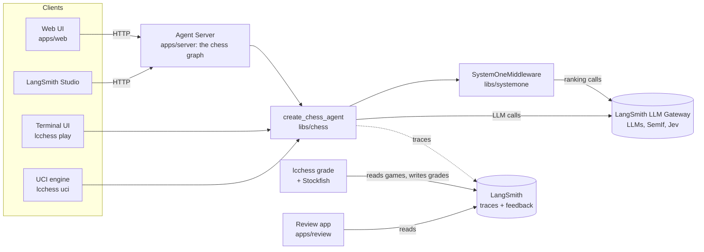
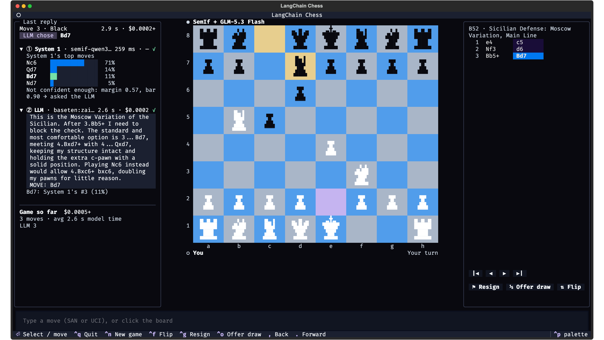
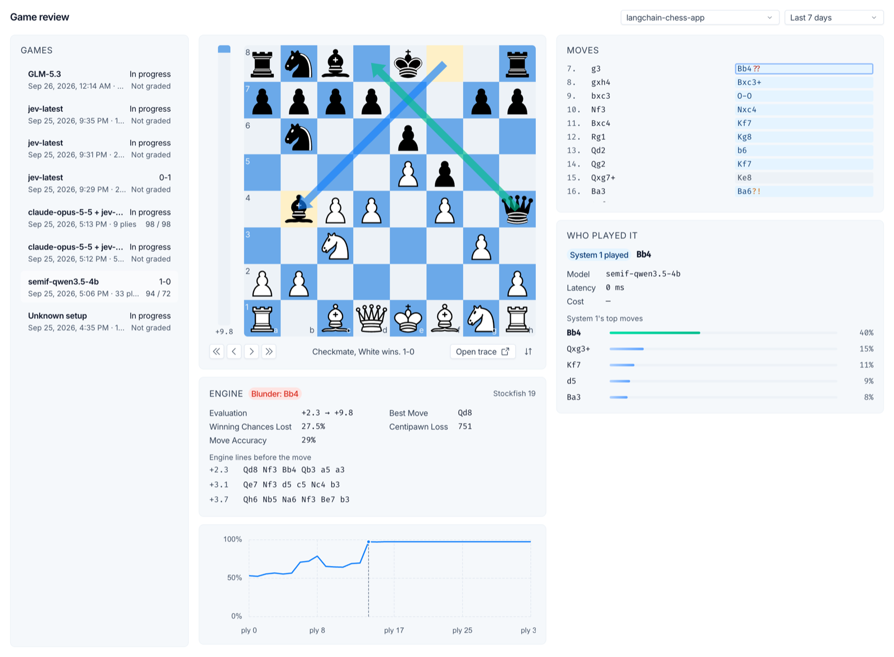

# langchain-chess

Play chess against LLM agents built on LangChain's `create_agent`, in the browser, the terminal,
or any chess GUI, then grade every move with Stockfish and replay the game in LangSmith.


The agent is a **System 1 + System 2** player. A fast move ranker (System 1: SemIf or Jev)
scores the legal moves. When it is confident it plays straight away and the LLM never runs.
Otherwise it hands the LLM (System 2) a shortlist, and the LLM thinks the position through.
Every decision, its cost and its latency are recorded on the game.

## What you can do

| I want to... | Use | Run |
|---|---|---|
| Play in the browser | [Web UI](apps/web) on a local Agent Server | `mise run dev` |
| Play in the terminal | [`lcchess play`](libs/cli#play-in-the-terminal) | `mise run dev:tui` |
| Pit the agent against engines in a chess GUI | [`lcchess uci`](libs/cli#use-it-as-a-uci-engine) | `mise run dev:uci` |
| See which moves were blunders | [`lcchess grade`](libs/cli#grade-games) + the [review app](apps/review) | `lcchess grade`, `mise run dev:review` |
| Measure how well System 1 ranks moves | [LangSmith experiments](evals) over Stockfish-labelled Lichess positions | `mise run eval:systemone -- --model ...` |
| Build my own chess agent | [`langchain-chess`](libs/chess) and [`langchain-chess-systemone`](libs/systemone) | `create_chess_agent(...)` |

## How it fits together



The web UI and the review app share their board, move list and move details through
[`packages/chess-ui`](packages/chess-ui).

## Before you start

You need:

- **macOS or Linux** with `git`, `bash` and `curl`.
- **[mise](https://mise.jdx.dev/getting-started.html), activated in your shell** (`mise activate`,
  step 2 of its guide). It installs everything else at pinned versions: Node 24, pnpm, uv (which
  provides Python 3.13), Stockfish, fastchess, lefthook, the `langsmith` CLI and Socket Firewall
  (`sfw`). Activation puts them on your `PATH` inside the repo; the commands below assume it.
- **A [LangSmith](https://smith.langchain.com) account** with two API keys (they can be the
  same key if one workspace does both jobs):

  | Key | Used for | Where it goes |
  |---|---|---|
  | Tracing key | Recording and reading runs; reading, creating and deleting feedback (grading) | `LANGSMITH_API_KEY` in `.env` |
  | Gateway key | Every model call (the LLM and System 1) | `LC_GATEWAY_KEY` in your shell |

  [Create keys](https://docs.langchain.com/langsmith/create-account-api-key) under Settings → API
  Keys. The gateway key must be [workspace-scoped with the `gateway:invoke` and `workspaces:read`
  permissions](https://docs.langchain.com/langsmith/llm-gateway-quickstart), in a workspace
  where an admin has [enabled the LLM Gateway](https://docs.langchain.com/langsmith/llm-gateway-admin-setup).
  Provider secrets live in the gateway workspace, set by its admin:

  | Model | Needs |
  |---|---|
  | GLM-5.3 Flash (the default LLM, `baseten/...`) | A Baseten provider secret |
  | The other web presets (Baseten, Fireworks, OpenAI, Anthropic models) | That provider's secret |
  | SemIf (the default System 1) | Nothing: LangChain-hosted |
  | Jev (`typesafe/jev-latest`) | A TypeSafe provider secret |

## Set up

```sh
git clone https://github.com/darieldatoon/langchain-chess
cd langchain-chess
mise trust && mise install   # the toolchain
mise run setup               # Python and JS dependencies, git hooks
cp .env.example .env
```

Fill in `.env`:

| Variable | Value |
|---|---|
| `LANGSMITH_API_KEY` | Your tracing key |
| `LANGSMITH_WORKSPACE_ID` | The tracing workspace's id ([Settings](https://smith.langchain.com/settings) → General). Without it, the SDK may use another workspace and get 403s. |
| `LANGSMITH_PROJECT` | Where local games are traced. Default: `langchain-chess-local`. |

Keep `LANGSMITH_TRACING=true` (the template's value): grading and the review app read games from
their traces.

Then export the gateway key in your shell profile. `.env` expands it from your environment, so
the key never sits in the repo:

```sh
export LC_GATEWAY_KEY=lsv2_...
```

The server refuses to start if `LC_GATEWAY_KEY` is missing. Without it, model calls would
quietly go to the tracing workspace's gateway instead.

## Play in the browser

```sh
mise run dev
```

This starts the Agent Server on `:2024` and the web UI on `:5173`. Once both answer, it prints:

```text
  ♟  Web UI:  http://localhost:5173/ui/
     API:     http://127.0.0.1:2024
     Studio:  https://smith.langchain.com/studio/?baseUrl=http://127.0.0.1:2024
```

Open the web UI and pick a side and an opponent in the New game dialog. The defaults are SemIf
for System 1 and GLM-5.3 Flash for the LLM. Click a piece, then its target. When you play Black,
the agent opens.


After each reply you can see who chose the move (System 1, the LLM, or a forced move), System 1's
top moves and why the LLM was or wasn't asked, the LLM's analysis, and each stage's model time
and cost, with running totals for the game. The [web UI README](apps/web) covers
every control.

If `2024` or `5173` is taken, the task stops rather than talk to another project's server. Pick
other ports:

```sh
LANGGRAPH_PORT=2034 WEB_PORT=5180 mise run dev
```

Studio's chat view plays too. Type `go` for the agent to move, or type your move (`e4`, `e2e4`).

## Play in the terminal

```sh
mise run dev:tui                    # you play White
mise run dev:tui -- --side black    # options after -- go to `lcchess play`
```



Type a move (`Nf3` or `g1f3`) and press Enter, or click a piece and then its target. The screen
follows the web app's, with a New Game screen on `ctrl+n`. See the [CLI README](libs/cli) for the
keys, the options, and how to install `lcchess` without cloning.

## Grade and review your games

```sh
uv run --all-packages --env-file .env lcchess grade --thread <thread-id>   # the id is under Opponent in the web UI
langsmith auth login --prompt-workspace                                     # once: pick the tracing workspace
mise run dev:review
```

`lcchess grade` replays a game from its traces, grades every move with Stockfish, and writes
the grades back to the traces as LangSmith feedback. The [review app](apps/review) is a
LangSmith custom app that replays graded games as an analysis board, and its **Analyze** button
grades a game for you in a LangSmith sandbox. It runs through the `langsmith` CLI's own
credentials, not `.env`, hence the login:



## Build your own agent

```python
from langchain.chat_models import init_chat_model
from langgraph.checkpoint.memory import InMemorySaver

from langchain_chess import create_chess_agent
from langchain_chess_systemone import SystemOneMiddleware

agent = create_chess_agent(
    init_chat_model("langsmith:baseten/zai-org/GLM-5.3-Flash"),
    middleware=[SystemOneMiddleware("semif-qwen3.5-4b", threshold=0.9)],
    checkpointer=InMemorySaver(),
)
config = {"configurable": {"thread_id": "game-1"}}

agent.invoke({"messages": [{"role": "user", "content": "e4"}]}, config)  # you play 1. e4
state = agent.get_state(config).values
print(state["plies"][-1]["san"])  # the agent's reply
```

Save it as `play.py` and run it with `uv run --all-packages --env-file .env python play.py`.
One thread is one game, and one run plays at most one turn. The [core README](libs/chess)
covers the inputs, the game record and writing your own middleware. The
[SystemOne README](libs/systemone) covers the gate.

## Repository layout

| Path | Package | What it is |
|---|---|---|
| [`libs/chess`](libs/chess) | `langchain-chess` | `create_chess_agent`, the game state and the middleware contract |
| [`libs/systemone`](libs/systemone) | `langchain-chess-systemone` | `SystemOneMiddleware`: the System 1 ranker and its gate |
| [`libs/cli`](libs/cli) | `langchain-chess-cli` | The `lcchess` command: `play`, `uci`, `grade` |
| [`apps/server`](apps/server) | `langchain-chess-server` (private) | The `chess` graph and the `/ui` routes for the Agent Server |
| [`apps/web`](apps/web) | | The React UI served at `/ui` |
| [`apps/review`](apps/review) | | The LangSmith custom app that replays graded games |
| [`packages/chess-ui`](packages/chess-ui) | `@langchain-chess/chess-ui` | Board, move list and move details shared by the two web apps |
| [`evals`](evals) | `langchain-chess-evals` (private) | The labelled positions dataset and System 1 experiments in LangSmith |

## Development

```sh
mise run check       # ruff, ty, and the web lint, format and type checks
mise run test        # pytest and Vitest, both gated at 100% line and branch coverage
mise run test:live   # against the real gateway, a real `langgraph dev` included (a few cents)
mise run test:uci    # two SemIf-only games under fastchess
mise tasks           # every task
```

- **Dependencies.** Add them through Socket Firewall: `sfw uv add --package <distribution> <dep>`
  (root dev tools: `sfw uv add --group dev <tool>`), and `sfw pnpm add <pkg>` in the JS package
  that needs it. JS versions shared by several packages live in the `pnpm-workspace.yaml`
  catalog. Lint and format config for all JS lives in the root `vite.config.ts` (Vite+).
- **Hooks.** Pre-commit runs when matching files are staged: ruff on the staged Python files,
  plus `ty` and the web checks over the whole repo, and a secret scan. Pre-push runs
  `mise run test`.
- **CI and deploys.** Pull requests that change more than Markdown run `check` and `test`. A push to `main` that changes the
  agent (`langchain-chess-app` on LangSmith Deployments, web UI included), the review app or
  its grader snapshot runs them again, then deploys what changed. See
  [apps/server](apps/server#deploy) and [apps/review](apps/review#publish).
- **OpenWiki.** [`openwiki/`](openwiki) is a generated wiki of this repo for coding agents.
  `mise run wiki:update` refreshes stale pages; `mise run wiki:view` browses it.

Design decisions and measurements live in the [OpenWiki](openwiki/index.md).

## Troubleshooting

| Symptom | Fix |
|---|---|
| `port 2024 is already in use` | Stop the other server, or set `LANGGRAPH_PORT` / `WEB_PORT`. |
| The server exits: gateway key is empty | Export `LC_GATEWAY_KEY` in the shell that runs `mise`. |
| 403 on traces or grading | Set `LANGSMITH_WORKSPACE_ID` to the tracing key's workspace. |
| `Memory: Summarize` is disabled in the web UI | That model's input limit is unknown, so summarizing can't be scheduled. |
| `lcchess grade` can't find the game | Pass the project it was traced to: `--project langchain-chess-local` locally, `langchain-chess-app` for the deployment. |

## License

[MIT](LICENSE)
