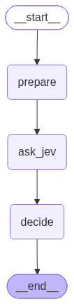
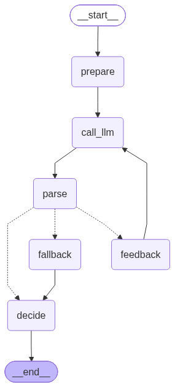
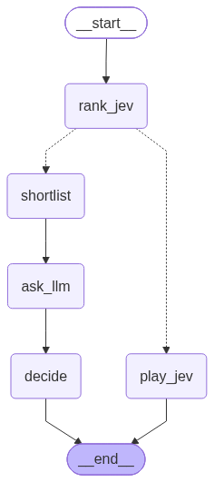

# jev-chess

Does System 1 plus System 2 beat either alone? Jev (TypeSafe AI's typed-decision model)
plays fast and cheap. Reasoning LLMs play slower and better. A confidence-gated hybrid
lets Jev move when it is sure and escalates its top-k candidates to an LLM when it is not.
Stockfish grades every move.

Every model call, Jev included, goes through the LangSmith LLM Gateway, so one gateway key
covers every provider and each call is traced with cost and latency. Tracing and gateway can
use different LangSmith orgs; see `.env.example`.

## Setup

```sh
brew install stockfish lc0
uv sync
uv run lefthook install   # lefthook ships as a dev dependency
cp .env.example .env   # two LangSmith keys: one for tracing, one for the gateway
```

## Commands

```sh
uv run jev-chess --help
uv run pytest            # unit tests, fails under 100% coverage
uv run pytest -m live    # tests that hit APIs or engines
uv run ruff check . && uv run ruff format --check . && uv run ty check
```

## Layout

- `src/jev_chess/core` pure types and position facts
- `src/jev_chess/policies` Jev, LLM, and hybrid move policies (LangGraph)
- `src/jev_chess/engines` Stockfish and Maia adapters
- `src/jev_chess/runner` native game loop and telemetry
- `src/jev_chess/uci` UCI adapter for arenas and Lichess
- `src/jev_chess/analysis` grading, recall, Pareto reports

## Policy graphs

Each move policy is a LangGraph. Rendered from the compiled graphs (`docs/graphs/*.mmd` is the
Mermaid source).

| Jev | LLM | Hybrid |
|---|---|---|
|  |  |  |
