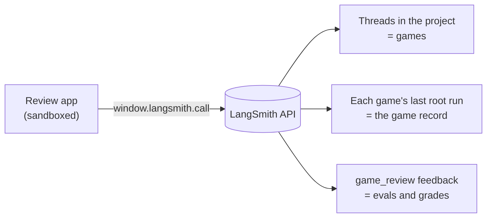

# langchain-chess review app

A [LangSmith custom app](https://docs.langchain.com/langsmith/custom-apps) that replays graded
games as an analysis board: an eval bar and graph, a quality mark on every move, arrows for the
move played and the engine's best move, who played each move (System 1, the LLM, a forced move,
or you) with its reasoning, and a link to the move's trace.


The app only reads. The grades come from [`lcchess grade`](../../libs/cli#grade-games), which
writes them to the games' traces as feedback.

## See your games

After the [repository setup](../../README.md#set-up):

1. **Play a game** in the web UI with tracing on. Local games go to `langchain-chess-local`
   (`LANGSMITH_PROJECT` in `.env`). The thread id is under Opponent.
2. **Grade it:** `uv run --all-packages --env-file .env lcchess grade --thread <thread-id>`. For
   a terminal game, see [grading a batch](../../libs/cli#grade-games).
3. **Sign the `langsmith` CLI in** once, choosing the workspace the games are traced to:
   `langsmith auth login --prompt-workspace`. Or export `LANGSMITH_API_KEY` and
   `LANGSMITH_WORKSPACE_ID`. `mise run dev:review` doesn't read `.env`.
4. **Preview:** `mise run dev:review`. It builds the app, opens it in a local sandbox like the one
   in LangSmith, and rebuilds on save. API calls go through your CLI credentials.
5. **Pick the project** (top right; the deployment's `langchain-chess-app` is preselected when it
   exists), a time window, and a game. Ungraded games say "Not graded".



## Publish

Pushes to `main` that change the app publish it
([`.github/workflows/deploy-review.yml`](../../.github/workflows/deploy-review.yml)) once the `CUSTOM_APP_ID`
repository variable is set. To set it up:

```sh
mise run review:size                                             # build; check the upload fits
cd apps/review && langsmith apps push --name langchain-chess-review   # the first push creates the app
```

The first push writes the app id to `.langsmith/app.json` (gitignored). Copy its `app_id` into
the `CUSTOM_APP_ID` variable; CI writes the file from it, since the CLI reads the id from nowhere
else. The deploy key (`LANGSMITH_API_KEY`) must be able to manage custom apps in the workspace.
Custom apps depend on your LangSmith plan: Plus gets one per org.

## Constraints worth knowing

- **Push from the repo.** The app depends on `packages/chess-ui` through `workspace:*`, so only a
  checkout of this repo can build it. `langsmith apps pull` and LangSmith's in-browser editor
  can't.
- **Size.** Push uploads this whole directory as text, `.gitignore` or not: 5 MiB and 500 files
  at most. Keep images and coverage out of it (the README screenshots live in `docs/images/`).
  Library mode inlines every font, so `postcss.config.cjs` keeps only the latin woff2 faces. CI
  runs `review:size`.
- **Sandbox.** The build is one CommonJS file, `dist/bundle.js`, exporting
  `render(data, root, metadata)`. It can reach only the LangSmith API, through
  `window.langsmith.call`, and navigates with `window.langsmith.openUrl`. The theme follows
  `metadata.mode`. There is no localStorage, so the reply card's Show/Hide toggles last only the
  session: they carry from game to game, but not across a reload.
- **Data.** Each page of games is one threads query, then one call each for the threads' last
  root runs and the grader's `game_review` feedback. `game_review` carries every eval and grade
  and the run that played each move, so replaying a game reads nothing more.

## Test

```sh
pnpm --dir apps/review exec vp test --run --coverage
```
