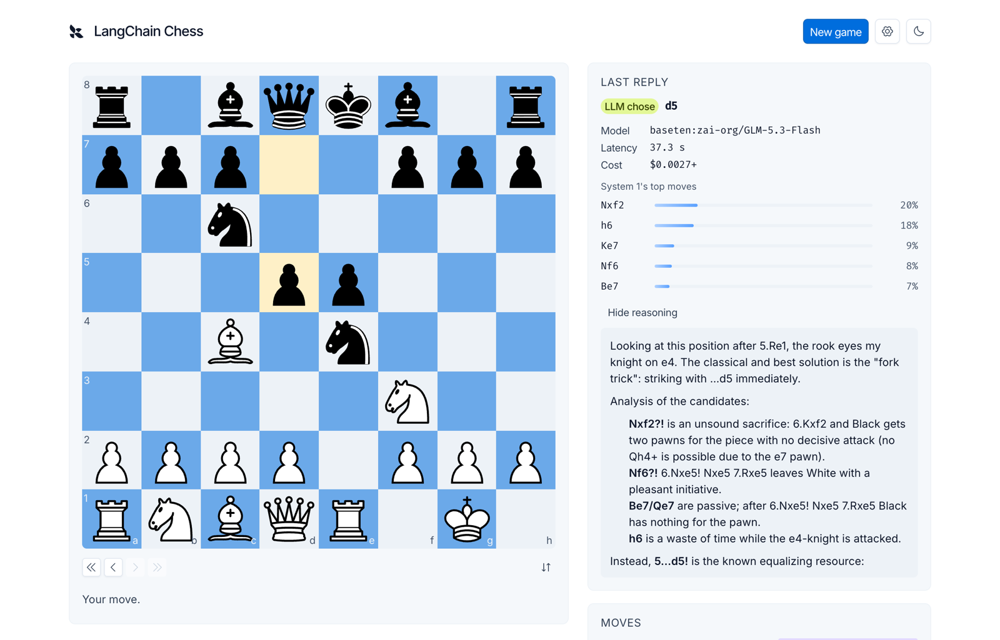
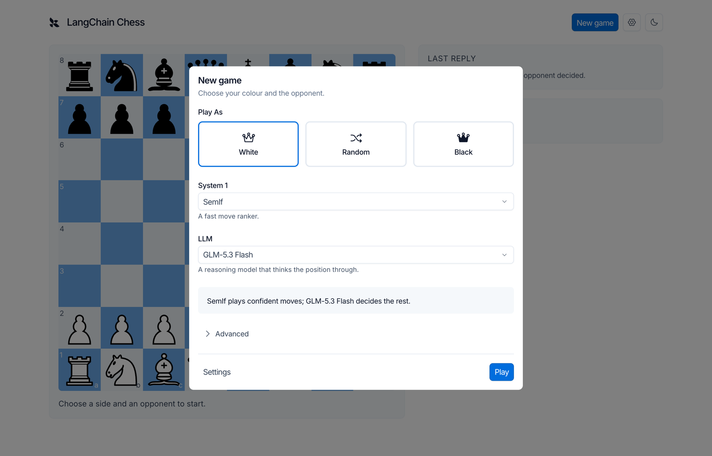
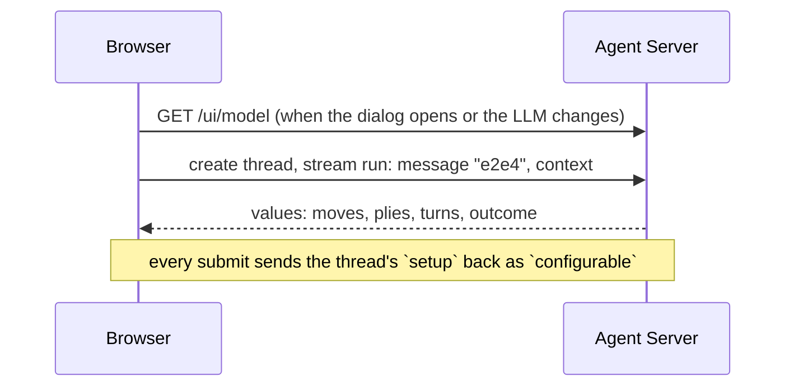

# langchain-chess web UI

Play the `chess` agent in the browser at <https://darieldatoon.github.io/langchain-chess/>. Locally, `mise run dev` serves this
React app at `/ui`.



## Run it

After the [repository setup](../../README.md#set-up), from the repo root:

```sh
mise run dev
```

That starts `langgraph dev` on `:2024` and this app on `:5173`, then prints the URLs. Open
<http://localhost:5173/ui/>. To use other ports: `LANGGRAPH_PORT=2034 WEB_PORT=5180 mise run dev`.

## Play a game

1. **New game.** The dialog opens by itself when the URL has no game. Pick White, Random or
   Black, a System 1 (Jev, Luna Decisions, another classifier, or none) and an LLM (a preset, a custom `init_chat_model`
   spec, or none). Advanced holds the rest: the system prompt, what each turn shows, memory,
   model arguments (JSON), reasoning effort, how confident System 1 must be to play alone and
   how many candidates the LLM sees. Every setting has an info icon that says what it does and
   when to change it. A game from elsewhere with another System 1 model keeps it, by name.
2. **Move.** Click a piece, then its target, or drag it. When you play Black, the agent opens.
3. **Read the reply.** Last reply shows the turn stage by stage: System 1's top moves and why it
   played or asked the LLM, then the LLM's analysis, each with its model time and cost. System 1's
   result appears as soon as it's ready, while the LLM is still thinking, and the analysis
   streams in under it. A turn that failed keeps what it produced, and Retry carries on from
   there. "Game so far" adds up the cost and average model time. The chevrons open and close
   each stage, and the ⚙ button chooses what the card shows; both stay as you left them.
4. **After the game**, Rematch swaps colours and keeps the opponent. New game starts over.
5. **Share an opponent.** Export in the New game dialog saves the settings
   as `opponent.json`, the file `lcchess --config`, UCI's `Config` and the evals read. Import
   loads one, keeping the side you picked.



- **One thread is one game.** Its id stays in the URL (`?thread=`), so a reload reopens it. The
  id is also under Opponent, for `lcchess grade --thread`.
- **A game keeps its setup.** The server records it in the game's thread on the first turn, so
  the same link continues the game in any browser, and changing the setup later never changes
  it. Games from before threads recorded their setup are view-only.
- **Retry.** If the provider fails mid-turn, Retry re-runs the pending turn.
- **Theme.** The moon button toggles dark mode.

## Against a deployed server

The site is built by [`.github/workflows/pages.yml`](../../.github/workflows/pages.yml) on pushes to
`main` that change the UI. The repository variable `VITE_API_URL` names the deployment it talks
to (LangSmith → Deployments → the `langchain-chess` agent's production deployment → API URL);
after changing it, run the workflow by hand.

## Sign in

On load the app asks the server whether it needs a sign-in. The local `langgraph dev` needs none,
so the app opens straight on the game. A deployed server does, so the app opens on a sign-in
screen:

- **Sign in with LangSmith** (the default, when the build has an OAuth app). Authorization code
  with PKCE through `oidc-client-ts`. Access tokens last five minutes and refresh on demand, one
  refresh at a time; they live in `sessionStorage` and go out as `Authorization: Bearer`. The
  server ([`auth.py`](../server/langchain_chess_server/auth.py)) admits only tokens issued to this
  app for members of its org. Sign-out revokes the refresh token. If the refresh token stops
  working, the app goes back to sign-in; the game stays in the URL.
- **API key** (under Advanced, or the only option without an OAuth app). A key from the
  deployment's workspace, checked before it is kept, held in `sessionStorage` for this tab only,
  and sent as `X-Api-Key`. LangSmith checks it, as before.

Settings (the gear) shows how this tab is signed in, with Sign out.

### Set up the OAuth app

1. An org admin registers a **Public** OAuth app under LangSmith **Settings → OAuth
   applications**, with scopes `openid`, `email`, `profile`, `offline_access` and redirect URIs
   `https://darieldatoon.github.io/langchain-chess/` and `http://localhost` (trailing slashes as
   shown). The org needs the `sign_in_with_langsmith` flag.
2. Set repository variables `OAUTH_CLIENT_ID` (`lsc_…`) and `LANGSMITH_ORGANIZATION_ID`, and
   `LANGSMITH_SSO_SLUG` if the org signs in through SSO. The Pages build and the deployment both
   read them, so run both workflows by hand afterwards.

Locally, put `VITE_OAUTH_CLIENT_ID`, `VITE_LANGSMITH_ORGANIZATION_ID` (and
`VITE_LANGSMITH_SSO_SLUG`) in `apps/web/.env.development.local`, and `OAUTH_CLIENT_ID` and
`ALLOWED_ORGANIZATION_ID` in `.env`. `langgraph dev` lets keyless requests through, so the
sign-in screen only shows against a server that needs it.

## The LangSmith renderer

`render.html`, served at <https://darieldatoon.github.io/langchain-chess/render.html>, is the positions dataset's custom output renderer in
LangSmith (see [evals](../../evals/README.md#see-outputs-as-a-board)). LangSmith embeds it in an
iframe and posts each run's outputs or reference outputs, with the example's inputs, as
`{type: "output" | "reference", data, metadata: {inputs}}`. The page fetches nothing and accepts
messages only from the window that embeds it: self-hosted LangSmith can live on any origin.
`src/render/messages.ts` reads the messages; the views reuse the board from
[`packages/chess-ui`](../../packages/chess-ui).

LangSmith embeds only `https` pages, so it can't reach `vp dev`. Instead, with `vp dev` running,
open <http://localhost:5173/ui/render-preview.html>: it embeds the renderer four times and posts
real messages from `preview/samples.ts`, as LangSmith would. It is not a build input, so it never
deploys.

## Develop

```sh
pnpm --dir apps/web exec vp dev          # this app alone, against a server already on :2024
pnpm --dir apps/web exec vp test --run   # Vitest; add --coverage for the 100% gate
mise run check:web                       # format, lint and type check (config: root vite.config.ts)
mise run build                           # into apps/server/langchain_chess_server/static
```

`VITE_API_URL` points the app at another server.



- **The contract.** Moves are human chat messages whose content is the UCI move (`go` asks the
  agent to open), each with a stable id: resending a finished move is a no-op, and resending one
  whose turn is still pending retries that turn. An empty submit retries a pending turn too. The
  app reads only `start_fen`, `moves`, `plies`, `turns`, `outcome`, `error`, `setup`,
  `systemone_live` and `messages`.
- **Types.** [`packages/chess-ui/src/types.ts`](../../packages/chess-ui/src/types.ts) mirrors the
  Python state by hand. That package also holds the board, move list and move details this app
  shares with the review app.
- **Setup to context.** `src/setup.ts` turns the dialog's choices into a `ChessContext` (both
  models set is `hybrid`, one alone is `systemone` or `llm`). A new game sends it until its
  first turn records it as `setup`. The human's side isn't stored: the external plies are
  theirs, and before the first one they play the side the agent didn't open with.
- **localStorage** holds only the last setup (`langchain-chess:setup`), what the reply card
  shows (`langchain-chess:view`), and the email of the last LangSmith sign-in
  (`langchain-chess:last-account`). Nothing per game, and no credentials: those are in
  `sessionStorage`. The app deletes the API key older versions kept in `langchain-chess:app`.
- **Styling** follows the Macaw design system: semantic Tailwind classes from its preset
  (`bg-surface-level-2`, `text-secondary`), Macaw components for controls, and no raw colours.
  The chessboard reads the same tokens as CSS variables. To find components:
  `pnpm --dir apps/web exec macaw search <capability>`, then
  `pnpm --dir apps/web exec macaw inspect <Name>` for their props.
