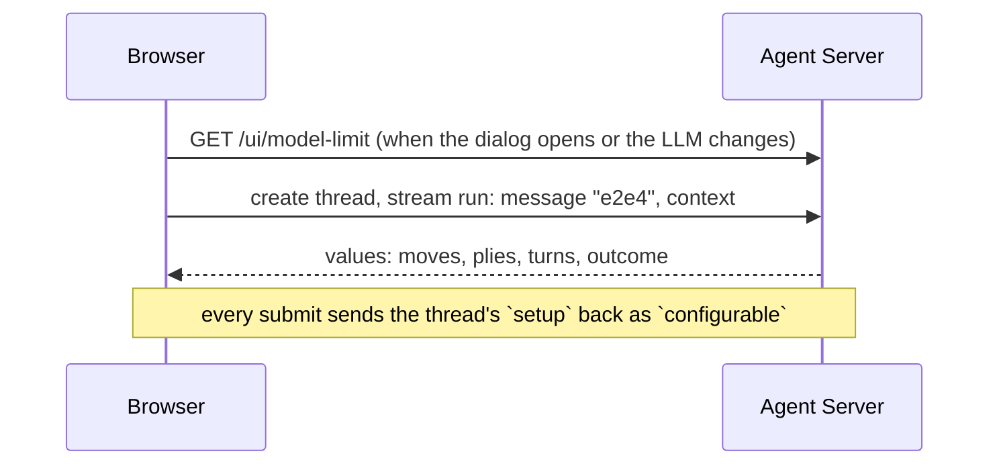

# langchain-chess web UI

Play the `chess` agent in the browser. The Agent Server serves this React app at `/ui`, locally
and in the deployment.


## Run it

After the [repository setup](../../README.md#set-up), from the repo root:

```sh
mise run dev
```

That starts `langgraph dev` on `:2024` and this app on `:5173`, then prints the URLs. Open
<http://localhost:5173/ui/>. To use other ports: `LANGGRAPH_PORT=2034 WEB_PORT=5180 mise run dev`.

## Play a game

1. **New game.** The dialog opens by itself when the URL has no game. Pick White, Random or
   Black, a System 1 (SemIf, Jev, or none) and an LLM (a preset, a custom `init_chat_model`
   spec, or none). Advanced holds the rest: the system prompt, what each turn shows, memory,
   model arguments (JSON), reasoning effort, how confident System 1 must be to play alone and
   how many candidates the LLM sees. Every setting has an info icon that says what it does and
   when to change it. A game from elsewhere with another System 1 model keeps it, by name.
2. **Move.** Click a piece, then its target, or drag it. When you play Black, the agent opens.
3. **Read the reply.** Last reply shows who chose the move (System 1, the LLM, or a forced move),
   the model, latency and cost, System 1's top moves, and the LLM's reasoning. While the
   opponent thinks, the same card shows spinners and streams the reasoning in. Show/Hide hides
   the top moves or the reasoning, and stays as you left it.
4. **After the game**, Rematch swaps colours and keeps the opponent. New game starts over.


- **One thread is one game.** Its id stays in the URL (`?thread=`), so a reload reopens it. The
  id is also under Opponent, for `lcchess grade --thread`.
- **A game keeps its setup.** The server records it in the game's thread on the first turn, so
  the same link continues the game in any browser, and changing the setup later never changes
  it. Games from before threads recorded their setup are view-only.
- **Retry.** If the provider fails mid-turn, Retry re-runs the pending turn.
- **Theme.** The moon button toggles dark mode.

## Against a deployed server

A deployed Agent Server needs a LangSmith API key. When the server answers 401 or 403, the app
asks for one (the gear, Settings). It stays in this browser's localStorage and is sent as
`X-Api-Key`. The local `langgraph dev` needs none: the server's own `.env` holds the model keys.

## The LangSmith renderer

`render.html`, served at `/ui/render.html`, is the positions dataset's custom output renderer in
LangSmith (see [evals](../../evals/README.md#see-outputs-as-a-board)). LangSmith embeds it in an
iframe and posts each run's outputs or reference outputs, with the example's inputs, as
`{type: "output" | "reference", data, metadata: {inputs}}`. The page fetches nothing and accepts
messages only from the window that embeds it: self-hosted LangSmith can live on any origin.
`src/render/messages.ts` reads the messages; the views reuse the board from
[`packages/chess-ui`](../../packages/chess-ui).

LangSmith embeds only `https` pages, so it can't reach `vp dev`. Instead, with `vp dev` running,
open <http://localhost:5173/ui/render-preview.html>: it embeds the renderer four times and posts
real messages from `preview/samples.ts`, as LangSmith would. It is not a build input, so it never
deploys.

## Develop

```sh
pnpm --dir apps/web exec vp dev          # this app alone, against a server already on :2024
pnpm --dir apps/web exec vp test --run   # Vitest; add --coverage for the 100% gate
mise run check:web                       # format, lint and type check (config: root vite.config.ts)
mise run build                           # into apps/server/langchain_chess_server/static
```

`VITE_API_URL` points the app at another server.



- **The contract.** Moves are human chat messages whose content is the UCI move (`go` asks the
  agent to open), each with a stable id: resending a finished move is a no-op, and resending one
  whose turn is still pending retries that turn. An empty submit retries a pending turn too. The
  app reads only `start_fen`, `moves`, `plies`, `turns`, `outcome`, `error`, `setup` and
  `messages`.
- **Types.** [`packages/chess-ui/src/types.ts`](../../packages/chess-ui/src/types.ts) mirrors the
  Python state by hand. That package also holds the board, move list and move details this app
  shares with the review app.
- **Setup to context.** `src/setup.ts` turns the dialog's choices into a `ChessContext` (both
  models set is `hybrid`, one alone is `systemone` or `llm`). A new game sends it until its
  first turn records it as `setup`. The human's side isn't stored: the external plies are
  theirs, and before the first one they play the side the agent didn't open with.
- **localStorage** holds only the last setup (`langchain-chess:setup`), the API key
  (`langchain-chess:app`), and which reply sections are open (`langchain-chess:view`). Nothing
  per game.
- **Styling** follows the Macaw design system: semantic Tailwind classes from its preset
  (`bg-surface-level-2`, `text-secondary`), Macaw components for controls, and no raw colours.
  The chessboard reads the same tokens as CSS variables. To find components:
  `pnpm --dir apps/web exec macaw search <capability>`, then
  `pnpm --dir apps/web exec macaw inspect <Name>` for their props.
