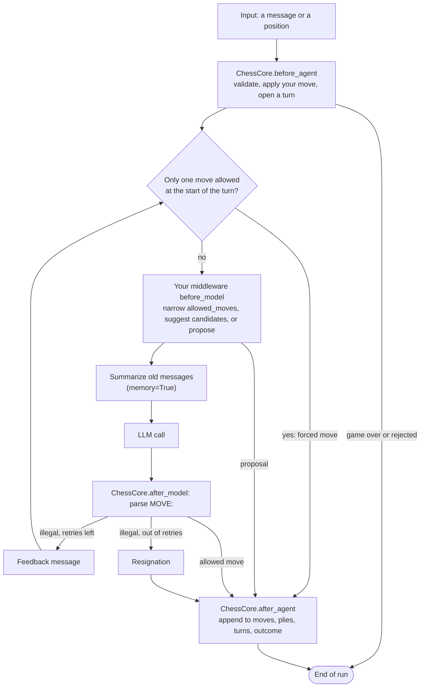

# langchain-chess

`create_chess_agent`: a chess-playing agent on LangChain's `create_agent`. Everything that shapes
how a move is chosen (legality checks, forced moves, System 1 ranking, memory summarization) is
middleware, and you can add your own.

For accounts, keys and running the apps, start with the [repository README](../../README.md).

## Install

The package isn't on PyPI. Inside this repo it is already installed by `mise run setup`. From
another uv project:

```sh
uv add "langchain-chess @ git+https://github.com/darieldatoon/langchain-chess#subdirectory=libs/chess"
```

Bring the chat model's integration package too: `langchain-openai` for `langsmith:` gateway
models, or `langchain-anthropic` for `anthropic:` models with your own key.

## Play a game

```python
from langchain.chat_models import init_chat_model
from langgraph.checkpoint.memory import InMemorySaver

from langchain_chess import create_chess_agent

agent = create_chess_agent(
    init_chat_model("langsmith:baseten/zai-org/GLM-5.3-Flash"),
    checkpointer=InMemorySaver(),
)
config = {"configurable": {"thread_id": "game-1"}}

agent.invoke({"messages": [{"role": "user", "content": "e4"}]}, config)
state = agent.get_state(config).values
state["plies"][-1]  # the agent's move: SAN, source, analysis, model, latency, telemetry
state["turns"][-1]  # every call on that turn, with tokens and cost
```

Or send the whole position, as a GUI does. A new thread can start from any position; later
positions on a thread must extend its game:

```python
config = {"configurable": {"thread_id": "game-2"}}
agent.invoke({"position": {"moves": ["e2e4", "c7c5"]}}, config)
```

Without a checkpointer the agent is stateless and every run must carry a `position`.

## Inputs and the game record

- **One run plays at most one turn; one thread is one game.** The agent always moves for the side
  to move.
- **Input** is either a chat message (`go`, or one move in SAN or UCI) or a `position`
  (`start_fen`, UCI `moves`, optional `restrict` to limit the agent's choices).
- **Rejected input.** A position that doesn't extend the thread's game is rejected. Takebacks and
  new games use a new thread.
- **Retry.** A run with no new input (`{}`) retries a pending turn, or does nothing. A decision
  that already passed validation is committed without asking again; otherwise the turn re-runs
  from the model call, which costs another call and may change the move.
- **Resume.** After a failure inside a turn, `agent.invoke(None, config)` continues from the step
  that failed. If a hook after the model call failed, the saved reply is played without calling
  the model again.
- **Stalls.** When a `langsmith:` model's stream goes silent past langchain-openai's
  `stream_chunk_timeout` (120 s), the model is called once more in the same turn. A second stall
  fails the turn, which a retry can pick up.
- **Time controls.** The client keeps the clock, as a UCI GUI does. Every run of a timed game
  carries `clock` (`control` with `base_ms` and `increment_ms`, then `white_ms` and `black_ms`,
  after the client's own increment); the first run fixes the game's `time_control`. Each ply's
  `clock_ms` is the mover's time left after it. The agent is charged its wall time within the
  run: a move that lands after its time ran out loses on time. `{"clock": ..., "flag": side}`
  ends the game when the client says `side` ran out on its move; it's a draw if the other side
  can't mate.
- **The record** is `start_fen`, `moves`, `plies`, `turns`, `outcome`, `error` and `time_control`.
  Read only those keys, plus any your own middleware documents (the Agent Server's `setup`, for
  one). `messages` is the model's working context and may be summarized. The thread-state API also
  returns private channels.

## How a turn runs



A retry after an illegal reply goes back through every `before_model` hook, which is why
they must be idempotent (see below).

## Options

| Option | Default | What it does |
|---|---|---|
| `memory` | `False` | `True` keeps earlier turns and summarizes them at 70% of the model's `max_input_tokens`, counting the system prompt and the turn's message too. A system prompt that fills the trigger alone is rejected. Pass `summarization=` for another trigger. |
| `system_prompt` | the bundled prompt | Replaces it. An empty string is an error. |
| `show_fen`, `show_board` | `True` | Show the FEN and the text board in each turn's message. |
| `move_list` | `"both"` | The moves each turn lists: `"both"` (middleware's candidates and every legal move), `"legal"`, `"candidates"` or `"none"`. A restricted turn always lists the permitted moves. |
| `max_retries` | `3` | Feedback rounds after an illegal reply. The side to move resigns on the next one (four illegal replies in all). |
| `draw_claims` | `"auto"` | `"auto"` ends the game on an actual threefold repetition or the fifty-move rule. `"never"` leaves claimable draws to the caller. |
| `forced_move` | `True` | When the turn starts with one allowed move (legal, and within `restrict`), play it without calling a model. |
| `fixed_topology` | `False` | Keep the summarization node with `memory=False`, so agents with either memory setting share one graph. An Agent Server graph factory needs this: the server reads state with a graph built without the run's settings. |
| `render_position` | | A pure function from a `PositionView` to the position section of each turn's message, replacing `show_fen`, `show_board` and `move_list`. The core still adds the moves so far, a custom starting FEN, the side to move, check, the permitted moves on a restricted turn and the `MOVE: <move>` request. |
| `seed` | `0` | Seeds middleware that samples (such as SystemOne's tournament). |
| `context_schema`, `name` | | Passed through to `create_agent`. |

`chat_model(spec, model_arguments(model_kwargs, reasoning_effort=...))` builds a model with extra
constructor arguments. `model_kwargs` wins over the settings; its names for the same thing
(`reasoning_effort` and `reasoning.effort`; `max_tokens`, `max_output_tokens` and
`max_completion_tokens`) are reduced to one value first. Credentials and connections, the model
name and the fields the agent sends (`input`, `messages`, `instructions`, `stream`) are held back
everywhere, top level or inside `extra_body`. A call with hosted `tools` has its cost marked
incomplete.

`model=None` works only when middleware always proposes, as in a System-1-only agent.

## Cost

No gateway response carries a cost, so every provider response inside a model call is recorded
and priced locally with [genai-prices](https://github.com/pydantic/genai-prices). It uses the
snapshot bundled with the pinned version and never fetches prices. A move's cost is its turn's
total: every LLM attempt, every System 1 request, and any summary call. Calls that completed
before a model call failed are kept on the turn, and a retry doesn't count them again. A stalled
attempt isn't priced: its usage would have arrived in the final chunk.

```python
from langchain_chess import turn_cost

turn_cost(state["turns"][-1]["calls"])  # {"usd": 0.0027, "complete": True}, or None
```

`complete` is `False` when some call couldn't be priced. SemIf reports no token counts, so a
hybrid move's total is incomplete.

## Write your own middleware

Extensions are ordinary `AgentMiddleware`. Subclass `ChessMiddleware` to get `position()`,
`propose()`, `narrow()`, `ply_meta()`, `turn_calls()` and `turn_latency_ms()`. Every extension is
wrapped in a write guard that hands its hooks a detached copy of the state and checks what they
return:

- `allowed_moves` may only narrow. An empty intersection is a `ChessContractError`.
- `proposal` must be an allowed move, and only one per turn. A proposer jumps from `before_model`
  to `end` and must declare `@hook_config(can_jump_to=["end"])`.
- `candidates` are soft suggestions, set by one middleware per turn.
- The game record, `messages` and core bookkeeping belong to the core.
- Your own state keys must be `PrivateStateAttr` (or at least `OmitFromInput`). No tools. A key
  that is only `OmitFromInput` is in the output and the thread state, for clients to read.
- `before_model` must be idempotent, because a retry re-enters it. Freeze each decision per turn
  id and replay it as `current allowed ∩ frozen`.
- Implement the sync and async variant of every hook.
- `turn_calls()` and `turn_latency_ms()` report your frozen decision's calls and time. The core
  adds them to the turn once, when it finalizes, so retries never double count.
- `after_model` can run with no new reply, after a model call that failed once some provider
  calls had completed. The core then re-raises the failure.

[`langchain-chess-systemone`](../systemone) is a complete example. For tests,
`langchain_chess.testing` has `ScriptedModel`, a chat model that replies from a script.

## Test

```sh
uv run --all-packages pytest libs/chess --no-cov -q
```
