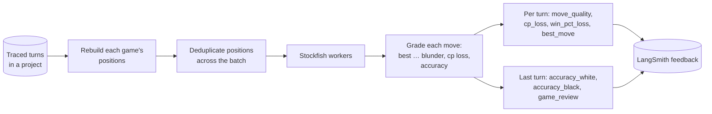

# langchain-chess-cli

The `lcchess` command. Play the agent in your terminal, plug it into any chess GUI as a UCI
engine, and grade finished games with Stockfish.


For accounts, keys and the full setup, start with the [repository README](../../README.md).

## Install

**From a checkout** (recommended): `mise run setup` installs it, and every command below runs as
`uv run --all-packages --env-file .env lcchess ...`, which loads your `.env`. `mise run dev:tui`
and `mise run dev:uci` are shortcuts for exactly that.

**Without cloning.** The packages aren't on PyPI, so only uv can install it: it resolves the
sibling packages from the same commit, where pip would look for them on PyPI.

```sh
uvx --env-file /absolute/path/to/.env \
  --from "git+https://github.com/darieldatoon/langchain-chess#subdirectory=libs/cli" lcchess play
uv tool install "git+https://github.com/darieldatoon/langchain-chess#subdirectory=libs/cli"
```

An installed `lcchess` doesn't read `.env`, so export the variables from
[`.env.example`](../../.env.example) in your shell. Installing it doesn't install Stockfish or
fastchess; `mise install` does, in a checkout.

**Your own provider key.** The default model, `langsmith:baseten/zai-org/GLM-5.3-Flash`, goes
through the LLM Gateway. To call Anthropic directly instead, install the extra, set
`ANTHROPIC_API_KEY`, and unset `LANGSMITH_GATEWAY` (while it is `true`, bare model names also go
through the gateway):

```sh
uv tool install "langchain-chess-cli[anthropic] @ git+https://github.com/darieldatoon/langchain-chess#subdirectory=libs/cli"
lcchess play --policy llm --model claude-opus-5-5
```

Every command has `--help`.

## Play in the terminal

```sh
mise run dev:tui                                  # hybrid: SemIf + GLM-5.3 Flash
mise run dev:tui -- --side black --policy llm     # the LLM alone, you play Black
```

- **Move** by typing SAN (standard notation, `Nf3`) or UCI (from and to squares, `g1f3`) and pressing Enter, by clicking a piece and then
  its target, or with the arrow keys and Enter (or Space) on the piece and again on the target.
  Legal targets are marked.
- **Keys:** `ctrl+n` new game, `ctrl+f` new game with the other side, `ctrl+r` retry a failed
  move, `ctrl+s` ask the agent to open, `ctrl+q` quit, `ctrl+p` command palette.
- The pieces grow with the terminal. The board colours are `chess-board--*` component classes,
  so CSS can restyle them. The block-art pieces are chess-tui's.

## Use it as a UCI engine

```sh
mise run dev:uci -- --policy systemone
```

Type UCI commands to check it answers. With `--policy systemone` a move takes a second or two:

```text
> uci
id name langchain-chess
option name Model type string default langsmith:baseten/zai-org/GLM-5.3-Flash
option name ReasoningEffort type combo default default var default var low var medium var high
option name SystemOneModel type string default semif-qwen3.5-4b
option name Policy type combo default systemone var llm var systemone var hybrid
option name Threshold type string default 0.9
option name K type spin default 5 min 1 max 255
option name Memory type combo default none var none var summarize
option name Seed type spin default 0 min 0 max 2147483647
uciok
> isready
readyok
> position startpos moves e2e4
> go movetime 20000
bestmove g8f6
```

**In a GUI** (Cute Chess, Arena, En Croissant, fastchess), register a command that runs from the
repo root:

| Field | Value |
|---|---|
| Command | `uv` |
| Arguments | `run --all-packages --env-file .env lcchess uci --policy hybrid` |
| Working directory | Your clone |

- **Time controls.** LLM moves take seconds, so short time controls mean fallback moves: this
  turn's System 1 top move when it ranked, else a seeded random legal move. GLM-5.3 Flash
  can take 30–60 seconds a move. Analysis streams as `info string` lines.
- **Endings.** A resignation (after four illegal replies), a finished game and a rejected
  position answer `bestmove 0000` with an `info string` reason. That's a null move, which
  fastchess scores as an illegal-move loss for the engine that played it: the intended forfeit.
  Draw claims are left to the GUI. `go ponder` and `ponderhit` work, but the engine advertises no
  `Ponder` option and never suggests a ponder move.
- `mise run test:uci` plays two SemIf-only games under fastchess as a smoke test.

## Grade games

`lcchess grade` replays games from their traces, grades every move with a UCI engine, and writes
the grades back to the traces as LangSmith feedback. The [review app](../../apps/review) shows
them.

```sh
# One game: the thread id is under Opponent in the web UI
uv run --all-packages --env-file .env lcchess grade --thread <thread-id>

# Your latest terminal game (the TUI doesn't show its thread id)
uv run --all-packages --env-file .env lcchess grade --metadata surface=tui --limit 1

# A batch from the deployment, listed but not written
uv run --all-packages --env-file .env lcchess grade --project langchain-chess-app \
  --since 2026-09-01 --metadata surface=web --limit 50 --dry-run
```

```text
grading 1 games, 17 positions on 15 x Stockfish 19 (depth 16, multipv 1, threads 1, hash_mb 256)
graded 01a0dc37-...: 16 plies, accuracy white 62.2 black 99.3 [17/17 positions, 15.9/s]
done: 1 graded, 0 skipped
```



- **Which project.** `--project` defaults to `LANGSMITH_PROJECT`: `langchain-chess-local` for
  local games, `langchain-chess-app` for the deployment.
- **Skips.** Games already graded with the same engine and settings are skipped; `--force`
  re-grades. Re-grading replaces this grader's earlier feedback and leaves other feedback alone.
- **Search.** `--depth` (default 16), `--nodes` or `--movetime`; also `--multipv`, `--hash`,
  `--workers`, `--engine-threads`. With one engine thread, `--nodes` gives the same grades on
  any machine. Each position starts from a cleared hash.
- **Engine.** `stockfish` on `PATH` (mise installs it), or `--engine` / `STOCKFISH_PATH`.
- **Grades** follow Lichess (a ply is one side's move; a full move is two plies): `move_quality` is `best`, `good`, `inaccuracy`, `mistake` or
  `blunder`, and `cp_loss` is how many centipawns (hundredths of a pawn) the move gave away. Moves that came in as input (yours, in the web UI) count toward `game_review` and
  the accuracies but get no per-turn feedback. Every entry's source info records the engine, the
  settings and their fingerprint.

## Test

```sh
uv run --all-packages pytest libs/cli --no-cov -q
uv run --all-packages pytest libs/cli/tests/test_tui_snapshots.py --snapshot-update --no-cov   # after a UI change
```
