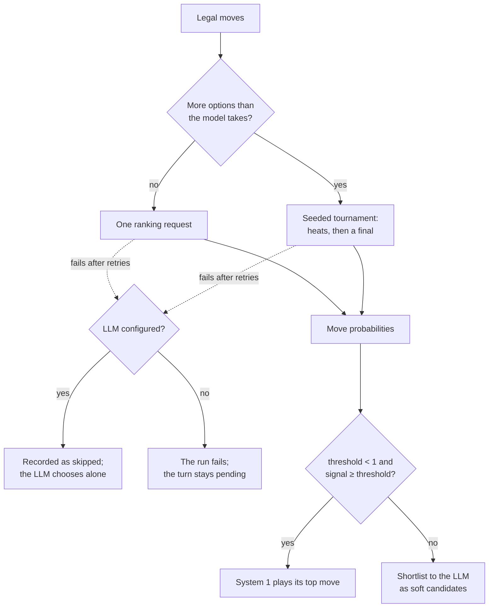

# langchain-chess-systemone

`SystemOneMiddleware`: a fast System 1 model ranks the legal moves before the LLM runs. If it
is confident, it plays the move and the LLM never runs. Otherwise it gives the LLM a shortlist,
and the LLM may still play any legal move.

For accounts, keys and running the apps, start with the [repository README](../../README.md).

## Setup

System 1 calls go to `{TYPESAFE_BASE_URL}/v1/systemone`. The repo's `.env.example` points both
variables at the LLM Gateway:

```sh
TYPESAFE_BASE_URL=https://gateway.smith.langchain.com
TYPESAFE_API_KEY=${LC_GATEWAY_KEY}
```

| Model | Use it for |
|---|---|
| `semif-qwen3.5-4b` | The default in the app and CLI. LangChain-hosted; use it for anything user-facing. |
| `typesafe/jev-latest` | Experiments only. Needs a TypeSafe provider secret in the gateway workspace. |

## Use it

```python
from langchain.chat_models import init_chat_model
from langgraph.checkpoint.memory import InMemorySaver

from langchain_chess import create_chess_agent
from langchain_chess_systemone import SystemOneMiddleware

# System 1 plays confident moves; the LLM decides the rest.
hybrid = create_chess_agent(
    init_chat_model("langsmith:baseten/zai-org/GLM-5.3-Flash"),
    middleware=[SystemOneMiddleware("semif-qwen3.5-4b", gate="margin", threshold=0.9, k=5)],
    checkpointer=InMemorySaver(),
)

# System 1 alone: it always plays, and there is no LLM to fall back to.
system_one_alone = create_chess_agent(
    None,
    middleware=[SystemOneMiddleware("semif-qwen3.5-4b", threshold=0.0, has_model=False)],
)

config = {"configurable": {"thread_id": "game-1"}}
hybrid.invoke({"messages": [{"role": "user", "content": "e4"}]}, config)
print(hybrid.get_state(config).values["plies"][-1]["source"])  # `systemone` or `llm`

# Without a checkpointer, every run carries the whole position.
state = system_one_alone.invoke({"position": {"moves": ["e2e4"]}})
print(state["plies"][-1]["san"])
```

Run it from the repo root with `uv run --all-packages --env-file .env python example.py`.

## The gate



- **Signal.** `gate="margin"` uses the top move's probability minus the second's.
  `gate="confidence"` uses the model's own confidence.
- **Threshold.** `0` always plays. `1` never plays and only suggests. A tournament's
  probabilities are among its finalists only, so `tournament_threshold` (when set) replaces
  `threshold` for tournament turns.
- **Shortlist.** The top `k` moves, or with `top_p` the smallest prefix reaching that probability
  mass, capped at `k`. The LLM sees them as suggestions; every legal move stays allowed.
- **Tournaments.** SemIf takes at most 16 options per question (Jev: 255) and 32 questions per
  request. With more legal moves, balanced heats run in as few requests as possible, the best of
  each heat go to a final, and the seed makes the draw repeatable within a turn.
- **Retries.** The decision is frozen per turn, so a retried turn replays it instead of
  re-ranking and flipping the gate.

## The settings

`ChessContext` in [`settings.py`](langchain_chess_systemone/settings.py) is every setting of a
game's opponent, System 1's and the core's, with a description of each. The web app, the
server, the CLI and the UCI engine all read it, and `build_agent` in
[`agent.py`](langchain_chess_systemone/agent.py) builds the agent it describes, with the model,
ranker and checkpointer injected:

```python
from langgraph.checkpoint.memory import InMemorySaver

from langchain_chess_systemone.agent import build_agent
from langchain_chess_systemone.settings import load

settings = load({"version": 2, "policy": "hybrid", "k": 3, "model_kwargs": {"temperature": 0.2}})
agent = build_agent(settings, checkpointer=InMemorySaver())
```

A settings file is `ChessContext` as JSON. `version` is required and every other key is optional:
missing keys take their version's defaults, a null resets a key to its default, and an unknown key
is an error. Older versions are migrated. Games record every key of their version, and
`load_recorded` reads them, including games recorded before versions. The JSON Schemas are in
[`packages/chess-ui/src/generated`](../../packages/chess-ui/src/generated): `opponent.schema.json`
for a file and `settings.schema.json` for the resolved settings.

Change a setting in `settings.py`, bump `VERSION` and add its migration and frozen defaults when
the change needs one, then run `mise run generate:settings`: the web app's types, checks and
defaults are generated from it, and a test fails while they are stale.

## Options

| Option | Default | What it does |
|---|---|---|
| `model` | | System 1 model id (see above). |
| `gate` | `"margin"` | `"margin"` or `"confidence"`. |
| `threshold` | `0.9` | The signal needed to play. |
| `tournament_threshold` | `None` | The threshold for tournament turns. |
| `k` | `5` | Shortlist size, 1 to 255. |
| `top_p` | `None` | Cut the top `k` further, to the fewest moves whose probabilities reach this. |
| `style` | `"rich"` | How each move is described to the ranker. |
| `with_eval`, `with_nouls` | `False` | Ask the ranker for an evaluation score and position flags too. |
| `has_model` | `True` | Set `False` when no LLM is behind it, so a ranking failure fails the run. |
| `ranker` | gateway | Inject your own `Ranker`, for example a fake in tests. |

What System 1 decided is on each ply as `ply["meta"]["SystemOneMiddleware"]` (telemetry is
keyed by middleware name): its status, ranking, shortlist, signal and threshold.

## Test

```sh
uv run --all-packages pytest libs/systemone --no-cov -q
```

`langchain_chess_systemone.testing` holds the fakes the tests use.
