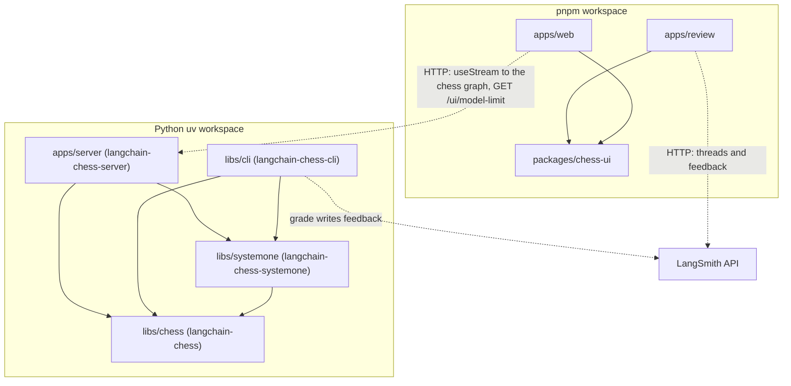
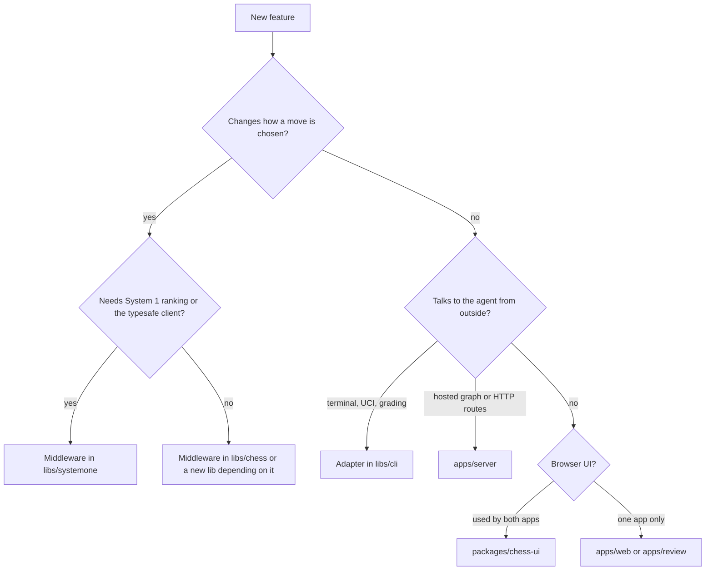

# Package map and dependency direction

langchain-chess is two workspaces in one repository:

- a **uv workspace** of four Python packages (the root `pyproject.toml` is a virtual root with no package of its own), and
- a **pnpm workspace** of three JavaScript packages (`apps/web`, `apps/review`, `packages/*`).

The layout keeps graph building apart from the clients of the graph. Move choice (legality, forced moves, System 1 ranking, memory) is middleware in the libraries under `libs/chess` and `libs/systemone`, which build the agent graph. `libs/cli` and `apps/server` wrap that graph for a transport (UCI, terminal, Agent Server). The JS apps never import Python. They talk over HTTP and share their UI code through `packages/chess-ui`. The README's "How it fits together" diagram and "Repository layout" table show the same split.

## The packages

| Path | Distribution / npm name | Import | Role | Layer |
|---|---|---|---|---|
| `libs/chess` | `langchain-chess` | `langchain_chess` | `create_chess_agent`, `ChessState`, the `ChessMiddleware` contract, core middleware (core, forced move, summarization), rules, pricing, the shared `chat_model` factory, engine grading | Core library |
| `libs/systemone` | `langchain-chess-systemone` | `langchain_chess_systemone` | `SystemOneMiddleware`, its no-op stand-in `NoSystemOne`, and `GatewayRanker` (SemIf/Jev System 1 ranking, tournaments) | Middleware library |
| `libs/cli` | `langchain-chess-cli` | `langchain_chess_cli` | The `lcchess` script: `uci`, `play` (Textual TUI), `grade` | Adapter |
| `apps/server` | `langchain-chess-server` (private, `Private :: Do Not Upload`) | `langchain_chess_server` | The `chess` graph factory, the server-only `GameSetupMiddleware`, and the FastAPI `/ui` app for the Agent Server | Adapter / deployable |
| `packages/chess-ui` | `@langchain-chess/chess-ui` (private) | TS source | The board, move list, ply details, analysis, selectors and TS mirrors of the state types | Shared UI |
| `apps/web` | `langchain-chess-web` | — | React UI, built into the server's static dir and served at `/ui` | Frontend |
| `apps/review` | `langchain-chess-review` | — | LangSmith custom app that replays graded games | Frontend |

The uv workspace members are listed explicitly (`libs/chess`, `libs/systemone`, `libs/cli`, `apps/server`), because a glob over `apps/` would pick up `apps/web`, which has no `pyproject.toml`. The pnpm workspace likewise leaves out `apps/server`, which has no `package.json`.

## Dependency direction

*Solid arrows are package dependencies. Dotted arrows are runtime HTTP calls; they are not imports.*

What the manifests and imports establish:

- **`systemone -> chess`.** `langchain-chess-systemone` depends on `langchain-chess`. Its middleware subclasses `ChessMiddleware` and reads `ChessState`/`PositionView`. Its ranker records calls through `langchain_chess.pricing.make_call` and `langchain_chess.state.Call`.
- **`chess` imports nothing from the other packages.** `langchain_chess` never imports `langchain_chess_systemone`. The only reverse link is packaging: `langchain-chess` declares an optional extra, `langchain-chess[systemone]`, which installs the sibling package. The CLI uses that extra (`langchain-chess[systemone]`) to get both libraries in one requirement. Treat the extra as a convenience for installs. It is not permission to import systemone from core code.
- **`cli -> chess, systemone` and `server -> chess, systemone`.** Each adapter has its own `build_agent` that calls `create_chess_agent` (`libs/cli/langchain_chess_cli/options.py`, `apps/server/langchain_chess_server/graph.py`). Both pass no chat model when the policy is `systemone`, force `memory="none"` in that case, and reject `memory="summarize"` with `ChessContractError` when `langchain_chess.middleware.summarization.input_limit` finds no known input limit for the model. Both build their chat model with the shared `langchain_chess.chat_models.chat_model`. They differ in how they wire System 1:
  - The **CLI** adds a `SystemOneMiddleware` unless the policy is `llm`, and leaves out System 1 entirely for `llm`. It passes its options straight to the middleware, which builds its default `GatewayRanker`.
  - The **server** always keeps a System 1 node so that the graph's shape never changes: `NoSystemOne()` when the policy is `llm`, otherwise a `SystemOneMiddleware`. It always adds its own `GameSetupMiddleware` as well, and it builds the graph with `fixed_topology=True`. It builds the `GatewayRanker` itself, with a `langchain_typesafe` `TypeSafeClassifier`. The classifier's API key and base URL come from `ServerSettings.typesafe()` (`TYPESAFE_API_KEY`, `TYPESAFE_BASE_URL`), and its HTTP clients come from the process-wide `POOL` in `clients.py`, which the `/ui` app's lifespan closes. When there is no execution runtime (reads, updates, introspection), `make_graph` returns a model-free `shape()` graph with the same nodes. See [Agent Server integration](../integrations/agent-server.md).
- **The CLI's `grade` command** also uses `langchain_chess.engine` and `langchain_chess.grading` from the core library.
- **Nothing depends on `cli` or `server`.** They are leaves and don't import each other. What they share (chat-model construction, input limits, rules) lives in `libs/chess`. The server is marked private and never published.
- **Web and review share `packages/chess-ui` as TypeScript source.** Both depend on `@langchain-chess/chess-ui` through `workspace:*`. The package's `exports` point straight at `./src/index.ts`, `./src/styles.css` and `./src/testing.ts`, with no build step. One consequence: `apps/review` can only be built from a checkout of this repo.
- **The JS side reaches Python only over HTTP.** `apps/web` drives the `chess` graph through `useStream` from `@langchain/react` (`apps/web/src/useGame.ts`). Its only other call to the server is `GET /ui/model-limit` (`apps/web/src/modelLimit.ts`), which tells the new-game dialog whether to offer `summarize`. It does not fetch `/ui/config`. Its context defaults (`DEFAULT_CONTEXT`) come from `packages/chess-ui`. `apps/review` doesn't talk to the agent at all. It reads threads, each game's last root run and the grader's `game_review` feedback from the LangSmith API through the sandbox's `window.langsmith.call`.

### The hand-maintained type bridge

There is no generated contract between Python and TS. `packages/chess-ui/src/types.ts` mirrors `langchain_chess/state.py`, `langchain_chess_systemone/types.py`, and `ChessContext` and the `setup` state key in `apps/server/langchain_chess_server/`. A header comment says to "keep them in step by hand". If you change state keys, ply metadata, context fields or the `setup` record in Python, update the mirror in the same change. Otherwise the UIs will misread the thread state.

## Shared tooling that spans packages

- **Workspace sources live only in the root `pyproject.toml`.** Every member has `workspace = true` under `[tool.uv.sources]` there, so `uvx --from git+…#subdirectory=libs/cli` can resolve the unpublished siblings from the same commit. The server README warns that a member-level `workspace = true` source fails in the Agent Server image, because each member is installed there on its own.
- **The deployment image** builds from the uv workspace with `langchain-chess-server` as the package (`langgraph.json` `source`). `dockerfile_lines` has to `ADD` every member's `pyproject.toml`. Keep that list in step with the workspace members when you add a package. `langgraph.json` also wires the graph (`chess` → `graph.py:make_graph`) and the HTTP app (`app.py:app`). See [Deployment](../operations/deployment.md).
- **The web build output** goes to `apps/server/langchain_chess_server/static` (the `outDir` in `apps/web/vite.config.ts`). The server mounts that directory at `/ui` as `StaticFiles` only when it exists. Otherwise `/ui/` returns a 404 "UI not built" response, while `/ui/config` and `/ui/model-limit` still answer. This is a build-artifact link, not a code dependency.
- **Tests and coverage** run from the root. `testpaths` covers all four Python packages, and coverage is measured over all four import packages with `--cov-fail-under=100`. Live tests (`-m live`) are excluded by default. Vitest runs per JS package, also at 100% coverage.
- **Shared JS versions** live in the `pnpm-workspace.yaml` `catalog`, so the apps and `packages/chess-ui` can't drift apart on React, chess.js, react-chessboard, Vite+, and so on.
- **Measured design decisions** (prompt caching, memory and analysis length) are recorded in [Decisions and measurements](../concepts/decisions.md), not in the packages.

## Where does a new feature go?

*Decision guide for placing a feature. The layer determines which package it may import.*

- **Move-choice logic is middleware.** Legality narrowing, proposals, candidate suggestions, and anything that inspects the position before the model runs belong in an `AgentMiddleware`/`ChessMiddleware`. General-purpose behaviour goes in `libs/chess`. System 1 ranking and anything that needs `langchain-typesafe` goes in `libs/systemone`. A new family of policies can be a new library under `libs/` that depends on `langchain-chess`, the way systemone does. Middleware must follow the write-guard contract: narrow-only `allowed_moves`, one proposal per turn, private state keys, an idempotent `before_model`, and sync and async hooks. See [Middleware contract](../concepts/middleware-contract.md).
- **Middleware tied to the hosted graph's settings** can live in `apps/server`. `GameSetupMiddleware` is the example: it records the run's resolved `ChessContext` as the `setup` key on a game's first turn. Because the server graph must keep the same shape on every call, a server setting may switch a node off (as `NoSystemOne` does) but never remove it.
- **Game-rule, record, pricing, model or grading helpers** that more than one adapter needs belong in `libs/chess` (as with `rules`, `pricing`, `chat_models`, `engine`, `grading`). Don't put them in an adapter and then import across adapters.
- **Adapters stay outside the graph.** A new transport (a new CLI command, a UCI option, a bot integration) goes in `libs/cli` or a new leaf package. Changes to what the hosted graph exposes (context knobs, routes, settings) go in `apps/server`; see [Agent Server integration](../integrations/agent-server.md). Adapters configure the agent with `create_chess_agent(..., middleware=[...])`. They must not reach into or mutate core-owned state.
- **UI components shared by both web apps** (board, move list, ply details, formatting, selectors, state types) go in `packages/chess-ui`. Components used by only one app stay in that app. See [Web frontends](../architecture/web-frontends.md).
- **Never add an import that points upward.** Examples: `langchain_chess` importing `langchain_chess_systemone`, any library importing `langchain_chess_cli` or `langchain_chess_server`, or a JS package importing Python-generated code.

## Related pages

- [Quickstart](../quickstart.md)
- [Design decisions](../concepts/decisions.md)
- [Middleware contract](../concepts/middleware-contract.md)
- [Web frontends](../architecture/web-frontends.md)
- [Agent Server integration](../integrations/agent-server.md)
- [Deployment](../operations/deployment.md)
