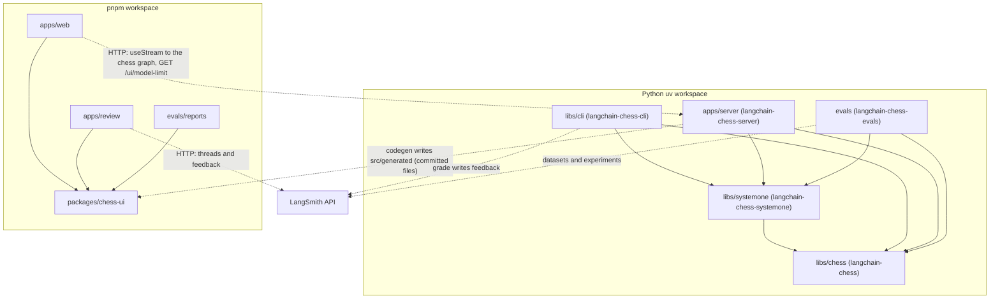
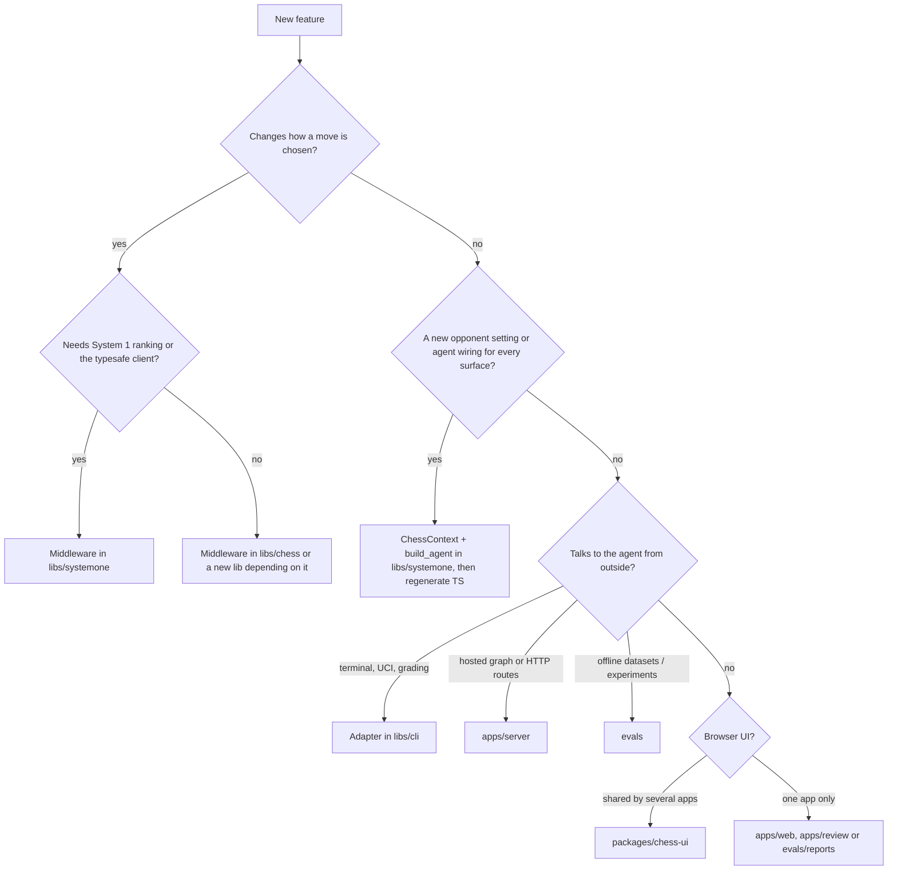

# Package map and dependency direction

langchain-chess is two workspaces in one repository:

- a **uv workspace** of five Python packages. The root `pyproject.toml` is a virtual root with no package of its own.
- a **pnpm workspace** of four JavaScript packages: `apps/web`, `apps/review`, `evals/reports` and `packages/*`.

The layout keeps graph building apart from the clients of the graph. Move choice (legality, forced moves, System 1 ranking, memory) is middleware in the libraries under `libs/chess` and `libs/systemone`. `libs/systemone` also owns the one `build_agent` that turns a `ChessContext` into the agent graph. `libs/cli` and `apps/server` wrap that graph for a transport (UCI, terminal, Agent Server). `evals` runs offline experiments against the libraries. The JS packages never import Python at runtime. They talk over HTTP, share UI code through `packages/chess-ui`, and receive the settings types as generated, committed TypeScript files.

## The packages

| Path | Distribution / npm name | Import | Role | Layer |
|---|---|---|---|---|
| `libs/chess` | `langchain-chess` | `langchain_chess` | `create_chess_agent`, `ChessState`, the `ChessMiddleware` contract, core middleware (core, forced move, summarization), rules, pricing, `CoreSettings`, `model_arguments`, the shared `chat_model` factory, engine grading | Core library |
| `libs/systemone` | `langchain-chess-systemone` | `langchain_chess_systemone` | `SystemOneMiddleware`, its no-op stand-in `NoSystemOne`, `GatewayRanker` (System 1 ranking through Jev on TypeSafe or OpenAI Decisions, tournaments), the versioned `ChessContext` settings and their JSON Schemas, and the shared `build_agent` | Middleware library, agent assembly |
| `libs/cli` | `langchain-chess-cli` | `langchain_chess_cli` | The `lcchess` script: `uci`, `play` (Textual TUI), `grade` | Adapter |
| `apps/server` | `langchain-chess-server` (private, `Private :: Do Not Upload`) | `langchain_chess_server` | The `chess` graph factory, the server-only `GameSetupMiddleware`, the FastAPI `/ui` app for the Agent Server, and the settings codegen | Adapter / deployable |
| `evals` | `langchain-chess-evals` (private, `Private :: Do Not Upload`) | `langchain_chess_evals` | The `lcchess-evals` script: position datasets and LangSmith experiments on System 1 | Leaf tooling |
| `packages/chess-ui` | `@langchain-chess/chess-ui` (private) | TS source | The board, move list, ply details, analysis, selectors, TS mirrors of the state types, and the generated settings module | Shared UI |
| `apps/web` | `langchain-chess-web` | — | React UI, built into the server's static dir and served at `/ui` | Frontend |
| `apps/review` | `langchain-chess-review` | — | LangSmith custom app that replays graded games | Frontend |
| `evals/reports` | `langchain-chess-reports` (private) | — | Dated static HTML experiment reports built with Macaw and `chess-ui` | Frontend (static) |

The uv workspace members are listed explicitly (`libs/chess`, `libs/systemone`, `libs/cli`, `apps/server`, `evals`), because a glob over `apps/` would pick up `apps/web`, which has no `pyproject.toml`. The pnpm workspace likewise leaves out `apps/server`, which has no `package.json`.

## Dependency direction

*Solid arrows are package dependencies. Dotted arrows are runtime HTTP calls or a build-time file generation step; none of them is an import.*

What the manifests and imports establish:

- **`systemone -> chess`.** `langchain-chess-systemone` depends on `langchain-chess`. Its middleware subclasses `ChessMiddleware` and reads `ChessState`/`PositionView`. Its ranker records calls through `langchain_chess.pricing.make_call` and `langchain_chess.state.Call`. Its `ChessContext` extends `langchain_chess.settings.CoreSettings`.
- **`chess` imports nothing from the other packages.** `langchain_chess` never imports `langchain_chess_systemone`. The only reverse link is packaging: `langchain-chess` declares an optional extra, `langchain-chess[systemone]`, which installs the sibling package. The CLI uses that extra (`langchain-chess[systemone]`) to get both libraries in one requirement. Treat the extra as a convenience for installs. It is not permission to import systemone from core code.
- **One `build_agent`, in `libs/systemone`.** `langchain_chess_systemone.agent.build_agent` is the single place that turns a `ChessContext` into a graph for every surface. Surfaces inject what they own: a model factory, a ranker factory, a checkpointer, extra middleware, `fixed_topology` and a `context_schema`. It calls only the factories the policy uses. With policy `systemone` it builds no chat model. With any policy but `llm` it adds a `SystemOneMiddleware`. With `llm` it adds `NoSystemOne()` only when `fixed_topology=True`, and otherwise leaves System 1 out. Memory stays on only when there is a chat model, and `build_agent` raises `ChessContractError` if memory is on and `langchain_chess.middleware.summarization.input_limit` finds no known input limit for the model. Its defaults build the chat model with the core `langchain_chess.chat_models.chat_model` and the ranker as a plain `GatewayRanker`.
- **`cli -> chess, systemone` and `server -> chess, systemone`.** Both adapters call that shared `build_agent`. They differ only in what they inject:
  - The **CLI** (`libs/cli/langchain_chess_cli/main.py`) builds its `ChessContext` from an optional settings file plus flags (`options.overlay`). Its `uci` and `play` commands call `build_agent(settings, checkpointer=...)` with the default model and ranker factories and no fixed topology. `options.run_config` names and tags the trace by surface and records the settings plus `sent(...)` in metadata.
  - The **server** (`apps/server/langchain_chess_server/graph.py`) wraps `build_agent` in `build_graph`. It passes `server_model`, which keeps only the `model_kwargs` the server surface allows. It passes a `pooled_ranker`, whose `GatewayRanker` gets a classifier chosen by the System 1 model name. An `openai/<model>` name gets an OpenAI Decisions classifier from `langchain_chess_systemone.ranker.classifier`, which uses the `LANGSMITH_GATEWAY*` credentials and `httpx` clients from `DECISIONS_POOL`. Any other name gets a `langchain_typesafe` `TypeSafeClassifier`, with its API key and base URL from `ServerSettings.typesafe()` (`TYPESAFE_API_KEY`, `TYPESAFE_BASE_URL`, which raises if either is unset) and `httpx2` clients from `POOL`. Both pools are process-wide, live in `clients.py`, and are closed by the `/ui` app's lifespan. The CLI instead uses `build_agent`'s `default_ranker`, a plain `GatewayRanker` that builds its own classifier. The server also adds its own `GameSetupMiddleware`, sets `fixed_topology=True` and `context_schema=ChessContextInput`, and attaches `sent(settings, "server")` as run metadata. When there is no execution runtime (reads, updates, introspection), `make_graph` returns a model-free `shape()` graph with the same nodes. See [Agent Server integration](../integrations/agent-server.md).
- **The CLI's `grade` command** also uses `langchain_chess.engine` and `langchain_chess.grading` from the core library.
- **`evals -> chess, systemone`.** `langchain-chess-evals` depends on both libraries. Its System 1 experiments drive `GatewayRanker`/`Ranker` and load `ChessContext` settings files. Its scoring reuses `langchain_chess.grading` and `langchain_chess.rules`. See [System 1 evals](../workflows/system-one-evals.md).
- **Nothing depends on `cli`, `server` or `evals`.** They are leaves and don't import each other. What they share (agent assembly, settings, chat-model construction, input limits, rules, grading) lives in `libs/systemone` or `libs/chess`. The server and evals are marked private and never published.
- **Web, review and reports share `packages/chess-ui` as TypeScript source.** All three depend on `@langchain-chess/chess-ui` through `workspace:*`. The package's `exports` point straight at its source files, with no build step. One consequence: `apps/review` can only be built from a checkout of this repo.
- **The JS side reaches Python only over HTTP.** `apps/web` drives the `chess` graph through `useStream` from `@langchain/react` (`apps/web/src/useGame.ts`). Its only other call to the server is `GET /ui/model-limit` (`apps/web/src/modelLimit.ts`), which tells the new-game dialog whether to offer memory. It does not fetch `/ui/config`. Its context defaults (`DEFAULT_CONTEXT`) come from the generated settings module in `packages/chess-ui`. `apps/review` doesn't talk to the agent at all. It reads threads, each game's last root run and the grader's `game_review` feedback from the LangSmith API through the sandbox's `window.langsmith.call`.

### The Python-to-TS bridge: generated settings, hand-kept state

Two kinds of Python types reach TypeScript, and they arrive by different routes. Neither is a runtime import.

- **Settings are generated.** `python -m langchain_chess_server.codegen <dir>` (`mise run generate:settings`, which targets `packages/chess-ui/src/generated`) renders `settings.ts`, `settings.schema.json` and `opponent.schema.json`. It works from `ChessContext`'s schemas in `langchain_chess_systemone.schema`, the version defaults in `langchain_chess_systemone.settings`, and the `model_kwargs` rules in `langchain_chess.model_arguments`. The TS output holds `SETTINGS_VERSION`, the `ChessContext` interface, `SETTING_SPECS`, labels, help text, `DEFAULT_CONTEXT`, `VERSION_DEFAULTS` and `MODEL_KWARGS_RULES`. `packages/chess-ui/src/index.ts` re-exports it. The files are committed, and `apps/server/tests/test_codegen.py` fails when they are stale. So a settings change in Python means re-running the codegen and committing the output in the same change. The codegen lives in the server package, but the generated files are build-time artifacts. No JS package imports Python, and no Python package imports the generated files.
- **State types are hand-maintained.** `packages/chess-ui/src/types.ts` mirrors `langchain_chess/state.py` and `langchain_chess_systemone/types.py`. Its header says to "keep them in step by hand" and points at the generated file for settings. It also types the server's `setup` state key as `unknown`, to be read with `loadRecorded`. If you change state keys, ply metadata or System 1 metadata in Python, update the mirror in the same change. Otherwise the UIs will misread the thread state.

## Shared tooling that spans packages

- **Workspace sources live only in the root `pyproject.toml`.** Every member, `langchain-chess-evals` included, has `workspace = true` under `[tool.uv.sources]` there, so `uvx --from git+…#subdirectory=libs/cli` can resolve the unpublished siblings from the same commit. The server README warns that a member-level `workspace = true` source fails in the Agent Server image, because each member is installed there on its own.
- **The deployment image** builds from the uv workspace with `langchain-chess-server` as the package (`langgraph.json` `source`). `dockerfile_lines` has to `ADD` the `pyproject.toml` of each member the image needs. It currently lists `libs/chess`, `libs/systemone`, `libs/cli` and `apps/server`, but not `evals`. Check that list when you add a package. `langgraph.json` also wires the graph (`chess` → `graph.py:make_graph`) and the HTTP app (`app.py:app`). See [Deployment](../operations/deployment.md).
- **The web build output** goes to `apps/server/langchain_chess_server/static` (the `outDir` in `apps/web/vite.config.ts`). The server mounts that directory at `/ui` as `StaticFiles` only when it exists. Otherwise `/ui/` returns a 404 "UI not built" response, while `/ui/config` and `/ui/model-limit` still answer. This is a build-artifact link, not a code dependency.
- **Tests and coverage** run from the root. `testpaths` covers all five Python packages' test directories. Coverage is measured, with branch coverage on, over all five import packages with `--cov-fail-under=100`. Tests marked `live` or `e2e` are excluded by default. Vitest runs per JS package, also at 100% coverage.
- **Shared JS versions** live in the `pnpm-workspace.yaml` `catalog`, so the apps and `packages/chess-ui` can't drift apart on React, chess.js, react-chessboard, Vite+, Macaw, and so on.
- **Measured design decisions** (prompt caching, memory and analysis length) are recorded in [Decisions and measurements](../concepts/decisions.md), not in the packages. How settings are versioned, resolved and checked is covered in [Settings and model arguments](../concepts/settings-and-model-arguments.md).

## Where does a new feature go?

*Decision guide for placing a feature. The layer determines which package it may import.*

- **Move-choice logic is middleware.** Legality narrowing, proposals, candidate suggestions, and anything that inspects the position before the model runs belong in an `AgentMiddleware`/`ChessMiddleware`. General-purpose behaviour goes in `libs/chess`. System 1 ranking and anything that needs `langchain-typesafe` goes in `libs/systemone`. A new family of policies can be a new library under `libs/` that depends on `langchain-chess`, the way systemone does. Middleware must follow the write-guard contract: narrow-only `allowed_moves`, one proposal per turn, private state keys, an idempotent `before_model`, and sync and async hooks. See [Middleware contract](../concepts/middleware-contract.md).
- **Settings and agent assembly shared by every surface** go in `libs/systemone`: fields on `ChessContext` (or `CoreSettings` in `libs/chess` for core-only knobs) and their wiring in `build_agent`. Don't give an adapter its own copy of `build_agent`. Inject a factory or extra middleware instead. After a settings change, run `mise run generate:settings` and commit the regenerated `packages/chess-ui/src/generated` files.
- **Middleware tied to the hosted graph's settings** can live in `apps/server`. `GameSetupMiddleware` is the example: it records the run's resolved `ChessContext` as the non-private `setup` key on a game's first turn only, so any client can continue a game from its thread. Because the server graph must keep the same shape on every call, a server setting may switch a node off (as `NoSystemOne` does) but never remove it.
- **Game-rule, record, pricing, model or grading helpers** that more than one package needs belong in `libs/chess` (as with `rules`, `pricing`, `chat_models`, `model_arguments`, `engine`, `grading`). Don't put them in an adapter and then import across adapters.
- **Adapters stay outside the graph.** A new transport (a new CLI command, a UCI option, a bot integration) goes in `libs/cli` or a new leaf package. Changes to what the hosted graph exposes (context knobs, routes, settings) go in `apps/server`; see [Agent Server integration](../integrations/agent-server.md). Adapters configure the agent through `build_agent`'s injection points (factories, `middleware=[...]`). They must not reach into or mutate core-owned state.
- **Experiments and datasets** go in `evals`, and their static write-ups go in `evals/reports`. Nothing may import `langchain_chess_evals`.
- **UI components shared by more than one web package** (board, move list, ply details, formatting, selectors, state types) go in `packages/chess-ui`. Components used by only one app stay in that app. See [Web frontends](../architecture/web-frontends.md).
- **Never add an import that points upward.** Examples: `langchain_chess` importing `langchain_chess_systemone`, any library importing `langchain_chess_cli`, `langchain_chess_server` or `langchain_chess_evals`, or a JS package importing Python code at runtime. The generated settings files are the only sanctioned Python-to-TS path.

## Related pages

- [Quickstart](../quickstart.md)
- [System 1](../architecture/system-one.md)
- [Settings and model arguments](../concepts/settings-and-model-arguments.md)
- [Design decisions](../concepts/decisions.md)
- [Middleware contract](../concepts/middleware-contract.md)
- [Web frontends](../architecture/web-frontends.md)
- [Agent Server integration](../integrations/agent-server.md)
- [System 1 evals](../workflows/system-one-evals.md)
- [Deployment](../operations/deployment.md)
ws/system-one-evals.md)
- [Deployment](../operations/deployment.md)
