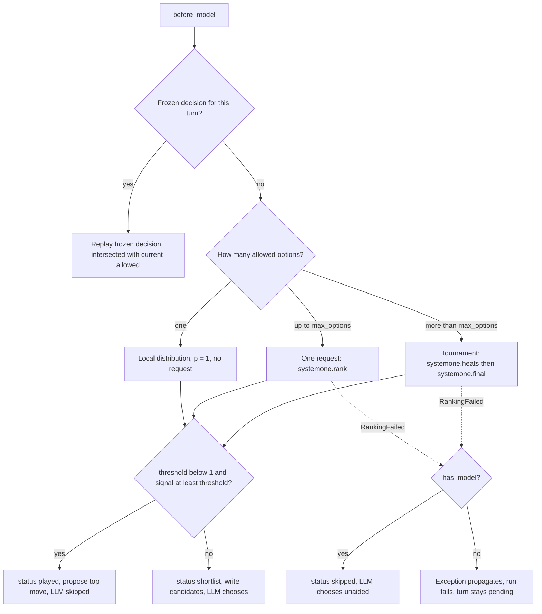
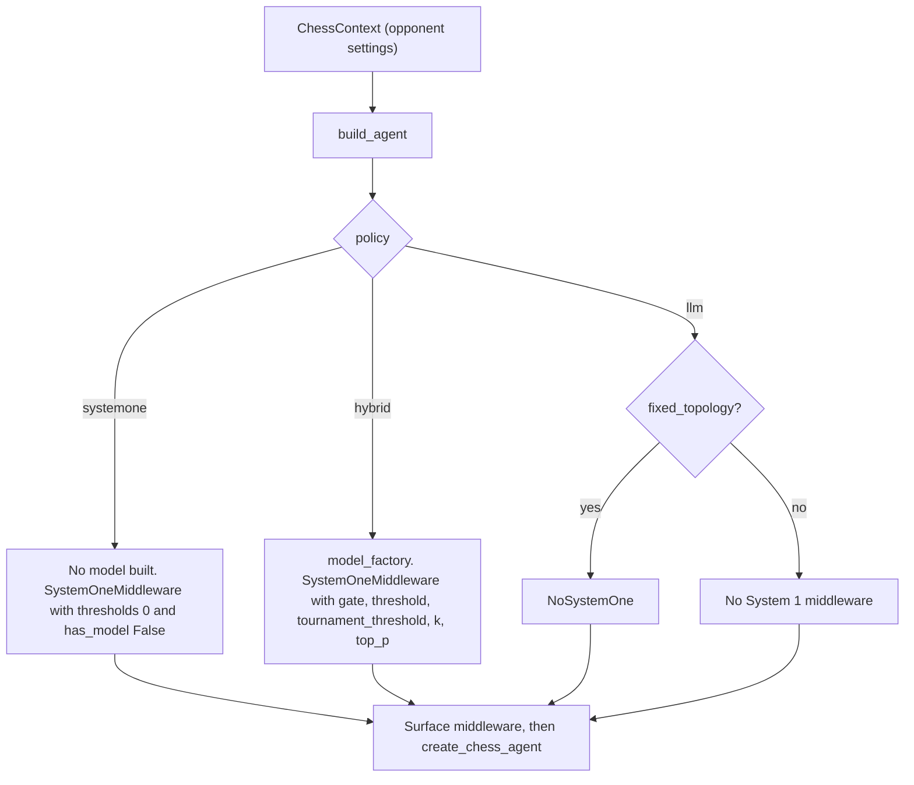

# System 1 (SystemOneMiddleware)

`libs/systemone` puts a fast "System 1" classifier in front of the chess LLM. Each turn,
`SystemOneMiddleware` asks a ranker for a probability distribution over the moves that are
currently allowed. A **gate** then decides who moves. If System 1 is confident enough, it
proposes its top move and the LLM never runs. If not, it writes a soft **shortlist** of
candidates into the prompt, and the LLM may still play any allowed move. The package depends on
`libs/chess` and never the other way round (see
[package map](package-map.md)). It uses only the public middleware contract: `position`,
`propose`, `candidates`, `fallback_move`, `ply_meta`, `turn_calls` and `turn_latency_ms` (see
[middleware contract](../concepts/middleware-contract.md)). The package also owns the opponent
settings (`ChessContext`) and `build_agent`, the one agent builder that the server and the CLI
share.

The main pieces:

| Piece | Role |
|---|---|
| `build_agent` (`agent.py`) | Builds the chess agent a `ChessContext` describes, for the server and the CLI alike. Chooses System 1's place in the middleware stack for the opponent policy. |
| `ChessContext` (`settings.py`) | Every opponent setting, System 1's knobs included, plus the versioned settings file format. |
| `SystemOneMiddleware` (`middleware.py`) | Builds the rank request, applies the gate, freezes the decision for the turn, replays it, and emits telemetry. |
| `NoSystemOne` (`middleware.py`) | A do-nothing stand-in with the same node name and state schema, used when System 1 is switched off but the graph shape must stay fixed. |
| `GatewayRanker` (`ranker.py`) | Turns a `RankRequest` into one or more `TypeSafeClassifier` requests to the LLM Gateway's System 1 route. Validates the answers and records one `Call` per request. |
| `describe.py` | Board-verified move facts (captures, check and mate, static exchange, attacked or defended squares), rendered as Choice option criteria. |
| `tournament.py` | A pure, seeded knockout plan for more options than one Choice can hold, driven by `drive`/`adrive`. |
| `validate.py` | Per-Choice validation and normalization of returned probabilities. |
| `testing.py` | `FakeRanker` and `FakeTypeSafeClient`. The fake client enforces SemIf's 2–16 options per Choice and 32 questions per request. |

## The decision flow

*Rank, then gate, then play, shortlist or skip. The decision is frozen on first entry and replayed on every retry.*

### Ranking request

`before_model` (and `abefore_model`) builds a `RankRequest` from the `PositionView`: the start
FEN, the UCI move history, the **currently allowed** moves as options, and a seed. The seed is
`turn_seed(agent_seed, turn_id)`, a SHA-256 of the agent seed and turn id. It is deliberately
not `hash()`, which Python randomizes per process. So the tournament shuffle can be repeated
within a turn but differs across turns. The agent seed is the opponent's `seed` setting
(`ChessContext.seed`, default 0), which `build_agent` passes to `create_chess_agent(seed=...)`.

The request sent to the gateway has two parts:

- **`state`**: facts only. Side to move, FEN, an ASCII board with a legend, material in pawn
  units (including `for_side_to_move`), whether the side is in check, the last `history_plies`
  (default 6) moves in SAN, and the fullmove number.
- **`questions`**: one `Choice` per ranking (named `move` for a single ranking or the final).
  Its criteria map each UCI option to a deterministic description from `describe_moves`. The
  instructions ask for "the strongest legal move". They deliberately state no value
  preferences, so the ranking does not simply echo the prompt. Heats and the final also append
  "Only some of the legal moves are listed". When `with_eval` or `with_nouls` is on, the single
  or final request also carries a `Score` (`eval`, seven rungs from Black winning to White
  winning) and two `Noul`s (`needs_calculation`, `tactics_present`). These are telemetry only
  and never affect the gate.

The async path builds the request (including the move descriptions, which can take most of a
second in a crowded position) in a worker thread via `asyncio.to_thread`, so it stays off the
event loop.

### Move descriptions

`describe.py` computes `MoveFacts` with python-chess, never with a model. Static exchange
evaluation walks the legal recaptures on the destination square, so pins and king safety are
respected. The `rich` style (the default `style` setting) renders movement, then tactical
phrases (checkmate or gives check, captures, wins or loses material in the exchange), then
square safety. The phrase order is fixed, so the same facts always give the same string. The
`terse` style keeps only the SAN plus the first tactical phrase.

## The gate

`_freeze` turns a validated `MoveDistribution` into a `FrozenDecision`:

- **Signal.** `gate="margin"` (the default) uses `p1 - p2`, where a single candidate's margin
  is its own probability. `gate="confidence"` uses the Choice's reported confidence. Both values
  are always recorded, whichever gate is active.
- **Threshold.** The default is `0.9`. After a tournament, `tournament_threshold` replaces it
  when set; otherwise `threshold` applies. A final over fewer moves inflates the margin, and
  SemIf's confidence depends on the option count, so a tournament gets its own threshold. The
  applied value is recorded as `threshold_used`. The code says nothing about how well these
  defaults are calibrated. For measured System 1 accuracy and gate calibration on labelled
  positions, see [System 1 evals](../workflows/system-one-evals.md). Other design decisions are
  collected in [design decisions](../concepts/decisions.md).
- **Plays** when `threshold < 1.0 and signal >= threshold`. So `threshold=0` always plays
  (System 1 alone) and `threshold=1` never plays (a pure pruner), even for a distribution
  of 1.0/0.0.
- **Played:** status `played`. The top move is proposed with `source="systemone"` and
  `meta={"model": ...}`, and the proposal jumps past the LLM.
- **Otherwise:** status `shortlist`. The shortlist is the top `k` candidates (default 5, at
  most 255). If `top_p` is set, it is the smallest prefix whose cumulative probability reaches
  `top_p`, still capped at `k`. The shortlist goes into `candidates`, which the prompt renders
  as "Suggested candidates: … you may play any allowed move". A one-move shortlist is still a
  suggestion, not a forced move.
- In both cases System 1's top move is written as `fallback_move`. The UCI adapter
  (`libs/cli/langchain_chess_cli/uci/completion.py`) uses it as `bestmove` after a cancellation
  or execution failure, but only when the last turn belongs to that search and the move is in
  the search's root pool (legal moves within `searchmoves`). Otherwise the adapter picks a seeded
  random move from the pool, or the null move `0000` if the pool is empty.

Argument validation fails fast in the constructor: `k` must be within 1..255, `top_p` within
(0, 1], and both thresholds within [0, 1].

### Frozen decisions and replay

The decision is stored in the private `systemone_turn` channel, keyed by `turn_id`. A later
`before_model` on the same turn, such as an illegal-reply retry or a re-run after a failed
commit, **replays** the frozen decision instead of re-ranking. Re-ranking could flip the gate:
re-ranking .60/.25/.15 over a k=2 shortlist would turn a .35 margin into .41 and cross a .40
threshold. Replay is monotone. It writes only `current allowed ∩ frozen`, so a later narrowing
by another middleware is never undone. A proposal or fallback that is no longer allowed is
dropped, stale candidates are filtered out, and a `skipped` decision replays as nothing. Tests
check that a tournament is not re-run on retry, and that a played move is proposed again after
a failed commit without a second ranking call. The general pattern is described in the
[middleware contract](../concepts/middleware-contract.md) and the
[turn lifecycle](turn-lifecycle.md).

## NoSystemOne

`NoSystemOne` has `SystemOneMiddleware`'s name and `SystemOneState` schema, but its
`before_model`/`abefore_model` return nothing. The server's graph factory must build the same
nodes, edges and state schema for every call (a setting may switch a node off but never remove
it). So `build_agent(..., fixed_topology=True)` installs `NoSystemOne` for `policy="llm"`, and
the server's `shape()`, the credential-free graph used for reads, updates and introspection,
always uses it. Tests check that a graph with `NoSystemOne` has the same topology as one with
`SystemOneMiddleware` (the LLM then plays with empty ply meta), and that every policy and memory
combination built with `fixed_topology=True` has one shape. The CLI builds without a fixed
topology, so for `llm` it simply leaves the middleware out.

## GatewayRanker

`GatewayRanker(model, style, with_eval, with_nouls, max_options, client, history_plies=6,
timeout_s=15.0, max_attempts=3)` wraps a `TypeSafeClassifier` (anything matching the small
`Classifier` protocol with `invoke`/`ainvoke`, so tests can inject a fake). With no `client`, a
`TypeSafeClassifier(model, timeout=timeout_s)` is built on first use, so building a graph needs
no credentials. The 15 s timeout is short on purpose: System 1 answers in well under a second,
so a long call is treated as a stalled connection and retried.

- **Models and caps.** `semif-*` models get 16 options per Choice and `typesafe/jev-*` models
  get 255. Unknown models default to 16, which costs at most an extra round. `max_options`
  must be within 2..255. The `systemone_model` setting documents `semif-qwen3.5-4b` (the
  default) and `typesafe/jev-latest`.
- **One option** returns a local distribution (probability 1, confidence 1) with no request
  and no `Call`. Under the default threshold this makes System 1 play a move that has been
  narrowed to one option. Under `threshold=1` the LLM still plays it.
- **Up to the cap:** a single request, traced as `systemone.rank`.
- **Over the cap:** a tournament, with heat requests traced as `systemone.heats` and the final
  as `systemone.final`.
- **Retries.** Only transient errors are retried: rate limit, connection, timeout and internal
  server error. The ranker makes up to `max_attempts=3` attempts in total, sleeping
  `min(4.0, 0.5 * 2**n)` seconds between them (0.5 s, then 1 s). Any other exception, such as
  a 422 validation error, fails immediately. Exhaustion and hard errors both raise
  `RankingFailed`, carrying the `Call`s of the requests that completed before the failure and
  `elapsed_ms`, the time the ranking ran before failing.
- **Validation.** `validate_choice` rejects labels that were not options, and probabilities
  that are non-finite or outside [0, 1]. It also rejects an all-zero sum, a sum that misses 1
  beyond tolerance (1e-3, or `0.005 × n` when every value is rounded to two decimals, as Jev's
  are) and a confidence outside [0, 1]. Missing labels count as 0, and ties are broken by
  option order. Probabilities are only ever scaled **down** (divided by `max(total, 1)`): a sum
  slightly above 1 is normalized, but a rounded-away shortfall is left as is, because scaling it
  up would inflate the top move and the margin (0.85 plus 32 zeros would become 1.0). Without
  validation, an unnormalized 6.0/2.5/1.5 would give a margin of 3.5. A malformed answer raises
  `RankingFailed("malformed …")`, but its `Call` is kept.
- **Cost.** Each request records a `Call` of kind `systemone` with provider `typesafe` and
  model `typesafe:<model>`. SemIf returns no token usage, so its calls have `cost_usd=None` and
  the turn's cost is incomplete. Jev returns usage and is priced (see
  [models, gateway and cost](../concepts/models-gateway-and-cost.md)).

## The tournament

`plan(options, cap, seed)` is a pure generator. It yields `Batch`es (one provider request each)
and receives each batch's validated `Answers`:

1. Shuffle the options with a request-local `random.Random(seed)`.
2. While the pool is larger than `cap`, split it into `ceil(n / cap)` heats whose sizes differ
   by at most one. Each heat sends its top `floor(cap / h)` moves on, and the `cap mod h` spare
   places go one each to the first heats. With more heats than places, each heat sends one move
   on, and the loop recurses. A single-move heat is a **bye**: it is recorded with probability 1
   and never sent.
3. Heat Choices are packed into requests of at most **32 questions** (`MAX_QUESTIONS`, SemIf's
   per-request limit). Heat requests carry no aux questions.
4. The final is one request with Choice `move` over the finalists. It carries the optional
   eval and Noul questions.

Probabilities are never compared across heats. The final's distribution, and therefore
`MoveDistribution.candidates`, the telemetry `top` list and the shortlist, covers **finalists
only**. The telemetry flags this as `finalist_conditional`. Each move's `stages` record where
it stood in every round, never a global rank. For SemIf (cap 16) and any real chess position
(at most 218 legal moves, so at most 14 heats), a tournament is always exactly two requests:
one heats request, then the final. Example: 30 options become two heats of 15 with 8 places
each, then a 16-move final.

## Failure behavior

| Situation | With an LLM (`has_model=True`, hybrid) | Without an LLM (`has_model=False`, System 1 alone) |
|---|---|---|
| Transient error, recovered within 3 attempts | Normal decision | Normal decision |
| Exhausted retries, hard error, or malformed answer | Status `skipped`, with `error` and the elapsed time recorded. No candidates or fallback are written, and the LLM chooses unaided. Completed calls stay on the turn. | `RankingFailed` propagates from `before_model`. The run fails and the turn stays `pending`. |
| Heats succeed but the final fails | `skipped`; the heat call is kept | Run fails |
| System 1 credentials missing on the server | `ValueError` while building the graph, before any turn | Same |

## Wiring: `build_agent` and the opponent settings

### One builder for every surface

`build_agent` lives in `libs/systemone/langchain_chess_systemone/agent.py`. Both the server
graph and the CLI (`lcchess uci`, `lcchess play`) call it. It takes a `ChessContext` (the
opponent) and lets each surface inject what it owns: a `model_factory`, a `ranker_factory`, the
checkpointer, extra middleware (which runs **after** System 1), `fixed_topology` and the
context schema. Only the factories a policy uses are called.

*How `build_agent` places System 1 in the stack for each policy.*

- **`policy="systemone"`.** No model is built (the model factory is never called), and
  `systemone()` sets `threshold=0.0`, `tournament_threshold=0.0` and `has_model=False`,
  whatever the settings say. So System 1 alone always plays when ranking succeeds. Memory is
  off because there is no model.
- **`policy="hybrid"`** (the default). The model is built, and the middleware gets the
  settings' `gate`, `threshold`, `tournament_threshold`, `k` and `top_p`, with `has_model=True`.
- **`policy="llm"`.** No ranker is built. With `fixed_topology=True` (the server) the stack
  gets `NoSystemOne`. Otherwise (the CLI) System 1 is left out.

The ranker comes from the `ranker_factory`, which reads the settings' `systemone_model`,
`style`, `with_eval` and `with_nouls`:

- **Default (CLI).** `default_ranker` builds a plain `GatewayRanker`. Its `TypeSafeClassifier`
  is created lazily on first use, so building the graph needs no credentials.
- **Server** (`apps/server/langchain_chess_server/graph.py`). `pooled_ranker` builds the
  `GatewayRanker` with a `TypeSafeClassifier` that uses the `TYPESAFE_API_KEY` and
  `TYPESAFE_BASE_URL` server settings. `ServerSettings.typesafe()` raises `ValueError` if either
  is missing. It is called only from the ranker factory, so only the policies that run System 1
  need them. `build_graph` calls `build_agent` with `fixed_topology=True`, the lenient
  `ChessContextInput` context schema and `GameSetupMiddleware` as the surface middleware. Each
  classifier gets its sync and async HTTP clients from `POOL` (`clients.py`): one per-process
  `httpx2.Client`/`httpx2.AsyncClient` pair with a 15 s timeout, created lazily under a lock on
  first use. All graphs built in the process share the pair. The FastAPI app's lifespan
  (`app.py`), which the Agent Server merges with its own, calls `POOL.aclose()` on shutdown.
  After that, the next `get()` creates a fresh pair. The pool lives in its own module, always
  imported by package name, because langgraph loads `graph.py` from its file path under a
  generated module name, and a pool kept there would exist once per copy.

### Where the settings come from

System 1's knobs are fields of `SystemOneSettings`, which is part of `ChessContext` in
`libs/systemone/langchain_chess_systemone/settings.py`. They are `systemone_model`
(`semif-qwen3.5-4b`), `style` (`rich`), `with_eval` and `with_nouls` (both `False`, recorded
only), `gate` (`margin`), `threshold` (0.9), `tournament_threshold` (null, so `threshold`
applies), `k` (5, at most 255), `top_p` (null) and `seed` (0). `policy` (default `hybrid`)
chooses the opponent. `ChessContext` validates the ranges when it is built, and the middleware
constructor checks them again. A settings file is `ChessContext` as versioned JSON (currently
`version: 2`). Older versions are migrated forward, and a newer version or unknown keys are
rejected. See [settings and model arguments](../concepts/settings-and-model-arguments.md) for
the file format and migrations.

- **CLI.** `--config` loads an opponent settings file (`load_file`). Each flag given then
  overrides it, and each `--reset <name>` puts a setting back to its default (`overlay`).
  Without `--config`, the flags apply over the defaults.
- **Server.** `resolve_context` merges the assistant's `context` first, then the keys present
  in `config["configurable"]`. A source without a `version` is read as the current version, and
  keys the settings don't know are dropped. An explicit null resets a setting to its default (so
  a run can clear an assistant's `top_p`). The merged values are validated up front, so a bad
  value fails the run before any ranking. A graph factory call with no execution runtime (reads,
  updates, introspection) gets `shape()` instead.

## Telemetry

`ply_meta` writes `Ply.meta["SystemOneMiddleware"]` (`SystemOneMeta`) with these fields:

- `status` (`played` / `shortlist` / `skipped`) and `model`
- `top` (up to 5 moves), `shortlist` and `followed` (whether the LLM played a shortlisted move;
  `None` when System 1 played or ranking was skipped)
- `gate`, `signal`, `confidence`, `margin` and `threshold_used`
- `finalist_conditional`, `played_move_result` and `tournament`
- `error`, `latency_ms`, and the optional `eval_score`, `needs_calculation` and
  `tactics_present`

`latency_ms` is the ranker's wall time for the whole ranking. It is 0.0 for a local one-option
distribution, and for a skipped decision it is the time the ranking ran before failing
(`RankingFailed.elapsed_ms`). All telemetry is read from the frozen decision, so replays report
the first ranking's values. `turn_calls` contributes the frozen decision's `Call`s to the turn,
and `turn_latency_ms` contributes the same ranking time once. Retries therefore never count it
twice: a System 1 move's ply and turn latency equal the ranking time, and a hybrid turn adds it
to the model time. These TypedDicts are mirrored by hand in `packages/chess-ui/src/types.ts`, so
keep them in step.

## Tests that matter

- `tests/test_agent.py`: each policy builds its stack (System 1 present for `systemone` and
  `hybrid`, absent for `llm`), `fixed_topology=True` gives one shape for every policy and
  memory setting, settings reach the agent (`threshold_used`, `k`), `policy="systemone"` never
  builds a model even with `threshold=1`, and `default_ranker` follows the settings' model and
  style.
- `tests/test_middleware.py`: gate edges (`threshold` 0 and 1, confident play skips the model),
  replay never re-gates, monotone replay under later narrowing, tournament threshold, malformed
  distributions leading to `skipped` with a model and a pending turn without one, a rounded-away
  Jev shortfall that cannot clear the margin gate, failed finals keeping heat calls,
  `NoSystemOne` keeping the topology, and ranking latency counted once (including on skip).
- `tests/test_ranker.py`: run names (`systemone.rank`, `systemone.heats`, `systemone.final`),
  one-option local ranking, async descriptions off the event loop, transient retry and
  exhaustion carrying completed calls, immediate failure on other errors (with `elapsed_ms`),
  Jev pricing versus unpriced SemIf, and lazy default client construction.
- `tests/test_tournament.py`: balanced heats, quotas, byes, recursion at small caps, 32-question
  chunking, seeded shuffle, and the final always fitting.
- `tests/test_live.py`: opt-in (`-m live`) runs against the real gateway. These cost money.

## Runtime note: System 1 play versus hand-off, and ranking failures

The consolidated findings live in [runtime behavior](../operations/runtime-behavior.md).

- **Observed:** none recorded here. This page could not read the LangSmith sample for this
  update, so it gives **no** sampled counts for how often System 1 played a move itself versus
  handing off to the LLM (`played` versus `shortlist`), for `skipped` ranking failures,
  tournament frequency, System 1 latency, or `systemone.*` span counts. Check the
  runtime-behavior page for any figures from the current pull. Do not infer them from this page.
- **Correlated (how to read traces against the code):**
  - A System 1 play is a turn with a `systemone.*` span and no LLM span after it. A hand-off
    has an LLM span after the System 1 span. Both outcomes are also in
    `Ply.meta["SystemOneMiddleware"].status`, together with `latency_ms` and `threshold_used`.
  - A ranking failure in a hybrid game shows failed or repeated `systemone.*` spans followed by
    an LLM span, and `status: "skipped"` with `error` set. In a `policy="systemone"` game it
    shows as an errored root and a pending turn.
  - Each gateway request is a span named after the constants in `ranker.py`. A single-request
    turn shows one `systemone.rank` span. A SemIf tournament shows exactly one
    `systemone.heats` span followed by one `systemone.final` span. Retries appear as repeated
    spans with the same name within one turn.
  - A turn with no System 1 span either had a single allowed option (ranked locally), was
    replayed from its frozen decision, or ran with `policy="llm"`.
  - SemIf spans carry no token usage, so their cost is `None` by design.
- **Hypothesis (checks to run on a future sample):**
  - Does the default `threshold=0.9` margin gate ever play in hybrid games, or does it act
    mostly as a pruner? Compare with the calibration measured on the
    [evals page](../workflows/system-one-evals.md).
  - How often do positions exceed 16 allowed moves and so pay for two sequential requests?
  - Do transient-error retries or the `skipped` path fire at all in production?
  - How much of a turn's wall time does System 1 add next to the LLM call?
