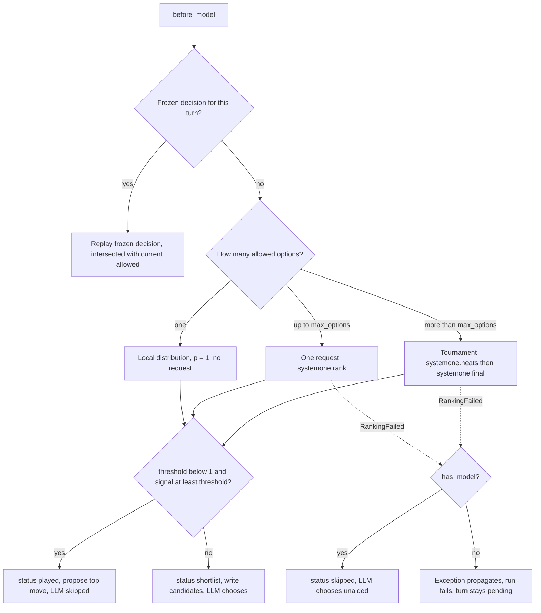

# System 1: SystemOneMiddleware, ranker and tournament

`libs/systemone` puts a fast "System 1" classifier in front of the chess LLM. Each turn,
`SystemOneMiddleware` asks a ranker for a probability distribution over the moves that are
currently allowed. A **gate** then decides who moves. If System 1 is confident enough, it
proposes its top move and the LLM never runs. If not, it writes a soft **shortlist** of
candidates into the prompt, and the LLM may still play any allowed move. The package depends on
`libs/chess` and never the other way round (see
[package map](package-map.md)). It uses only the public middleware contract: `position`,
`propose`, `candidates`, `fallback_move`, `ply_meta` and `turn_calls` (see
[middleware contract](../concepts/middleware-contract.md)).

The main pieces:

| Piece | Role |
|---|---|
| `SystemOneMiddleware` (`middleware.py`) | Builds the rank request, applies the gate, freezes the decision for the turn, replays it, and emits telemetry. |
| `GatewayRanker` (`ranker.py`) | Turns a `RankRequest` into one or more `TypeSafeClassifier` requests to the LLM Gateway's System 1 route. Validates the answers and records one `Call` per request. |
| `describe.py` | Board-verified move facts (captures, check and mate, static exchange, attacked or defended squares), rendered as Choice option criteria. |
| `tournament.py` | A pure, seeded knockout plan for more options than one Choice can hold, driven by `drive`/`adrive`. |
| `validate.py` | Per-Choice validation and renormalization of returned probabilities. |
| `testing.py` | `FakeRanker` and `FakeTypeSafeClient`. The fake client enforces SemIf's 2–16 options per Choice and 32 questions per request. |

## The decision flow

*Rank, then gate, then play, shortlist or skip. The decision is frozen on first entry and replayed on every retry.*

### Ranking request

`before_model` (and `abefore_model`) builds a `RankRequest` from the `PositionView`: the start
FEN, the UCI move history, the **currently allowed** moves as options, and a seed. The seed is
`turn_seed(agent_seed, turn_id)`, a SHA-256 of the agent seed and turn id. It is deliberately
not `hash()`, which Python randomizes per process. So the tournament shuffle can be repeated
within a turn but differs across turns. The agent seed comes from `create_chess_agent(seed=...)`,
which the server exposes as the `seed` context knob.

The request sent to the gateway has two parts:

- **`state`**: facts only. Side to move, FEN, an ASCII board with a legend, material in pawn
  units (including `for_side_to_move`), whether the side is in check, the last `history_plies`
  (default 6) moves in SAN, and the fullmove number.
- **`questions`**: one `Choice` per ranking (named `move` for a single ranking or the final).
  Its criteria map each UCI option to a deterministic description from `describe_moves`. The
  instructions ask for "the strongest legal move". They deliberately state no value
  preferences, so the ranking does not simply echo the prompt. Heats and the final also append
  "Only some of the legal moves are listed". When enabled, the final request also carries a
  `Score` (`eval`, seven rungs from Black winning to White winning) and two `Noul`s
  (`needs_calculation`, `tactics_present`). These are telemetry only and never affect the
  gate.

### Move descriptions

`describe.py` computes `MoveFacts` with python-chess, never with a model. Static exchange
evaluation walks the legal recaptures on the destination square, so pins and king safety are
respected. The `rich` style (the default, and the server's default `style` knob) renders
movement, then tactical phrases (checkmate or gives check, captures, wins or loses material in
the exchange), then square safety. The phrase order is fixed, so the same facts always give the
same string. The `terse` style keeps only the SAN plus the first tactical phrase.

## The gate

`_freeze` turns a validated `MoveDistribution` into a `FrozenDecision`:

- **Signal.** `gate="margin"` (the default) uses `p1 - p2`, where a single candidate's margin
  is its own probability. `gate="confidence"` uses the Choice's reported confidence. Both values
  are always recorded, whichever gate is active.
- **Threshold.** The default is `0.9`. After a tournament, `tournament_threshold` replaces it
  when set; otherwise `threshold` applies. A final over fewer moves inflates the margin, and
  SemIf's confidence depends on the option count, so a tournament gets its own threshold. The
  applied value is recorded as `threshold_used`. The measurements behind the defaults are in the
  README's [Decisions and measurements](../../README.md#decisions-and-measurements) section.
- **Plays** when `threshold < 1.0 and signal >= threshold`. So `threshold=0` always plays
  (System 1 alone) and `threshold=1` never plays (a pure pruner), even for a distribution
  of 1.0/0.0.
- **Played:** status `played`. The top move is proposed with `source="systemone"` and
  `meta={"model": ...}`, and the proposal jumps past the LLM.
- **Otherwise:** status `shortlist`. The shortlist is the top `k` candidates (default 5, at
  most 255). If `top_p` is set, it is the smallest prefix whose cumulative probability reaches
  `top_p`, still capped at `k`. The shortlist goes into `candidates`, which the prompt renders
  as "Suggested candidates: … you may play any allowed move". A one-move shortlist is still a
  suggestion, not a forced move.
- In both cases System 1's top move is written as `fallback_move`. The UCI adapter plays it as
  `bestmove` after a cancellation or failure (see `libs/cli/langchain_chess_cli/uci/completion.py`).

Argument validation fails fast in the constructor: `k` must be within 1..255, `top_p` within
(0, 1], and both thresholds within [0, 1].

### Frozen decisions and replay

The decision is stored in the private `systemone_turn` channel, keyed by `turn_id`. A later
`before_model` on the same turn, such as an illegal-reply retry or a re-run after a failed
commit, **replays** the frozen decision instead of re-ranking. Re-ranking could flip the gate:
re-ranking .60/.25/.15 over a k=2 shortlist would turn a .35 margin into .41 and cross a .40
threshold. Replay is monotone. It writes only `current allowed ∩ frozen`, so a later narrowing
by another middleware is never undone. A proposal or fallback that is no longer allowed is
dropped, stale candidates are filtered out, and a `skipped` decision replays as nothing. Tests
check that a tournament is not re-run on retry, and that a played move is proposed again after
a failed commit without a second ranking call. The general pattern is described in the
[middleware contract](../concepts/middleware-contract.md) and the
[turn lifecycle](turn-lifecycle.md).

## GatewayRanker

`GatewayRanker(model, style, with_eval, with_nouls, max_options, client, history_plies=6,
timeout_s=15.0, max_attempts=3)` wraps a `TypeSafeClassifier`. By default the client is built
on first use, so building a graph needs no credentials. The server passes in a cached client
built with `TYPESAFE_API_KEY`/`TYPESAFE_BASE_URL` settings and a 15 s timeout
(`apps/server/langchain_chess_server/graph.py`).

- **Models and caps.** `semif-*` models get 16 options per Choice and `typesafe/jev-*` models
  get 255. Unknown models default to 16, which costs at most an extra round. The server
  documents `semif-qwen3.5-4b` (the default) and `typesafe/jev-latest` (experiments only).
- **One option** returns a local distribution (probability 1, confidence 1) with no request
  and no `Call`. Under the default threshold this makes System 1 play a move that has been
  narrowed to one option. Under `threshold=1` the LLM still plays it.
- **Up to the cap:** a single request, traced as `systemone.rank`.
- **Over the cap:** a tournament, with heat requests traced as `systemone.heats` and the final
  as `systemone.final`.
- **Retries.** Only transient errors are retried: rate limit, connection, timeout and internal
  server error. The ranker makes up to `max_attempts=3` attempts in total, sleeping
  `min(4.0, 0.5 * 2**n)` seconds between them (0.5 s, then 1 s). Any other exception, such as
  a 422 validation error, fails immediately. Exhaustion and hard errors both raise
  `RankingFailed`, carrying the `Call`s of the requests that completed before the failure.
- **Validation.** `validate_choice` rejects labels that were not options, and probabilities
  that are non-finite or outside [0, 1]. It also rejects a sum that misses 1 beyond tolerance
  (1e-3, or `0.005 × n` when every value is rounded to two decimals, as Jev's are) and a
  confidence outside [0, 1]. Missing labels count as 0. Small drift is renormalized, and ties
  are broken by option order. Without this, an unnormalized 6.0/2.5/1.5 would give a margin of
  3.5. A malformed answer raises `RankingFailed("malformed …")`, but its `Call` is kept.
- **Cost.** Each request records a `Call` of kind `systemone` with provider `typesafe` and
  model `typesafe:<model>`. SemIf returns no token usage, so its calls have `cost_usd=None` and
  the turn's cost is incomplete. Jev returns usage and is priced (see
  [models, gateway and cost](../concepts/models-gateway-and-cost.md)).

## The tournament

`plan(options, cap, seed)` is a pure generator. It yields `Batch`es (one provider request each)
and receives each batch's validated `Answers`:

1. Shuffle the options with a request-local `random.Random(seed)`.
2. While the pool is larger than `cap`, split it into `ceil(n / cap)` heats whose sizes differ
   by at most one. Each heat sends its top `floor(cap / h)` moves on, and the `cap mod h` spare
   places go one each to the first heats. With more heats than places, each heat sends one move
   on, and the loop recurses. A single-move heat is a **bye**: it is recorded with probability 1
   and never sent.
3. Heat Choices are packed into requests of at most **32 questions** (`MAX_QUESTIONS`, SemIf's
   per-request limit). Heat requests carry no aux questions.
4. The final is one request with Choice `move` over the finalists. It carries the optional
   eval and Noul questions.

Probabilities are never compared across heats. The final's distribution, and therefore
`MoveDistribution.candidates`, the telemetry `top` list and the shortlist, covers **finalists
only**. The telemetry flags this as `finalist_conditional`. Each move's `stages` record where
it stood in every round, never a global rank. For SemIf (cap 16) and any real chess position
(at most 218 legal moves, so at most 14 heats), a tournament is always exactly two requests:
one heats request, then the final. Example: 30 options become two heats of 15 with 8 places
each, then a 16-move final.

## Failure behavior

| Situation | With an LLM (`has_model=True`, hybrid) | Without an LLM (`has_model=False`, System 1 alone) |
|---|---|---|
| Transient error, recovered within 3 attempts | Normal decision | Normal decision |
| Exhausted retries, hard error, or malformed answer | Status `skipped`, with `error` recorded. No candidates or fallback are written, and the LLM chooses unaided. Completed calls stay on the turn. | `RankingFailed` propagates from `before_model`. The run fails and the turn stays `pending`. |
| Heats succeed but the final fails | `skipped`; the heat call is kept | Run fails |

In the server and CLI, `policy="systemone"` builds the middleware with `threshold=0.0`,
`tournament_threshold=0.0` and `has_model=False`, so System 1 alone always plays when ranking
succeeds. `policy="llm"` omits the middleware entirely. `hybrid` (the default) uses the context
knobs `gate`, `threshold`, `tournament_threshold`, `k`, `top_p`, `style`, `with_eval`,
`with_nouls` and `systemone_model`.

The two surfaces wire the ranker differently:

- **Server** (`apps/server/langchain_chess_server/graph.py`). `systemone()` builds a
  `GatewayRanker` itself, passing `style`, `with_eval` and `with_nouls` plus a
  `TypeSafeClassifier` from an `lru_cache`d factory keyed by model, API key and base URL (15 s
  timeout). It hands that ranker to `SystemOneMiddleware`, which receives only the gate,
  threshold, `k`, `top_p` and `has_model` knobs. Graphs built for the same System 1 model and
  credentials therefore share one client. The knobs are declared on `ChessContext`
  (`context.py`). `systemone_model` is documented as `semif-qwen3.5-4b` (the default) or
  `typesafe/jev-latest`. `with_eval` and `with_nouls` default to `False` and are described as
  telemetry.
- **CLI** (`libs/cli/langchain_chess_cli/options.py`). It passes `style`, `with_eval` and
  `with_nouls` straight to `SystemOneMiddleware`. With no `ranker`, the middleware builds its
  own `GatewayRanker`, whose client is created lazily on first use.

## Telemetry

`ply_meta` writes `Ply.meta["SystemOneMiddleware"]` (`SystemOneMeta`) with these fields:

- `status` (`played` / `shortlist` / `skipped`) and `model`
- `top` (up to 5 moves), `shortlist` and `followed` (whether the LLM played a shortlisted move;
  `None` when System 1 played or ranking was skipped)
- `gate`, `signal`, `confidence`, `margin` and `threshold_used`
- `finalist_conditional`, `played_move_result` and `tournament`
- `error`, `latency_ms`, and the optional `eval_score`, `needs_calculation` and
  `tactics_present`

`turn_calls` contributes the frozen decision's `Call`s to the turn. These TypedDicts are
mirrored by hand in `packages/chess-ui/src/types.ts`, so keep them in step.

## Tests that matter

- `tests/test_middleware.py`: gate edges (`threshold` 0 and 1, confident play skips the model),
  replay never re-gates, monotone replay under later narrowing, tournament threshold, malformed
  distributions leading to `skipped` with a model and a pending turn without one, and failed
  finals keeping heat calls.
- `tests/test_ranker.py`: run names (`systemone.rank`, `systemone.heats`, `systemone.final`),
  one-option local ranking, transient retry and exhaustion carrying completed calls, immediate
  failure on other errors, Jev pricing versus unpriced SemIf.
- `tests/test_tournament.py`: balanced heats, quotas, byes, recursion at small caps, 32-question
  chunking, seeded shuffle, and the final always fitting.
- `tests/test_live.py`: opt-in (`-m live`) runs against the real gateway. These cost money.

Measured choices, such as the default model and why rich descriptions are the default, are
recorded in the README's
[Decisions and measurements](../../README.md#decisions-and-measurements) section.

## Runtime evidence

The consolidated findings live in [runtime behavior](../operations/runtime-behavior.md).

- **Observed:** none for this page. The LangSmith sample pulled for this wiki update could not
  be read from this page's generation context. This page therefore reports **no** sampled
  counts for gate outcomes (`played` / `shortlist` / `skipped`), tournament frequency, System 1
  latency, or per-call usage of `systemone.rank` / `systemone.heats` / `systemone.final`.
  See the runtime-behavior page for any figures from this pull.
- **Correlated (how to read traces against the code):**
  - Each gateway request is a span named after the constants in `ranker.py`. A single-request
    turn shows one `systemone.rank` span. A SemIf tournament shows exactly one
    `systemone.heats` span followed by one `systemone.final` span.
  - Retries appear as repeated spans with the same name within one turn.
  - A turn with no System 1 span either had a single allowed option (ranked locally) or was
    replayed from its frozen decision.
  - Gate outcome, `latency_ms` and `threshold_used` are in `Ply.meta["SystemOneMiddleware"]`,
    not in the span names.
  - SemIf spans carry no token usage, so their cost is `None` by design.
- **Hypothesis (checks to run on a future sample):**
  - Does the default `threshold=0.9` margin gate ever play in hybrid games, or does it act
    mostly as a pruner?
  - How often do positions exceed 16 allowed moves and so pay for two sequential requests?
  - Do transient-error retries or the `skipped` path fire at all in production?
  - How much of a turn's wall time does System 1 add next to the LLM call?
ll time does System 1 add next to the LLM call?
