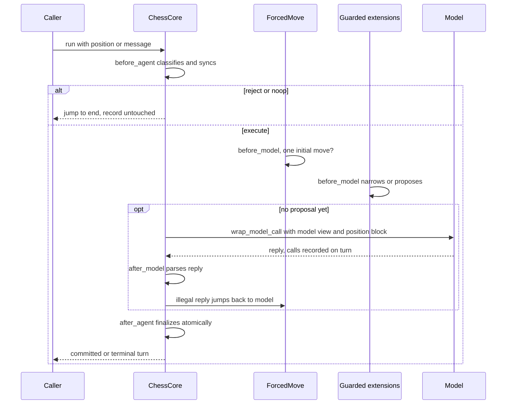
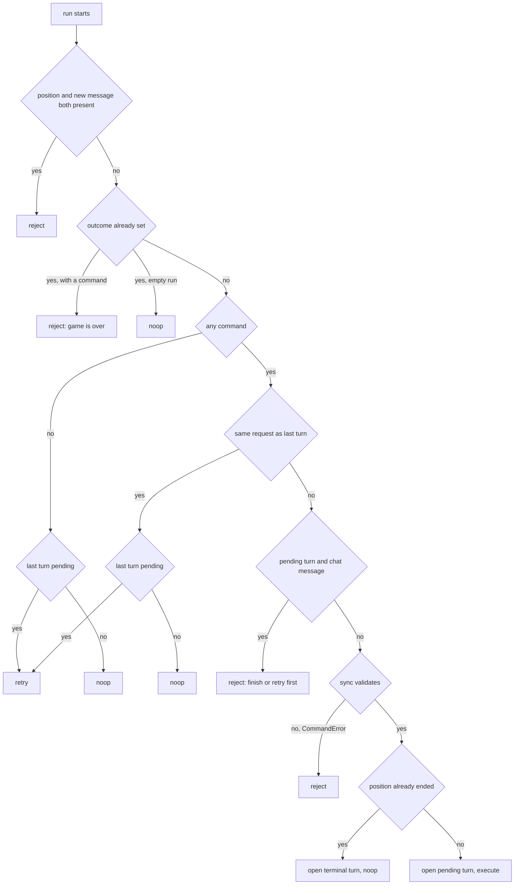
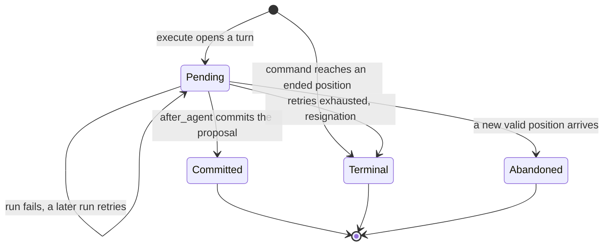

# Turn lifecycle

`create_chess_agent` (`libs/chess/langchain_chess/agent.py`) is a thin wrapper around LangChain's `create_agent(tools=[])`. It passes no tools. All chess behaviour lives in middleware, and one middleware owns the game: `ChessCore` (`libs/chess/langchain_chess/middleware/core.py`). This page covers how one run becomes at most one turn, and the invariants you must keep when you change that code.

Related pages: [middleware contract](/openwiki/concepts/middleware-contract.md) (what extensions may write), [state record](/openwiki/concepts/state-record.md) (the keys clients read), [prompt and memory](/openwiki/concepts/prompt-and-memory.md) (what the model sees), [System 1](/openwiki/architecture/system-one.md) (the main proposer), and [runtime behavior](/openwiki/operations/runtime-behavior.md) (what production runs look like).

## The stack `create_chess_agent` builds

The stack always has the same shape:

1. **`ChessCore`** comes first. Its `before_agent` runs first, its `wrap_model_call` is the outermost wrapper, and its `after_model` and `after_agent` run last. It receives the guarded extensions so that it can collect their `turn_calls`, `turn_latency_ms` and `ply_meta` when a turn finishes.
2. **`ForcedMoveMiddleware`** comes next, unless you pass `forced_move=False`.
3. **User middleware** comes after that. Each one is wrapped by `guard()` from `contract.py`. The guard gives each hook a detached copy of the state and checks every write. Two extensions may not declare the same private state key; if they do, construction fails with a `ChessContractError`.
4. **A summarization node** comes last. With `memory="summarize"` it is `ChessSummarization`. Being last means it runs only right before a real LLM call. This mode requires a model. With any other memory setting the node is present only if `fixed_topology=True`, in which case it is `NoSummarization`, a no-op `before_model` that uses the same node name (`SummarizationMiddleware`).

If `model` is `None`, the stack gets a `NoModel` stand-in. Calling it raises `ChessContractError`, so a System-1-only agent fails loudly when no proposer fires. It never plays a random move. After compiling, the factory checks that the graph's input schema contains only `messages` and `position`. An extension that leaks a public state key fails at build time. The compiled graph is returned with a `CallRecorder` callback attached. That callback captures every provider response for the turn's `calls`.

Without a checkpointer the agent is stateless, so every run must carry a `position` (see `test_stateless_agent`).

### Fixed topology: a setting switches a node off, it never removes it

The Agent Server reads, updates and introspects thread state with a graph built *without* the run's settings (`make_graph` returns `shape()` when there is no execution runtime). If the graph's nodes depended on settings, the reading graph and the running graph would disagree. The rule is therefore that a setting may switch a node off but must never remove it:

- `fixed_topology=True` keeps a summarization node under `memory="none"` by adding `NoSummarization`. `test_a_fixed_topology_keeps_a_summarization_node_that_never_summarizes` checks that the `none` and `summarize` graphs then have identical topology and that no summary call is ever made.
- The server applies the same idea to its own extension: it always adds a System 1 node, either `SystemOneMiddleware` or `NoSystemOne`, which keeps System 1's node and state keys when the policy is `llm`. It also always adds `GameSetupMiddleware`, and it builds with `fixed_topology=True`, both for runs (`build_agent`) and for the model-free `shape()` graph.
- `fixed_topology` covers only the summarization node. `forced_move=False` still removes `ForcedMoveMiddleware`, so a caller that needs a stable graph must keep `forced_move` constant.

## Invariants a change must keep

- **One run plays at most one turn. One thread is one game.** `before_agent` records the run's `invocation`, with an `action` that is one of `execute`, `reject` or `noop`. Only an `execute` run can call the model or finalize anything. `reject` and `noop` jump straight to `end`.
- **A retry replays a validated decision. It does not ask again.** When a pending turn is retried and a `proposal` or `terminal_intent` is already in state, `_retry` jumps directly to `end` so that `after_agent` finalizes it. Asking the model again would cost money and could change the move. `test_a_committed_proposal_survives_a_failing_after_agent` and `test_a_resignation_survives_a_failing_after_agent` in `tests/test_contract.py` pin this: the model is called exactly as often as it was in the failed run.
- **`before_model` is re-entered.** An illegal reply makes `after_model` jump back to `model`. In `create_agent` that re-runs every `before_model` hook. A fresh retry of a pending turn with no decision yet resets `allowed_moves` to the turn's `initial_allowed` and clears the decision keys in `_DECISION_RESET`: `proposal`, `terminal_intent`, `candidates`, `candidates_by`, `fallback_move` and `failed_call`. For these reasons extension `before_model` hooks must be idempotent. They must freeze decisions per `turn_id` and replay them as `current allowed ∩ frozen` (the rule is in the `ChessMiddleware` docstring in `contract.py`).
- **The illegal-move budget is durable.** `illegal_attempts` lives on the `TurnRecord`, not in the decision keys. A retry after a provider error keeps the count (`test_a_provider_error_retry_keeps_the_illegal_move_budget`).
- **Finalization is atomic and happens in one place.** Only `after_agent` writes `moves`, `plies`, the turn's final status and `outcome` for an agent move. A failure before that point leaves the turn `pending` with the model's reply still in state, and the next run can recover it.
- **Every check replays from the root.** `rules.replay` rebuilds the board from `start_fen` with the full move stack. A board built from a FEN alone has no history and would never see a repetition.

## One run, end to end

*The hook order of one run. An illegal reply loops back through every `before_model` before the next model call, and a proposal from `before_model` skips the model entirely.*

## Command classification (`before_agent`)

A run's input is either a `position` (`start_fen`, UCI `moves`, optional `restrict`) or a new, unconsumed `HumanMessage`. The request key is a SHA-256 `fingerprint` of the position (the order of `restrict` is ignored, but whether it is present is not), or the message id.

*How `ChessCore._lifecycle` classifies a run. A new position that validates while a turn is pending abandons that turn before opening the new one.*

Details that matter when you change this:

- **Chat sync** (`_sync_chat`) accepts exactly `go` or one legal move in SAN or UCI (`rules.parse_chat`). Anything else raises `CommandError`, including null-move spellings such as `0000` (`legal_member` checks that the move is in the legal set, not just that it parses). The human's move is recorded as an `external` ply.
- **Position sync** (`_sync_position`) requires the requested moves to *extend* the thread's game, with the same root and the thread's moves as a prefix. A `restrict` list must be non-empty and legal. New moves become `external` plies. A synthetic delta `HumanMessage` is added, such as "New game. You are White." or the new movetext. Takebacks and new games need a new thread.
- A rejected chat message is removed from `messages` (`RemoveMessage`), and the reason goes into `error`. The game record is never touched.
- Resending the same message id, or the same position after a commit, is a `noop`. Resending the same position while its turn is still pending is a retry. This is how clients recover after a provider error (`test_resent_position_retries_a_failed_turn`).
- A resignation cannot be rederived from the board. The check for `outcome` therefore runs before any sync.
- On a thread's first run, `_first_run` writes the empty record (`start_fen`, `moves`, `plies`, `turns`, `outcome`, `error`, `consumed_message_ids`), because LangGraph omits keys that were never written.

## Invocation and `opened_turn` bookkeeping

`invocation` is private, per-run state, kept separate from the durable `TurnRecord.status`. Every run gets a fresh `invocation` with a new `id`, its `action`, and `opened_turn`:

- `opened_turn` is the id of the turn **this run** opened, whether that turn is pending (`execute`) or opened directly as terminal (`noop` on an ended input position).
- A retry (`_retry`), a reject and an ordinary noop open no turn, so `opened_turn` is `None`. `test_the_invocation_names_only_a_turn_this_run_opened` checks this across a failed run, an empty retry, a new position and another empty retry.
- The field is `NotRequired`; checkpoints from before it existed have no `opened_turn`.

Extensions use it to act exactly once per turn opening. The server's `GameSetupMiddleware` writes the thread's `setup` only when there is exactly one turn and its id equals `invocation.opened_turn`. It checks in both `before_agent` and `after_agent`, because a run that opens a terminal turn jumps from `ChessCore.before_agent` straight to `end`, past the extension's `before_agent`. `_finalize` itself keys off `invocation.action`: it does nothing unless the action is `execute`.

## The turn lifecycle

Each `TurnRecord` in `turns` has a `status`: `pending`, `committed`, `abandoned` or `terminal`.

*The states a TurnRecord moves through. A committed move that ends the game stays `committed` and sets `outcome`. Only an ended input position or a resignation produces a `terminal` turn.*

When a turn opens, `initial_allowed` is set to the legal moves, filtered by `restrict`. This list is the turn's hard constraint, and the forced-move check and every retry reset use it. A turn opened on an already-ended position gets `status: "terminal"`, the outcome and a result message, and the run is a `noop` that never calls the model.

Whenever a turn leaves `pending` (committed, terminal or abandoned), `_finalized` folds each extension's `turn_calls` into its `calls` and adds each extension's `turn_latency_ms` to its `latency_ms`, exactly once. So the cost and time of abandoned work are still recorded. This is how the UCI adapter's fallback moves show up: the GUI's next position includes the fallback move, which abandons the pending turn.

## The model call (`wrap_model_call`)

`ChessCore` is the outermost wrapper. It rewrites the request's messages as `model_view(...)` followed by a trailing position block from `render_position`. The position block is never stored. It contains the movetext, FEN, ASCII board, side to move, any suggested `candidates`, and either the restricted move list or the full legal-move list (controlled by `show_legal_moves`). `model_view` depends on `memory`. With `none` the model sees only the current turn, starting from its opening message. With `full` or `summarize` it sees the whole history, minus earlier turns' rejected attempts and feedback. In both modes the current turn shows only its latest rejected reply, reasoning blocks are removed from other AI messages, and every message is deep-copied so that wrappers cannot change state. See [prompt and memory](/openwiki/concepts/prompt-and-memory.md).

Everything the provider returns inside the wrapper is captured through `recorder.sink("llm")` and appended to the turn's `calls` in the wrapper's own state update. The wall-clock time of the wrapper is added to `turn.latency_ms`. An empty AI reply is stored as the `EMPTY_REPLY` placeholder (`[no text in reply]`), because Anthropic rejects a replayed assistant turn that has no text.

**Failures inside the wrapper** take one of two paths:

- If the handler raises before any provider call completed, the exception propagates unchanged and the turn stays `pending`.
- If some provider calls had already completed (for example an inner wrapper that calls the model twice), the wrapper does not raise. It returns an empty response plus an update that keeps those calls on the turn and sets a `failed_call` marker (`{id, error}`), remembering the original exception in memory. `after_model` then sees the marker and re-raises the original exception in the same run. On a later resume the in-memory exception is gone, so `after_model` clears the marker and jumps back to `model` to try again instead of re-raising forever (`test_calls_before_a_wrapper_failure_are_kept_and_retried_once`, `test_resuming_after_a_wrapper_failure_calls_the_model_again`).

**`ContextBudgetError`**: if the provider raises an exception whose text matches one of the overflow hints (`prompt is too long`, `context length`, `context_length`, `maximum context`, `too many tokens`, `input is too long`), the wrapper converts it to `ContextBudgetError`. It then follows the same two paths: raised directly, or re-raised by `after_model` when calls had completed (`test_an_overflow_after_a_completed_call_is_still_a_budget_error`). Either way the turn stays `pending`.

## Reply parsing, retries and resignation (`after_model`)

`parse.parse_move` reads the move from the reply. If the reply contains a `MOVE:` marker (case-insensitive), only the **last** marker counts: its line is read to the end, and the first word (with `*` and backticks stripped, `0-0` normalised to `O-O`) is the candidate. An empty or unreadable last marker is rejected; the parser does not fall back to an earlier marker. Only when there is no marker at all is the last move-like token used. The candidate is tried as SAN first, then as UCI, and it must be legal. `_parse` then applies these rules:

- If the move is legal **and** in `allowed_moves`, it becomes the `proposal` (`source: "llm"`, with the reply text as `analysis` and the reply id in `meta`).
- If the move is legal but not allowed (because of `restrict` or a middleware narrowing it), or if no move was found, the reply id is added to `rejected_message_ids` and `illegal_attempts` goes up by one. If the previous count was below `max_retries`, a feedback `HumanMessage` ("Try again, ... Choose from: ...") is added and the run jumps back to `model`. Remember that this re-runs `before_model`.
- Once `max_retries` (default 3) retries are used up, a `terminal_intent` resignation for the side to move is set (`reason: "illegal_moves"`). With the default setting that happens after four illegal replies.

## Forced-move shortcut

When `turn.initial_allowed` has exactly one move and no proposal exists yet, `ForcedMoveMiddleware.before_model` proposes that move (`source: "forced"`) and jumps to `end`. No model is called. It deliberately reads `initial_allowed` rather than `allowed_moves` or `candidates`, so a narrowing or a one-move shortlist never counts as a forced position. A position whose `restrict` has one move therefore counts as forced (`test_the_same_position_again_gives_a_new_turn`).

## Atomic finalization (`after_agent`)

`_finalize` acts only when `invocation.action == "execute"`. It first folds the extensions' calls and latency into the turn (`_finalized`), then:

- If a **`terminal_intent`** is set, the turn becomes `terminal`, `outcome` is set, and a result message is added (for example "White resigns after repeated illegal moves. 0-1").
- If a **`proposal`** is set, it is checked again against both the board's legal moves and `allowed_moves`. If either check fails, it raises `ChessContractError`. If neither a proposal nor an intent exists, that is also a `ChessContractError`. The ply is appended with source, analysis, model (for LLM moves, the last `llm` call's model; otherwise `meta.model`), `turn_id`, the turn's `latency_ms`, and each extension's `ply_meta`. A proposal that did not come from the LLM also gets a synthetic `MOVE: <san>` AI message. The turn becomes `committed` with its `ply` index, and all decision keys are reset.
- Last, `ending(board, draw_claims)` checks the new position. If the game has ended, `outcome` and a result message are written in the same update, and the turn stays `committed`.

## Draw claims

`rules.ending` always applies automatic endings: checkmate, stalemate, insufficient material, fivefold repetition and the 75-move rule. With `draw_claims="auto"`, it also ends the game on a threefold repetition or fifty-move rule that has **actually happened**. It never uses `outcome(claim_draw=True)` or `can_claim_threefold_repetition()`, because those would declare a draw the next move merely could reach, before the agent has moved (`test_threefold_is_not_adjudicated_before_the_agent_moves`). The default is `"never"`, which leaves claimable draws to the caller. The UCI adapter relies on this default. `replay` checks for an ending before every ply, so a position with moves after the game ended is rejected as a `CommandError`.

## Focused tests

- `libs/chess/tests/test_lifecycle.py`: classification (noop, reject, retry), `opened_turn`, abandonment, the durable illegal-move budget, illegal retries and the model view on the third attempt, resignation, `restrict`, terminal inputs, draws, empty replies and `ContextBudgetError`.
- `libs/chess/tests/test_rules.py`: endings, draw claims only once they have occurred, replay rejecting moves after an ending, `parse_chat` strictness, fingerprint semantics.
- `libs/chess/tests/test_contract.py`: finalization surviving a failing `after_agent` or `after_model` hook, `failed_call` recovery after a partial wrapper failure, overflow after a completed call, and `NoModel` failing loudly.
- `libs/chess/tests/test_memory.py`: `fixed_topology` keeping an inert summarization node.

## Runtime evidence

This subsection covers **sampled traces only**. The trace sample is weighted toward anomalies (error and outlier buckets), so read nothing here as a fleet-wide rate. This pull's figures for model calls per turn, illegal-retry frequency and turn latency are kept on [runtime behavior](/openwiki/operations/runtime-behavior.md). This page does not restate them, because they change with every pull.

- **Observed:** no aggregated trace figures were available while this page was written. Take per-turn call counts and latency from [runtime behavior](/openwiki/operations/runtime-behavior.md) rather than from this page.
- **Correlated:** the code sets expectations you can check against traces. A normal LLM turn makes one `llm` call. Each illegal reply adds one more call, up to `max_retries + 1` calls, which is 4 with the default, before the turn resigns. A forced move, or a proposal from middleware, makes zero LLM calls. `turn.latency_ms`, which is also copied onto the ply, is the time inside `ChessCore.wrap_model_call` plus whatever each extension reports through `turn_latency_ms` at finalization (System 1 reports its frozen ranking time). Other `before_model` work and graph overhead are not counted, so trace root latency can still be higher than the recorded ply latency.
- **Hypothesis:** if sampled turns often show several LLM calls, the retry and feedback path is a cost driver. Check the rejected-reply signature (no `MOVE:` line, empty reply, or a disallowed move) before you change `feedback_text`, `SYSTEM_PROMPT` or `max_retries`.
