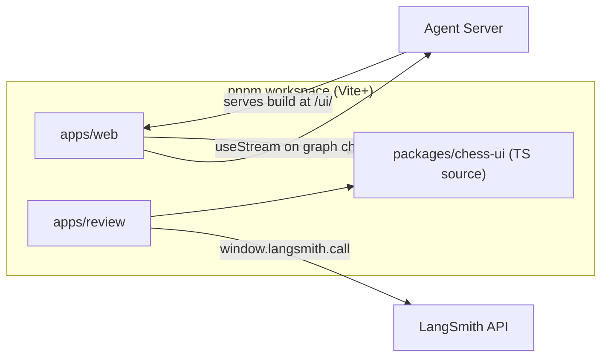
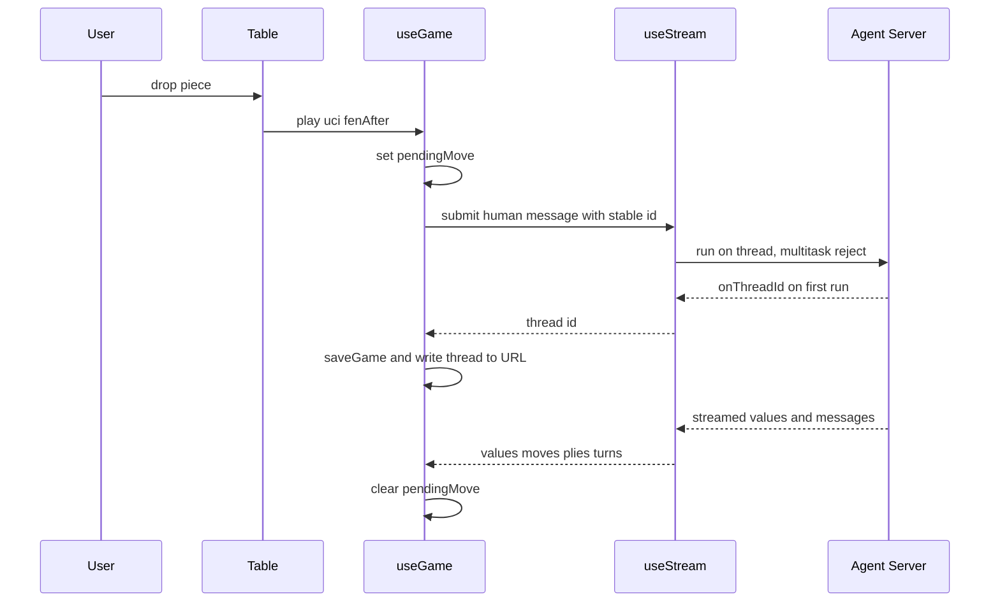

# Web Frontends

The JavaScript side of the repository has three packages in one pnpm workspace. `apps/web` is the play UI. `apps/review` is a LangSmith custom app for looking at graded games. `packages/chess-ui` holds the board, move list, types and selectors that both apps use (`pnpm-workspace.yaml`). None of them import Python. The web app reaches the agent over the Agent Server HTTP API. The review app only talks to the LangSmith API. For the server side of that boundary, see [Agent Server integration](/openwiki/integrations/agent-server.md). For the thread values the UIs read, see [State record](/openwiki/concepts/state-record.md).

*The two apps, the shared package, and the one remote system each app talks to.*

## apps/web: the play UI

### Entry and served location

`src/main.tsx` mounts `App` inside `StrictMode`, `AppThemeProvider` and `TooltipProvider`. The Vite config builds with `base: "/ui/"` and writes the bundle into `apps/server/langchain_chess_server/static` (`apps/web/vite.config.ts`). In production, the Python app (`apps/server/langchain_chess_server/app.py`) mounts that directory at `/ui` and redirects `/ui` to `/ui/`. It mounts under `/ui` rather than `/` because `/` is the server's health check. When no build exists, `/ui/` returns a 404 that tells you to run `mise run build` or `vp dev`.

`apiUrl()` in `src/settings.ts` decides where the API is:

1. If `VITE_API_URL` is set, it uses that.
2. Otherwise, under `vp dev`, it uses `http://localhost:2024` (`langgraph dev`).
3. Otherwise it uses `window.location.origin`, since production serves the UI from the same origin.

The build splits vendor code into long-lived chunks (react, langchain, chessboard, ui). There is deliberately no catch-all vendor group, so the lazily loaded Markdown chunk stays separate.

### useGame: one useStream, one thread, one game

`useGame(apiKey, context, humanSide)` in `src/useGame.ts` is the only connection to the agent. It opens one `useStream<ChessValues>` from `@langchain/react` with `assistantId: "chess"`, the chosen `apiKey` (omitted when empty) and the current `threadId`. Everything the page renders is derived from `stream.values`:

- It replays `start_fen` plus `moves` with chess.js (`replay` from chess-ui) to get the board FEN and fallback SANs.
- It builds move-list entries from `plies`, falling back to SAN and then UCI. Moves without a ply are labelled `external`.
- `lastReply` is the last ply whose source isn't `external` (`lastPolicyPly`), plus its turn record (`turnOf`) and the FEN it was chosen from.
- While a run is streaming, `liveAnalysis` shows the newest AI text after the current turn opened. It skips messages that already committed a ply, so the previous move's analysis never shows up as live.
- `pendingTurn` is true when the last turn record has status `pending` (`isPending`).

Every submit goes through one `send` helper. It passes `config: { configurable, run_name: "chess-web", tags: ["web"] }`, `metadata: { surface: "web" }` and `multitaskStrategy: "reject"`. The `configurable` object contains exactly the `ChessContext` fields and nothing else (`configurableOf`).

The hook exposes three actions:

| Action | What it sends | When the UI offers it |
|---|---|---|
| `play(uci, fenAfter)` | a human message whose content is the UCI move | when you drop a piece on an unlocked board |
| `start()` | a human message `go` | "Start" / "Ask opponent to move": opponent to move, no pending turn |
| `retry()` | empty input `{}`, which resumes the pending turn | "Retry": a run failed mid-turn (pending turn) |

A fresh `go` would be rejected while a turn is pending, so after a failure the only way forward is an empty submit. `play` is optimistic: it stores a `pendingMove` (UCI and FEN after the move) and the board shows it until the submit settles, whether it succeeds or fails.

### Thread in the URL

A game is a thread, and the page records the thread in the `?thread=` query parameter. `threadFromUrl` reads it when the page mounts, and `writeThreadToUrl` updates it with `history.replaceState`, so no history entries are added. When `useStream` reports a new thread id through `onThreadId`, the hook:

1. saves a game record (side and context) to localStorage under `langchain-chess:game:<threadId>`,
2. binds the thread id in state,
3. writes it into the URL.

This happens only while the hook is still mounted. A replaced game's stream can report its id late, and that report must not rebind the page. On reload, `App` finds the thread in the URL, loads the pinned side and context with `loadGame`, and reopens the same thread (`src/App.tsx`, `src/storage.ts`).

To start a new game or a rematch, `App` clears the URL parameter and creates a new `Seat` with a higher `number`. The `Table` is keyed by that number, so it remounts and `useStream` starts with `threadId: null`, which makes a fresh thread. If the human plays Black, the seat has `autoStart` set and the table sends `go` once when it mounts. A ref guards that effect, because StrictMode runs mount effects twice.

*One human move, from the drop to the settled thread values.*

### Command ids make resends idempotent

Every human command gets a message id from `createCommandIds()` in `src/commands.ts`, keyed by `commandKey(threadId, ply, content)`, which produces `"<threadId|new>:<ply>:<content>"`. The id generator is a memo held for the lifetime of the hook. The same command at the same position in the same thread always reuses the same id, and a different key gets a new `crypto.randomUUID()`. The server treats a message id it has already consumed as a no-op, so re-sending a command can't play a move twice. Do not mint a fresh id for an existing key.

The `Table` wraps every action in `issue()`. It clears the dismissed notice and any earlier submit error. It swallows the SDK's "a run is already in flight" rejection (`isBusyRejection`), because the first command's answer is already on its way. Any other submit failure is shown.

### Table state, locking and errors

The board is locked in any of these cases:

- you are viewing an earlier ply,
- a run is loading,
- the game is over,
- a turn is pending,
- an optimistic move is in flight.

Stepping back through plies (`BoardControls`, `usePlyKeys`, clicking the move list) replays from `startFen`. A move that arrives meanwhile leaves you where you are until you go back to the end.

Errors come from three places:

- `values.error` is a move rejection recorded in graph state. It appears as a dismissible "Move rejected" banner and comes back on the next command.
- `stream.error` and submit failures appear as an `ErrorMessage`.
- Auth failures show a "LangSmith API key needed" banner that links to Settings. `isAuthError` detects them from HTTP status 401/403 or from matching message text (`src/format.ts`).

### New game dialog and settings

With no game on screen, the New game dialog *is* the page: it can't be closed, and it has no close button. The overlay state lets you open Settings from the dialog and return to it with your unsaved picks (`draft`) intact.

The dialog edits a `Setup`: side (White, Black or Random), System 1 model or none, LLM preset, custom spec or none, and the Advanced knobs. `matchupOf` turns a setup into a `ChessContext`:

- The policy is `hybrid` when both a System 1 model and an LLM are chosen, `systemone` or `llm` when only one is chosen.
- Choosing neither is not playable. Neither is an empty custom spec.
- The model the policy doesn't use is still filled with its default, because the field is required (`src/setup.ts`).

Advanced settings only show the sections that matter for the chosen matchup. Gate and shortlist knobs appear only for hybrid. After a game starts, the opponent card lists the knobs that differ from the defaults (`changedKnobs`).

Pressing Play does two things:

1. It checks the API key. `checkApiKey` POSTs `{limit: 1}` to `/assistants/search` with `x-api-key` when a key is set. Any status other than 401/403 counts as ok. A 401/403 means `missing` if no key was sent and `rejected` if one was. A network error means `unreachable`. Because `langgraph dev` accepts anything, an empty key only counts as missing when the server says so (`src/auth.ts`).
2. If the key is ok, it saves the setup, resolves a Random side once (the game keeps that colour), and seats the game. The context is pinned to the game for its whole life.

If the dialog unmounts while the check is running, a late answer does nothing.

The API key is the only app-level setting. It is stored under `langchain-chess:app` and sent as `apiKey` to `useStream`.

**Where the settings schema comes from.** The server exposes `GET /ui/config`, which returns `{ graph, schema, defaults }` built from the Python `ChessContext` (`app.py`). The current web client does not fetch it. The knob types, ranges and defaults are hand-mirrored in `packages/chess-ui/src/types.ts` (`ChessContext`, `DEFAULT_CONTEXT`) and `apps/web/src/settings.ts` (`CONTEXT_CHECKS`). The header of `types.ts` says to keep them in step with the Python by hand. If you add a context field, update all three places.

### Persistence is untrusted

All localStorage readers accept missing, old or corrupt entries (`src/storage.ts`):

- `sanitizeContext` keeps only known knobs with valid values. Each failing knob falls back to its own default, so obsolete storage can't reach a run.
- `sanitizeSetup` and `sanitizeGame` do the same field by field.
- Legacy keys are migrated: the old global `langchain-chess:settings` blob, which held both the key and a context, and side-only `langchain-chess:side:<thread>` entries. A legacy side entry gets the default context.

## packages/chess-ui: shared source, not a built library

`@langchain-chess/chess-ui` is private, and its `exports` point directly at TypeScript source: `.` is `./src/index.ts`, and there are also `./styles.css` and `./testing` (`packages/chess-ui/package.json`). The package has no build step. Each app compiles it as part of its own Vite build, through the `workspace:*` dependency. Because of this:

- Each app's Tailwind `content` globs include `../../packages/chess-ui/src/**` (`apps/web/tailwind.config.cjs`), so utility classes used in the shared components get generated.
- Each app imports `@langchain-chess/chess-ui/styles.css` next to the Macaw stylesheet (`apps/web/src/index.css`).
- React and React DOM are peer dependencies, so there is exactly one React.

What the package provides (`src/index.ts`):

- **Types** (`types.ts`): hand-written TypeScript copies of the Python state and context. They include `ChessValues`, which lists the only thread channels a UI may read (`messages`, `start_fen`, `moves`, `plies`, `turns`, `outcome`, `error`), and state-API private channels must never be read. They also include `Ply`, `TurnRecord`, `Outcome`, `SystemOneMeta`, `ChessContext`/`DEFAULT_CONTEXT`, and `Quality` for graded moves.
- **Chess helpers** (`chess.ts`): `replay` rebuilds positions and stops quietly at the first move chess.js rejects, because the server is the authority. `tryMove` is the client-side legality check on drag, and the graph validates the move again on the server. The file also has `sideToMove`, `opposite` and `fenOrStart`.
- **Selectors** (`selectors.ts`): pure reads over thread values. They are `lastPolicyPly`, `turnOf`, `isPending`, `liveAnalysis`, `systemOneMeta` (reads the `SystemOneMiddleware` ply meta), and `turnCost`, which mirrors the Python pricing and makes a move cost its whole turn.
- **Components**: `Board`, `BoardControls`, `MoveList` (optionally shows a per-ply `quality`), `PlyDetails`, `Analysis` (lazy Markdown), and the keyboard hook `usePlyKeys`.
- **`./testing`**: fixture builders (`call`, `turn`, plies) for tests.

## apps/review: reading graded games in LangSmith

`apps/review` runs inside LangSmith's custom-app sandbox. It is a library build that produces one CommonJS `dist/bundle.js` with everything inlined:

- Code splitting is off, because the sandbox can't load chunks.
- `process.env.NODE_ENV` is defined as `"production"`, because the sandbox has no `process` (`apps/review/vite.config.ts`).

The sandbox calls the exported `render(data, container, metadata)` on every host update. The entry creates the root and the inline stylesheet once and re-renders in place. It follows the host's light or dark mode (`src/entry.tsx`, `HostTheme`). Its only connection to the outside is `window.langsmith.call` and `openUrl` (`src/global.d.ts`). Tests inject `call` through `createApi(call)`.

Data flow (`src/api.ts`):

1. `GET /api/v1/sessions` lists projects. The default pick is `langchain-chess-app`, then any project whose name contains `chess`, then the most recent.
2. `POST /api/v2/threads/query` returns a page of 20 threads for the chosen project and time window (1, 7, 30 or 90 days). Paging uses a cursor.
3. For each thread's `last_trace_id`, two requests run in parallel:
   - `POST /api/v2/runs/query` fetches the root runs with metadata and outputs, bounded by `min_start_time` to avoid heavier rate limits.
   - `GET /api/v1/feedback` fetches feedback with key `game_review`.
4. `toGame` joins them. `values` is the last run's outputs only when they contain a `moves` array. Otherwise the game shows "No game record". The matchup label is derived from run metadata (`policy`, `model`, `systemone_model`).

`reviewsByRun` (`src/review.ts`) keeps a feedback item only if all of these hold:

- its key is `game_review`,
- `feedback_source.metadata.grader` is `"lcchess grade"`,
- its value parses as a version-1 `GameReview` with `evals` and `plies` arrays.

Other feedback under the same key is ignored. `App` tags each loaded page with its `project|since` query, so a stale response is never shown for a new query.

`GameView` renders the game with the shared components:

- It rebuilds FENs for every position and marks move-list entries with each ply's `quality`.
- It draws the played move as an arrow, plus the engine's `best_move` when that differs.
- With a review, it shows an eval bar (`evals[index]`, one per position including the start), a `GradeCard`, and an `EvalGraph`. Win percentages mirror the Python `win_percent`, clamped at ±1000 cp.
- Without a review, it shows a hint to run `lcchess grade --thread <id>`.
- "Open trace" resolves the run URL on the server (`GET /api/v2/runs/{id}/url`), so the host and workspace are correct on any deployment.

How reviews are produced is covered in [Grading and review](/openwiki/workflows/grading-and-review.md).

## Vite+ workspace conventions

- **Tooling.** Every package uses Vite+ (`vp`): `vp dev`, `vp build`, `vp test --run --coverage`. At the root, `vp check`, `vp run -r test` and `vp run -r build` run across the workspace (`package.json`). The review app's `dev` script is `langsmith apps dev`.
- **One version per shared dependency.** `pnpm-workspace.yaml` pins shared dependencies in a `catalog`, including `vite` aliased to `@voidzero-dev/vite-plus-core`. Every package refers to them as `catalog:`, so the apps and chess-ui can't drift. An override forces every `vite@*` to the catalog version.
- **Lint and format.** These are configured only in the root `vite.config.ts`, because Vite+ ignores `lint`/`fmt` blocks in nested configs. Oxlint runs with the react, typescript and oxc plugins, type-aware with type checking. Rules include `react/rules-of-hooks` and `vite-plus/prefer-vite-plus-imports`, which is why tests import `vi` from `vite-plus/test`. Formatting skips `apps/server`, `libs`, and `openwiki/**`.
- **Tests.** Each app runs jsdom Vitest over `tests/**/*.test.{ts,tsx}` with a **100% coverage threshold** on lines, functions, branches and statements. The review app writes coverage outside its own directory, because `langsmith apps push` uploads the directory without reading `.gitignore`. The web tests replace `useStream` with a shared fake (`apps/web/tests/support/fakeStream.ts`) that records every option set and supports per-thread overrides, so tests can hold two games apart. `App` takes injectable `random`, `checkKey` and `modelLimit`, so tests are deterministic and need no server. Focused suites include `useGame.test.tsx`, `commands.test.ts`, `storage.test.ts`, `setup.test.ts` and `auth.test.ts`. The review app has `logic.test.ts`, `App.test.tsx` and `entry.test.tsx`. See [Testing conventions](/openwiki/testing/testing-conventions.md).
est.ts`, `App.test.tsx` and `entry.test.tsx`. See [Testing conventions](/openwiki/testing/testing-conventions.md).
+ ignores `lint`/`fmt` blocks in nested configs. Oxlint runs with the react, typescript and oxc plugins, type-aware with type checking. Rules include `react/rules-of-hooks` and `vite-plus/prefer-vite-plus-imports`, which is why tests import `vi` from `vite-plus/test`. Formatting skips `apps/server`, `libs`, and `openwiki/**`.
- **Tests.** Each app runs jsdom Vitest over `tests/**/*.test.{ts,tsx}` with a **100% coverage threshold** on lines, functions, branches and statements. The review app writes coverage outside its own directory, because `langsmith apps push` uploads the directory without reading `.gitignore`. The web tests replace `useStream` with a shared fake (`apps/web/tests/support/fakeStream.ts`) that records every option set and supports per-thread overrides, so tests can hold two games apart. `App` takes injectable `random` and `checkKey`, so tests are deterministic and need no server. Focused suites include `useGame.test.tsx`, `commands.test.ts`, `storage.test.ts`, `setup.test.ts` and `auth.test.ts`. The review app has `logic.test.ts`, `App.test.tsx` and `entry.test.tsx`. See [Testing conventions](/openwiki/testing/testing-conventions.md).
conventions](/openwiki/testing/testing-conventions.md).
