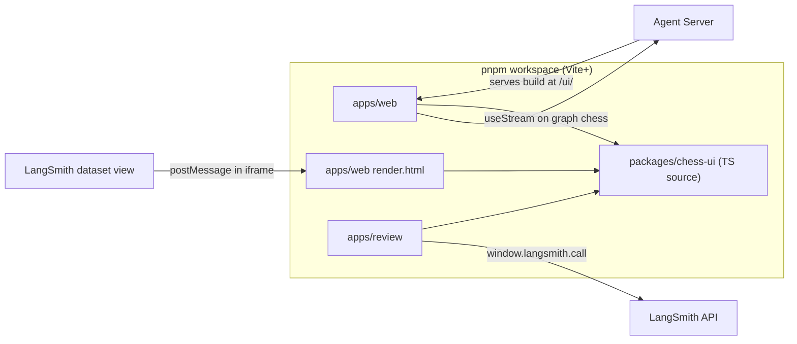
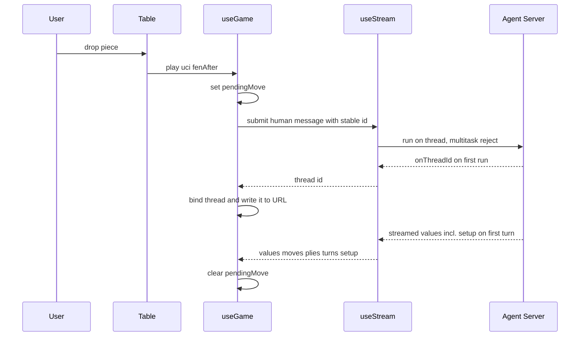
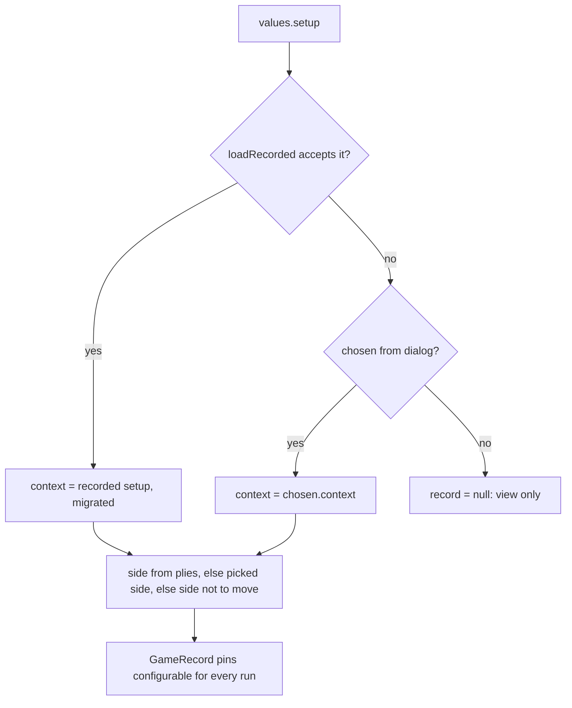
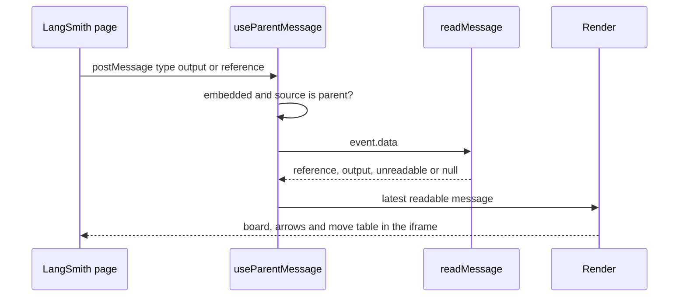

# Web Frontends

The JavaScript side of the repository is a pnpm workspace. Its frontend packages are `apps/web`, `apps/review` and `packages/chess-ui`; the workspace also contains `evals/reports` (`pnpm-workspace.yaml`).

- `apps/web` is the play UI. Its build also produces `render.html`, a LangSmith custom output renderer for the positions dataset.
- `apps/review` is a LangSmith custom app for looking at graded games and starting new grading jobs.
- `packages/chess-ui` holds the board, move list, types, selectors and the settings model that both apps use.

None of them import Python. The play UI reaches the agent over the Agent Server HTTP API. The renderer fetches nothing: it only reads messages that LangSmith posts to it. The review app only talks to the LangSmith API. For the server side of that boundary, see [Agent Server integration](/openwiki/integrations/agent-server.md). For the thread values the UIs read, see [State record](/openwiki/concepts/state-record.md). For the settings themselves, see [Settings and model arguments](/openwiki/concepts/settings-and-model-arguments.md).

*The apps, the shared package, and the one remote system each one talks to.*

## apps/web: the play UI

### Entry and served location

`src/main.tsx` mounts `App` inside `StrictMode`, `AppThemeProvider` and `TooltipProvider`. The Vite config builds with `base: "/ui/"` and writes the bundle into `apps/server/langchain_chess_server/static` (`apps/web/vite.config.ts`). There are two build inputs: `index.html` (the play UI) and `render.html` (the output renderer, see [below](#renderhtml-the-langsmith-output-renderer)). In production, the Python app (`apps/server/langchain_chess_server/app.py`) mounts that directory at `/ui` and redirects `/ui` to `/ui/`. It mounts under `/ui` rather than `/` because `/` is the server's health check. When no build exists, `/ui/` returns a 404 that tells you to run `mise run build` or `vp dev`.

`apiUrl()` in `src/settings.ts` decides where the API is:

1. If `VITE_API_URL` is set, it uses that.
2. Otherwise, under `vp dev`, it uses `http://localhost:2024` (`langgraph dev`).
3. Otherwise it uses `window.location.origin`, since production serves the UI from the same origin.

The build splits vendor code into long-lived chunks (react, langchain, chessboard, ui). Vite's preload helper gets a chunk of its own, because otherwise it lands in the langchain chunk and `render.html`, which needs no LangChain code, would download all of it. There is deliberately no catch-all vendor group, so the lazily loaded Markdown chunk stays separate.

### useGame: one useStream, one thread, one game

`useGame(apiKey, chosen)` in `src/useGame.ts` is the only connection to the agent. It opens one `useStream<ChessValues>` from `@langchain/react` with `assistantId: "chess"`, the chosen `apiKey` (omitted when empty) and the current `threadId`. `chosen` is a new game's side and context (a `GameRecord`). It is used only until the thread records its own setup, and it is `null` for a game opened from a link. Everything the page renders is derived from `stream.values`:

- It replays `start_fen` plus `moves` with chess.js (`replay` from chess-ui) to get the board FEN, the FEN after every move, and fallback SANs.
- It builds move-list entries from `plies`, falling back to SAN and then UCI. Moves without a ply are labelled `external`.
- `record` is the game's side and context, from `gameOf(values, chosen)` (see [Continuing a game from its thread](#continuing-a-game-from-its-threads-setup-record)).
- `reply` drives the reply card. While a run is streaming it is `thinking`, with `liveAnalysis` as the text so far: the newest AI text after the current turn opened, skipping messages that already committed a ply, so the previous move's analysis never shows up as live. Otherwise it is the last ply whose source isn't `external` (`lastPolicyPly`), plus its turn record (`turnOf`) and the FEN it was chosen from.
- `pendingTurn` is true when the last turn record has status `pending` (`isPending`).
- `restore` says whether the thread has loaded (see below).

Every submit goes through one `send` helper. It passes `config: { configurable, run_name: "chess-web", tags: ["web"] }`, `metadata: { surface: "web" }` and `multitaskStrategy: "reject"`. `configurable` comes from `configurableOf(record.context)`: the settings `version` first, then every setting key in order, and nothing else. The same object is what an exported settings file contains. When there is no record, `DEFAULT_CONTEXT` stands in, but in that case the board stays locked, so the stand-in never reaches a run.

The hook exposes three actions:

| Action | What it sends | When the UI offers it |
|---|---|---|
| `play(uci, fenAfter)` | a human message whose content is the UCI move | when you drop a piece on an unlocked board |
| `start()` | a human message `go` | "Start" / "Ask opponent to move": opponent to move, no pending turn |
| `retry()` | empty input `{}`, which resumes the pending turn | "Retry": a run failed mid-turn (pending turn) |

A fresh `go` would be rejected while a turn is pending, so after a failure the only way forward is an empty submit. `play` is optimistic: it stores a `pendingMove` (UCI and FEN after the move) and the board shows it until the submit settles, whether it succeeds or fails.

### Thread in the URL and loading

A game is a thread, and the page records the thread in the `?thread=` query parameter. `threadFromUrl` reads it when the hook mounts, and `writeThreadToUrl` updates it with `history.replaceState`, so no history entries are added. When `useStream` reports a new thread id through `onThreadId`, the hook binds it in state and writes it into the URL. This happens only while the hook is still mounted. A replaced game's stream can report its id late, and that report must not rebind the page. The browser stores nothing per game: the game's settings live in the thread itself.

A game from the URL can only be played once it has loaded. `restore` tracks each load by the SDK's `hydrationPromise`:

- `loading` while `isThreadLoading`,
- `missing` when a load for a thread id settles cleanly but binds no thread (the SDK settles a 404 that way),
- `failed` when the load rejects,
- `ready` otherwise.

A superseded load that settles late can't overwrite the current one's outcome. A changed API key creates a new client, which loads the thread again. The `Table` shows a "Couldn't load this game" banner with a Reload button for `failed`, and a "This game isn't on the server" banner for `missing`. Reload remounts the table on the same thread (a new seat number, same URL).

To start a new game or a rematch, `App` clears the URL parameter and creates a new `Seat` with a higher `number` and a `chosen` record (a rematch swaps sides and keeps the context). The `Table` is keyed by that number, so it remounts and `useStream` starts with `threadId: null`, which makes a fresh thread. If the human plays Black, the seat has `autoStart` set and the table sends `go` once when it mounts. A ref guards that effect, because StrictMode runs mount effects twice.

*One human move, from the drop to the settled thread values.*

### Continuing a game from its thread's setup record

Any client can continue a game from its thread alone, because the server records the game's settings in the thread. `GameSetupMiddleware` (`apps/server/langchain_chess_server/game_setup.py`), which `build_graph` adds to every run's graph (`graph.py`), adds a public `setup` channel to the graph state. It writes the run's resolved `ChessContext` (every key of its version) into `setup` only in the run that opened the game's first turn, and never again. It does this both before and after the agent, so the record exists even when the first turn fails or ends the game. Later runs still play with whatever context they send, but `setup` keeps naming the first turn's settings. A thread created before `setup` existed never gets one. The middleware state marks `setup` as `OmitFromInput`, so a client can't write it.

On the client, `ChessValues.setup` mirrors that channel as `unknown`, and `gameOf(values, chosen)` in `src/setup.ts` produces the game's `GameRecord`:

- **Context.** It uses `recordedContext(values.setup)`, which wraps chess-ui's `loadRecorded`. This is strict: the record needs a valid `version` and exactly the keys of that version, each valid, or it counts as damaged. A context patched with defaults would play a different game. A record from an older settings version is migrated to the current one (version 2 only added keys, whose defaults play as version 1 did). When there is no valid record, it falls back to `chosen.context`, which covers a new game before its first turn is recorded. If neither exists, the record is `null`.
- **Human side** (`humanSideOf`). The human plays the `external` moves, so the side of the last external ply decides. Before any external ply, the human is the opposite of whoever played ply 0. Before any move at all, it is the picked side, or else the side *not* to move, because the opponent's first turn is still open.

*How the web UI decides which setup a thread is played with.*

So opening a link `?thread=<id>` creates a seat with `chosen: null`. Once the thread loads, its `setup` supplies the opponent and knobs, and its plies supply the human's colour. Every later command sends exactly that context as `configurable`. A thread with no readable `setup` (older games, or a damaged record) gets `record === null`: the board stays locked, the status says "View only.", the opponent card shows "Unknown", and a "View only" banner suggests starting a new game.

### Command ids make resends idempotent

Every human command gets a message id from `createCommandIds()` in `src/commands.ts`, keyed by `commandKey(ply, content)`, which produces `"<ply>:<content>"`. The key deliberately leaves out the thread id, because a new game's first command is sent before the server assigns one. The id memo lives for the lifetime of the hook, which is one game, since the table remounts for a new game. The same command at the same position always reuses the same id, and a different key gets a new `crypto.randomUUID()`. The server treats a message id it has already consumed as a no-op, so re-sending a command can't play a move twice. Do not mint a fresh id for an existing key.

The `Table` wraps every action in `issue()`. It clears the dismissed notice and any earlier submit error. It swallows the SDK's "a run is already in flight" rejection (`isBusyRejection`), because the first command's answer is already on its way. Any other submit failure is shown.

### Table state, locking and errors

The board is locked in any of these cases:

- the game has no record, or has not finished loading (`restore !== "ready"`),
- you are viewing an earlier ply,
- a run is loading,
- the game is over,
- a turn is pending,
- an optimistic move is in flight.

Stepping back through plies (`BoardControls`, the arrow keys, clicking the move list) goes through chess-ui's `usePlyCursor` and shows the FENs `useGame` already replayed. At the end the cursor follows the game; on an earlier ply, a move that arrives meanwhile leaves you where you are until you go back to the end.

Errors come from these places:

- `values.error` is a move rejection recorded in graph state. It appears as a dismissible "Move rejected" banner and comes back on the next command.
- `stream.error` and submit failures appear as an `ErrorMessage`.
- Auth failures show a "LangSmith API key needed" banner that links to Settings. `isAuthError` (`src/format.ts`) detects them from HTTP status 401/403, or from SDK request messages that *start* with `HTTP 401/403`, `Protocol request failed: 401/403` or `Thread state request failed: 401/403`. The match is anchored so that a failed run's message, such as a model provider's 401, isn't mistaken for the browser's key being refused.
- Load failures show the `failed` / `missing` banners described above.

### New game dialog and settings

With no game on screen, the New game dialog *is* the page: it can't be closed, and it has no close or Cancel button. The overlay state lets you open Settings from the dialog and return to it with your unsaved picks (`draft`) intact. The header's gear button opens Settings directly when a game is on screen.

The dialog edits a `Setup`: side (White, Black or Random), System 1 model or none, LLM preset, custom spec or none, and the Advanced knobs. `matchupOf(setup, summarize)` turns a setup into a `ChessContext`:

- The policy is `hybrid` when both a System 1 model and an LLM are chosen, `systemone` or `llm` when only one is chosen.
- Choosing neither is not playable. Neither is an empty custom spec, nor `model_kwargs` that the server would hold back (`modelKwargsProblems(..., "server")`) when an LLM plays.
- `memory` is a boolean; its "Summarize" option means on. If an LLM is chosen with memory on, the matchup is blocked while the model's limit is being checked (`checking`) and when the check couldn't be made (`unknown`, which comes with a Retry button). A model with no known limit (`no`) has memory turned off (`memoryOf`).
- The model the policy doesn't use is still filled with its default, because the field is required (`src/setup.ts`).

Number fields and the model-arguments JSON field in Advanced settings keep their own text; while that text isn't a valid value, Play is blocked ("Fix the Advanced settings marked invalid"). Advanced settings only show the sections that matter for the chosen matchup. Gate and shortlist knobs appear only for hybrid. Each setting's label and tooltip come from the generated `SETTING_LABELS` and `SETTING_HELP`. After a game starts, the opponent card lists the knobs that differ from the defaults (`changedKnobs`) and shows the thread id.

**Model limit.** The dialog asks the server for the chosen LLM's input limit through `GET /ui/model-limit?model=…` (`src/modelLimit.ts`), sending `x-api-key` when a key is set. It waits 300 ms (`LIMIT_DELAY_MS`) so typing a custom spec doesn't flood the server. The answer is one of three kinds. `known` means the limit is a number. `none` means `max_input_tokens` is `null`: the model has no known limit or can't be built. `failed` covers a non-OK response, a malformed body or a network error, and says nothing about the model. These map to `summarize` values `yes`, `no` and `unknown`. The Summarize memory option is disabled only for `no`. An answer that arrives for a model that is no longer selected is dropped, and a changed API key asks again.

Pressing Play does two things:

1. It checks the API key. `checkApiKey` POSTs `{limit: 1}` to `/assistants/search` with `x-api-key` when a key is set. Any status other than 401/403 counts as ok. A 401/403 means `missing` if no key was sent and `rejected` if one was. A network error means `unreachable`. Because `langgraph dev` accepts anything, an empty key only counts as missing when the server says so (`src/auth.ts`). A failed check shows a banner with an "Open settings" action.
2. If the key is ok, and the picks on screen are still the ones Play was pressed for and still playable, it saves the setup, resolves a Random side once (the game keeps that colour), and seats the game with that side and context as `chosen`.

If the dialog unmounts while the check is running (cancelled, or sent to Settings), a late answer does nothing. If the picks were edited during the check, the answer doesn't start a game and you have to press Play again.

The API key is the only app-level setting. The Settings dialog trims it, stores it under `langchain-chess:app`, and it is sent as `apiKey` to `useStream`.

### Settings import and export files

An opponent's settings can leave and enter the app as a JSON file (`src/files.ts` is the imperative edge; the parsing is pure):

- **Export.** The dialog's Export button is enabled only while the matchup is playable, and downloads `opponent.json` containing `configurableOf(context)`. The opponent card of a game with a record has the same Export for the game's own context. So an exported file is exactly what a run sends as `configurable`: `version` first, then every setting.
- **Import.** The dialog's Import button opens a file picker. `readJson` rejects a file that isn't JSON ("That file isn't JSON."). `importedSetup(data, side)` then runs chess-ui's `loadSettings`: the file needs a `version` no newer than the app's, may set any subset of settings, rejects unknown keys and invalid values, and is resolved over the defaults. A valid file replaces the pickers and knobs (`setupOf`) but keeps the side you picked, and remounts Advanced so its text fields show the imported values. A failure shows "Couldn't import that setup" with the `SettingsError` message. A read that finishes after the dialog unmounted is dropped.

The same file format is what the Python side loads (see [Settings and model arguments](/openwiki/concepts/settings-and-model-arguments.md)).

### Persistence is untrusted

localStorage holds three things (`src/storage.ts`): the last New game setup (`langchain-chess:setup`), the app settings (`langchain-chess:app`), and which reply-card sections are open (`langchain-chess:view`). A game's own setup lives in its thread. Every reader accepts missing, old or corrupt entries, and also blocked storage:

- `browserStorage()` returns `null` when reading `localStorage` throws or every call on it throws. Writers report whether the write landed. When storage is blocked, or a save fails, `App` shows a "This browser isn't saving" banner.
- A stored setup carries the settings `version` its knobs are in (`storedSetup`). `sanitizeSetup` treats a setup without a version as the defaults, and otherwise falls back field by field. Its knobs go through `sanitizeContext`, which migrates them from their version dropping unknown keys, then keeps each valid value on its own and gives each failing one its default. If the version itself can't be read, no stored knob is trusted. So obsolete storage can't reach a run.
- The view toggles fall back to their defaults one by one.

## render.html: the LangSmith output renderer

`render.html` mounts `src/render/main.tsx`, a separate small React app that LangSmith embeds in an iframe as the positions dataset's custom output renderer. The deployed page is `/ui/render.html`; `lcchess-evals positions upload --renderer-url <https URL>` writes it into the dataset's `iframe_config`, which must be an absolute `https://` URL (`evals/langchain_chess_evals/positions/upload.py`). See [System 1 evals](/openwiki/workflows/system-one-evals.md) for the dataset.

**Protocol.** LangSmith posts each run's outputs, or the example's reference outputs, as `{type: "output" | "reference", data, metadata: {inputs}}`. `useParentMessage` (`src/render/useParentMessage.ts`) listens for `message` events and keeps the latest one it can read. It accepts a message only when the page is embedded (`window.parent !== window`) and the event's `source` is the embedding window. It deliberately checks the source window rather than an origin, because self-hosted LangSmith can live on any origin; the embedded check matters because a top-level page is its own parent.

**Parsing.** `readMessage` (`src/render/messages.ts`) is pure. It returns `null` for anything that isn't an `output` or `reference` message, so the page ignores other traffic. Otherwise it returns one of:

- `reference`: the position plus Stockfish's `evals` (per move, centipawns or mate from White's side) and `ranked` (every legal move, best first; every ranked move needs an eval).
- `output`: the position plus System 1's ranking, either `ranked` moves with `confidence`, `margin`, `tournament`, `requests` and `latency_ms`, or a `failed` ranking carrying the run's `error`.
- `unreadable`, with the first reason found.

The position comes from `metadata.inputs` (`start_fen`, `moves`, `legal`): the start FEN must be valid and every move must replay legally, or the message is unreadable. These shapes mirror the evals dataset schema and System 1's eval target outputs.

**Views.** `Render` draws a locked chess-ui `Board` from the mover's side with the top three moves as arrows, and next to it either a Stockfish table of every move with its eval (`evalText` shows it from the mover's side, such as `+0.4` or `mate in 3`), or System 1's top five moves as `MoveBar`s (with "Show all") plus confidence, margin, tournament, requests and latency. A failed ranking shows a "Ranking failed" banner; an unreadable message shows "Not a chess position". Before any message it says it is waiting for LangSmith, or, when opened on its own, how to set it as the renderer. LangSmith sends no theme, so the page follows the system's colour scheme and never the play UI's stored choice (`storageKey={null}`).

`render-preview.html` is a dev-only page (`vp dev`, then `/ui/render-preview.html`) that embeds the renderer several times and posts sample messages from `preview/samples.ts`. It is not a build input, so it never deploys. The same samples drive `tests/render/messages.test.ts`.

*How a LangSmith run reaches the renderer's board.*

## packages/chess-ui: shared source, not a built library

`@langchain-chess/chess-ui` is private, and its `exports` point directly at TypeScript source: `.` is `./src/index.ts`, and there are also `./styles.css` and `./testing` (`packages/chess-ui/package.json`). The package has no build step. Each app compiles it as part of its own Vite build, through the `workspace:*` dependency. Because of this:

- Each app's Tailwind `content` globs include `../../packages/chess-ui/src/**` (`apps/web/tailwind.config.cjs`, which also lists `index.html` and `render.html`), so utility classes used in the shared components get generated.
- Each app imports `@langchain-chess/chess-ui/styles.css` next to the Macaw stylesheet (`apps/web/src/index.css`).
- React and React DOM are peer dependencies, so there is exactly one React.

What the package provides (`src/index.ts`):

- **Generated settings** (`generated/settings.ts`): `mise run generate:settings` runs `langchain_chess_server.codegen`, which writes the settings' TypeScript and JSON Schemas (`settings.schema.json`, `opponent.schema.json`) from the Python `ChessContext`. The TypeScript holds `SETTINGS_VERSION`, the `ChessContext` interface with each setting's description, `SETTING_SPECS` (type, enum values, ranges, nullability), `SETTING_LABELS` and `SETTING_HELP` for the web form, `DEFAULT_CONTEXT`, the frozen `VERSION_DEFAULTS` of every version, and `MODEL_KWARGS_RULES`. Do not edit it by hand: a server test (`apps/server/tests/test_codegen.py`) fails when the committed files are stale, and the formatter skips the directory.
- **Settings logic** (`settings.ts`): a hand-written mirror of `libs/systemone/langchain_chess_systemone/settings.py`. `isSetting` checks a value against its spec (and `model_kwargs` against the local rules), `migrateSettings` carries a partial set of settings to the current version, `loadSettings` reads a settings file, `loadRecorded` reads a game's recorded setup, and `modelKwargsProblems`, `heldBack` and `sentEffort` mirror the Python model-argument rules. Its tests run the shared cases in `libs/systemone/tests/fixtures/settings-cases.json`, so the TypeScript and Python loaders give the same answers. The web app's `CONTEXT_CHECKS` is derived from `SETTING_SPECS`, so no setting range is hand-copied any more.
- **Types** (`types.ts`): hand-written TypeScript copies of the Python state, which its header says to keep in step by hand. They include `ChessValues`, which lists the only thread channels a UI may read (`messages`, `start_fen`, `moves`, `plies`, `turns`, `outcome`, `error`, and `setup`, which older games don't have). State-API private channels must never be read. They also include `Ply`, `TurnRecord`, `Outcome`, `SystemOneMeta`, `RankedMove`, `ReplyState`, `PlyView` and `Quality` for graded moves.
- **Chess helpers** (`chess.ts`): `replay` rebuilds positions and stops quietly at the first move chess.js rejects, because the server is the authority; from a rejected move on, the position stays put. `tryMove` is the client-side legality check on drag, and the graph validates the move again on the server. The file also has `isPromotion`, `sideToMove`, `opposite`, `fullmoveNumber`, `isFen`, `fenOrStart` and `sanAt`.
- **Selectors** (`selectors.ts`): pure reads over thread values. They are `lastPolicyPly`, `turnOf`, `isPending`, `liveAnalysis`, `systemOneMeta` (reads the `SystemOneMiddleware` ply meta), and `turnCost`, which mirrors the Python pricing and makes a move cost its whole turn.
- **Components and hooks**: `Board` (drag or click-to-move, with a promotion picker and optional arrows; it reads the current position through a ref so a drag can't land after the board locked or moved on), `BoardControls`, `MoveList` (optionally shows a per-ply `quality`), `MoveBar`, `PlyDetails`, `Analysis` (lazy Markdown), and `usePlyCursor`, which uses the keyboard hook `usePlyKeys`.
- **`./testing`**: fixture builders (`call`, `turn`, plies) for tests.

The server still exposes `GET /ui/config`, which returns `{ graph, schema, defaults }` built from the Python `ChessContext` (`app.py`), but no frontend fetches it: the frontends compile the generated schema in instead. To add a setting, change the Python `ChessContext`, run `mise run generate:settings`, and update the shared cases and any web form section. Note that `loadRecorded` rejects a recorded `setup` that lacks a key of its version, so a record is only readable if its version's key set matches.

## apps/review: reading and grading games in LangSmith

`apps/review` runs inside LangSmith's custom-app sandbox. It is a library build that produces one CommonJS `dist/bundle.js` with everything inlined:

- Code splitting is off, because the sandbox can't load chunks.
- `process.env.NODE_ENV` is defined as `"production"` (except under Vitest), because the sandbox has no `process` (`apps/review/vite.config.ts`).

The sandbox calls the exported `render(data, container, metadata)` on every host update. The entry creates the root, the inline stylesheet and the app's dependencies (`api`, `openUrl`) once, and re-renders in place. A new `api` would re-run the App's loads and reset the chosen project. It follows the host's light or dark mode (`src/entry.tsx`, `HostTheme`). Its only connection to the outside is `window.langsmith.call` and `openUrl` (`src/global.d.ts`). Tests inject `call` through `createApi(call)`.

Data flow (`src/api.ts`):

1. `GET /api/v1/sessions` lists projects. The default pick is `langchain-chess-app`, then any project whose name contains `chess`, then the most recent.
2. `POST /api/v2/threads/query` returns a page of 20 threads for the chosen project and time window (1, 7, 30 or 90 days). Paging uses a cursor; a page appended by "load more" skips games already listed.
3. For each thread's `last_trace_id`, two requests run in parallel:
   - `POST /api/v2/runs/query` fetches the root runs with metadata and outputs, bounded by `min_start_time` to avoid heavier rate limits.
   - `GET /api/v1/feedback` fetches feedback with keys `game_review` and `grade_status`.
4. `toGame` (`src/games.ts`) joins them. `values` comes from `decodeValues` (`src/values.ts`). The project picker lists every project, so outputs can be anything. The last run's outputs count as a game record only if they validate: `moves` must be a UCI array, and the optional `start_fen`, `plies`, `turns` and `outcome` must have the shapes the view draws. Otherwise the game shows "No game record". The matchup label is derived from run metadata (`policy`, `model`, `systemone_model`).

`reviewsByRun` (`src/review.ts`) considers a feedback item only if its key is `game_review`, its `feedback_source.metadata.grader` is `"lcchess grade"`, and it has a `run_id`. Other feedback under the same key is ignored. `parseReview` then turns the value into a `Grading`:

- `graded` for a complete version-1 `GameReview`: engine, numeric settings, per-side accuracy, well-formed `evals` and per-ply grades, and exactly one eval per position.
- `invalid`, with the first problem found, otherwise.

`toGame` also marks a graded review `invalid` when its plies don't match the game's moves, so evaluations are never drawn against a different move sequence. `App` tags each loaded page with its `project|since` query, so a stale response is never shown for a new query. A "load more" is owned by the same query, so a new query cancels it instead of racing it. Refresh reloads every page on screen in place (`firstPages`), fetching further pages until the open game is among them, so the list and the open game stay up meanwhile.

**Analyze.** The review app can also start grading (`src/analysis.ts`). The Analyze button writes a `grade_status` feedback mark with value `analyzing` (grader `lcchess grade`) on the game's last run, creates a sandbox named after the thread from the `langchain-chess-grader` snapshot with an explicit, limited set of delegated permissions, waits for it to be ready, and launches `lcchess grade --project … --thread … --workers 4 [--force] --sandbox-job` detached inside it. It then lets go: the job replaces the game's feedback, settles or clears the mark, and deletes its sandbox. If the launch fails, the mark and any sandbox are removed and a readable reason is shown (sandboxes not enabled, missing snapshot, sandbox limit, already running, role not allowed). The sandbox name is per thread, so a second start on the same game conflicts instead of running twice. `marksByRun` reads this grader's newest mark per run; an `analyzing` mark older than 10 minutes counts as `stalled`, and a `failed` mark carries the job's log. Retrying a failed or stalled job first deletes the old sandbox and mark. How the grading itself works is in [Grading and review](/openwiki/workflows/grading-and-review.md).

`GameView` renders the game with the shared components:

- It rebuilds FENs for every position (`replay`) and marks move-list entries with each ply's `quality`.
- It draws the played move as an arrow, plus the engine's `best_move` when that differs.
- With a graded review, it shows an eval bar (`evals[index]`, one per position including the start), a `GradeCard`, an `EvalGraph`, and a Re-analyze button. Win percentages mirror the Python `win_percent`, clamped at ±1000 cp.
- `AnalysisBanner` shows where the game stands: "Analyzing…" while a job runs, "Analysis didn't finish" for a stalled one and "Analysis failed" with its log (both with Retry), "Analysis couldn't start" for a failed launch, "Review unreadable" for an `invalid` review (Re-analyze, or `lcchess grade --thread <id> --force`), and "Not graded yet" with an Analyze button (or `lcchess grade --thread <id>`) for an ungraded game.
- "Open trace" opens the graded ply's run (or the thread's last run) by resolving its URL on the server (`GET /api/v2/runs/{id}/url`), so the host and workspace are correct on any deployment.

## Vite+ workspace conventions

- **Tooling.** Every package uses Vite+ (`vp`): `vp dev`, `vp build`, `vp test --run --coverage`. At the root, `vp check`, `vp run -r test` and `vp run -r build` run across the workspace (`package.json`). The review app's `dev` script is `langsmith apps dev`.
- **One version per shared dependency.** `pnpm-workspace.yaml` pins shared dependencies in a `catalog`, including `vite` aliased to `@voidzero-dev/vite-plus-core`. Every package refers to them as `catalog:`, so the apps and chess-ui can't drift. An override forces every `vite@*` to the catalog version.
- **Lint and format.** These are configured only in the root `vite.config.ts`, because Vite+ ignores `lint`/`fmt` blocks in nested configs. Oxlint runs with the react, typescript and oxc plugins, type-aware with type checking. Rules include `react/rules-of-hooks` and `vite-plus/prefer-vite-plus-imports`, which is why tests import `vi` from `vite-plus/test`. Formatting skips `apps/server`, `libs`, the Python parts of `evals`, `openwiki/**`, and the generated `packages/chess-ui/src/generated/**`, which a test compares byte for byte.
- **Tests.** Each app runs jsdom Vitest over `tests/**/*.test.{ts,tsx}` with a **100% coverage threshold** on lines, functions, branches and statements. The review app writes coverage outside its own directory, because `langsmith apps push` uploads the directory without reading `.gitignore`. Most web tests replace `useStream` with a shared fake (`apps/web/tests/support/fakeStream.ts`). The fake records every option set, supports per-thread overrides so tests can hold two games apart, and exposes `hydrationPromise` and `getThread` so load outcomes can be simulated. `useGame.sdk.test.tsx` runs the real SDK over a stubbed `fetch` to pin how it settles a thread load. `App` takes injectable `random`, `checkKey` and `modelLimit`, so tests are deterministic and need no server. Focused suites include `useGame.test.tsx`, `commands.test.ts`, `storage.test.ts`, `setup.test.ts`, `settings.test.ts`, `files.test.ts`, `modelLimit.test.ts`, `auth.test.ts`, and the renderer's `tests/render/` suites. chess-ui's `settings.test.ts` runs the shared Python settings cases. The review app has `logic.test.ts`, `analysis.test.ts`, `components.test.tsx`, `App.test.tsx` and `entry.test.tsx`. See [Testing conventions](/openwiki/testing/testing-conventions.md).
