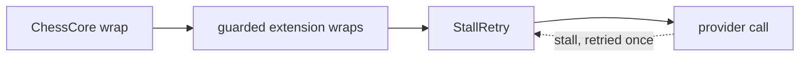
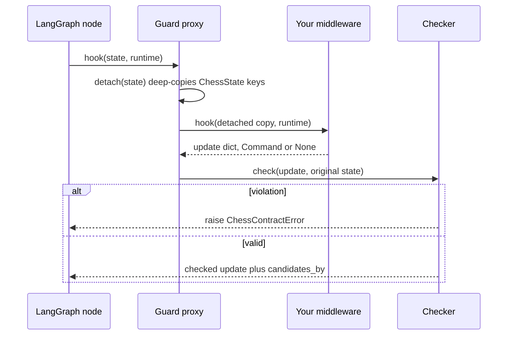
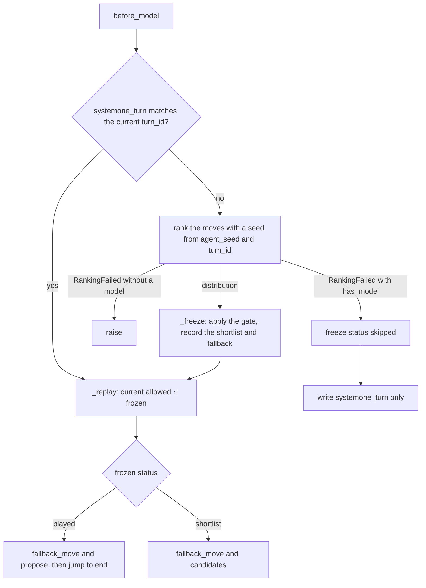

# The middleware contract

Every middleware passed to `create_chess_agent(middleware=[...])` is an extension. An extension can shape a turn in three ways: it can shrink the set of moves the agent may play, suggest moves to the LLM, or propose a move and skip the LLM. It cannot touch the game record. Two pieces enforce this:

- **`ChessMiddleware`** (`libs/chess/langchain_chess/contract.py`): an optional base class with helpers and the written rules.
- **The write guard** (`guard()` in the same file): a proxy generated around *every* user middleware, whether or not it subclasses `ChessMiddleware`. The proxy gives each hook a detached copy of the state and validates what the hook returns.

The module docstring says plainly that the guard **is not a security boundary**. Extensions run in-process as trusted code. The guard exists so that their mistakes fail loudly with a `ChessContractError` instead of quietly corrupting a game. Don't rely on it to contain untrusted code.

For the turn phases these hooks run inside, see [the turn lifecycle](/openwiki/architecture/turn-lifecycle.md). For the record clients read, see [the state record](/openwiki/concepts/state-record.md). For the main real extension, see [System One](/openwiki/architecture/system-one.md).

## Where extensions sit in the stack

`create_chess_agent` builds the stack in this order ([agent.py](/libs/chess/langchain_chess/agent.py)):

1. `ChessCore`
2. `ForcedMoveMiddleware`, when `forced_move=True`
3. the guarded extensions, in the order you passed them
4. `ChessSummarization` with `memory=True`, or a `NoSummarization` placeholder with `fixed_topology=True`. The placeholder keeps the graph's nodes the same whatever the `memory` setting is.
5. `StallRetry`, always, and always last.

It then calls `create_agent` with `tools=[]`, and with `NoModel()` when `model=None`. `NoModel` raises if it is ever called. Because `ChessCore` comes first, its `before_agent` opens or retries the turn before any extension runs. Its `wrap_model_call` is the outermost wrapper. Its `after_model` parses the reply, and its `after_agent` commits the turn after every extension hook has run. Extensions run in list order, so a later extension sees the narrowing and candidates written by earlier ones.

### Core-owned `StallRetry` stays last

`StallRetry` ([stall_retry.py](/libs/chess/langchain_chess/middleware/stall_retry.py)) is a `ModelRetryMiddleware` that the core appends itself. You never pass it, and it is not guarded. It retries only errors that mean the response stream stalled: `langchain_openai.StreamChunkTimeoutError`, or nothing at all when `langchain_openai` isn't installed. It retries once, with no delay, because the stall has already waited out the 120 s chunk timeout. It uses `on_failure="error"`, so a second stall raises and the pending turn's retry can resume it. With `"continue"`, the last stall would instead become the model's reply. It only wraps the model call, so it adds no graph node.

`create_agent` nests `wrap_model_call` wrappers in list order, so the last middleware is the innermost wrapper, the one closest to the provider. Putting `StallRetry` there means a retry repeats **only the provider call**. `ChessCore`'s wrapper, which prepares the prompt and keeps the call bookkeeping, runs once, and so does every user extension's wrapper. Summarization is a `before_model` hook, not a wrapper, so a stall retry never re-summarizes either. A stalled attempt records no call, because its usage would have come in the final chunk. User middleware can never sit after `StallRetry`, because `create_chess_agent` appends it after the extensions and the summarization slot. If it moved earlier, a stall would re-run the wrappers that come after it, including any user extension's wrapper or retry logic.

*Model-call wrappers from outermost to innermost. A stall retry never leaves the innermost layer.*

Construction also enforces some rules:

- `guard()` raises if the middleware has `tools` ("chess agents have none").
- `guard()` raises if an `a*` node hook is overridden but isn't a coroutine function.
- `guard()` copies `seed` onto `ChessMiddleware.agent_seed`. It raises if the instance is already bound to a different seed ("already bound to seed …; give each agent its own instance"). Agents with the same seed may share an instance.
- `create_chess_agent` raises if two extensions declare the same private state key.
- `create_chess_agent` raises if the compiled graph's input schema exposes anything beyond `messages` and `position`. This catches a key that isn't marked `PrivateStateAttr`/`OmitFromInput`, and a redeclared `ChessState` key.

The server's graph ([graph.py](/apps/server/langchain_chess_server/graph.py)) always ends up with two extensions and `fixed_topology=True`. For a run, `build_graph` calls SystemOne's `build_agent` ([agent.py](/libs/systemone/langchain_chess_systemone/agent.py)) with `middleware=[GameSetupMiddleware(settings)]`. `build_agent` puts a SystemOne middleware first, or its `NoSystemOne` stand-in for the `llm` policy, and then that middleware. For reads and introspection, `shape()` calls `create_chess_agent(None, middleware=[NoSystemOne(), GameSetupMiddleware(ChessContext())])` directly, so both paths build the same nodes.

## `ChessMiddleware` helpers

| Helper | What it gives you |
|---|---|
| `position(state)` → `PositionView` | A frozen snapshot of the turn: `start_fen`, `moves`, `allowed` (the current hard constraint), `initial_allowed` (legal moves ∩ `restrict` when the turn opened), `candidates` (or `None`), and `turn_id`. `view.board()` replays a fresh `chess.Board` from the root, including the move stack. `view.restricted` says whether `allowed` differs from the legal moves. The prompt renderer reads the same view type. |
| `propose(uci, *, source=None, analysis=None, meta=None)` | Returns `{"proposal": {...}, "jump_to": "end"}`. `source` defaults to the middleware's `name`. Use it only from `before_model`. At commit, a non-LLM proposal's `meta["model"]` becomes `Ply.model`. |
| `narrow(state, moves)` | Returns `{"allowed_moves": [...]}` holding the current allowed moves that are also in `moves`, in their current order. It can never widen the set. |
| `ply_meta(state)` | Override to return JSON telemetry. It is stored as `Ply.meta[self.name]` when this turn commits a move. Default: `None`. |
| `turn_calls(state)` | Override to report your own model calls (`Call` records). They are appended to `TurnRecord.calls` whenever the turn finalizes: committed, terminal, or abandoned when a new command replaces a pending turn. Default: `[]`. |
| `turn_latency_ms(state)` | Override to report your own time on the turn. It is added to `TurnRecord.latency_ms` whenever the turn finalizes, so the committed ply's `latency_ms` includes it. Report each frozen decision's time once per turn, however many retries replay it. Default: `0.0`. |

`ChessCore._finalized` folds the extensions' calls and latency into the turn once, as the turn finalizes. `_finalize` calls `ply_meta` for each extension when a move commits. All three helpers are reached through the proxy, and the proxy passes each a detached copy of the state ([core.py](/libs/chess/langchain_chess/middleware/core.py)).

## How the guard works

`guard(inner, seed=...)` builds a class named `Guarded<ClassName>` that inherits from `AgentMiddleware`. It defines a hook on the proxy **only** where `inner`'s class overrides that hook. `create_agent` detects hooks by identity and builds sync and async nodes separately, so an extension that defines only `abefore_model` gets only an async node. The proxy keeps `inner`'s `name`, `state_schema`, `trace_policy`, `transformers` and each hook's `__can_jump_to__`, so graph node names such as `Proposer.before_model` stay the same. It also exposes `inner` and `own_keys`.

*A guarded node hook: the middleware sees a copy, and only a validated update reaches the graph.*

**Detached copies.** LangGraph passes channel values without copying them, so `detach()` deep-copies every `ChessState` key. Keys the middleware declares itself are passed through unchanged. Mutating the state in place, for example `state["moves"].append(...)`, therefore has no effect. `test_in_place_mutation_has_no_effect` covers this. Return an update instead.

**Checks on node hooks** (`before_agent`, `before_model`, `after_model`, `after_agent`, sync and async):

- The update must be `None`, a `dict`, or `Command(update=dict)`. A `Command` with `goto`, `graph` or `resume` is refused.
- `jump_to` and the middleware's own keys (from its `state_schema`, minus `ChessState` keys) always pass.
- Any other key must be in `WRITABLE = {allowed_moves, proposal, fallback_move, candidates}`. Otherwise the error says "core-owned" for `ChessState` keys, or "not declared in its state_schema" for anything else.
- A `proposal` must be a well-formed `Proposal`: `uci` and `source` strings, an optional string `analysis`, a JSON-only `meta`, and no other keys.
- The checks run against the allowed set *as narrowed by the same update*. A single update that narrows to `d2d4` and proposes `e2e4` fails.

**Checks on `wrap_model_call`.** The proxy passes the wrapper a `request` whose `state` is detached. If the wrapper returns an `ExtendedModelResponse` with a command, that command may write **only the middleware's own keys**. The check runs inside the proxy because `create_agent` strips inner `ExtendedModelResponse`s and applies their commands separately. A plain `ModelResponse` passes through unchecked.

## What each writable key may do

| Key | Rule enforced by the guard | Meaning |
|---|---|---|
| `allowed_moves` | Must be non-empty and a subset of the current allowed moves ("may only narrow", "the narrowing leaves no move"). | The hard constraint. `ChessCore` parses the reply against it and checks it again at commit. In the prompt, a restricted turn gets an "Only these moves are permitted" line instead of the legal-move list. If an extension narrows the moves after a proposal exists, the commit fails with "proposal … is not an allowed move". |
| `proposal` | Only allowed when no proposal exists this turn. Its `uci` must be allowed. | The decision. One per turn. A proposer must jump to `end` from `before_model` and must declare `@hook_config(can_jump_to=["end"])`. Without it, `create_agent` silently ignores the jump. A jump to `end` with neither a proposal nor an outcome fails at commit with "the turn ended without a move or an outcome". |
| `candidates` | Must be duplicate-free and a subset of the allowed moves. Only one middleware may write it per turn: the guard records the writer in `candidates_by`, and a different writer fails with "X already set candidates this turn". The same writer may rewrite it on replay. `None` is accepted. | A **soft** suggestion. `ChessCore.turn_message` filters them to the moves that are still allowed before rendering, so a later hard restriction never leaves stale suggestions visible. The bundled renderer shows them, when `move_list` is `"both"` or `"candidates"`, as "Suggested candidates: … you may play any allowed move". `ForcedMoveMiddleware` reads `initial_allowed`, never `candidates`, so a one-move shortlist is not treated as a forced move. |
| `fallback_move` | If set, it must be allowed. | A move to play if the run never completes. Core only resets it. The UCI adapter plays it after a cancelled or failed search, as long as it's still in the root pool of the same request ([completion.py](/libs/cli/langchain_chess_cli/uci/completion.py)). |

`ChessCore` clears `proposal`, `terminal_intent`, `candidates`, `candidates_by`, `fallback_move` and `failed_call` whenever a turn opens, retries from scratch, or finalizes (`_DECISION_RESET`). Extension-owned keys are **not** cleared. That is why a frozen decision survives a retry. The illegal-reply budget is not part of this reset: it is counted on the durable `TurnRecord.illegal_attempts`.

## Private state and telemetry

Declare extension state in a subclass of `ChessState` and mark each key `Annotated[..., PrivateStateAttr]`, or at least `OmitFromInput`. This keeps it out of the input schema. A key name may belong to only one extension per agent. Keep telemetry in these keys until the turn finalizes, then expose it through `ply_meta`, `turn_calls` and `turn_latency_ms`. Don't write it into core records directly, because the guard refuses that.

`OmitFromInput` without `PrivateStateAttr` is meant for a key that clients should read but never send. The server's `GameSetupMiddleware` ([game_setup.py](/apps/server/langchain_chess_server/game_setup.py)) is a plain `AgentMiddleware` extension that declares `setup: Annotated[dict, OmitFromInput]`. It writes the run's resolved `ChessContext` only on the run that opened the game's first turn, from both `before_agent` and `after_agent`. The `after_agent` write is there because a turn that ends the game jumps from `ChessCore.before_agent` straight past later `before_agent` hooks.

## Idempotent `before_model` and frozen decisions

`before_model` can run more than once per turn:

1. **In-run retry.** When `ChessCore.after_model` rejects an illegal reply, it jumps back to `model`, which re-enters at the first `before_model`. `allowed_moves` and `candidates` keep their current values.
2. **Resume after a failed model call.** If the provider fails before any call completed, the error simply propagates. If it fails after some calls have already completed, `ChessCore.wrap_model_call` keeps those calls and sets `failed_call`. `after_model` hooks, including extensions' hooks, then run with no new reply. `ChessCore.after_model` re-raises the original error in that same run. On a later resume the error is no longer held in memory, so it clears `failed_call` and jumps back to `model`, which runs `before_model` again.
3. **Cross-run retry.** A new run on a thread with a pending turn and the same request resets the decision keys and restores `allowed_moves` to `initial_allowed`. The exception is a turn that already has a validated `proposal`/`terminal_intent`: that one skips straight to finalization.

The rules are therefore:

- **Freeze each decision per `turn_id`, never per FEN.** Two move orders can reach the same FEN on different turns, and a per-FEN cache would reuse a decision across turns.
- **Replay it as `current allowed ∩ frozen`.** Replay only writes what is still allowed, so a later narrowing by another middleware or a `restrict` is never undone.
- Don't redo expensive or random work on replay. Re-ranking can also move a gate across its threshold.
- An `after_model` hook must cope with the no-new-reply case after a failed model call.

## Worked example: `SystemOneMiddleware`

[`SystemOneMiddleware`](/libs/systemone/langchain_chess_systemone/middleware.py) is the reference extension:

- It declares `SystemOneState` with one private key, `systemone_turn: Annotated[FrozenDecision | None, PrivateStateAttr]`.
- It implements `before_model` and `abefore_model`, both decorated with `@hook_config(can_jump_to=["end"])`.

*SystemOne ranks once per turn, freezes the result, and replays it on every later entry.*

- `_current()` returns the frozen decision only if its `turn_id` equals `turns[-1]["id"]`. A decision left over from an earlier turn is ignored.
- The ranking seed is `turn_seed(agent_seed, turn_id)`, a SHA-256 of both values. It repeats within a turn but not across games, and it never uses `hash()`, which is randomized per process.
- `_replay()` writes `fallback_move` if the top move is still allowed. It then does one of two things. If the status is `played` and the move is still allowed, it calls `propose(played, source="systemone", meta={"model": ...})`. If the status is `shortlist`, it writes `candidates` holding the shortlist entries that are still allowed, which may be an empty list. A `skipped` decision replays as nothing.
- On an in-run retry, SystemOne rewrites `candidates` as the same writer, which the guard allows. After a cross-run reset with no saved proposal, the proposal or candidates are rebuilt from `systemone_turn` without asking the ranker again. When a validated proposal was already checkpointed, the retry commits it without re-entering SystemOne (`test_a_played_move_is_reproposed_after_a_failed_commit`).
- `ply_meta`, `turn_calls` and `turn_latency_ms` all read the frozen decision. Ranking calls and time therefore reach the `TurnRecord` even when the LLM played the move, and they are counted once however many retries replay the decision.

## Checklist for a new middleware

1. Subclass `ChessMiddleware`, or plain `AgentMiddleware` if you only need `wrap_model_call`, observation, or your own keys. Register **no tools**.
2. Put your state in a `ChessState` subclass, mark every key `PrivateStateAttr` (or `OmitFromInput` if clients must read it), and pick names no other extension uses. Never redeclare `ChessState` keys.
3. Implement **both** the sync and async variant of every hook you override, `wrap_model_call` included. Async variants must be `async def`.
4. From node hooks, write only `allowed_moves` through `narrow()`, `proposal` through `propose()`, `candidates`, `fallback_move`, and your own keys. From `wrap_model_call` commands, write only your own keys.
5. If you propose, do it from `before_model` and add `@hook_config(can_jump_to=["end"])`.
6. Make `before_model` idempotent. Key a frozen decision by `position(state).turn_id`, store it in your private key, and on every entry replay it as `current allowed ∩ frozen`, as `SystemOneMiddleware._replay` does. Derive any randomness from `agent_seed` and `turn_id` (see `turn_seed`), never from `hash()`.
7. Give each agent its own instance unless the agents share a seed.
8. Report telemetry through `ply_meta`, your model calls through `turn_calls`, and your time through `turn_latency_ms`. Each should check that your stored decision belongs to the current turn.
9. Return updates. Never mutate `state`, because the mutation is thrown away.

## Tests that pin the contract

`libs/chess/tests/test_contract.py` covers:

- narrowing composition, and disjoint restrictions failing before any model call;
- core-owned writes;
- in-place mutation having no effect;
- wrapper commands, and a plain `ModelResponse` passing through unchecked;
- unmarked, redeclared and duplicate keys;
- tools, non-coroutine async hooks, and an instance shared across agents with different seeds (`test_a_middleware_is_shared_only_by_agents_with_one_seed`);
- a second candidates writer, and the same writer rewriting;
- the parametrized `test_guard_rules` table, including malformed proposals;
- a second proposal;
- async-only and `model=None` proposers;
- failures in `after_model`, `after_agent` and model wrappers, and resuming after them;
- a jump without a decision;
- a proposal narrowed away before commit;
- the `PositionView` and helper outputs (`test_position_view_and_helpers`);
- the core-owned `StallRetry`: a stall retried inside the turn with one recorded call, a second stall failing the turn so that a retry resumes it, other timeouts not retried, no stall types without `langchain_openai`, and no extra graph node (`test_stall_retry_adds_no_node`).

SystemOne's freeze and replay behaviour is covered in `libs/systemone/tests/test_middleware.py`:

- `test_the_frozen_shortlist_is_replayed_and_never_regated`
- `test_replay_writes_only_what_is_still_allowed`
- `test_a_later_restriction_hides_stale_suggestions`
- `test_two_move_orders_to_one_fen_are_ranked_separately`
- `test_the_agent_seed_reaches_systemone` and `test_turn_seed_is_stable_and_turn_specific`
- `test_a_hybrid_turn_counts_the_ranking_once_across_retries`

The shared fakes (`ScriptedModel`, `position`, `human`) live in `langchain_chess.testing`. See [testing conventions](/openwiki/testing/testing-conventions.md).
rn_specific`
- `test_a_hybrid_turn_counts_the_ranking_once_across_retries`

The shared fakes (`ScriptedModel`, `position`, `human`) live in `langchain_chess.testing`. See [testing conventions](/openwiki/testing/testing-conventions.md).
chess.testing`. See [testing conventions](/openwiki/testing/testing-conventions.md).
rn_specific`
- `test_a_hybrid_turn_counts_the_ranking_once_across_retries`

The shared fakes (`ScriptedModel`, `position`, `human`) live in `langchain_chess.testing`. See [testing conventions](/openwiki/testing/testing-conventions.md).
