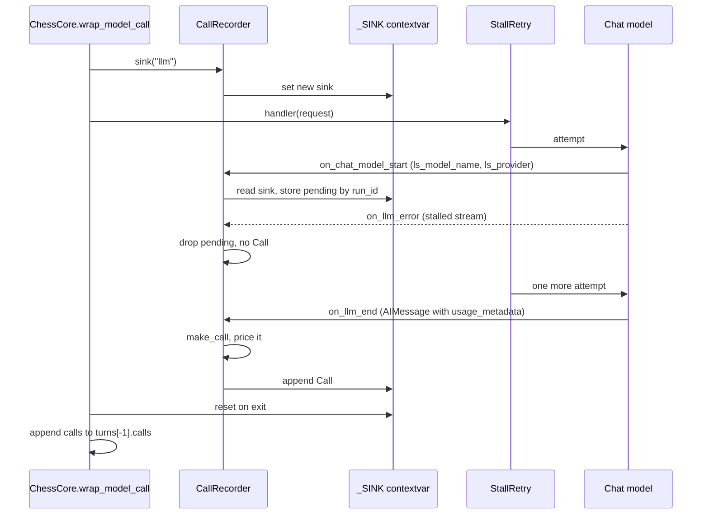

# Model specs, the LLM Gateway and cost

Every model in this repo is named by a string, and every call it makes is written to the state
record as a priced `Call`. This page covers four linked mechanisms:

1. **Naming and construction.** `init_chat_model` specs, the `langsmith:` gateway provider, the
   one canonical `provider:model` form (`libs/chess/langchain_chess/models.py`), how settings and
   `model_kwargs` resolve (`libs/chess/langchain_chess/model_arguments.py`), and the shared
   chat-model builder (`libs/chess/langchain_chess/chat_models.py`).
2. **Reasoning efforts.** A committed, probed snapshot of which specs reject a reasoning effort
   (`libs/chess/langchain_chess/efforts.py`, `efforts.json`), checked before the first call.
3. **Capture.** `CallRecorder`, a callback handler that writes each provider response into a
   sink held in a context variable (`libs/chess/langchain_chess/recorder.py`), and `StallRetry`,
   which retries a stalled stream without recording it.
4. **Pricing and context windows.** Costs are computed locally from `usage_metadata` with a
   pinned `genai-prices` snapshot (plus one hard-coded OpenAI Decisions rate), and the same
   snapshot supplies context windows. `turn_cost` adds costs up per turn and says whether the
   total is complete (`libs/chess/langchain_chess/pricing.py`).

Where calls end up (`turns[-1]["calls"]`) is covered in [the state record](./state-record.md).
The full settings schema and the `model_kwargs` hold-back rules are covered in
[settings and model arguments](./settings-and-model-arguments.md). System 1 request details are in
[System 1](../architecture/system-one.md). How the input limit feeds the summarization trigger is
covered in [prompt and memory](./prompt-and-memory.md).

## Model specs and the `langsmith:` provider

Models are plain `init_chat_model` specs, set through the `model` setting (server context,
Studio, the CLI `--model` option or a settings file):

| Spec form | Example | Route |
|---|---|---|
| `langsmith:<vendor>/<model>` | `langsmith:baseten/zai-org/GLM-5.3-Flash` (the default), `langsmith:anthropic/claude-opus-5-5` | LangSmith LLM Gateway, through its OpenAI-compatible route (`ChatOpenAI` underneath) |
| `provider:model` | `openai:gpt-5.6-sol` | That provider's own LangChain package and key, or the gateway passthrough when `LANGSMITH_GATEWAY` is on |
| bare name | `gpt-5.6-sol` | `init_chat_model` infers the provider. The CLI needs the provider extra installed |

**Defaults live in one place.** `DEFAULT_MODEL = "langsmith:baseten/zai-org/GLM-5.3-Flash"` and
`reasoning_effort = None` are defaults on `CoreSettings` (`libs/chess/langchain_chess/settings.py`).
`ChessContext` (`libs/systemone/langchain_chess_systemone/settings.py`) extends it with System 1's
settings and is the one settings type the server and the CLI both use, so they cannot drift apart.
`reasoning_effort` accepts `low`, `medium`, `high` or null. System 1 models are separate names
that never go to `init_chat_model`: `systemone_model` defaults to `typesafe/jev-latest` (Jev, served
through `langchain-typesafe`), with `openai/gpt-6-luna` (OpenAI Decisions, any `openai/` name) as
the alternative; another TypeSafe classifier also works. SemIf (`semif-*`) models are retired
because the gateway no longer serves them: settings-file version 3's migration rewrites any
`semif-` System 1 model to Jev.

### `model_identity` and `canonical_model`

`model_identity(name, provider=None)` returns a `(vendor, model)` pair. It accepts a spec, a gateway
name, or a callback's `ls_model_name`:

- It strips the `langsmith:` prefix (`GATEWAY_PREFIX`) first.
- It splits any other `vendor:model` on the colon.
- It splits a `vendor/model` name on the **first** slash, so
  `fireworks/accounts/fireworks/models/kimi-k3` becomes vendor `fireworks` and model
  `accounts/fireworks/models/kimi-k3`. **That vendor beats the `provider` argument.** Through the
  gateway, LangChain reports `ls_provider="openai"`, which is the transport, not the model's
  vendor. So `anthropic/claude-opus-5` with `provider="openai"` resolves to
  `anthropic:claude-opus-5`.
- A bare name uses `provider`, or `"unknown"` if no provider is given.

`canonical_model` formats the result as `vendor:model`. This is the form stored in every
`Call["model"]` (for example `anthropic:claude-opus-5-5`, `typesafe:jev-latest`,
`openai:gpt-6-luna`). It is also the vendor/model pair that pricing and context-window lookup use.
If you change this function, you change the stored model names, which price entry each call
matches, and which context window a model gets.

## Reasoning effort and `model_kwargs` resolution

Before a model is built, the settings are resolved into a `ModelArguments` value by
`model_arguments(model_kwargs, reasoning_effort=..., surface=...)`. The precedence is
**`model_kwargs` beats the settings, which beat the app's defaults**:

- **Aliases collapse to one value.** `reasoning_effort` and `reasoning.effort` are one effort;
  `max_tokens`, `max_output_tokens` and `max_completion_tokens` are one output limit. Aliases that
  disagree are an error. Otherwise the integration would send both, or the app's `max_tokens`
  would beat a passed-through `max_output_tokens`.
- **The effort.** An effort in `model_kwargs` wins over the `reasoning_effort` setting. If
  `model_kwargs` has a `reasoning` object, the effort is merged into it; otherwise it becomes
  `reasoning_effort`. With no effort at all, no reasoning argument is set, because models without
  reasoning (such as Claude Haiku 4.5) reject the parameter outright, even as a default.
  `extra_body.reasoning` replaces the whole request object, so `ModelArguments.reasoning_effort`
  (the value actually sent) is then whatever effort that object carries, possibly none.
- **The output limit** from `model_kwargs` becomes `ModelArguments.max_tokens` and overrides the
  app's computed budget (below). A limit set only inside `extra_body` isn't seen, so memory may
  summarize too late.
- **Held-back names** (credentials and connections, model names, what the agent sends, app-owned
  constructor arguments; on the `server` surface also account resources and anything off its
  allowlist) raise `ModelArgumentsError`. `CoreSettings` validates the `local` rules when settings
  load. The server's `server_model` resolves with `surface="server"`. Details are on
  [settings and model arguments](./settings-and-model-arguments.md).

`arguments(settings, surface)` and `sent(settings, surface)` in
`libs/systemone/langchain_chess_systemone/agent.py` wrap this for a `ChessContext`. `sent` puts the
values as sent (`reasoning_effort` and any `max_tokens` override) into run metadata: the server
graph via `with_config(metadata=...)` and CLI runs via `run_config`. The recorded `setup` keeps
`model_kwargs` exactly as given. With `policy="systemone"`, nothing is sent and `sent` reports
`reasoning_effort: None`.

### Which models take an effort: the probed snapshot

Whether a model accepts a reasoning effort depends on the route, not a catalog (the source notes
the gateway sends Baseten Anthropic's `output_config.effort` rather than the documented
`reasoning_effort`). So `libs/chess/langchain_chess/efforts.json` records, per spec, the result of
a real probe, and `takes_effort(model)` reads it:

- **Unrecorded specs take an effort** (`takes_effort` returns `True`). Only specs the probe found
  to reject one return `False`; currently `langsmith:anthropic/claude-haiku-4-5-20251001`. The
  same model under another route (for example `anthropic:claude-haiku-4-5-20251001`) is unprobed
  and so allowed.
- **`chat_model` refuses early.** Its first step, `_check_effort`, raises `ModelArgumentsError`
  ("`<spec>` doesn't take a reasoning effort; remove it from the settings and from model
  arguments") when the resolved `ModelArguments.reasoning_effort` is set for a spec recorded as
  `False`. Because the resolved effort counts, an effort given only in
  `model_kwargs`/`extra_body.reasoning` is refused too. This replaces a 400 from the provider on
  the first call.
- **Late rejections still have a clear error.** For an unprobed spec, the provider's own rejection
  is recognised by `rejects_effort` (a status-400 error whose `param` is `reasoning.effort` or
  `reasoning_effort`, or with no `param`, whose message mentions "effort") and re-raised by
  `provider_errors()` as `ReasoningEffortError`, both around the LLM call in `ChessCore` and the
  summary call in `ChessSummarization`.
- **Probing.** `probe(model)` builds the spec at every offered effort (`low`, `medium`, `high`)
  with `max_tokens=256` and invokes it once each. A spec that takes some efforts and rejects
  others raises `MixedEffortsError`; any other failure propagates. `refresh` re-probes every
  recorded spec plus the added ones and writes the snapshot only after all probes succeed.
  Run it with `mise run probe:efforts` (append specs to add them). Only web presets have to be
  recorded. A probe sees only failures: the gateway silently drops the effort for GPT-4o and
  GPT-4.1, so those would be recorded as taking one.
- **The web UI asks first.** The server's `GET /ui/model?model=…` route returns
  `{"max_input_tokens": model_limit(model), "takes_effort": takes_effort(model)}`, so the new-game
  dialog offers an effort only to models not known to reject one.

## Building the chat model: output budget and the profile

There is one builder, `chat_model(model, arguments=None, *, connection=None)` in
`libs/chess/langchain_chess/chat_models.py`. `default_model(settings)` in the systemone package
calls it with the `local` arguments. This is the default `model_factory` of the shared
`build_agent`, which the CLI's `play` and UCI commands use. The server's `server_model(settings)`
(`apps/server/langchain_chess_server/graph.py`) calls it with the `server` arguments.
`connection` is for trusted code only (for example an HTTP client in tests), never settings.
After the effort check above, every model it builds gets:

- `max_tokens=<output budget>`. Without a `model_kwargs` override, the budget comes from
  `output_budget(window, ceiling)`: `MAX_TOKENS` (64000), lowered to the model's own output limit
  (`ceiling`) when one is known and to half the context window when the window is small. The cap
  includes reasoning tokens (the source records that 8000 ran out mid-game at medium effort).
  64000 is also the budget for a gateway model whose own output limit is unknown; the source notes
  that Claude Haiku 4.5, the only web preset that enforces its limit, allows exactly that.
- `name=<model part of model_identity>` sets the trace span name (for example `claude-opus-5-5`
  or `zai-org/GLM-5.3-Flash`). Without it, every vendor behind the gateway would show up as
  `ChatOpenAI`.
- the resolved `ModelArguments.kwargs` (reasoning, temperature and so on), then `connection`.

`_check_room` raises `ModelArgumentsError` when an explicit output limit is at least the model's
context window: it would leave no input, and memory would summarize before every call.

The `profile` (which carries `max_input_tokens`, the limit the fractional summarization trigger
is a fraction of) depends on the route:

- **`langsmith:` specs.** The gateway's `ChatOpenAI` has no model profile. The window comes from
  `context_window(model)` (the combined input+output window in the genai-prices snapshot). The
  output ceiling comes from `_vendor_profile`, which builds the vendor's own integration
  (`init_chat_model("<vendor>:<model>", api_key="unused")`, no request is made) and reads its
  `max_output_tokens`. If that integration isn't installed (`ImportError`/`ValueError`), the
  budget stays at the cap. The profile is then `{"max_input_tokens": window - budget}`, or none at
  all when genai-prices doesn't know the model. (A TODO notes the vendor lookup should move to
  genai-prices once it ships per-model output limits.)
- **Native provider specs and bare names.** The model is built once to read its native profile.
  The window is genai-prices' value, falling back to the profile's `max_input_tokens` (needed for
  bare specs such as `gpt-4`); the budget is capped by the profile's `max_output_tokens`. The
  native profile is kept but its `max_input_tokens` is lowered to the smaller of the native value
  and `window - budget`, so summarization always leaves room for the output budget. An unknown
  native model keeps the cap and gets no input limit.

Examples pinned by tests: gateway Opus 5.5 gets `1,000,000 − 64,000`; GLM-5.3-Flash via Baseten
(no Baseten integration installed) gets `1,048,000 − 64,000`; `openai/gpt-4` (8,192 window) gets
`max_tokens=4096` and `8192 − 4096`; `gpt-4-turbo` and `gpt-4o` are held to their 4,096 and 16,384
output limits, over the gateway or natively.

The shared `build_agent` and the surfaces turn this into user-facing behaviors:

- `build_agent` raises `ChessContractError` ("… has no known input limit, so it can't use memory;
  turn it off") when `memory=True` is requested for a model whose profile lacks
  `max_input_tokens` (`input_limit` in `libs/chess/langchain_chess/middleware/summarization.py`).
  With `policy="systemone"` no chat model is built, so memory is forced off and the check never
  runs. `memory` is a boolean; the old `full`/`summarize` string modes are gone and rejected.
- The server's `model_limit(model)` (cached with `lru_cache`) builds
  `default_model(ChessContext(model=model))` and returns its `input_limit`, or `None` if the model
  can't be built (`ValueError`, which includes `ModelArgumentsError`, or `ImportError`). The
  `/ui/model` route in `apps/server/langchain_chess_server/app.py` returns it as
  `max_input_tokens` (next to `takes_effort`), so the web UI's new-game dialog only offers memory
  for models with a known limit. The terminal UI's setup screen has its own uncached
  `model_limit` with the same logic (`libs/cli/langchain_chess_cli/tui/setup.py`).

Building the graph never calls a model. With `policy="systemone"`, no chat model is built at all.
System 1 clients are built lazily too: `classifier(model, …)` returns an OpenAI Decisions client
for `openai/` names and a `TypeSafeClassifier` otherwise. On the server, `pooled_ranker` gives
TypeSafe classifiers their key and base URL from `ServerSettings.typesafe()` and one shared
connection pool, while Decisions clients take their credentials from `LANGSMITH_GATEWAY*` like the
chat models and share a separate pool.

## Environment variables (names only)

Provider secrets live in the gateway workspace, never in this repo's environment. The variables
are:

| Variable | Role |
|---|---|
| `LC_GATEWAY_KEY` | A shell variable holding the workspace-scoped gateway key (`gateway:invoke`). The `.env` template reuses it through `${LC_GATEWAY_KEY}` expansion |
| `LANGSMITH_GATEWAY` | Turns on langchain-core's gateway resolution |
| `LANGSMITH_GATEWAY_API_KEY` | The key the chat model (and the OpenAI Decisions System 1 client) sends to the gateway. The client reads this itself |
| `TYPESAFE_API_KEY`, `TYPESAFE_BASE_URL` | Jev/TypeSafe System 1 credentials and the gateway root. `langchain-typesafe` posts to `{TYPESAFE_BASE_URL}/v1/systemone`; the gateway serves Jev as `typesafe/jev-latest` |
| `LANGSMITH_TRACING`, `LANGSMITH_API_KEY`, `LANGSMITH_WORKSPACE_ID` | Tracing. It may be a different org from the gateway; the workspace id pins the workspace the tracing key belongs to |
| `LANGSMITH_AGENT_ID`, `LANGSMITH_AGENT_ENVIRONMENT` | Which agent and environment traces report into (local runs versus the deployment). The template warns not to also set `LANGSMITH_PROJECT`, or the SDK traces nothing |

**Set-but-empty is an error.** If `LC_GATEWAY_KEY` is missing, the template's expansion
produces an empty string. langchain-core would then silently fall back to `LANGSMITH_API_KEY` and
send model calls to the tracing org's gateway. `ServerSettings` (pydantic-settings, reading the
shell first and `.env` second) fails validation ("is set but empty; unset it or give it a value")
when `LANGSMITH_GATEWAY_API_KEY`, `TYPESAFE_API_KEY` or `TYPESAFE_BASE_URL` is set to an empty or
whitespace-only value. Leaving them unset is fine: all three default to `None`, and the gateway key
is read only for this check (the chat model reads the variable itself). The sign-in settings in
the same class (`OAUTH_CLIENT_ID`, `ALLOWED_ORGANIZATION_ID`) deliberately do the opposite: blank
means unset, and values are stripped. `make_graph` instantiates `ServerSettings` only for a run: reads, state updates and
introspection (no `execution_runtime`) get the credential-free `shape()` graph, so they need none
of these variables. `ServerSettings.typesafe()` raises when either TypeSafe variable is unset;
only System 1 policies (`hybrid`, `systemone`) with a TypeSafe model call it, so an OpenAI
Decisions System 1 needs no TypeSafe variables. The CLI deliberately enforces none of these rules:
it builds through the shared `build_agent`/`default_model`, which relies on langchain-core's
resolution plus the provider's own environment. Local commands that call models must load `.env`
explicitly (`uv run --env-file .env ...`).
[Deployment](../operations/deployment.md) covers the deployed environment.

## CallRecorder: capturing every provider response

*One model call whose first stream stalls. Every retry or fallback inside `handler` produces
another start/end (or start/error) pair in the same sink; only responses become Calls.*

How it works:

- `create_chess_agent` creates one `CallRecorder` and passes it to `ChessCore` and, when memory is
  on, to `ChessSummarization`. It then returns `graph.with_config(callbacks=[recorder])`, so the
  recorder sees every chat-model callback in the graph (`libs/chess/langchain_chess/agent.py`).
- `recorder.sink(kind)` puts a fresh `_Sink(kind, calls)` into a module-level `ContextVar` and
  resets it on exit. `ChessCore.wrap_model_call` / `awrap_model_call` open `sink("llm")` around
  the handler (inside `provider_errors()`) and also add the call's wall time to the turn's
  `latency_ms`. `ChessSummarization.before_model` / `abefore_model` open `sink("summary")` (with
  `provider_errors()`) around the summarization step. Both then add the collected calls to the
  current turn's `calls`.
- If the handler raises after at least one response was recorded (for example a fallback chain
  whose last attempt failed), `ChessCore` does not drop those calls: it returns them in the turn
  update with a `failed_call` marker, and `after_model` re-raises the error afterwards. If nothing
  was recorded the error propagates directly. Either way the error has first passed through
  `provider_errors()`: errors that look like a context overflow become `ContextBudgetError`, and a
  provider's rejection of the reasoning effort becomes `ReasoningEffortError`.
- `on_chat_model_start` does nothing outside a sink. Inside one, it records a pending entry keyed
  by `run_id`, holding the model (`ls_model_name`, then the serialized name, then `"unknown"`),
  `ls_provider`, a UTC start time, and whether the request carries hosted tools (`tools` in the
  invocation params or in `extra_body`). The start time becomes `called_at`.
- `on_llm_end` removes the pending entry and appends a priced `Call`, but only when the first
  generation is a `ChatGeneration` whose message is an `AIMessage`. Plain text `Generation`s are
  ignored. A call that carried hosted tools gets `cost_complete=False`, because token prices don't
  cover a hosted tool's own charges (a chess agent binds no tools, so only `model_kwargs` can add
  them, and the server holds `tools` back). `on_llm_error` drops the pending entry, so **failed
  attempts record no Call**. Every attempt that returned a response is recorded, including inner
  retries and fallbacks.
- `run_inline = True` and a lock protect the pending map. `recorder.pending` should be zero
  between runs.

**Invariant: never key calls by the callback run tree.** With LangSmith tracing on, traceable
spans sit between the node and the provider call, and parent-run lookups would record nothing.
The context variable is the only link between a sink and its calls. Code that makes a model call
outside `wrap_model_call` or the summarization hook is simply not recorded. A new call site must
open its own sink.

### Stalled calls record nothing

`StallRetry` (`libs/chess/langchain_chess/middleware/stall_retry.py`) is a `ModelRetryMiddleware`
that `create_chess_agent` always appends last in the stack. It sits inside `ChessCore`'s wrapper,
so a retry repeats only the provider call and stays inside the same `llm` sink and turn:

- It retries only what `stall_errors()` returns: `langchain_openai.StreamChunkTimeoutError`
  (every `langsmith:` gateway model is a `ChatOpenAI`), or nothing when `langchain_openai` isn't
  installed. Any other error, such as a plain `TimeoutError`, fails the turn at once.
- It retries once (`max_retries=1`) with no delay, since the stall already waited out
  langchain-openai's 120 s chunk timeout. With `on_failure="error"`, a second stall raises, so the
  pending turn's own retry path sees the error rather than a fake reply.
- **A stalled attempt records no `Call`.** Its usage would arrive in the final chunk, which never
  came, and `on_llm_error` drops its pending entry. The tokens the provider may have billed for the
  stalled attempt are therefore invisible to `turn_cost`; they do not mark it incomplete. A
  stalled-then-successful turn shows one `Call`, not two.

System 1 does not go through `CallRecorder`. `GatewayRanker._call` builds its own `Call` with
`make_call("systemone", self.model, tokens, at, provider="typesafe")` from the classifier
response's `usage`, including on malformed responses (`RankingFailed` carries the calls)
(`libs/systemone/langchain_chess_systemone/ranker.py`). For an `openai/…` Decisions model the
slash rule in `model_identity` makes the vendor `openai`, not `typesafe`. So the three `CallKind`s
are `llm`, `summary` and `systemone`.

## Local pricing with genai-prices

No gateway route returns a cost. The gateway prices calls asynchronously for its own spend caps.
So `pricing.py` prices each call from LangChain `usage_metadata`, using `genai-prices` pinned at
`0.1.9` in `libs/chess/pyproject.toml`. Its bundled snapshot is used as-is. **Never call
`update_prices`.** Prices (and the context windows derived from the same snapshot) change only
when the pin is bumped, and each priced call records the version in `priced_with`
(`"genai-prices <version>"`, the module constant `PRICED_WITH`). Unpriced calls have
`priced_with=None`.

`tokens_from_usage` converts usage into genai-prices' convention, where `input` already
includes cache reads and writes:

- **No usage at all (`None` or an empty mapping) means unknown, not zero.** `input` and `output`
  are `None`, and so is the cost.
- If Anthropic's TTL-split keys (`ephemeral_5m_input_tokens`, `ephemeral_1h_input_tokens`)
  are present, `cache_write` is their sum and `cache_write_1h` is the 1-hour subset.
  `ChatAnthropic` zeroes the generic `cache_creation` in that case. Otherwise `cache_creation`
  counts as 5-minute writes, because the gateway's Responses route writes only those.
- Any non-zero input detail other than `cache_read`, `cache_creation` or the ephemeral keys (for
  example the service-tier `priority_cache_read`), or any non-zero output detail other than
  `reasoning` (for example `audio`), marks the tokens `approximated`. Those tokens are already
  inside `input_tokens` / `output_tokens` and are priced as ordinary tokens. Zero-valued unknown
  keys do not count.

`price(provider, model, tokens, at)` calls `calc_price` with the request timestamp. It returns
`(None, False)` when usage is unreported or genai-prices raises `LookupError` (unknown model).
Otherwise it returns `(usd, not approximated)`. `make_call` resolves the vendor through
`model_identity`, prices the call, and fills in the `Call` fields.

**The one exception: OpenAI Decisions.** genai-prices has no Decisions rates and would price
those requests at the model's chat rate. So when `make_call` sees a `systemone` call whose vendor
is `openai`, it uses `decisions_price` instead: input tokens times the per-million rate in
`DECISIONS_USD_PER_MTOK` (`gpt-6-luna`: $0.10), with output free. It returns `(None, False)` for a
Decisions model without a listed rate or with unreported input, and is incomplete when usage was
approximated. The same model as an `llm` call (`langsmith:openai/gpt-6-luna`) is priced at its
chat rate through genai-prices. These calls still record `PRICED_WITH` in `priced_with`.

`context_window(model)` resolves the spec through `model_identity` and asks the same snapshot for
the model's `context_window` (input and output together), returning `None` for unknown models.
The tests pin examples: Opus 5.5 1,000,000; `openai/gpt-5.6-sol` 1,050,000; Fireworks Kimi K3
1,040,000; Baseten GLM-5.3 1,048,000.

## `turn_cost` and incomplete costs

A move's cost is its turn's total: every LLM attempt, System 1 request and summary.
`turn_cost(calls)`:

- returns `None` when no call has a price (so a turn whose calls are all unpriced, or with no
  calls, shows no cost);
- otherwise returns `{"usd": sum of priced calls, "complete": ...}`, where `complete` is true only
  if **every** call has a price and `cost_complete=True`.

A turn's cost is incomplete (a lower bound) when any call:

- uses a model the pricing doesn't know: a model genai-prices lacks (for example a TypeSafe
  classifier other than Jev, which is priced as `typesafe:jev-latest`), or a Decisions model with
  no entry in `DECISIONS_USD_PER_MTOK`;
- reported no usage;
- had approximated usage dimensions;
- carried hosted tools (priced by tokens, but `cost_complete=False`).

Attempts that errored or stalled without a response record no `Call` at all, so they are invisible
to `turn_cost` rather than marking it incomplete.

The terminal UI's `cost_text` (`libs/cli/langchain_chess_cli/tui/reply.py`) shows `—` for `None`
and appends `+` to incomplete totals (a lower bound); it applies `turn_cost` per turn, per stage
(System 1 versus LLM and summary calls) and to the game so far. `turn_cost` and `TurnCost` are
exported from `langchain_chess`, so other clients should use them rather than summing `cost_usd`
themselves.

For prompt caching and measured prompt sizes, see
[Decisions and measurements](decisions.md). It records why Anthropic prompt caching is
not used on the `langsmith:` route and how large prompts are. Those numbers change, so they are
not repeated here.

## Tests that matter

- `libs/chess/tests/test_chat_models.py`: the `output_budget` rule (cap, half of a small window,
  vendor ceiling); native models held to their output limit and their input limit lowered to leave
  room for it; gateway models' `window - budget` profile, span name and reasoning effort; no profile
  for unknown gateway models; the vendor output ceiling applied over the gateway, and the cap kept
  when the vendor integration isn't installed; bare names sized like their qualified specs; a
  model recorded as taking no effort refused one (from settings or model arguments) before its
  first call but built at its default, and unrecorded models taking any effort.
- `libs/chess/tests/test_efforts.py`: `rejects_effort` needs a 400 about the effort parameter;
  probes ask at every offered effort, mixed results and other failures fail the probe; `refresh`
  writes the snapshot only after every probe ran; the committed snapshot and `takes_effort`
  defaults.
- `libs/chess/tests/test_model_arguments.py`: the final request body captured at the HTTP
  transport — `model_kwargs` beating the settings and the app, every output-limit alias becoming
  one `max_output_tokens`, the effort joining a `reasoning` object, `extra_body.reasoning`
  replacing it; names held back everywhere and on the server only.
- `libs/chess/tests/test_pricing.py`:
  - no usage stays unknown (no cost, no `priced_with`);
  - Opus through the Responses route (vendor taken from the gateway name, cache reads and writes);
  - Anthropic 1-hour writes as total plus subset;
  - OpenAI Decisions priced at its own rate, not the chat one;
  - Jev priced under `typesafe`, another classifier not;
  - context windows come from the price snapshot, `None` for unknown models;
  - unknown models and service-tier / unmapped output keys give incomplete costs;
  - `turn_cost` completeness rules.
- `libs/chess/tests/test_recorder.py`: calls outside a sink are ignored; only chat generations are
  recorded, errors drop pending entries, and the sink's `kind` is carried through; a call with
  hosted tools is priced but incomplete.
- `libs/chess/tests/test_contract.py`: inner double calls and retry-middleware calls each recorded;
  calls before a wrapper failure kept; a stalled stream retried within the turn with one recorded
  call; a second stall failing the turn and a retry resuming it; only a stall retried; no stall
  errors without `langchain_openai`.
- `libs/chess/tests/test_lifecycle.py` and `test_memory.py`: a rejected effort on the move call
  or the summary call surfaces as `ReasoningEffortError`.
- `libs/systemone/tests/test_agent.py`: the default model is the gateway chat model and takes
  `model_kwargs`; memory needs a known input limit; `sent` values match what the request carries;
  System 1 alone never builds a model.
- `apps/server/tests/test_graph.py`: the default gateway chat model (`max_tokens`, span name,
  `window - 64000` profile); no reasoning sent when `reasoning_effort` is empty; provider specs
  routed through the passthrough; reads needing no credentials; TypeSafe settings needed only
  when System 1 runs, and a Decisions model needing none; memory rejected without a known input
  limit; `model_limit` agreeing with the agent, including a small window split between input and
  output; the server holding back arguments it doesn't allow; run metadata recording the values
  sent.
- `apps/server/tests/test_app.py`: the `/ui/model` route.
- `libs/chess/tests/test_live.py` (opt-in `-m live`, costs money): real Opus turns through the
  gateway record `anthropic:claude-opus-5-5` with positive tokens and a complete `turn_cost`.
- `apps/server/tests/test_settings.py`: blank-key rejection and `.env` loading.

## Runtime evidence (volatile)

The consolidated findings live in [runtime behavior](../operations/runtime-behavior.md).

- **Observed (this LangSmith pull, volatile):** no per-call-kind token or cost patterns could be
  read from this page's generation context, so this page reports **no** sampled token counts,
  cost totals or call-count patterns for `llm`, `summary` or `systemone` calls. Take any figures
  from the runtime-behavior page, which scopes each pull's numbers.
- **Correlated (how to read traces against the code):** LLM spans are named after the model
  (`name=` in `chat_model`), not `ChatOpenAI`. A turn with several LLM spans had parse retries,
  provider-level retries or a stall retry; each response is a separate `Call`, but a stalled span
  has no matching `Call`. A System 1 classifier that genai-prices doesn't know carries no priced
  cost, so a hybrid turn using it is marked incomplete. Run metadata shows the `reasoning_effort`
  and `max_tokens` actually sent, which can differ from the settings when `model_kwargs` overrode
  them.
