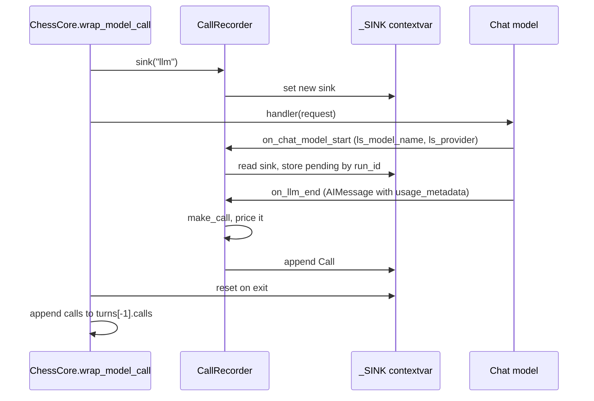

# Model specs, the LLM Gateway and cost accounting

Every model in this repo is named by a string, and every call it makes is written to the state
record as a priced `Call`. This page covers three linked mechanisms:

1. **Naming.** `init_chat_model` specs, the `langsmith:` gateway provider, and the one canonical
   `provider:model` form (`libs/chess/langchain_chess/models.py`).
2. **Capture.** `CallRecorder`, a callback handler that writes each provider response into a
   sink held in a context variable (`libs/chess/langchain_chess/recorder.py`).
3. **Pricing and context windows.** Costs are computed locally from `usage_metadata` with a
   pinned `genai-prices` snapshot, and the same snapshot supplies context windows for gateway
   models. `turn_cost` adds costs up per turn and says whether the total is complete
   (`libs/chess/langchain_chess/pricing.py`).

Where calls end up (`turns[-1]["calls"]`) is covered in [the state record](./state-record.md).
System 1 request details are in [System 1](../architecture/system-one.md). How the context window
feeds the summarization trigger is covered in [prompt and memory](./prompt-and-memory.md).

## Model specs and the `langsmith:` provider

Models are plain `init_chat_model` specs, set through the server context `model` knob or the
CLI `--model` option:

| Spec form | Example | Route |
|---|---|---|
| `langsmith:<vendor>/<model>` | `langsmith:baseten/zai-org/GLM-5.3-Flash` (the default), `langsmith:anthropic/claude-opus-5-5` | LangSmith LLM Gateway, through its OpenAI-compatible route (`ChatOpenAI` underneath) |
| `provider:model` | `openai:gpt-5.6-sol` | That provider's own LangChain package and key, or the gateway passthrough when `LANGSMITH_GATEWAY=true` |
| bare name | `gpt-5.6-sol` | `init_chat_model` infers the provider. The CLI needs the provider extra installed |

The default model, for both the server (`ChessContext.model` in
`apps/server/langchain_chess_server/context.py`) and the CLI (`AgentOptions.model` in
`libs/cli/langchain_chess_cli/options.py`, which mirrors the server defaults), is
`langsmith:baseten/zai-org/GLM-5.3-Flash`. The default `reasoning_effort` is `None` in both.
System 1 models are separate names: `semif-qwen3.5-4b` (the default) or `typesafe/jev-latest`.
These go to `langchain-typesafe`, not to `init_chat_model`.

### `model_identity` and `canonical_model`

`model_identity(name, provider=None)` returns a `(vendor, model)` pair. It accepts a spec, a gateway
name, or a callback's `ls_model_name`:

- It strips the `langsmith:` prefix (`GATEWAY_PREFIX`) first.
- It splits any other `vendor:model` on the colon.
- It splits a `vendor/model` name on the **first** slash, so
  `fireworks/accounts/fireworks/models/kimi-k3` becomes vendor `fireworks` and model
  `accounts/fireworks/models/kimi-k3`. **That vendor beats the `provider` argument.** Through the
  gateway, LangChain reports `ls_provider="openai"`, which is the transport, not the model's
  vendor. So `anthropic/claude-opus-5` with `provider="openai"` resolves to
  `anthropic:claude-opus-5`.
- A bare name uses `provider`, or `"unknown"` if no provider is given.

`canonical_model` formats the result as `vendor:model`. This is the form stored in every
`Call["model"]` (for example `anthropic:claude-opus-5-5`, `typesafe:jev-latest`,
`typesafe:semif-qwen3.5-4b`). It is also the vendor/model pair that pricing and context-window
lookup use. If you change this function, you change the stored model names, which price entry each
call matches, and which context window a gateway model gets.

## Building the chat model: `MAX_TOKENS`, reasoning effort and the profile

The server (`apps/server/langchain_chess_server/graph.py`, `chat_model(context)`) and the CLI
(`libs/cli/langchain_chess_cli/models.py`, `chat_model(model, reasoning_effort)`) build the model
the same way:

- `max_tokens=MAX_TOKENS` (32000). The cap includes reasoning tokens. The server comment records
  that 8000 ran out mid-game at medium effort. Keep it well above any reasoning budget.
- `name=<model part of model_identity>` sets the trace span name (for example `claude-opus-5-5`
  or `zai-org/GLM-5.3-Flash`). Without it, every vendor behind the gateway would show up as
  `ChatOpenAI`.
- `reasoning_effort` is passed **only when it is not `None`**. Models without reasoning (such as
  Claude Haiku 4.5) reject the parameter outright, even as a default, so an empty knob sends no
  reasoning setting at all and the model uses its own default.
- `profile={"max_input_tokens": context_window(model) - MAX_TOKENS}` is added **only for
  `langsmith:` specs, and only when `context_window` knows the model**. The gateway's
  `ChatOpenAI` has no model profile, and the fractional summarization trigger needs
  `max_input_tokens`. `context_window` reads the combined input+output window from the same
  genai-prices snapshot used for pricing, so the output cap is subtracted (for example Opus 5.5:
  1,000,000 − 32,000; GLM-5.3-Flash via Baseten: 1,048,000 − 32,000). Native providers ship full
  profiles, so they are never overridden. A gateway model genai-prices doesn't know gets no
  profile at all.

The server turns this into two user-facing behaviors:

- `build_agent` raises `ChessContractError` ("… has no known input limit … use memory='none'")
  when `memory="summarize"` is requested for a model whose profile lacks `max_input_tokens`
  (`input_limit` in `libs/chess/langchain_chess/middleware/summarization.py`). The `systemone`
  policy builds no chat model and forces `memory="none"`, so it never hits this check. The CLI's
  `build_agent` uses the same `input_limit` check.
- `model_limit(model)` (cached with `lru_cache`) builds the chat model and returns its
  `input_limit`, or `None` if the model can't be built (`ValueError`, `ImportError`). The
  `/ui/model-limit?model=…` route in `apps/server/langchain_chess_server/app.py` returns it so the
  web UI's new-game dialog only offers `summarize` for models with a known limit.

Building the graph never calls a model. With `policy="systemone"`, no chat model is built at all.
The System 1 classifier (`TypeSafeClassifier`) gets its key and base URL from
`ServerSettings.typesafe()`, and each (model, key, base URL) combination is cached with
`lru_cache`.

## Environment variables (names only)

Provider secrets live in the gateway workspace, never in this repo's environment. The variables
are:

| Variable | Role |
|---|---|
| `LC_GATEWAY_KEY` | A shell variable holding the workspace-scoped gateway key (`gateway:invoke`). The `.env` template reuses it through `${LC_GATEWAY_KEY}` expansion |
| `LANGSMITH_GATEWAY` | Turns on langchain-core's gateway resolution |
| `LANGSMITH_GATEWAY_API_KEY` | The key the chat model sends to the gateway. The chat model reads this itself |
| `TYPESAFE_API_KEY`, `TYPESAFE_BASE_URL` | System 1 credentials and the gateway root. `langchain-typesafe` posts to `{TYPESAFE_BASE_URL}/v1/systemone` |
| `LANGSMITH_TRACING`, `LANGSMITH_API_KEY`, `LANGSMITH_PROJECT`, `LANGSMITH_WORKSPACE_ID` | Tracing. It may be a different org from the gateway |

**Set-but-empty is an error.** If `LC_GATEWAY_KEY` is missing, the template's expansion
produces `""`. langchain-core would then silently fall back to `LANGSMITH_API_KEY` and send model
calls to the tracing org's gateway. `ServerSettings` (pydantic-settings, reading the shell
first and `.env` second) rejects a blank `LANGSMITH_GATEWAY_API_KEY`, `TYPESAFE_API_KEY` or
`TYPESAFE_BASE_URL`. It is instantiated in `make_graph`, so graph construction fails.
`ServerSettings.typesafe()` raises when either TypeSafe variable is unset. Only policies that run
System 1 (`hybrid`, `systemone`) call it. The CLI deliberately enforces none of these rules and
relies on langchain-core's resolution plus the provider's own environment. Local commands that
call models must load `.env` explicitly (`uv run --env-file .env ...`).
[Deployment](../operations/deployment.md) covers the deployed environment.

## CallRecorder: capturing every provider response

*One model call. Retries and fallbacks inside `handler` each produce another start/end pair
that lands in the same sink.*

How it works:

- `create_chess_agent` creates one `CallRecorder` and passes it to `ChessCore` and
  `ChessSummarization`. It then returns `graph.with_config(callbacks=[recorder])`, so the recorder
  sees every chat-model callback in the graph (`libs/chess/langchain_chess/agent.py`).
- `recorder.sink(kind)` puts a fresh `_Sink(kind, calls)` into a module-level `ContextVar` and
  resets it on exit. `ChessCore.wrap_model_call` / `awrap_model_call` open `sink("llm")` around
  the handler. `ChessSummarization.before_model` / `abefore_model` open `sink("summary")` around
  the summarization step. Both then add the collected calls to the current turn's `calls`.
- `on_chat_model_start` does nothing outside a sink. Inside one, it records a pending entry keyed
  by `run_id`, holding the model (`ls_model_name`, then the serialized name, then `"unknown"`),
  `ls_provider`, and a UTC start time. The start time becomes `called_at`.
- `on_llm_end` removes the pending entry and appends a priced `Call`, but only when the first
  generation is a `ChatGeneration` whose message is an `AIMessage`. Plain text `Generation`s are
  ignored. `on_llm_error` drops the pending entry, so **failed attempts record no Call**.
  Every attempt that returned a response is recorded, including inner retries and fallbacks.
- `run_inline = True` and a lock protect the pending map. `recorder.pending` should be zero
  between runs.

**Invariant: never key calls by the callback run tree.** With LangSmith tracing on, traceable
spans sit between the node and the provider call, and parent-run lookups would record nothing.
The context variable is the only link between a sink and its calls. Code that makes a model call
outside `wrap_model_call` or the summarization hook is simply not recorded. A new call site must
open its own sink.

System 1 does not go through `CallRecorder`. `GatewayRanker._call` builds its own `Call` with
`make_call("systemone", self.model, tokens, at, provider="typesafe")` from the classifier
response's `usage`, including on malformed responses (`RankingFailed` carries the calls)
(`libs/systemone/langchain_chess_systemone/ranker.py`). So the three `CallKind`s are `llm`,
`summary` and `systemone`.

## Local pricing with genai-prices

No gateway route returns a cost. The gateway prices calls asynchronously for its own spend caps.
So `pricing.py` prices each call from LangChain `usage_metadata`, using `genai-prices` pinned at
`0.1.9` in `libs/chess/pyproject.toml`. Its bundled snapshot is used as-is. **Never call
`update_prices`.** Prices (and the context windows derived from the same snapshot) change only
when the pin is bumped, and each priced call records the version in `priced_with`
(`"genai-prices <version>"`, the module constant `PRICED_WITH`). Unpriced calls have
`priced_with=None`.

`tokens_from_usage` converts usage into genai-prices' convention, where `input` already
includes cache reads and writes:

- **No usage at all (`None` or an empty mapping) means unknown, not zero.** `input` and `output`
  are `None`, and so is the cost.
- If Anthropic's TTL-split keys (`ephemeral_5m_input_tokens`, `ephemeral_1h_input_tokens`)
  are present, `cache_write` is their sum and `cache_write_1h` is the 1-hour subset.
  `ChatAnthropic` zeroes the generic `cache_creation` in that case. Otherwise `cache_creation`
  counts as 5-minute writes, because the gateway's Responses route writes only those.
- Any non-zero input detail other than `cache_read`, `cache_creation` or the ephemeral keys (for
  example the service-tier `priority_cache_read`), or any non-zero output detail other than
  `reasoning` (for example `audio`), marks the tokens `approximated`. Those tokens are already
  inside `input_tokens` / `output_tokens` and are priced as ordinary tokens. Zero-valued unknown
  keys do not count.

`price(provider, model, tokens, at)` calls `calc_price` with the request timestamp. It returns
`(None, False)` when usage is unreported or genai-prices raises `LookupError` (unknown model).
Otherwise it returns `(usd, not approximated)`. `make_call` resolves the vendor through
`model_identity`, prices the call, and fills in the `Call` fields.

`context_window(model)` resolves the spec through `model_identity` and asks the same snapshot for
the model's `context_window` (input and output together), returning `None` for unknown models.
The tests pin examples: Opus 5.5 1,000,000; `openai/gpt-5.6-sol` 1,050,000; Fireworks Kimi K3
1,040,000; Baseten GLM-5.3 1,048,000.

## `turn_cost` and incomplete costs

A move's cost is its turn's total: every LLM attempt, System 1 request and summary.
`turn_cost(calls)`:

- returns `None` when no call has a price (so a turn with only SemIf calls, or no calls, shows no
  cost);
- otherwise returns `{"usd": sum of priced calls, "complete": ...}`, where `complete` is true only
  if **every** call has a price and `cost_complete=True`.

A turn's cost is incomplete (a lower bound) when any call:

- is **SemIf** (`semif-qwen3.5-4b`). genai-prices has no entry for it, so it is unpriced even
  when usage is reported. Jev is priced as `typesafe:jev-latest`;
- reported no usage;
- uses a model genai-prices doesn't know;
- had approximated usage dimensions.

The terminal UI shows `—` for `None` and prefixes incomplete totals with `≥`
(`libs/cli/langchain_chess_cli/tui/view.py`, `cost_text`). `turn_cost` and `TurnCost` are
exported from `langchain_chess`, so other clients should use them rather than summing
`cost_usd` themselves.

For prompt caching and measured per-move cost, see the README's
[Decisions and measurements](../../README.md#decisions-and-measurements). It records why
Anthropic prompt caching is not used on the `langsmith:` route and how large prompts are. Those
numbers change, so they are not repeated here.

## Tests that matter

- `libs/chess/tests/test_pricing.py`:
  - no usage stays unknown (no cost, no `priced_with`);
  - Opus through the Responses route (vendor taken from the gateway name, cache reads and writes);
  - Anthropic 1-hour writes as total plus subset;
  - Jev priced but SemIf not;
  - context windows come from the price snapshot, `None` for unknown models;
  - unknown models and service-tier / unmapped output keys give incomplete costs;
  - `turn_cost` completeness rules.
- `apps/server/tests/test_graph.py`: the gateway chat model's `max_tokens`, span name and
  `window - 32000` profile; no profile for unknown gateway models; no reasoning sent when
  `reasoning_effort` is empty; provider specs routed through the passthrough; `summarize`
  rejected without a known input limit; `model_limit` agreeing with the agent.
- `libs/chess/tests/test_recorder.py`:
  - calls outside a sink are ignored;
  - only chat generations are recorded, errors drop pending entries, and the sink's `kind` is
    carried through.
- `libs/chess/tests/test_live.py` (opt-in `-m live`, costs money): real Opus turns through the
  gateway record `anthropic:claude-opus-5-5` with positive tokens and a complete `turn_cost`.
- `apps/server/tests/test_settings.py`: blank-key rejection and `.env` loading.

## Runtime evidence (volatile)

The consolidated findings live in [runtime behavior](../operations/runtime-behavior.md).

- **Observed (this pull, volatile):** no per-call-kind token or cost figures could be read from
  this page's generation context. This page therefore gives **no** sampled numbers for `llm`,
  `summary` or `systemone` calls. Take them from the runtime-behavior page.
- **Correlated (how to read traces against the code):** LLM spans are named after the model
  (`name=` in `chat_model`), not `ChatOpenAI`. A turn with several LLM spans had parse retries
  or provider-level retries (each response is recorded as a separate `Call`). SemIf spans carry
  no priced cost by design, so a hybrid turn's `turn_cost` is marked incomplete whenever SemIf
  ran.
