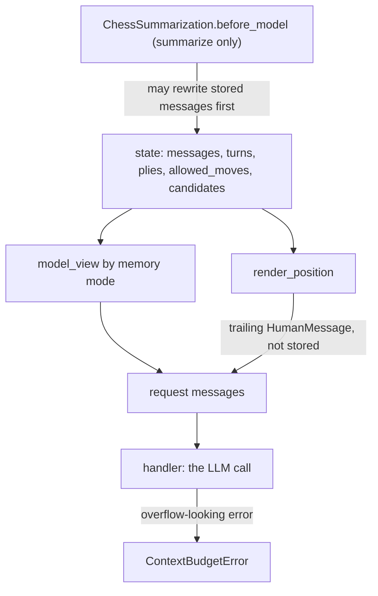

# Prompt, model view and memory modes

Every LLM call the chess agent makes is built in one place: `ChessCore._prepare`, which runs inside `ChessCore.wrap_model_call` ([core.py](/libs/chess/langchain_chess/middleware/core.py)). It replaces the request's messages with:

1. `model_view(messages, turns, memory)`: a filtered, deep-copied view of the stored conversation, and
2. one trailing `HumanMessage` produced by `render_position(...)`: the current position, which is **never stored**.

The system prompt (`SYSTEM_PROMPT`, or `system_prompt=` passed to `create_chess_agent`) is set by `create_agent` and is unaffected. All the wording lives in [prompt.py](/libs/chess/langchain_chess/prompt.py). That module is pure, and its docstring asks that wording changes be deliberate and come with rendered-prompt tests. For where this fits in a run (turn opening, retries, finalization), see [turn lifecycle](/openwiki/architecture/turn-lifecycle.md).

*How one move request is assembled. Summarization, when on, rewrites stored `messages` before `wrap_model_call` reads them.*

## What is stored vs. what is rendered

Stored `messages` hold only a small working conversation:

- **Opening message of a turn.** For a chat command this is the human's own message (`go`, `e4`, …). For a `position` command, core writes a short delta built by `delta_text`: `New game. You are White.` on a fresh thread, the new movetext since the last turn (for example `1... c5`), or `Your move as Black.` when nothing new was played. The turn record keeps its id in `opened_message_id`.
- **Model replies**, including reasoning blocks (kept for tracing).
- **Retry feedback** (`feedback_text`): `Try again, that move was rejected: <reason>. Choose from: <allowed SAN>. …`, or a variant that says the output budget was probably spent on reasoning when the reply had no text. Feedback and rejected reply ids are tracked per turn in `feedback_message_ids` and `rejected_message_ids`.
- **Result messages** and, in `summarize` mode, the summary message.

Board state never lives in the conversation. The position block is rebuilt from `start_fen`, `plies` (SAN), the replayed board, `allowed_moves` and `candidates` on every call, including retries within a turn. So the model always sees the current position, whatever memory mode dropped or summarized.

## The position block (`render_position`)

Lines, in order:

1. `Moves so far: <movetext>` (numbered from any root FEN), or `(none, this is the first move)`.
2. `FEN: …`
3. The ASCII board in a code fence (ranks 8 to 1, uppercase is White).
4. `White to move.` / `Black to move.` and, if applicable, `You are in check.`
5. **Candidates.** `Suggested candidates: <SAN list>. These are suggested candidates; you may play any allowed move.` Only candidates still in `allowed_moves` are shown. The intersection is computed at render time, so if a later extension narrows the allowed set further, no stale candidate shows up. If nothing survives, the line is left out.
6. **Move list.** Exactly one of these, or neither:
   - `Only these moves are permitted: …` whenever `allowed_moves` differs from the full legal set (a `position.restrict`, or narrowing by middleware). This line appears **regardless of `show_legal_moves`**, because the model would otherwise try moves it cannot play.
   - `Legal moves: …` when nothing is restricted and `show_legal_moves=True` (the default).
   - Nothing when unrestricted and `show_legal_moves=False`.
7. `Reply with your analysis, then the final line \`MOVE: <move>\`.`

`candidates` are soft suggestions. In practice `SystemOneMiddleware` writes them when it doesn't play a move itself, and the write guard allows only one writer per turn. They are reset whenever a turn opens, retries from scratch or finalizes. See the [middleware contract](/openwiki/concepts/middleware-contract.md).

## The model view (`model_view`) and memory modes

`memory` is a `create_chess_agent` argument that `ChessCore` passes to `model_view`. It is typed `Literal["none", "summarize"]` and defaults to `"none"`. There is no `full` mode any more: the server's `ChessContext` rejects `memory="full"` with a validation error. Rules shared by both modes:

- Only `HumanMessage` and `AIMessage` pass through.
- **Current turn:** every feedback message is kept, but among its rejected replies only the latest is shown. Earlier rejected attempts are hidden, so a third attempt sees the opening message, the feedback lines and the newest bad reply.
- **Reasoning blocks** (`reasoning`, `thinking`, `redacted_thinking`) are stripped from every AI message except the current turn's latest rejected reply. Stored messages keep them.
- Every returned message is a `copy.deepcopy`, so wrappers further in that mutate messages can't reach checkpointed state.

| Mode | What precedes the position block |
|---|---|
| `none` (default) | Only the current turn: messages from `opened_message_id` onward. Earlier turns are invisible, so the position block carries all context. |
| `summarize` | The whole stored conversation, minus the rejected replies and feedback of **earlier** turns, so what remains is a clean record of opening messages and accepted replies. `ChessSummarization` may have compacted that conversation into a leading summary message plus recent messages. Until the trigger fires, the model sees every earlier turn's opening and accepted reply. |

`model_view` handles `summarize` as "everything except earlier turns' failures". The summarization itself happens only in `ChessSummarization`, which rewrites stored `messages`.

Adapters pin the mode when there is no LLM: the server graph ([graph.py](/apps/server/langchain_chess_server/graph.py)) and the CLI ([options.py](/libs/cli/langchain_chess_cli/options.py)) force `memory="none"` when `policy="systemone"`. The server exposes `memory` (default `none`, described as "the conversation summarized at 70% of the model's input limit") and `show_legal_moves` as `ChessContext` knobs ([context.py](/apps/server/langchain_chess_server/context.py)). The CLI's `AgentOptions` mirror them with the same defaults, and the UCI engine advertises a `Memory` combo option (`none` / `summarize`). Neither adapter has a summary-trigger knob any more.

## ChessSummarization

[summarization.py](/libs/chess/langchain_chess/middleware/summarization.py) subclasses LangChain's `SummarizationMiddleware`. It keeps the stock trigger and cutoff logic and adds chess-specific accounting and validation.

**Placement.** `create_chess_agent` appends it only when `memory="summarize"`, and always **last** in the stack ([agent.py](/libs/chess/langchain_chess/agent.py)). It is core-owned and not wrapped by the write guard, and it is the only middleware allowed to rewrite `messages`. Because it runs last in `before_model`, it runs only when a real LLM call is about to happen. When System 1 proposes a move or the forced-move shortcut applies, the run jumps to the end before it runs. Its `name` property returns `"SummarizationMiddleware"`, so graph node names (for example `SummarizationMiddleware.before_model`) stay stable.

**Defaults.**

- `trigger = ("fraction", 0.7)` of the model's input limit, which leaves room for the system prompt, the position and the output.
- `keep = ("messages", 20)`.
- `summary_prompt = CHESS_SUMMARY_PROMPT`. It asks the model to keep plans, threats, opponent tendencies and open questions. It also tells the model to ignore rejected moves and retry feedback, and not to list moves or describe the board, since the position is shown on every turn.

**Construction-time checks** (each raises `ChessContractError`):

- `memory="summarize"` with `model=None` fails with the message "needs a model".
- `summary_prompt` must contain `{messages}`.
- `keep` must be `("messages", n)` with `n >= 2 * max_retries + 2`, which is 8 for the default `max_retries=3`. The stock cutoff counts messages and knows nothing about turns. This floor guarantees that one turn's opening message, every attempt and every feedback line can all be kept. Token-based `keep` values are rejected.
- **Profile requirement.** A fractional trigger needs the model's `max_input_tokens`, which `input_limit(model)` reads from `model.profile`. If the stock constructor raises `ValueError` (no profile), the error is re-raised as `ChessContractError` with a hint: give the model `profile={'max_input_tokens': ...}`, pass `summarization` with an absolute trigger, or use `memory='none'`.

**Configuring it in the library.** Pass a preconfigured `SummarizationMiddleware` as `create_chess_agent(summarization=...)`. `ChessSummarization.from_middleware` copies its public settings (`trigger`, `keep`, `summary_prompt`, `trim_tokens_to_summarize`, `token_counter`), and the checks above still apply. Tests use this route to set small message-count triggers.

**How the adapters configure it.** The server and CLI never pass `summarization=`, so deployed games always use the fractional default of 70% of the input limit. Both adapters build their chat model the same way (`chat_model` in the server's [graph.py](/apps/server/langchain_chess_server/graph.py) and the CLI's [models.py](/libs/cli/langchain_chess_cli/models.py)):

- The gateway's `ChatOpenAI` ships without a profile. So for `langsmith:` models only, the adapter looks up `context_window(model)` from the pricing snapshot ([pricing.py](/libs/chess/langchain_chess/pricing.py)). That window counts input and output together. If it is known, the adapter attaches `profile={"max_input_tokens": window - MAX_TOKENS}`, where `MAX_TOKENS = 32000` is the output cap.
- Native providers keep their own full profiles. The adapter never replaces them.
- Before calling `create_chess_agent`, `build_agent` rejects `memory="summarize"` with a `ChessContractError` ("has no known input limit … use memory='none'") when `input_limit(model)` is `None`. A `systemone` policy is exempt, because its memory is already forced to `none`.
- The server also serves `GET /ui/model-limit?model=…`, backed by the cached `model_limit()` helper, which builds the same chat model and returns its `input_limit`. The new-game dialog offers `summarize` only when that value is known.

See [models, gateway and cost](/openwiki/concepts/models-gateway-and-cost.md).

**Accounting (`_account`).** `before_model`/`abefore_model` run the stock hook inside `recorder.sink("summary")`. If the stock hook returns a rewrite:

- the summary's own provider calls (kind `summary`) are appended to the current turn's `calls` **in the same state update as the rewrite**, so the summary and its cost are checkpointed together;
- any id-less `HumanMessage` in the rewrite (the summary) gets a UUID and is added to `consumed_message_ids`, so core's lifecycle never mistakes it for a new chat command.

Consequences, verified in [test_memory.py](/libs/chess/tests/test_memory.py):

- A turn's calls can read `["summary", "llm"]`, or `["llm", "summary", "llm"]` when a retry within the turn pushes the conversation over the trigger.
- If the model call after a summary fails, the rewrite and the `summary` call are already checkpointed, and the turn stays pending.
- Concurrent stateless runs each record their own summary.
- After a rewrite in the middle of a turn, the current turn's opening message may be summarized away, but the newest attempt and its feedback survive, and the retry still ends with the position block.

Whether summary calls actually fire in deployed games is a runtime question. See [runtime behavior](/openwiki/operations/runtime-behavior.md) for observed call kinds per turn.

## Overflow detection

`wrap_model_call` and `awrap_model_call` catch exceptions from the handler. If the lowercased error text contains any of `prompt is too long`, `context length`, `context_length`, `maximum context`, `too many tokens` or `input is too long` (`looks_like_overflow`), the exception is re-raised as `ContextBudgetError` (exported from `langchain_chess`), chained to the original. Other exceptions propagate unchanged. Either way the turn stays `pending`, so a later run with no new command retries it. Detection is a heuristic based on provider error strings, so a provider with different wording produces a plain error. Summarization is the proactive defence, and this error is the reactive signal.

## Measurements

Prompt caching was evaluated and not shipped, partly because the gateway's single breakpoint lands on the per-turn position block. Memory mode was also measured against analysis length. Both are recorded in the README's [Decisions and measurements](/README.md#decisions-and-measurements) section. Read the numbers there, since they change.

## Tests that matter

- [test_text.py](/libs/chess/tests/test_text.py): exact rendered text of `render_position` (legal list, hidden list, candidates ∩ allowed, the permitted-only line, check), `delta_text`, `feedback_text`, and `model_view` for `none` and `summarize` (hidden attempts, earlier turns' failures dropped, reasoning stripping, deep copies).
- [test_memory.py](/libs/chess/tests/test_memory.py): summarization rewrites during a turn and on a retried turn, the keep floor and prompt checks, `input_limit` reading the profile, a profileless model failing and a profiled one getting the `SummarizationMiddleware.before_model` node, call ordering and checkpointing of `summary` calls, and what `summarize` memory shows across turns before any summary fires.
- [test_graph.py](/apps/server/tests/test_graph.py): the server builds `summarize` agents for gateway and native models with known limits, rejects an unknown-limit model (but not under `systemone`), rejects `memory="full"`, and `model_limit` equals the context window minus 32000 for gateway models.
- [test_lifecycle.py](/libs/chess/tests/test_lifecycle.py): `memory="none"` sees only the current turn, and `ContextBudgetError` leaves the turn pending.
