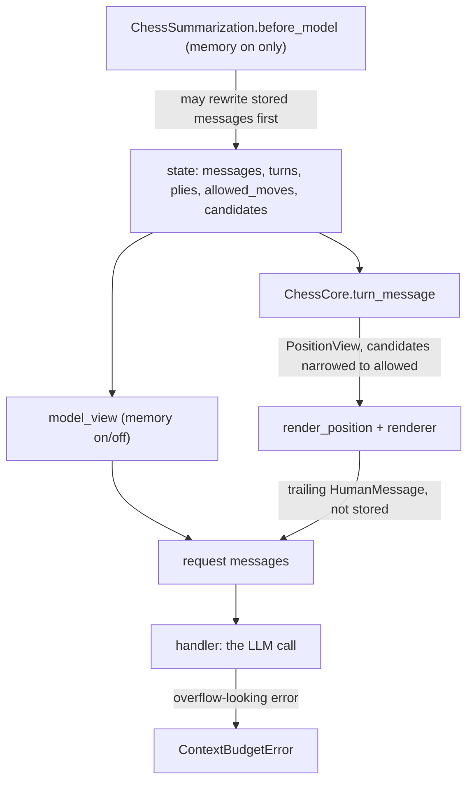

# Prompt and memory

Every LLM call the chess agent makes is built in one place: `ChessCore._prepare`, which runs inside `ChessCore.wrap_model_call` ([core.py](/libs/chess/langchain_chess/middleware/core.py)). It replaces the request's messages with:

1. `model_view(messages, turns, memory=...)`: a filtered, deep-copied view of the stored conversation, and
2. one trailing `HumanMessage` whose text comes from `ChessCore.turn_message(state)`, which calls `render_position(...)`. This is the current position, and it is **never stored**.

The system prompt is `SYSTEM_PROMPT`, or `system_prompt=` passed to `create_chess_agent`. `create_agent` sets it, and `_prepare` leaves it alone. Passing `None` keeps the bundled prompt, and an empty string raises `ChessContractError`. All the wording lives in [prompt.py](/libs/chess/langchain_chess/prompt.py). That module is pure, and its docstring asks that wording changes be deliberate and come with rendered-prompt tests. For where this fits in a run (turn opening, retries, finalization), see [turn lifecycle](/openwiki/architecture/turn-lifecycle.md). For the fields used below (`turns`, `plies`, `allowed_moves`, `candidates`, `consumed_message_ids`), see the [state record](/openwiki/concepts/state-record.md). For the settings surface (`CoreSettings`, `ChessContext`), see [settings and model arguments](/openwiki/concepts/settings-and-model-arguments.md).

*How one move request is assembled. When memory is on, summarization rewrites stored `messages` before `wrap_model_call` reads them.*

## What is stored vs. what is rendered

Stored `messages` hold only a small working conversation:

- **Opening message of a turn.** For a chat command this is the human's own message (`go`, `e4`, …). For a `position` command, core writes a short delta built by `delta_text`: `New game. You are White.` on a fresh thread, the new movetext since the last turn (for example `1... c5`), or `Your move as Black.` when nothing new was played. The turn record keeps its id in `opened_message_id`.
- **Model replies**, including reasoning blocks (kept for tracing). A reply with no text is stored as the placeholder `[no text in reply]` (`EMPTY_REPLY`), keeping its id and usage metadata.
- **Retry feedback** (`feedback_text`): `Try again, that move was rejected: <reason>. Choose from: <allowed SAN>. Keep the reply short and end with \`MOVE: <move>\`.` When the reply was the empty placeholder, the reason is replaced by one saying the output budget was probably spent on reasoning. Feedback and rejected reply ids are tracked per turn in `feedback_message_ids` and `rejected_message_ids`.
- **Result messages** and, when memory is on, the summary message.

Board state never lives in the conversation. The position block is rebuilt from `start_fen`, `moves`, `plies` (SAN), `allowed_moves` and `candidates` on every call, including retries within a turn. So the model always sees the current position, whether memory is off or earlier turns were summarized.

## The position block

### What core builds

`ChessCore.turn_message` builds a `PositionView` (`start_fen`, `moves`, `allowed`, `initial_allowed`, `candidates`, `turn_id`, defined in [contract.py](/libs/chess/langchain_chess/contract.py)) and passes it to `render_position`. It narrows `candidates` to those still in `allowed_moves` **before** rendering, so a later hard restriction never leaves a stale candidate on screen. `render_position` expects that narrowing to have been done already. `PositionView.restricted` is true when the allowed set differs from the full legal set.

`render_position(view, sans, render)` always writes these parts, whichever renderer is used:

1. `Moves so far: <movetext>` (numbered from any root FEN), or `(none, this is the first move)`.
2. `Starting position (FEN): …`, only when the game's root is not the standard starting position.
3. The renderer's **position** part, if it isn't blank.
4. `White to move.` / `Black to move.` and, if applicable, `You are in check.`
5. The renderer's **moves** part, if it isn't blank.
6. `Only these moves are permitted: …` whenever the turn is restricted (a `position.restrict`, or narrowing by middleware). This line comes from core and ignores `move_list`, because otherwise the model would try moves it cannot play.
7. `Reply with your analysis, then the final line \`MOVE: <move>\`.`

### The bundled renderer and its display settings

A renderer is a pure `PositionRenderer = Callable[[PositionView], str | PositionSection]`. A plain string counts as the position part. A `PositionSection(position=..., moves=...)` fills both slots. The bundled one is `position_renderer(show_fen=True, show_board=True, move_list="both")`, which `create_chess_agent` builds from its `show_fen`, `show_board` and `move_list` arguments:

- **Position part:** `FEN: …` when `show_fen`, then `Board (ranks 8 to 1, uppercase is White):` and the ASCII board in a code fence when `show_board`.
- **Moves part**, controlled by `move_list` (`ListedMoves = Literal["both", "legal", "candidates", "none"]` in [settings.py](/libs/chess/langchain_chess/settings.py)):

| `move_list` | `Suggested candidates: …` (when there are any) | `Legal moves: …` (unrestricted turns only) |
|---|---|---|
| `both` (default) | yes | yes |
| `legal` | no | yes |
| `candidates` | yes | no |
| `none` | no | no |

The candidates line reads `Suggested candidates: <SAN list>. These are suggested candidates; you may play any allowed move.` It also appears on restricted turns when `move_list` allows it. On a restricted turn, the `Legal moves` list is replaced by core's permitted-moves line.

Passing `render_position=` to `create_chess_agent` replaces the bundled renderer. `show_fen`, `show_board` and `move_list` are then ignored. Core's fixed parts (moves so far, a custom starting FEN, side to move, check, permitted moves, the `MOVE:` request) remain, so a custom renderer cannot drop them.

`candidates` are soft suggestions. In practice `SystemOneMiddleware` writes them when it doesn't play a move itself, and the write guard allows only one writer per turn. They are reset whenever a turn opens, retries from scratch or finalizes. See the [middleware contract](/openwiki/concepts/middleware-contract.md).

## The model view (`model_view`) and memory

`memory` is a **boolean**. It is `create_chess_agent(memory=False)` by default, and `ChessCore` passes it to `model_view(..., memory=...)`. The old string modes are gone: `none` became `False`, `summarize` became `True`, and `full` was removed (see [below](#the-removed-full-mode)). Rules shared by both settings:

- Only `HumanMessage` and `AIMessage` pass through.
- **Current turn:** every feedback message is kept, but among its rejected replies only the latest is shown. Earlier rejected attempts are hidden, so a third attempt sees the opening message, the feedback lines and the newest bad reply.
- **Reasoning blocks** (`reasoning`, `thinking`, `redacted_thinking`) are stripped from every AI message except the current turn's latest rejected reply. Stored messages keep them.
- Every returned message is a `copy.deepcopy`, so wrappers further in that mutate messages can't reach checkpointed state.

| `memory` | What precedes the position block |
|---|---|
| `False` (default) | Only the current turn: messages from `opened_message_id` onward. Earlier turns are invisible, so the position block carries all context. |
| `True` | The whole stored conversation, minus the rejected replies and feedback of **earlier** turns, so what remains is a clean record of opening messages and accepted replies. `ChessSummarization` may have compacted that conversation into a leading summary message plus recent messages. Until the trigger fires, the model sees every earlier turn's opening and accepted reply. |

`model_view` handles `memory=True` as "everything except earlier turns' failures". The summarization itself happens only in `ChessSummarization`, which rewrites stored `messages`.

### The removed `full` mode

There used to be a third mode, `full`, which showed every earlier turn verbatim with no compaction. It has been removed, and `memory` is now a plain on/off switch. Settings are strict pydantic models where `memory: bool` defaults to `False` in every settings-file version. So the old string values (`"full"`, and also `"summarize"` or `"none"`) no longer validate in `ChessContext`. The measurements behind removing `full` and the condition for revisiting it are on the [decisions and measurements](/openwiki/concepts/decisions.md) page.

### Adapter knobs

`memory`, `move_list`, `show_fen`, `show_board` and `system_prompt` are `CoreSettings` fields, so every surface gets them through `langchain_chess_systemone.settings.ChessContext`. The `memory` field's description reads "Keep earlier turns, summarized at 70% of the model's input limit. Needs a model with a known input limit. Ignored when the LLM doesn't play." The UCI engine advertises `Memory` as a `check` option, and it still accepts the legacy values `summarize`/`none` as `true`/`false` ([engine.py](/libs/cli/langchain_chess_cli/uci/engine.py)). It also advertises `MoveList` as a combo of the four values. No surface has a summary-trigger knob.

## ChessSummarization

[summarization.py](/libs/chess/langchain_chess/middleware/summarization.py) subclasses LangChain's `SummarizationMiddleware`. It keeps the stock trigger and cutoff logic and adds chess-specific accounting and validation.

**Placement.** `create_chess_agent` appends it only when `memory=True` ([agent.py](/libs/chess/langchain_chess/agent.py)). It goes after `ChessCore`, `ForcedMoveMiddleware` and all user middleware, and only the core-owned `StallRetry` (a `wrap_model_call` retry for stalled streams) comes after it. So it is the last `before_model` hook, and it runs only when a real LLM call is about to happen. When System 1 proposes a move or the forced-move shortcut applies, the run jumps to the end before it runs. It is core-owned and not wrapped by the write guard, and it is the only middleware allowed to rewrite `messages`. Its `name` property returns `"SummarizationMiddleware"`, so graph node names (for example `SummarizationMiddleware.before_model`) stay stable.

**Fixed topology.** With `fixed_topology=True` and `memory=False`, `create_chess_agent` appends `NoSummarization` in the same slot instead. It has the same name and its `before_model` hooks do nothing, so the graph has the same nodes whatever the memory setting. The server builds every graph with `fixed_topology=True`. The Agent Server reads and updates thread state with a graph built without the run's settings: `shape()` in [graph.py](/apps/server/langchain_chess_server/graph.py) calls `create_chess_agent(None, fixed_topology=True, ...)`. The CLI does not set it.

**Defaults.**

- `trigger = ("fraction", 0.7)` of the model's input limit.
- `keep = ("messages", 20)`.
- `summary_prompt = CHESS_SUMMARY_PROMPT`. It asks the model to keep plans, threats, opponent tendencies and open questions. It also tells the model to ignore rejected moves and retry feedback, and not to list moves or describe the board, since the position is shown on every turn.

**The trigger counts the whole request.** `create_chess_agent` passes an `overhead` callable that returns the system prompt and the turn's position message (`core.turn_message(state)`). `before_model` counts those tokens and adds them only to the stock `_should_summarize` check. Trimming and the keep cutoff still count only the stored messages. So a long system prompt or position block moves the trigger earlier but does not change what gets summarized.

**Construction-time checks** (each raises `ChessContractError`):

- `memory=True` with `model=None` fails with "memory needs a model".
- `summary_prompt` must contain `{messages}`.
- `keep` must be `("messages", n)` with `n >= 2 * max_retries + 2`, which is 8 for the default `max_retries=3`. The stock cutoff counts messages and knows nothing about turns. This floor guarantees that one turn's opening message, every attempt and every feedback line can all be kept. Token-based `keep` values are rejected.
- **Profile requirement.** A fractional trigger needs the model's `max_input_tokens`, which `input_limit(model)` reads from `model.profile`. If the stock constructor raises `ValueError` (no profile), the error is re-raised as `ChessContractError` with a hint: give the model `profile={'max_input_tokens': ...}`, pass `summarization` with an absolute trigger, or turn memory off.
- **Room for the system prompt.** `check_room(prompt)` rejects a system prompt whose token count reaches a trigger threshold (a fraction of the input limit, or an absolute token trigger), because it would summarize before every call ("shorten it or turn memory off"). With memory off, a long prompt is accepted.

**Configuring it in the library.** Pass a preconfigured `SummarizationMiddleware` as `create_chess_agent(summarization=...)`. `ChessSummarization.from_middleware` copies its public settings (`trigger`, `keep`, `summary_prompt`, `trim_tokens_to_summarize`, `token_counter`), and the checks above still apply. Tests use this route to set small message-count or token triggers.

## Input limits and the memory eligibility check

Every surface builds its agent with the shared `build_agent(settings, ...)` in [langchain_chess_systemone/agent.py](/libs/systemone/langchain_chess_systemone/agent.py). The server's `build_graph` and the CLI's TUI and UCI factories call it, and none of them pass `summarization=`. So deployed games always use the fractional default of 70% of the input limit, which makes a correct `max_input_tokens` essential. Models come from the shared factory `chat_model(model, arguments)` in [chat_models.py](/libs/chess/langchain_chess/chat_models.py). `build_agent`'s `default_model` calls it with local model arguments, and the server's `server_model` calls it with the server's stricter `model_kwargs` filter. The factory sizes the output budget and the input limit together:

- **Output budget.** `output_budget(window, ceiling)` is `MAX_TOKENS = 64000` (reasoning included), capped by the model's own output limit when known and by half of a small context window. An explicit `max_tokens` from `model_kwargs` takes precedence. If it fills the whole window, `_check_room` raises `ModelArgumentsError`, because memory would then summarize on every call.
- **Gateway (`langsmith:`) models.** The gateway's `ChatOpenAI` ships without a profile, so the factory reads `context_window(model)` from the pricing snapshot ([pricing.py](/libs/chess/langchain_chess/pricing.py)). That window counts input and output together. The output ceiling comes from the vendor's own LangChain profile, when that integration is installed. If the window is known, the model gets `profile={"max_input_tokens": window - budget}` (for example `1_048_000 - 64000` for the default GLM model). If it is unknown, there is no profile.
- **Native providers.** The factory keeps the provider's own profile but may lower its `max_input_tokens` to `min(native max_input_tokens, window - budget)`, so the summarize schedule leaves room for the output budget. For a bare spec, the window falls back to the native profile's `max_input_tokens`.

The settings help warns that an output limit set only inside `extra_body` isn't seen by this sizing, so memory may summarize too late.

**Eligibility check.** In `build_agent`, a `systemone` policy never builds a model, and the effective memory is `settings.memory and model is not None`. If memory is on and `input_limit(model)` is `None`, `build_agent` raises `ChessContractError` ("… has no known input limit, so it can't use memory; turn it off") before calling `create_chess_agent`. With memory off, the same unknown-limit model builds fine. With `policy="systemone"`, memory is silently dropped and no summarization node is added.

The server also serves `GET /ui/model-limit?model=…` ([app.py](/apps/server/langchain_chess_server/app.py)), backed by the cached `model_limit()` helper in `graph.py`. It returns `input_limit(default_model(ChessContext(model=model)))`, or `None` if the model can't be built. The new-game dialog offers memory only when that value is known.

See [models, gateway and cost](/openwiki/concepts/models-gateway-and-cost.md).

## Summary accounting

`before_model`/`abefore_model` set the overhead token count, then run the stock hook inside `recorder.sink("summary")`. If the stock hook returns a rewrite, `_account`:

- appends the summary's own provider calls (kind `summary`) to the current turn's `calls` **in the same state update as the rewrite**, so the summary and its cost are checkpointed together;
- gives any id-less `HumanMessage` in the rewrite (the summary) a UUID and adds it to `consumed_message_ids`, so core's lifecycle never mistakes it for a new chat command.

Consequences, verified in [test_memory.py](/libs/chess/tests/test_memory.py):

- A turn's calls can read `["summary", "llm"]`, or `["llm", "summary", "llm"]` when a retry within the turn pushes the conversation over the trigger.
- If the model call after a summary fails, the rewrite and the `summary` call are already checkpointed, and the turn stays pending.
- Concurrent stateless runs each record their own summary.
- After a rewrite in the middle of a turn, the current turn's opening message may be summarized away, but the newest attempt and its feedback survive, and the retry still ends with the position block.

Whether summary calls actually fire in deployed games is a runtime question. See [runtime behavior](/openwiki/operations/runtime-behavior.md) for observed call kinds per turn.

## Overflow detection

`wrap_model_call` and `awrap_model_call` catch exceptions from the handler. If the lowercased error text contains any of `prompt is too long`, `context length`, `context_length`, `maximum context`, `too many tokens` or `input is too long` (`looks_like_overflow`), the exception is re-raised as `ContextBudgetError` (exported from `langchain_chess`), chained to the original. Other exceptions propagate unchanged. If some provider calls had already completed in that model call, core first records them on the turn (with a `failed_call` marker) and re-raises the same error from `after_model`, so the cost is kept. Either way the turn stays `pending`, so a later run with no new command retries it. Detection is a heuristic based on provider error strings, so a provider with different wording produces a plain error. Summarization is the proactive defence, and this error is the reactive signal.

## Measurements

The [decisions and measurements](/openwiki/concepts/decisions.md) page records the choices here that look like gaps, with their numbers. Anthropic prompt caching was not shipped, because the gateway's single request-level breakpoint lands on the per-turn position block (the trailing message `render_position` builds), so it would never hit, and prompts with memory off are small. That page also records the memory-mode comparison that led to removing `full`. The numbers are kept only there, so check that page for current values.

## Tests that matter

- [test_text.py](/libs/chess/tests/test_text.py): exact rendered text of `render_position`. It covers the legal list vs. the permitted-only line, the `move_list` matrix on unrestricted and restricted turns, dropping the FEN and board, the bundled line order, a `PositionSection` renderer, the custom starting FEN, and a custom renderer that cannot drop core's lines (check, permitted moves, the `MOVE:` request). It also covers `delta_text`, `feedback_text`, and `model_view` with memory off and on (hidden attempts, earlier turns' failures dropped, reasoning stripping, deep copies).
- [test_memory.py](/libs/chess/tests/test_memory.py): summarization rewrites during a turn and on a retried turn, the keep floor and prompt checks, `input_limit` reading the profile, a profileless model failing and a profiled one getting the `SummarizationMiddleware.before_model` node, a fixed topology keeping a summarization node that never summarizes, and call ordering and checkpointing of `summary` calls. It also checks that the trigger counts the system prompt and position message (but not what gets summarized), that a system prompt that leaves no room is rejected up front, and what memory shows across turns before any summary fires.
- [test_agent.py](/libs/systemone/tests/test_agent.py) (systemone): `build_agent` rejects memory for a model without an input limit, and `systemone` alone never builds a model or a summarization node.
- [test_graph.py](/apps/server/tests/test_graph.py): every policy × memory setting builds the same topology as a read graph (including the summarization node). Gateway profiles are `window - 64000`. Memory builds for gateway and native models with known limits and is rejected for an unknown-limit model (but not under `systemone`). `memory="full"` fails validation, and `model_limit` agrees with the agent.
- [test_lifecycle.py](/libs/chess/tests/test_lifecycle.py): memory off sees only the current turn, an empty reply is stored as the placeholder and triggers the reasoning-budget feedback, and `ContextBudgetError` leaves the turn pending.
