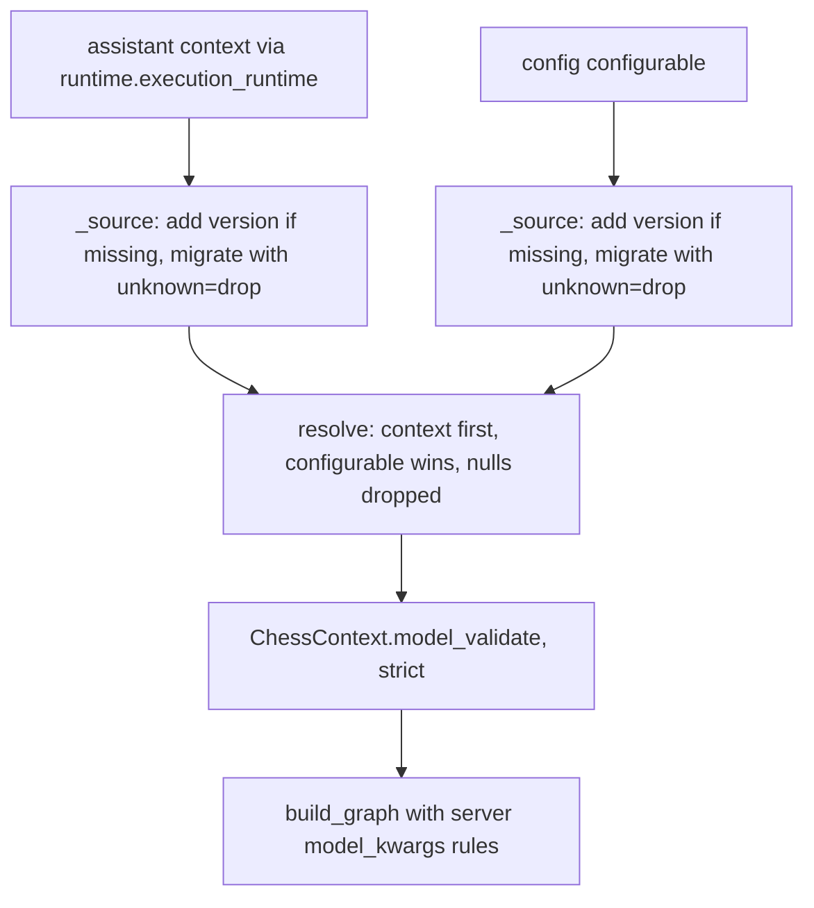

# Settings, versions and model arguments

Every game's opponent is described by one settings object, `ChessContext`. The agent server, the CLI (TUI and UCI), the web app and the evals all read it. The schema is defined once in Python, versioned, and generated into JSON Schema and TypeScript so that the browser checks values the same way the server does.

## Layers of the schema

- **`Settings`** (`libs/chess/langchain_chess/settings.py`) is the pydantic base class. Its config is `extra="forbid", frozen=True, strict=True`. Strict means there is no coercion (`"5"` is not accepted as `5`). The web app's checks are generated from the schema, and JavaScript has no loose `"5" == 5` equality either. Instances are immutable.
- **`CoreSettings`** holds the LLM core: `model` (default `DEFAULT_MODEL`, `langsmith:baseten/zai-org/GLM-5.3-Flash`), `model_kwargs`, `reasoning_effort`, `system_prompt`, `show_fen`, `show_board`, `move_list`, `memory` and `draw_claims`.
- **`SystemOneSettings`** (`libs/systemone/langchain_chess_systemone/settings.py`) holds the System 1 ranker and gate: `systemone_model`, `style`, `with_eval`, `with_nouls`, `gate`, `threshold`, `tournament_threshold`, `k` (from 1 to `CHOICE_LIMIT`), `top_p`, and `seed`, which is bounded to ±(2^53−1) so a browser keeps it exactly. `k` and `seed` accept whole-number floats such as `5.0`, because JSON cannot tell those apart from integers.
- **`ChessContext`** combines a head (`version: Literal[2]`, plus `policy`, which is one of `llm`, `systemone` or `hybrid`) with the two groups above.

Each field is declared through the `setting(...)` helper. It attaches a description (used by Studio and the CLI), `langgraph_nodes` (the nodes Studio highlights), and `x-label`/`x-help` (the web app's name and tooltip for the setting). Tests require every label to be unique and every tooltip to be plain text ending in a full stop.

The graph's `context_schema` is not `ChessContext` but `ChessContextInput`. That is a lenient `TypedDict` in which every key is optional and nullable. LangGraph builds the context from it without validation, so an assistant saved by an older version still runs. `resolve` does the real validation.

## Versions and migration

`VERSION` is currently 2. `DEFAULTS` freezes each version's keys and defaults, and a released entry must never be edited. `MIGRATIONS[n]` carries version *n*'s keys to version *n+1*. The only step so far, `_adds_prompt_and_model_options`, is 1→2. Version 2 only added keys (`model_kwargs`, `system_prompt`, `show_fen`, `show_board`).

Any schema change must bump `VERSION`: a key added, renamed or removed, a changed default, or a changed meaning. Each migration step takes a `complete` flag:

- For **partial** settings (a file or source that sets only some keys), a step writes only what it must. Writing an added key's default would override a source merged underneath. A step that changes a default must write the old default into a partial that omits the key.
- For **complete** (recorded) settings, the step fills in the added keys' defaults.

`version_of` requires a positive-integer `version` and rejects any version newer than the reader with a `SettingsError` ("upgrade it"). `migrate(data, unknown="error"|"drop", complete=...)` removes `version`, rejects or drops keys that version doesn't know, and applies every step up to `VERSION`.

Entry points:

| Function | Reads | Rules |
|---|---|---|
| `load(data)` / `load_file(path)` | settings files (JSON) | `version` required, every other key optional, unknown keys are an error |
| `load_recorded(data)` | settings a game recorded | must contain exactly its version's keys, otherwise "damaged"; migrated with `complete=True` |
| `resolve(*sources)` | migrated partial sources | merged in order with later sources winning; keys set to `None` are dropped before validation, which resets them to the default |
| `dump(settings)` | a `ChessContext` | every key of the current version as JSON; this is what a game records |

The rule that null means reset works because every nullable setting defaults to null.

## Server resolution: assistant context, then `configurable`

*How `make_graph` turns a run's two setting sources into one validated `ChessContext`.*

`resolve_context(config, runtime)` in `apps/server/langchain_chess_server/context.py`:

1. Reads the assistant context from `runtime.execution_runtime.context`, which can be a model or a dict, and then `config["configurable"]`.
2. Treats a source with no `version` (or a null one) as the current version, because Studio saves assistants without one. This is only safe while each version just adds keys. A version that renames or removes a key must decide how to read versionless sources. Because a versionless source is treated as version 3, it skips the 2→3 step, so a versionless source that still names a `semif-` model is not rewritten to Jev.
3. Migrates each source with `unknown="drop"`, so server-owned keys such as `thread_id` are ignored.
4. Resolves in the order context, then configurable. A key omitted from `configurable` keeps the assistant's value. An explicit `null` resets the key to its default, so a run can clear an assistant's `top_p`. Validation happens after the merge, so a bad value fails the run up front with a `ValidationError`, and a newer `version` fails with a `SettingsError`.

`make_graph` calls this only when the call carries an execution runtime. Reads, updates and introspection get the settings-free `shape()` graph instead. See [agent-server](/openwiki/integrations/agent-server.md).

## CLI and eval surfaces

- **CLI** (`libs/cli`): `_settings` loads `--config` through `load_file` (or starts from the defaults), parses `--model-kwargs` as JSON, then calls `overlay(settings, flags, resets)`. `overlay` sets each key named by `--reset` back to its default, then applies every flag that was given (a flag left out is `None` and ignored), then validates again. An unknown reset key, or `version`, raises `SettingsError`. The UCI engine also loads a settings file through `load_file`. `run_config` puts `dump(settings)` together with `sent(settings)` into trace metadata.
- **Opponent settings files** are partial settings files. For example, `evals/experiments/opponents/semif-terse.json` is just `{"version": 2, "systemone_model": "semif-qwen3.5-4b", "style": "terse"}`, and every missing key takes its version's default. A System 1 experiment TOML entry can name one with `opponent` instead of `model`/`style`, but not both. The eval CLI also accepts an opponent file. See [system-one-evals](/openwiki/workflows/system-one-evals.md).

## `model_kwargs`: checked, resolved, per surface

`model_kwargs` are extra constructor arguments for `init_chat_model`. They take precedence over the settings, which in turn take precedence over the app's defaults. `libs/chess/langchain_chess/model_arguments.py` is pure and owns the rules:

- **Held back on every surface** (`held_back`):
  - model names (`MODEL_NAMES`, because the `model` setting names, prices and sizes calls);
  - agent-owned keys (`AGENT_OWNED`: `input`, `messages`, `instructions`, `stream`, …);
  - app-owned constructor keys at the top level (`APP_OWNED`: `model_kwargs`, `model_provider`, `name`, `profile`, …);
  - anything that matches `CONNECTION_PATTERN` (key/secret/token/header/url/base/…), including inside `extra_body`. The exceptions are the output-limit names and `prompt_cache_key`.
- **Held back only on the `server` surface**: `ACCOUNT_RESOURCES` (`tools`, `tool_choice`, `previous_response_id`, `conversation`, `prompt`), and any top-level key that is not in the `SERVER_ALLOWED` allowlist (`temperature`, `top_p`, `max_tokens`/`max_output_tokens`/`max_completion_tokens`, `reasoning_effort`, `reasoning`, `verbosity`, `extra_body`). Keys inside `extra_body` are not subject to the allowlist, but the account-resource and connection checks still apply to them.
- **Shape checks** (`problems`): `extra_body` and `reasoning` must be objects. Aliases must agree: `reasoning_effort` and `reasoning.effort` are one group, and the three output-limit names are another; `True` and `1` count as different. The effort must be a non-empty string, and the output limit a positive integer (a whole-number float is accepted).

`model_arguments(model_kwargs, reasoning_effort=..., surface=...)` drops null values, raises `ModelArgumentsError` on any problem, and returns a `ModelArguments` with three parts:
- `kwargs`: the aliases collapsed to one name. The effort is merged into a `reasoning` object if one was given, and is otherwise sent as `reasoning_effort`.
- `max_tokens`: the output limit, if any.
- `reasoning_effort`: the effort the request actually carries. If `extra_body.reasoning` is present, it replaces the whole object.

Where each surface checks:

- The `CoreSettings.model_kwargs` validator runs the **`local`** rules, so no `ChessContext` anywhere can hold arguments that are forbidden everywhere.
- The server builds the model with `arguments(settings, "server")` in `server_model`, and records `sent(settings, "server")` as graph metadata. The CLI and evals use `default_model`, which applies the `local` rules.
- The web app mirrors `held_back` and `problems` in `packages/chess-ui/src/settings.ts`. `isSetting` uses `local`, and the new-game setup (`apps/web/src/setup.ts`) checks against `"server"` before starting a game. See [web-frontends](/openwiki/architecture/web-frontends.md).

For how the resolved arguments reach the gateway and affect token accounting, see [models-gateway-and-cost](/openwiki/concepts/models-gateway-and-cost.md). An output limit set only inside `extra_body` isn't seen, so memory may summarize too late.

## Codegen into `packages/chess-ui`

`python -m langchain_chess_server.codegen <dir>`, run as `mise run generate:settings`, writes three files into `packages/chess-ui/src/generated`:

- `settings.schema.json`: `settings_schema()`, the resolved `ChessContext` with every key required.
- `opponent.schema.json`: `input_schema()`, a settings file. Only `version` is required (as an enum of the known versions), every other key also admits `null` and keeps its default, and `additionalProperties` is false.
- `settings.ts`, which contains:
  - `SETTINGS_VERSION`;
  - enum types and the `ChessContext` interface;
  - `SETTING_SPECS` (the checks);
  - `SETTING_LABELS` and `SETTING_HELP`;
  - `DEFAULT_CONTEXT`;
  - `VERSION_DEFAULTS` (built from `DEFAULTS`);
  - `MODEL_KWARGS_RULES`, the rule sets exported from `model_arguments.py`.

The hand-written `packages/chess-ui/src/settings.ts` mirrors `migrate`, `resolve`, `load` and `load_recorded` on top of those generated values. `libs/systemone/tests/fixtures/settings-cases.json` is a shared fixture (`files`, `recorded`, `values`) that holds the Python and TypeScript readers to the same answers, and a test requires its `values` to cover every setting.

## Server environment settings (`ServerSettings`)

Separate from the per-game `ChessContext`, the agent server reads deployment-level settings from its environment through `ServerSettings` (`apps/server/langchain_chess_server/settings.py`), a pydantic-settings class. It reads the shell first and `.env` second, and ignores variables it doesn't declare. Model credentials are not here: the chat model reads the providers' own variables (or `LANGSMITH_GATEWAY*`) itself. Nothing is required.

| Variable | Used for | Blank value |
|---|---|---|
| `LANGSMITH_GATEWAY_API_KEY` | read only to reject a blank value | error |
| `TYPESAFE_API_KEY` | System 1 ranker | error |
| `TYPESAFE_BASE_URL` | System 1 ranker | error |
| `OAUTH_CLIENT_ID` | "Sign in with LangSmith" access policy | unset |
| `ALLOWED_ORGANIZATION_ID` | "Sign in with LangSmith" access policy | unset |

Blank values are handled in two different ways:

- **Keys: blank is an error.** If one of the gateway or TypeSafe variables is set to an empty or whitespace-only value, construction fails with a `ValidationError` ("is set but empty; unset it or give it a value"). The `.env` template expands `LANGSMITH_GATEWAY_API_KEY=${LC_GATEWAY_KEY}` to `""` when the shell variable is missing, and langchain-core would then quietly fall back to the tracing key. The variables are optional, but `typesafe()` raises `ValueError` ("System 1 needs …") when either TypeSafe variable is unset. Only the policies that run System 1 call it, through the server's pooled ranker.
- **OAuth settings: blank means unset.** `OAUTH_CLIENT_ID` and `ALLOWED_ORGANIZATION_ID` are stripped, and an empty result becomes `None`. The deploy workflow writes both before the OAuth app exists, and an unset value only refuses sign-in tokens. `auth.py` builds its `AccessPolicy` from these two values, and a policy with either value unset refuses every token, so the deployment accepts LangSmith API keys only. See [langsmith-sign-in](/openwiki/integrations/langsmith-sign-in.md).

## Rules a change must keep

- Keep settings strict: no coercion beyond the explicit whole-float handling for `k` and `seed`.
- Bump `VERSION` for any schema change, and add a frozen `DEFAULTS` entry and a `MIGRATIONS` step. Mirror the step in `packages/chess-ui/src/settings.ts`. New versions should only add keys unless the migration handles renames and removals, because versionless server sources are read as current.
- A migration for partial settings must not write an added key's defaults.
- Regenerate with `mise run generate:settings`. `test_the_committed_files_are_current` fails when the generated files are stale.
- Keep the server allowlist for `model_kwargs`: new top-level arguments reach the server only by being added to `SERVER_ALLOWED`, and the change then flows to the web app through codegen.
- Give every new field a `setting(...)` with a unique label and a plain tooltip, and add valid and invalid cases to `settings-cases.json`.

## Focused tests

- `libs/systemone/tests/test_settings.py`: file and recorded cases, per-key value cases, the defaults frozen to match the model, migrate and resolve semantics, immutability, and the lenient input schema.
- `apps/server/tests/test_context.py`: merge order, null reset, versionless sources, bounds, and rejection of newer versions.
- `libs/chess/tests/test_model_arguments.py`: precedence, collapsing aliases, `extra_body.reasoning` replacement, and the everywhere and server-only hold-backs, checked against captured gateway bodies.
- `apps/server/tests/test_codegen.py`: committed files are current, and the required-keys shape of both schemas.
tests/test_context.py`: merge order, null reset, versionless sources, bounds, and rejection of newer versions.
- `libs/chess/tests/test_model_arguments.py`: precedence, collapsing aliases, `extra_body.reasoning` replacement, and the everywhere and server-only hold-backs, checked against captured gateway bodies.
- `apps/server/tests/test_codegen.py`: committed files are current, and the required-keys shape of both schemas.
and the everywhere and server-only hold-backs, checked against captured gateway bodies.
- `apps/server/tests/test_codegen.py`: committed files are current, and the required-keys shape of both schemas.
