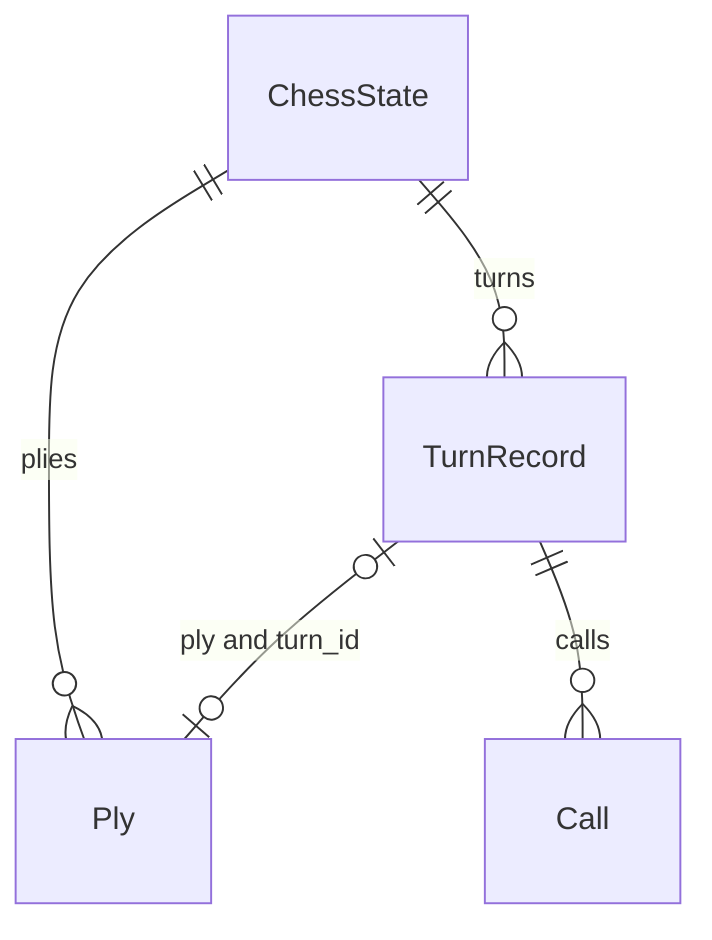
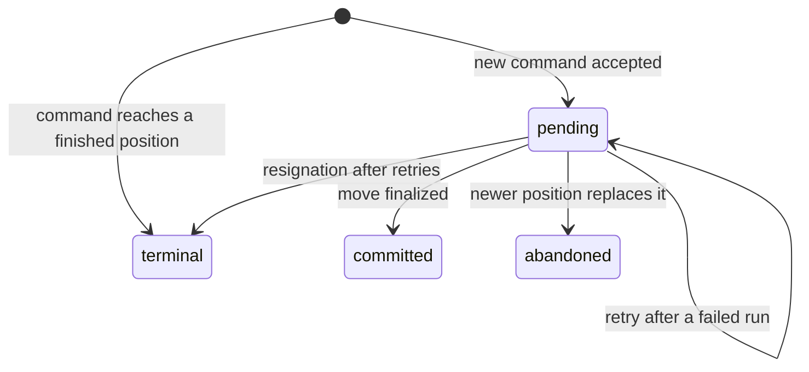
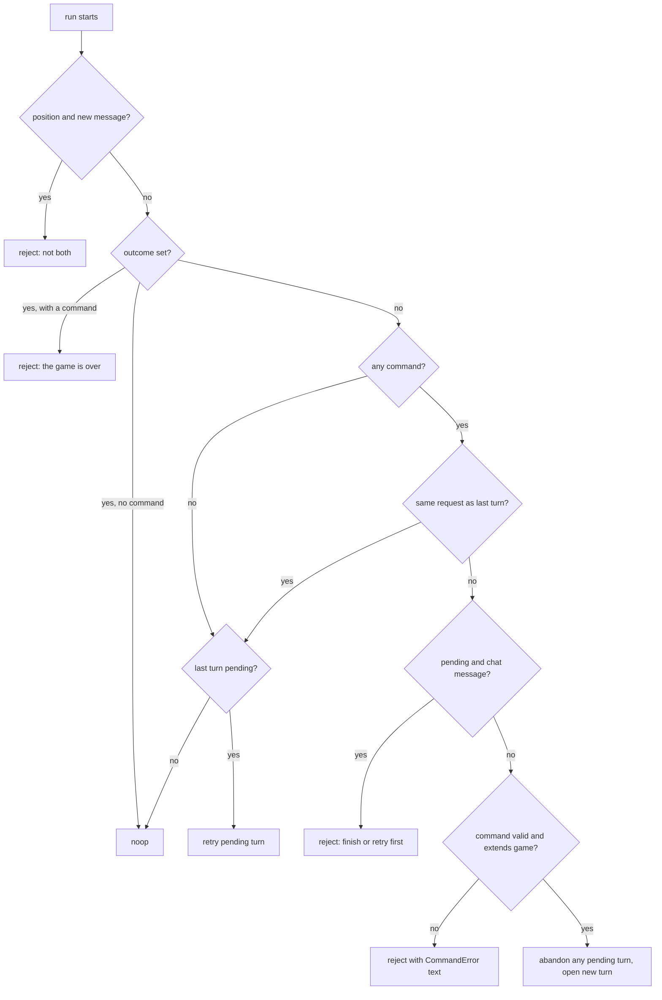

# The client-readable state record

A chess agent's LangGraph thread holds three kinds of channel:

- **The record.** This is what clients read.
- **The model's working context** (`messages`).
- **Private turn bookkeeping.** Only the middleware uses it.

This page covers the record, the input a caller may send, and how runs and threads map onto turns and games. For how `ChessCore` opens, retries and finalizes a turn step by step, see [the turn lifecycle](/openwiki/architecture/turn-lifecycle.md). For the extension rules (`ply_meta`, `turn_calls`, `turn_latency_ms`, the write guard), see [the middleware contract](/openwiki/concepts/middleware-contract.md). For how `Call` is priced, see [models, gateway and cost](/openwiki/concepts/models-gateway-and-cost.md).

All of these types live in `libs/chess/langchain_chess/state.py`. Every value is plain JSON-like data: strings, numbers, lists, TypedDicts and LangChain messages. That keeps everything serializable through LangGraph's codecs. The state has no custom reducers. Who may write which key is enforced by the write guard in `contract.py`, not by the channels.

## What clients may read

`RECORD_KEYS` names the record: `start_fen`, `moves`, `plies`, `turns`, `outcome` and `error`. `ChessCore` owns every one of them. Each is annotated `OmitFromInput`, so it appears in the output schema but is never accepted as input. If a caller sends `moves` or `outcome` alongside a command, the agent ignores them (`test_schemas`).

| Key | Meaning |
|---|---|
| `start_fen` | The game's root. It is normalized through `chess.Board(...).fen()` when a position command sets it. On the first run it defaults to the standard start. |
| `moves` | UCI moves from `start_fen`. They include external moves (from input) and the agent's own moves. |
| `plies` | One `Ply` per entry in `moves`, at the same index. |
| `turns` | Every turn the agent opened, including turns that produced no move (abandoned or terminal). |
| `outcome` | `null`, or a `Checkmate`, `Draw` (with a `DrawReason`) or `Resignation` (`reason: "illegal_moves"`). Once set, it is authoritative. |
| `error` | The reason the last command was rejected. Any accepted command, retry or no-op resets it to `null`. |

On the first run, even one that is rejected or does nothing, `ChessCore._first_run` writes an empty record: the standard `start_fen`, `[]` for the three lists, and `null` for `outcome` and `error` (it also seeds the private `consumed_message_ids` with `[]`). LangGraph leaves out keys that were never written, so without this step a new game would have no `outcome` at all (`test_first_run_writes_the_empty_record`).

### The server's `setup` key

The core record is not closed to additions: the core README tells clients to read the record keys "plus any your own middleware documents (the Agent Server's `setup`, for one)". The Agent Server's graph adds `GameSetupMiddleware` (`apps/server/langchain_chess_server/game_setup.py`), whose `SetupState` extends `ChessState` with `setup`, annotated `OmitFromInput` but deliberately **not** private so clients can read it.

- `setup` is `dump(ChessContext)` from `langchain_chess_systemone.settings`: the run's resolved opponent settings as JSON, with **every key of the current settings version** plus `version` itself (currently `2`). That covers policy, model, `model_kwargs`, prompt and board-display options, System 1 knobs, `draw_claims`, `seed`, and so on (`test_the_first_turn_records_the_setup_and_later_runs_keep_it` checks `setup["version"] == 2`).
- Because the settings are versioned, a recorded `setup` stays readable after the schema changes. Readers use `load_recorded` (Python) or `loadRecorded` (TypeScript, `packages/chess-ui/src/settings.ts`). Both require exactly the keys of the recorded version (otherwise the setup is "damaged") and then migrate it to the current version. The migration table is `MIGRATIONS`, and `DEFAULTS` freezes each version's keys.
- It is written only by the run that opened the game's **first** turn: exactly one turn exists and its id equals `invocation.opened_turn`. It is never rewritten, so later runs with different settings leave it naming the first turn's settings.
- The middleware checks in both `before_agent` (so a first turn whose model call fails still has it) and `after_agent` (because a first command that lands on a finished position jumps from `ChessCore.before_agent` straight to the end, skipping later `before_agent` hooks).
- A rejected first input opens no turn and records no `setup`. A thread created before `setup` existed never gains one, even when its pending first turn is retried (`apps/server/tests/test_graph.py`).

The web UI's `gameOf` (`apps/web/src/setup.ts`) continues a game from `values.setup`, and refuses to guess a context for a thread with no readable `setup`. `ChessValues.setup` in `types.ts` is typed as `ChessContext`.

### Why `messages` is not part of the record

`messages` is the model's working context, not a history of the game:

- **Commands don't always arrive as chat.** A position command becomes a synthesized "delta" `HumanMessage` (for example "New game. You are White." or "2. Nf3").
- **Messages get removed or added.** When a command is rejected, its chat message is deleted with `RemoveMessage`. When the model makes an illegal attempt, a feedback `HumanMessage` is added.
- **Some turns have no model reply.** A move from System 1 or a forced move gets a synthesized `AIMessage("MOVE: <san>")`.
- **Summarization rewrites history.** With `memory="summarize"`, older messages are replaced. `Ply.message_id` is documented as "the committed AI message (it may since have been summarized away)".

So the durable facts about a move live on `Ply` and `TurnRecord`. Message ids stored there (`message_id`, `opened_message_id`, `rejected_message_ids`, `feedback_message_ids`) are cross-references only and may dangle. The UI's `ChessValues` still lists `messages` as optional, but only so it can stream the live reply. `liveAnalysis` in `packages/chess-ui/src/selectors.ts` finds the newest AI text after the pending turn's `opened_message_id` (or after the last human message when nothing is pending) and skips replies already committed to a ply.

### Why the private channels are not part of it

Some channels hold the working state of a single turn:

- `allowed_moves`, `candidates`, `candidates_by`, `proposal`, `fallback_move`
- `consumed_message_ids`, `terminal_intent`, `failed_call`, `invocation`

All are `PrivateStateAttr`. They are left out of both the input and output JSON schemas, and core resets the decision channels at every turn boundary (`_DECISION_RESET`: `proposal`, `terminal_intent`, `candidates`, `candidates_by`, `fallback_move`, `failed_call`). The catch is that the thread-state API (`get_state`, or the Agent Server's thread state endpoint) returns **every** channel, including these. That is why `RECORD_KEYS` exists and why the TypeScript `ChessValues` comment says "never read them".

Two of them are worth knowing as diagnostics, not as a client contract:

- `invocation` describes this run only: `action` is `execute`, `reject` or `noop`, and `opened_turn` is the id of the turn this run opened, or `None` for a retry, rejection or plain no-op (`test_the_invocation_names_only_a_turn_this_run_opened`). A command that lands on an already-finished position records `noop` with `opened_turn` set to its terminal turn. `opened_turn` may be absent on older checkpoints. `GameSetupMiddleware` relies on it.
- `failed_call` marks a model call that failed after some provider calls had completed. Core keeps those completed calls on the turn, then `after_model` re-raises the original error in the same run.

`position` is similar: it is `OmitFromOutput`, and core clears it to `None` on every run.

## Record shapes

*How the record links together: a committed turn points at its ply by index, and a policy ply points back at its turn by id.*

**`Ply`**: one half-move.

- `ply` is the half-move's index. `side` is the side that moved.
- `uci` and `san` give the move in both notations.
- `source` is `"external"` for moves that came from input. Otherwise it is the proposal's source: `llm`, `systemone`, `forced`, or an extension's name.
- `analysis` holds the reply text for LLM moves.
- `message_id`, `turn_id` and `model` are all `null` on external plies, and their `latency_ms` is `0`.
- `latency_ms` is the owning turn's `latency_ms` at commit.
- `meta` holds per-middleware telemetry keyed by middleware name. For example, `meta["SystemOneMiddleware"]` holds System 1's shortlist and gate.

For an LLM move, `model` is the model of the turn's last `llm` call. For other sources it comes from `proposal.meta["model"]`. `ChessCore._finalize` builds the ply and gathers `meta` from each extension's `ply_meta()`. If the committed move itself ends the game, the same update sets `outcome` and adds a result message, and the turn stays `committed` (`test_threefold_is_not_adjudicated_before_the_agent_moves`).

**`TurnRecord`**: one attempt by the agent to move.

- `id` identifies the turn.
- `request` is a fingerprint of the command that opened it: the chat message id, or `position:<sha256>` of the start FEN, the moves and the sorted `restrict`.
- `initial_allowed` is the legal moves intersected with `restrict`, taken when the turn opened. A retry restores it.
- `status` is `pending`, `committed`, `abandoned` or `terminal`. `ply` is set only when the status is `committed`.
- `calls` lists every model call made during the turn, including calls that completed before a model call failed.
- `rejected_message_ids`, `feedback_message_ids` and `illegal_attempts` record illegal replies. Because the count lives on the durable turn, a retry after a provider error keeps the remaining illegal-move budget (`test_a_provider_error_retry_keeps_the_illegal_move_budget`). `opened_message_id` is the message that opened the turn.
- `latency_ms` is the summed model-call time, plus extensions' `turn_latency_ms()` added once when the turn finalizes.

Extensions' own calls (from `turn_calls()`) and time (from `turn_latency_ms()`) are folded into the turn by `ChessCore._finalized` exactly once: when it commits, becomes terminal, or is abandoned.

*The lifecycle of `TurnRecord.status`. Only the last turn can be `pending`.*

**`Call`**: one provider response.

- `kind` is `llm`, `systemone` or `summary`. `model` is the canonical `provider:model`.
- Token counts: `input_tokens`, `output_tokens`, `reasoning_tokens`, `cache_read_tokens`, `cache_write_tokens`, and `cache_write_1h_tokens` (the 1-hour subset of cache writes).
- `called_at` is an ISO 8601 timestamp.
- Price fields: `cost_usd`, `cost_complete` and `priced_with` (the genai-prices version).

Unreported usage shows up as `null`. SemIf, for example, reports no token counts, so its calls have `cost_usd: null` (`test_a_call_without_usage_has_no_cost`). A move costs its whole turn: `turn_cost` in Python, and its mirror `turnCost` in `selectors.ts`. Grading and review read the same shapes (see [grading and review](/openwiki/workflows/grading-and-review.md)).

### The TypeScript mirror

`packages/chess-ui/src/types.ts` is a hand-written copy of these Python types: `Side`, `DrawReason`, `Outcome`, `Call`, `TurnStatus`, `TurnRecord`, `Ply`, and `ChessValues` for the readable keys. It also mirrors the SystemOne telemetry types and the server's `ChessContext` and `setup`. Its header says: "Keep them in step by hand." Nothing generates or checks it. **If you change a field in `state.py` (or `ChessContext`), change `types.ts` in the same commit.** Otherwise `apps/web` and `apps/review` will quietly misread threads. See [web frontends](/openwiki/architecture/web-frontends.md) for the code that uses these types. Selectors such as `turnOf` (a ply's turn found through `turn_id`), `lastPolicyPly` (the last ply with a non-`external` source) and `isPending` (the last turn is `pending`) rely on the relationships described above.

## Input: `messages` or `position`

The agent's input schema has exactly two properties, `messages` and `position` (`ChessInput`). A run carries **one** command:

- **A chat message**: the newest `HumanMessage`, if its id isn't in `consumed_message_ids`. Its text must be `go` or a single legal move in SAN or UCI. A move is recorded as an `external` ply before the agent replies. Anything else is rejected as "neither `go` nor a legal move".
- **A `position`**: `{start_fen?, moves?, restrict?}`. `start_fen` defaults to the standard start, and `moves` are UCI moves from it. `restrict` is a hard limit on which moves the agent may consider, like UCI `searchmoves`. It must be non-empty and every entry must be legal in the resulting position. The allowed set is the legal moves intersected with `restrict`, kept in legal-move order (`test_restrict_narrows_the_turn`). If only one move is allowed, forced-move handling plays it (`source: "forced"`).

Sending both is rejected: "send a position or a message, not both".

## One run, one turn; one thread, one game

The agent always plays the side to move, and a run plays at most one turn. `ChessCore._lifecycle` (in `before_agent`, the first hook of every run) sorts each run into one of the paths below.

*How `before_agent` handles a run. Rejections set `error` and end the run without touching the game.*

The rules that follow from this:

- **Idempotent resubmission.** If the same command arrives again (same message id or same position fingerprint) after its turn committed, nothing happens. No model call is made and no turn is added (`test_same_chat_message_twice_is_a_noop`). If the turn is still pending, for example after a provider error, the resend retries it in place (`test_resent_position_retries_a_failed_turn`).
- **An empty run retries or does nothing.** `{}` or `{"messages": []}` retries a pending turn and is otherwise a no-op. Passing `None` as input resumes the checkpoint from the step that failed; on a finished checkpoint it runs nothing. A retry reuses a proposal or resignation that already passed validation instead of asking the model again.
- **A pending turn blocks new chat.** A new chat message while a turn is pending is rejected ("finish or retry the pending turn first"), and the message is removed (`test_fresh_go_while_a_turn_is_pending_is_rejected`). A new *position* instead marks the pending turn `abandoned` (with extension calls and time folded in) and opens a fresh one (`test_new_position_abandons_a_pending_turn`).
- **The game must extend.** A position command is validated against the thread's game. With the thread's game called *G*, the rejections are:
  - `"a different starting position; use a new thread"`: *G* has moves and the root differs from its root.
  - `"invalid FEN …"` or `"invalid position: …"`: the root is invalid.
  - `"`<uci>` is not a legal move here"` or `"move N (uci) comes after the game ended (…)"`: a requested move is illegal, or follows an ending. The replay checks for an ending before every ply.
  - `"restrict must not be empty"` or `"restrict contains moves that are not legal here"`.
  - `"the position does not extend this game; use a new thread"`: the requested moves don't start with *G*'s `moves`. This also applies when the only change is a new `restrict` on a shorter move list (`test_same_root_with_a_new_restriction_is_rejected_as_diverged`).
- **Takebacks and new games need a new thread.** The UCI adapter checks this itself (`_thread_extends`: same normalized root and the GUI's moves start with the thread's `moves`) and, when the GUI's position doesn't extend the current thread, replaces it with a fresh thread and deletes the old one from its checkpointer. It filters `searchmoves` to the legal moves and reports the dropped ones, so it never widens the restriction. If every `searchmoves` entry is illegal it sends an empty `restrict`, which the agent rejects.
- **Finished games are closed.** Once `outcome` is set, every command is rejected with "the game is over" and empty runs are no-ops. This check comes before any replay, because a resignation can't be worked out again from the board.
- **Terminal positions don't call the model.** If a command's position is already checkmate or an automatic draw, or with `draw_claims="auto"` a threefold repetition or fifty-move draw that has actually happened, a `terminal` turn is recorded along with the outcome and a result message, and the run ends as `noop`. The model is never called (`test_terminal_positions`, `test_chat_move_that_mates_ends_the_game`). Draws the next move could claim are never adjudicated early (`rules.ending`).
- **Exhausted retries resign.** After `max_retries` feedback rounds, the next illegal reply sets a resignation intent; finalization records the `Resignation` outcome and marks the turn `terminal` with `ply: null` (`test_exhausted_retries_resign`).

A rejection writes only `error`, `invocation` and the cleared `position`, plus the empty record on a first run. `moves`, `plies` and `turns` stay as they were. Without a checkpointer the agent is stateless: every run starts a new game from its own input (`test_stateless_agent`).

## Changing the record safely

- New public fields go on `ChessState` with `OmitFromInput`, and in `RECORD_KEYS` if clients should read them. Mirror them in `types.ts`. A deployment-specific public key can instead live on a middleware's own state schema, as `setup` does, if it is `OmitFromInput` and documented for clients.
- Extension-specific data belongs in `Ply.meta[<middleware name>]` through `ply_meta()`, or in `TurnRecord.calls` and `latency_ms` through `turn_calls()` and `turn_latency_ms()`. Don't add new top-level record keys for it. An extension's own state keys should be `PrivateStateAttr`. The write guard rejects extension writes to core-owned keys ("core-owned") and only allows writes to `allowed_moves`, `proposal`, `fallback_move` and `candidates`.
- `libs/chess/tests/test_lifecycle.py` is the behavioural spec for everything on this page, including schemas, no-ops, retries, rejections and terminal positions. `apps/server/tests/test_graph.py` covers when `setup` is (and isn't) recorded.
