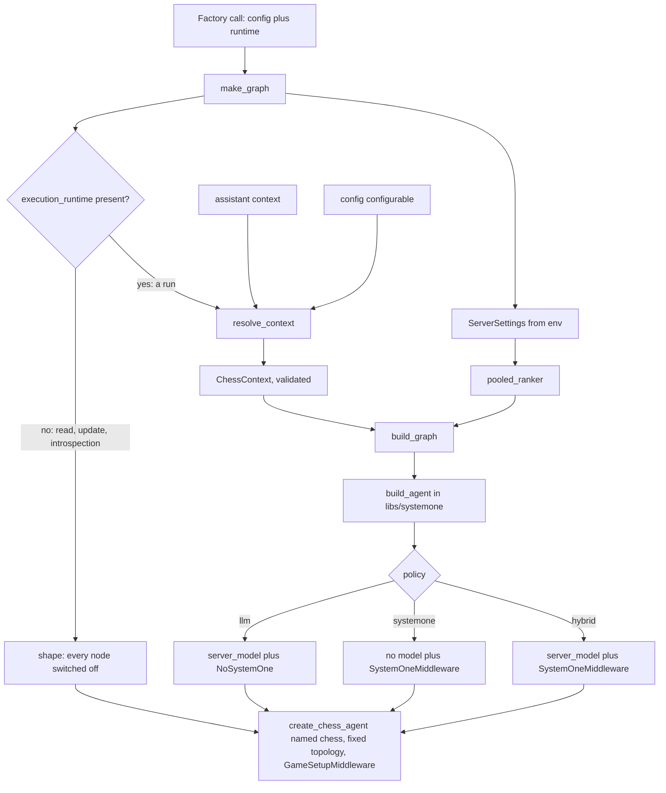
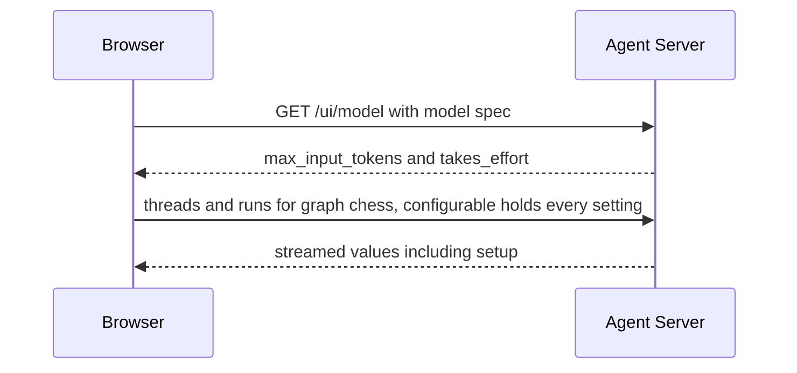

# Agent Server graph and the /ui app

`apps/server` (package `langchain_chess_server`) is the Agent Server adapter. It adds no chess logic and no settings schema of its own. It resolves a run's settings into a `ChessContext` (defined in `libs/systemone`), hands them to the shared `build_agent` (also in `libs/systemone`, used by every surface) together with the pieces the server owns (a pooled System 1 ranker, a stricter model factory, and `GameSetupMiddleware`), and answers the web UI's small JSON routes next to the graph API. Nothing else depends on it.

`langgraph.json` wires both entrypoints:

| Key | Target | Role |
| --- | --- | --- |
| `graphs.chess` | `apps/server/langchain_chess_server/graph.py:make_graph` | Graph factory. The Agent Server calls it with the config and runtime. |
| `http.app` | `apps/server/langchain_chess_server/app.py:app` | Custom FastAPI routes merged into the server: `/ui/config`, `/ui/model`, `/ui` (redirect), `/ui/` (the static build, when present), plus a lifespan hook. |
| `env` | `.env` | Environment file for the server. Name the variables only. Never document their values. |

For the image build (uv workspace, `dockerfile_lines`), see [deployment](/openwiki/operations/deployment.md).

## From a factory call to a compiled graph

*How `make_graph` turns one factory call into a compiled `chess` agent; every branch has the same nodes.*

The Agent Server calls the factory not only to run a thread but also, without the run's settings, to read or update thread state and to describe the graph. So `make_graph(config, runtime)` branches on `runtime.execution_runtime`:

- **No execution runtime** (a read, update or introspection): it returns `shape()`, the graph with every node switched off. `shape()` calls `create_chess_agent` directly with no model, `NoSystemOne()` and a `GameSetupMiddleware(ChessContext())` whose settings are never written, so it needs no model, no clients and no credentials. `test_reads_need_no_credentials` deletes the gateway and TypeSafe variables and still builds it.
- **A run**: `build_graph(resolve_context(config, runtime), ranker_factory=pooled_ranker(ServerSettings()))`. The factory must accept `runtime`. Assistant settings (the `context` given to `client.assistants.create`, or set in Studio) reach the graph only through `runtime.execution_runtime.context`. If you drop the parameter, those settings are lost with no error. The live test `test_assistant_settings_reach_the_factory_through_runtime` covers this: it runs with no run config, so only the assistant context can select `policy="systemone"`.

Construction is cheap and never calls a model or the System 1 classifier. `test_every_setting_builds_the_graph_reads_rebuild` checks that building every policy and memory combination sends no request to the (fake) System 1 client.

### Fixed topology: a setting may switch a node off but never remove it

Because reads get `shape()` while runs get a fully configured graph, every build must have the same nodes, edges and state schema. The module docstring states the rule, and three mechanisms keep it:

- With `fixed_topology=True`, `build_agent` inserts `NoSystemOne` for `policy="llm"` instead of dropping System 1. It reports the name `SystemOneMiddleware`, keeps System 1's state schema, and its `before_model` hook returns nothing.
- `create_chess_agent(..., fixed_topology=True)` keeps a no-op summarization node (`NoSummarization`) when `memory` is off, so the node set doesn't depend on `memory`.
- `GameSetupMiddleware` is present in every build, including `shape()`.

`test_every_setting_builds_the_graph_reads_rebuild` builds each (policy, memory) pair as a run and as a read and asserts identical topology, with `SummarizationMiddleware.before_model`, `SystemOneMiddleware.before_model` and `GameSetupMiddleware.before_agent` always present. The offline `langgraph dev` test `test_a_paused_run_reads_back_as_the_graph_that_ran` checks the same thing through a real server: a run paused before summarization reads back with the same `next`, and the graph the server describes has the nodes of the graph that ran, whether the settings came from run config or assistant context.

### `build_graph` over the shared `build_agent`

`build_agent` does not live in the server. It is `langchain_chess_systemone.agent.build_agent`, shared by the server, the CLI and other surfaces; each surface injects what it owns. The server's `build_graph(settings, *, ranker_factory, model_factory=server_model, checkpointer=None)` calls it with:

- `model_factory=server_model` and the caller's `ranker_factory` (in production `pooled_ranker(ServerSettings())`),
- `middleware=[GameSetupMiddleware(settings)]`, which runs after System 1,
- `fixed_topology=True` and `context_schema=ChessContextInput`,
- the default `name="chess"`.

It then applies `graph.with_config(metadata=sent(settings, "server"))`, so run metadata records the values actually sent to the model (`reasoning_effort` after `model_kwargs` resolution, and `max_tokens` when `model_kwargs` set one). `test_runs_record_the_values_sent_and_the_setup_keeps_model_kwargs_as_given` checks this. For `policy="systemone"` the metadata is only `{"reasoning_effort": None}`.

What the shared `build_agent` does with the settings:

- **Model.** `policy == "systemone"` passes `model=None` and never calls the model factory. Every other policy calls `model_factory(settings)`. Only the factories a policy uses are called, so `model_kwargs` go unread when the LLM doesn't play (`test_model_kwargs_go_unread_when_the_llm_does_not_play`).
- **Middleware.** For `systemone` and `hybrid`, one `SystemOneMiddleware` built from `ranker_factory(settings)` (see [System 1](/openwiki/architecture/system-one.md)); for `llm`, `NoSystemOne()` under a fixed topology. The surface's middleware follows. `test_the_llm_policy_never_asks_system_one` checks that an `llm` ply is sourced from the model and sends no System 1 request.
- **Memory.** `memory` is a boolean and is effective only when there is a model, so it is ignored for `systemone`.
- **Memory guard.** With a model and `memory=True`, the model must have a known input limit (`input_limit(model)`, which reads `max_input_tokens` from the model's profile). Otherwise `build_agent` raises a `ChessContractError` saying the model has no known input limit, so it can't use memory, and to turn it off.
- **Everything else** passes straight through to `create_chess_agent`: `system_prompt`, `show_fen`, `show_board`, `move_list`, `draw_claims`, `seed`, `fixed_topology`, `context_schema`, the optional checkpointer, and `name`.

The shared `systemone(settings, ranker)` builds the middleware. `gate`, `k` and `top_p` pass through unchanged. **System 1 alone must always play.** For `policy="systemone"`, both `threshold` and `tournament_threshold` are forced to `0.0` and `has_model=False`, whatever the settings say. `test_systemone_alone_always_plays_even_with_a_tournament_threshold` passes thresholds of 0.95 and 0.99 on a position with more legal moves than one capped request holds, and the resulting ply reports `threshold_used == 0.0` with `source == "systemone"`. For `hybrid`, the settings' thresholds apply.

### `pooled_ranker`: TypeSafe or OpenAI Decisions on shared connections

The server's `pooled_ranker(server)` returns a ranker factory that builds a `GatewayRanker` with the settings' `systemone_model`, `style`, `with_eval` and `with_nouls`. Its client depends on the System 1 model name:

- **`openai/<model>`** (the `DECISIONS` prefix, for example `openai/gpt-6-luna`, "Luna Decisions" in the web UI) is OpenAI Decisions. `_decisions(model)` calls the shared `classifier(model, timeout_s=TIMEOUT_S, ...)` from `langchain_chess_systemone.ranker` with `httpx` clients from `DECISIONS_POOL`. Credentials and the gateway URL come from `LANGSMITH_GATEWAY*`, as for the chat models, so a Decisions model needs **no TypeSafe settings**. `test_a_decisions_model_needs_no_typesafe_credentials_and_shares_its_own_pool` deletes `TYPESAFE_API_KEY`, builds two rankers, and checks that they point at the gateway's `/openai/v1` and share the same HTTP clients.
- **Anything else** (for example `typesafe/jev-latest`) is TypeSafe. `_classifier(model, *server.typesafe())` builds a `TypeSafeClassifier` per build, with its sync and async `httpx2` clients from `POOL`. `test_classifiers_share_one_connection_pool` checks that classifiers for different models share the same clients.

### `server_model` and `chat_model`

`server_model(settings)` calls `langchain_chess.chat_models.chat_model(settings.model, arguments(settings, "server"))`. The `"server"` surface is stricter than the local one: `model_kwargs` may set only allowlisted top-level arguments (`temperature`, `top_p`, the max-tokens aliases, `reasoning_effort`, `reasoning`, `verbosity`, `extra_body`), and never anything that reaches the deployment account's own tools and resources (`tools`, `tool_choice`, `previous_response_id`, `conversation`, `prompt`, also inside `extra_body`). A violation raises at build time. `test_the_server_builds_models_with_only_the_arguments_it_allows` covers both refusals. The full rules are on [settings and model arguments](/openwiki/concepts/settings-and-model-arguments.md).

Before building, the shared `chat_model` runs two checks that raise `ModelArgumentsError` (a `ValueError`) at graph build time:

- **Effort on a model that takes none.** If a reasoning effort is set and `takes_effort(model)` (from `langchain_chess.efforts`, a committed probe snapshot) says the spec rejects one, it fails up front instead of letting the provider answer the first call with a 400. A spec that was never probed is assumed to take an effort.
- **No room left.** An explicit output limit that fills the model's known context window is refused, since it would leave no input.

It then calls `init_chat_model` with:

- `max_tokens` set to an output budget: `model_kwargs`' own limit when given, otherwise `MAX_TOKENS = 64000` (the cap also covers reasoning tokens; a comment records that 8000 ran out mid-game at medium effort), capped by the model's own output limit when known and by half of a smaller context window. `test_a_small_window_splits_between_input_and_output` checks that `langsmith:openai/gpt-4` (8192-token window) gets `max_tokens = 4096`.
- `name` set to the bare model name from `model_identity`. Without it, every vendor reached through the gateway would show up in traces as `ChatOpenAI`.
- a reasoning effort **only when one is set** (in the settings or `model_kwargs`). Models without reasoning reject the parameter outright, so a `None` effort sends nothing (`test_no_reasoning_effort_sends_none` checks that Claude Haiku 4.5's request payload has no `reasoning` key).
- A `profile` whose `max_input_tokens` leaves room for the output budget. Gateway specs (the `langsmith:` prefix) give a `ChatOpenAI` with no profile, and memory's fractional trigger needs one. On the gateway path the factory looks up the model's context window with `context_window` from `langchain_chess.pricing` (the genai-prices snapshot) and, when it is known, sets `profile={"max_input_tokens": window - budget}`; it also consults the vendor integration's profile (if installed) for an output limit. A gateway model the snapshot does not know gets no profile. Native providers keep their own profile, with `max_input_tokens` lowered to `window - budget` when that is smaller.

`test_the_gateway_chat_model` checks the default model (`max_tokens == 64000`, profile `1_048_000 - 64000`, name `zai-org/GLM-5.3-Flash`), and the tests also check that `provider:model` specs and bare names are routed according to the environment.

### Memory and `model_limit`

The server builds no summarization middleware of its own. `libs/chess` applies its default fractional trigger (70% of the model's input limit), so `memory=True` works only for a model with a known input limit, enforced by the guard above. `test_memory_with_a_known_input_limit` builds gateway and native models with limits, and `test_memory_needs_a_known_input_limit` checks that an unknown gateway model fails with memory on, builds with it off, and that `systemone` with memory on still builds. The old string value `memory="full"` fails validation (`test_full_memory_is_gone`).

`model_limit(model)` (cached with `lru_cache(maxsize=64)`) builds `default_model(ChessContext(model=model))` from `libs/systemone` and returns its `input_limit`, or `None` if the model has no limit or can't be built (`ValueError`/`ImportError`). Because it goes through the same `chat_model` factory, it agrees with what `build_agent` will accept (`test_the_model_limit_agrees_with_the_agent`). The web UI's new-game dialog reads it through `/ui/model` to decide whether to offer memory (Summarize).

## `GameSetupMiddleware`: the game's settings in thread state

`GameSetupMiddleware` adds a `setup` key to the state (`SetupState` extends `ChessState`; the key is marked `OmitFromInput` but not private, because clients read it). It holds `dump(context)` of the run's resolved `ChessContext`, which is every key of the current version as JSON, including `version` and `model_kwargs` exactly as given. It writes it **once, on the game's first turn**:

- It writes only when `setup` is absent, there is exactly one turn, and that turn is the one this run opened (`invocation.opened_turn`). A later run plays with its own settings, but `setup` keeps naming the first turn's. `test_the_first_turn_records_the_setup_and_later_runs_keep_it` covers this and checks `setup["version"] == 3`.
- It hooks both `before_agent` (so a first turn whose model call fails still has it; `test_a_first_turn_that_fails_still_records_the_setup`) and `after_agent` (because a first turn that ends the game jumps from `ChessCore.before_agent` straight past this middleware's `before_agent`; the fool's-mate tests cover sync and async).
- A thread from before `setup` existed never gains one, whether the next run is a later turn, an empty retry, the same position, an illegal position, or a retried pending first turn. A rejected first input records no setup.

The web client uses this to continue a game from its thread alone: `gameOf` in `apps/web/src/setup.ts` takes `recordedContext(values.setup)` (falling back to the new game's picks only until the first turn records them), which calls `loadRecorded` from `packages/chess-ui`. That accepts the setup only if it has exactly its version's keys, all valid, and migrates it to the current version; a context filled in from defaults would play a different game, so a thread with no readable `setup` yields no game. See [state record](/openwiki/concepts/state-record.md) for the rest of the state.

## The System 1 client pools

`clients.py` holds two process-wide pools, each one pair of a sync and an async client with a 15-second timeout (`TIMEOUT_S`):

- `POOL`: `httpx2.Client` and `httpx2.AsyncClient`, for TypeSafe classifiers.
- `DECISIONS_POOL`: `httpx.Client` and `httpx.AsyncClient`, for OpenAI Decisions.

Both are instances of the generic `ClientPool(make)`:

- `get()` creates the pair on first use under a lock, so concurrent first uses make one pair (`test_concurrent_first_use_makes_one_pair`).
- `aclose()` closes the pair if one exists; the next `get()` makes a fresh one (tested for both pools).
- The FastAPI app's `lifespan` calls `POOL.aclose()` and then `DECISIONS_POOL.aclose()` on shutdown. The Agent Server merges this lifespan with its own, so graph clients close with the server.

The pools live in their own module, always imported by package name, because langgraph loads `graph.py` from its file path under a generated module name; a pool kept in `graph.py` would exist once per copy and the app's lifespan would close the wrong one. `test_shutdown_closes_the_clients_of_the_graph_langgraph_loads` loads `graph.py` by path, builds a classifier inside a `TestClient` session, and checks its clients are closed afterwards.

## `ChessContext`: the runtime knobs

`ChessContext` is not defined in the server. It is the versioned pydantic model in `libs/systemone/langchain_chess_systemone/settings.py` (`CoreSettings` from `libs/chess` plus `SystemOneSettings` plus a head with `version` and `policy`), strict, frozen and closed to extra keys. The server only imports it. Each field is declared through `setting(...)`, which attaches a description, `json_schema_extra={"langgraph_nodes": [...]}` (the nodes Studio highlights: `model` and/or `SystemOneMiddleware.before_model`), and the web app's `x-label`/`x-help`. Numeric knobs carry pydantic bounds, enforced when settings are resolved.

The graph's `context_schema` is not `ChessContext` but `ChessContextInput`, a lenient `TypedDict` in which every key is optional and nullable. LangGraph builds the context from it without validating, so an assistant saved by an older version still runs; `resolve` does the real validation.

Current version 3 knobs and defaults:

| Knob | Default | Effect |
| --- | --- | --- |
| `version` | `3` | Settings version. A source without one is read as the current version. |
| `policy` | `"hybrid"` | `llm`, `systemone` or `hybrid` (see above). |
| `model` | `"langsmith:baseten/zai-org/GLM-5.3-Flash"` | `init_chat_model` spec. `langsmith:<provider>/<model>` goes through the LLM Gateway; `provider:model` and bare names need that provider's package. |
| `model_kwargs` | `{}` | Extra constructor arguments, checked per surface (stricter on the server). |
| `reasoning_effort` | `None` | `low` / `medium` / `high`, or `None` to send no effort (required for models that take none). |
| `system_prompt` | `None` | Replaces the bundled system prompt. |
| `show_fen`, `show_board` | `True` | Show the FEN and a text board in each turn's message. |
| `move_list` | `"both"` | `both` / `legal` / `candidates` / `none`. |
| `memory` | `False` | Keep earlier turns, summarized at 70% of the input limit. Needs a known input limit. Ignored for `systemone`. |
| `draw_claims` | `"auto"` | End the game on threefold repetition or the fifty-move rule. `never` turns this off. |
| `systemone_model` | `"typesafe/jev-latest"` | Jev (TypeSafe), or `openai/gpt-6-luna` (OpenAI Decisions); another TypeSafe classifier works with a conservative per-request move cap. |
| `style` | `"rich"` | How legal moves are described to System 1 (`rich` / `terse`). |
| `with_eval`, `with_nouls` | `False` | Extra System 1 outputs, recorded only. |
| `gate` | `"margin"` | `margin` (top-1 minus top-2 probability) or `confidence`. |
| `threshold` | `0.9` | In [0, 1]. System 1 plays when the gate signal is at least this value. |
| `tournament_threshold` | `None` | In [0, 1]. Threshold after a tournament. `None` means use `threshold`. |
| `k` | `5` | Candidates suggested to the model, from 1 to `CHOICE_LIMIT` (255). |
| `top_p` | `None` | In (0, 1]. Cut the top `k` by probability mass. |
| `seed` | `0` | Seed for System 1's tournament shuffle, within ±(2^53−1). |

Version 3 changed only the `systemone_model` default: the gateway retired SemIf, so the 2-to-3 migration rewrites any `semif-` model to Jev (and a partial that omits the key also gets Jev). For versions, migrations and how to add a knob, see [settings and model arguments](/openwiki/concepts/settings-and-model-arguments.md).

## `resolve_context`: assistant context, then `configurable`

Knobs arrive two ways. Studio and the SDK set them as assistant **context**. The web UI puts them in the run's **`config["configurable"]`**. `resolve_context(config=None, runtime=None)` in `context.py` is a thin adapter over `migrate` and `resolve` from `langchain_chess_systemone.settings`:

1. **Read the assistant context** from `runtime.execution_runtime.context`. It can be a dict or a pydantic model (dumped with `model_dump`). A missing runtime, execution runtime or context counts as empty.
2. **Normalize each source** with `_source`: a source whose `version` is absent or `None` is read as the current `VERSION` (Studio saves an assistant without one), then `migrate(values, unknown="drop")` carries it to the current version as a *partial* setting. Keys that version doesn't know are dropped, because the server puts its own keys (such as `thread_id`) in `configurable`. A version newer than the reader raises `SettingsError`.
3. **Merge** with `resolve(assistant, configurable)`: later sources win, so **configurable wins**. An omitted key keeps the assistant's value.
4. **An explicit `None` resets a key to its default.** `resolve` drops `None` values before validation. This lets a run clear an assistant's `top_p`; it also means `threshold: None` resets to `0.9` rather than keeping the assistant's value. It works because every nullable setting defaults to null.
5. **Validate** with `ChessContext.model_validate` (strict), so a bad value such as `policy="jev"`, a string `k`, `k=0` or `threshold=1.1` fails the run up front with a `ValidationError`, before any turn opens.

Each source is migrated from its own version, so an unversioned assistant can be overridden by a versioned partial `configurable` (`test_an_unversioned_assistant_with_a_versioned_partial_override` in `test_server.py`). `test_context.py` covers defaults, overrides, null versus omission, unversioned sources, model and dict contexts, validation failure, a newer version, and the numeric bounds at and past each edge.

The web client's `configurableOf` sends `version` plus every setting key on every submit, so UI runs override all assistant context. The client's `ChessContext` type, defaults, per-key specs and version table are not hand-mirrored: `langchain_chess_server.codegen` (`mise run generate:settings`) generates them from the Python schema into `packages/chess-ui/src/generated`, and `test_codegen.py` fails when the committed files are stale. See [web frontends](/openwiki/architecture/web-frontends.md).

## `ServerSettings`

`ServerSettings` is a pydantic-settings class. It reads the shell first, then `.env`, and ignores unknown keys. It deliberately holds no model credentials: chat models (and OpenAI Decisions) read their providers' own environment variables (or `LANGSMITH_GATEWAY*`) themselves. It reads three variables:

- `LANGSMITH_GATEWAY_API_KEY` is read only so that a blank value can be rejected. The `.env` template expands it from a shell variable. If that expansion produces an empty string, langchain-core would otherwise fall back to the tracing key without any warning.
- `TYPESAFE_API_KEY` and `TYPESAFE_BASE_URL` are the TypeSafe System 1 credentials. `typesafe()` returns them and raises `ValueError("System 1 needs TYPESAFE_API_KEY and TYPESAFE_BASE_URL")` if either is missing.

A variable that is **set but empty** is a validation error, not the same as unset. Because `typesafe()` is called only when the ranker factory builds a TypeSafe client (for `systemone` and `hybrid` with a non-`openai/` System 1 model), an `llm`-only graph builds without TypeSafe settings, while `hybrid` with Jev fails at build time. `test_systemone_needs_typesafe_settings_only_when_it_runs` covers this. `make_graph` builds a fresh `ServerSettings()` on every run; `shape()` reads no settings at all.

## The FastAPI app: `/ui/config`, `/ui/model` and the local `/ui`

`app.py` exposes `app = create_app()`, a FastAPI app titled `langchain-chess ui` with the docs, redoc and OpenAPI routes turned off and the pool-closing `lifespan` attached. It has these routes:

- `GET /ui/config` returns `ui_config()`: `{"graph": "chess", "schema": ChessContext.model_json_schema(), "defaults": dump(ChessContext())}`. The schema includes the `langgraph_nodes` extras and the field defaults. The web client uses the generated schema instead; the live test uses this route to check that the app is mounted.
- `GET /ui/model?model=<spec>` returns `{"max_input_tokens": model_limit(model), "takes_effort": takes_effort(model)}`: the input limit (an integer or `null`) and whether the model takes a reasoning effort (`false` only for a spec the probe snapshot knows to reject one). The `model` query parameter is required (omitting it gives 422). `test_the_model_route` checks the GLM-5.3 limit with `takes_effort: true`, Claude Haiku 4.5 with `takes_effort: false`, and an unknown model with a `null` limit and `takes_effort: true`.
- `GET /ui` redirects (307) to `/ui/`.
- `/ui/` serves the static Vite build from `langchain_chess_server/static` through `StaticFiles(html=True)`, when that directory exists. The bundle lands there only from a local `mise run build` (for local runs and the e2e tests); **the deployment ships without it**, because GitHub Pages hosts the UI. Without the directory, `/ui/` returns a 404 JSON response that suggests `mise run build` or `vp dev`, and `/ui/config` and `/ui/model` still answer.

Two design constraints come from the source comments:

- **Why `/ui` and not `/`.** Custom routes shadow the Agent Server's own routes, and `/` is the server's health check. Mounting the UI at the root would break the health check.
- **Why `app.mount` and not `app.frontend()`.** Routes added with `app.frontend()` have low priority. The Agent Server has its own `/ui` mount (`langgraph_api/api/ui.py`), which would answer first, and the chess UI would never load. An explicit `app.mount("/ui", ...)` takes priority.

### How the web UI reaches the server

*The web client's two kinds of calls: model facts for the new-game dialog, and graph runs.*

- **Where the UI lives.** `apps/web/vite.config.ts` defaults to `base: "/ui/"` and writes into the server's static directory. The Pages workflow (`.github/workflows/pages.yml`) overrides `BASE_PATH` (`/<repo>/`), `OUT_DIR` and `VITE_API_URL`, and also passes the sign-in variables `VITE_OAUTH_CLIENT_ID`, `VITE_LANGSMITH_ORGANIZATION_ID` and `VITE_LANGSMITH_SSO_SLUG`, taken from repository variables. If they are unset, the UI offers API keys only; the server gets the same client and organization values. The workflow publishes the bundle to GitHub Pages and is skipped until the repository variable `VITE_API_URL` names the deployment.
- **Which server it calls.** `apiUrl` in `apps/web/src/settings.ts` uses `VITE_API_URL` when set (the Pages build), `http://localhost:2024` under `vp dev`, and otherwise `window.location.origin` (when this server serves the UI under `/ui`). The client's session decides the credentials on each request: none (for `langgraph dev` or a local server), a LangSmith API key sent as `x-api-key`, or a fresh sign-in access token sent as `Authorization: Bearer`.
- **Model facts.** `fetchModelFacts` in `apps/web/src/modelFacts.ts` calls `/ui/model` with the session's headers and returns `known` (a number or `null` limit plus a boolean `takes_effort`) or `failed` (non-OK response, malformed body or network error), which says nothing about the model. The dialog offers Summarize only for a known limit and drops the reasoning effort for a model that takes none.
- **`render.html`** is the second Vite build input, LangSmith's custom output renderer for the positions dataset. It ships with the bundle, so it is served from GitHub Pages (and, in a local build, at `/ui/render.html` through the same static mount, with no route of its own). It fetches nothing from the server; it draws what LangSmith posts to it. See [web frontends](/openwiki/architecture/web-frontends.md).

## Runtime note (LangSmith pull)

Labels follow [runtime behavior](/openwiki/operations/runtime-behavior.md): **Observed** comes from sampled traces, **Correlated** from code cited here.

- **Observed (this pull, volatile):** none. No figures for runs per thread, policy mix or graph-build failures could be read from the `langchain-chess-app` sample, so this page reports no counts or rates. Record them in runtime behavior when a refresh can read the sample.
- **Correlated, runs per thread.** One thread is one game and one run plays at most one turn, so a thread normally has about one run per opponent turn. Empty-input retries of a pending turn add runs. Threads that only read state add none, because reads build `shape()` and never run.
- **Correlated, policy mix.** Web runs carry every knob, including `policy`, in `configurable`. Studio and SDK runs may rely on assistant context. Run metadata added by `build_graph` holds only the values sent to the model (`reasoning_effort`, `max_tokens`), not `policy`.
- **Correlated, graph-build failures.** A run can fail inside `make_graph` before any turn opens: a `ValidationError` or `SettingsError` from `resolve_context`, `ValueError` from `ServerSettings.typesafe()` when a TypeSafe System 1 policy runs without TypeSafe variables, a `model_kwargs` refusal or a `ModelArgumentsError` (effort on a model that takes none, or an output limit filling the window) from `server_model`, or `ChessContractError` from the memory guard. `test_a_run_without_system_1_keys_fails_before_writing_and_its_thread_still_reads` shows the effect: the run ends in `error`, and the thread's state stays empty (`values == {}`, `next == []`) but can still be read.

## Tests that matter

- `apps/server/tests/test_graph.py` covers the identical topology of runs and reads for every policy and memory, reads without credentials, the `llm` policy never calling System 1, the `setup` recording rules (first turn, game-ending first turn, failed first turn, rejected input, legacy threads), the gateway chat model (budget, name, profile from the context window, small-window split), omitting the reasoning effort when unset, the TypeSafe requirement applying only to TypeSafe System 1 policies, Decisions models needing no TypeSafe credentials and sharing their own pool, System 1 alone forcing threshold 0, the shared TypeSafe connection pool, the memory input-limit guard, the removal of `memory="full"`, `model_limit` agreeing with the agent, the server's `model_kwargs` allowlist, and run metadata recording the values sent.
- `apps/server/tests/test_context.py` covers the migrate, merge, validation and bounds rules of `resolve_context`.
- `apps/server/tests/test_server.py` runs an offline `langgraph dev` with no System 1 keys: a paused run reads back as the graph that ran (via run config and via assistant context), an unversioned assistant takes a versioned partial override, and a run that fails at build leaves a readable, empty thread.
- `apps/server/tests/test_clients.py` covers single creation under concurrent first use and closing/recreating both pools.
- `apps/server/tests/test_app.py` covers the `/ui/config` payload, the routes without a build (redirect, 404), the `/ui/model` route (known limit, model taking no effort, unknown model, missing parameter), serving a static build, and shutdown closing the clients of a path-loaded `graph.py`.
- `apps/server/tests/test_codegen.py` fails when the generated settings files in `packages/chess-ui` are stale.
- `apps/server/tests/test_live.py` is opt-in (`-m live`) and costs money. It runs a real `langgraph dev` from `langgraph.json` and checks that the `/ui` app is mounted, that assistant context reaches the factory through `runtime`, that a full game plays on the server, and that the recorder prices LLM calls there.
- `apps/server/tests/e2e` (`mise run test:e2e`) builds the web UI into the static directory and plays games in Chromium against `langgraph dev` at `/ui/`.
 creation under concurrent first use and closing/recreating both pools.
- `apps/server/tests/test_app.py` covers the `/ui/config` payload, the routes without a build (redirect, 404), the `/ui/model` route (known limit, model taking no effort, unknown model, missing parameter), serving a static build, and shutdown closing the clients of a path-loaded `graph.py`.
- `apps/server/tests/test_codegen.py` fails when the generated settings files in `packages/chess-ui` are stale.
- `apps/server/tests/test_live.py` is opt-in (`-m live`) and costs money. It runs a real `langgraph dev` from `langgraph.json` and checks that the `/ui` app is mounted, that assistant context reaches the factory through `runtime`, that a full game plays on the server, and that the recorder prices LLM calls there.
- `apps/server/tests/e2e` (`mise run test:e2e`) builds the web UI into the static directory and plays games in Chromium against `langgraph dev` at `/ui/`.
