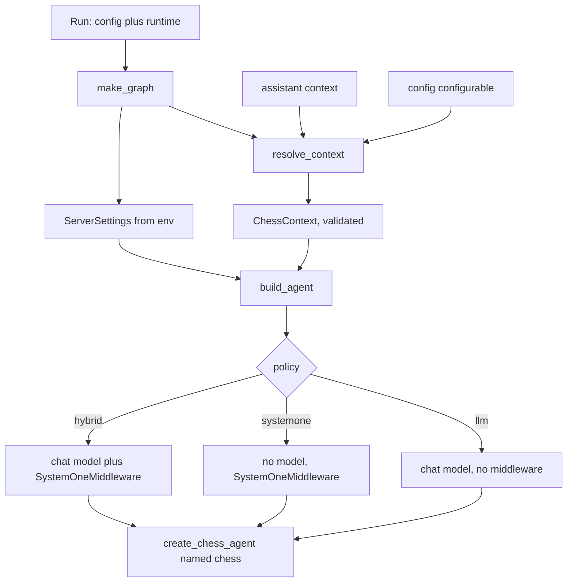

# Agent Server graph and the /ui mount

`apps/server` (package `langchain_chess_server`) is the Agent Server adapter. It adds no chess logic. It turns runtime knobs into a call to `create_chess_agent` from `libs/chess`, with or without `SystemOneMiddleware` from `libs/systemone`, and it serves the built web UI next to the graph API. Nothing else depends on it.

`langgraph.json` wires both entrypoints:

| Key | Target | Role |
| --- | --- | --- |
| `graphs.chess` | `apps/server/langchain_chess_server/graph.py:make_graph` | Graph factory. The Agent Server calls it with the run's config and runtime. |
| `http.app` | `apps/server/langchain_chess_server/app.py:app` | Custom FastAPI routes merged into the server: `/ui`, `/ui/`, `/ui/config`, `/ui/model-limit`. |
| `env` | `.env` | Environment file for the server. Name the variables only. Never document their values. |

For the image build (uv workspace, `dockerfile_lines`), see [deployment](/openwiki/operations/deployment.md).

## From a run to a compiled graph

*How `make_graph` turns one run's settings into a compiled `chess` agent.*

`make_graph(config, runtime)` has one line: `build_agent(resolve_context(ChessContext, config, runtime), ServerSettings())`. The factory must accept `runtime`. Assistant settings (the `context` given to `client.assistants.create`, or set in Studio) reach the graph only through `runtime.execution_runtime.context`. If you drop the parameter, those settings are lost with no error. The live test `test_assistant_settings_reach_the_factory_through_runtime` covers this: it runs with no run config, so only the assistant context can select `policy="systemone"`.

Construction is cheap and never calls a model. `test_each_policy_builds_its_stack` checks that building every policy sends no request to the (fake) System 1 client.

### `build_agent` and the three policies

`build_agent(context, settings, *, checkpointer=None)` takes these steps:

- **Model.** `policy == "systemone"` passes `model=None`. Every other policy builds a chat model with `chat_model(context)`.
- **Middleware.** `llm` gets no middleware. `systemone` and `hybrid` each get one `SystemOneMiddleware` (see [System 1](/openwiki/architecture/system-one.md)).
- **Memory.** When there is no model, memory is forced to `"none"`, so `memory` is ignored for `systemone`.
- **Summarize guard.** With a model and `memory="summarize"`, the model must have a known input limit (`input_limit(model)`, which reads `max_input_tokens` from the model's profile). Otherwise `build_agent` raises a `ChessContractError` saying the model has no known input limit and to use `memory='none'`.
- **Everything else** passes straight through to `create_chess_agent`: `show_legal_moves`, `draw_claims`, `seed`, `context_schema=ChessContext`, the optional checkpointer, and `name="chess"`.

`systemone(context, settings)` builds the middleware.

- The ranker is a `GatewayRanker` with the context's `style`, `with_eval` and `with_nouls`. Its client is a `TypeSafeClassifier` with a 15 s timeout. The client comes from an `lru_cache(maxsize=8)` keyed on `(model, api_key, base_url)`, so runs with the same settings share one client.
- `gate`, `k` and `top_p` pass through unchanged.
- **System 1 alone must always play.** For `policy="systemone"`, both `threshold` and `tournament_threshold` are forced to `0.0` and `has_model=False`, whatever the context says. `test_systemone_alone_always_plays_even_with_a_tournament_threshold` checks this. It passes thresholds of 0.95 and 0.99, and the resulting ply reports `threshold_used == 0.0` with `source == "systemone"`. For `hybrid`, the context thresholds apply.

### `chat_model`

`chat_model(context)` calls `init_chat_model(context.model, ...)` with these arguments:

- `max_tokens=32000` (`MAX_TOKENS`). The cap also covers reasoning tokens, and a comment in the source records that 8000 ran out mid-game at medium effort.
- `name` set to the bare model name from `model_identity`. Without it, every vendor reached through the gateway would show up in traces as `ChatOpenAI`.
- `reasoning_effort`, **only when the context sets one**. Models without reasoning reject the parameter outright, so a `None` effort sends nothing and the model uses its own default (`test_no_reasoning_effort_sends_none` checks that Claude Haiku 4.5's request payload has no `reasoning` key).

Gateway specs (the `langsmith:` prefix) give a `ChatOpenAI` with no profile, and the fractional summarization trigger needs one. On the gateway path only, `chat_model` looks up the model's context window with `context_window` from `langchain_chess.pricing` (the same genai-prices snapshot used for pricing) and, when it is known, sets `profile={"max_input_tokens": window - MAX_TOKENS}`. Native providers keep their own full profiles. A gateway model the snapshot does not know gets no profile. The tests also check that `provider:model` specs and bare names are routed according to the environment.

### Summarization and `model_limit`

The server no longer builds its own summarization middleware or an absolute trigger. `libs/chess` applies its default fractional trigger (70% of the model's input limit), so `memory="summarize"` works only for a model with a known input limit, enforced by the guard in `build_agent` above. `test_summarize_with_a_known_input_limit` checks that gateway and native models with limits get a `SummarizationMiddleware.before_model` node, and `test_summarize_needs_a_known_input_limit` checks that an unknown gateway model fails with `summarize`, builds with `none`, and that `systemone` with `summarize` gets no summarization node. `memory="full"` has been removed and now fails validation.

`model_limit(model)` (cached with `lru_cache(maxsize=64)`) builds `chat_model(ChessContext(model=model))` and returns its `input_limit`, or `None` if the model has no limit or can't be built (`ValueError`/`ImportError`). Because it goes through the same factory, it agrees with what `build_agent` will accept. The web UI's new-game dialog uses it (through `/ui/model-limit`) to decide whether to offer `summarize`.

## `ChessContext`: the runtime knobs

`ChessContext` is a keyword-only dataclass. It is also the graph's `context_schema`. Each field carries a pydantic `Field` description and `json_schema_extra={"langgraph_nodes": [...]}`, which tells Studio which nodes the knob affects (`model` and/or `SystemOneMiddleware.before_model`).

| Knob | Default | Effect |
| --- | --- | --- |
| `policy` | `"hybrid"` | `llm`, `systemone` or `hybrid` (see above). |
| `model` | `"langsmith:baseten/zai-org/GLM-5.3-Flash"` | `init_chat_model` spec. `langsmith:<provider>/<model>` goes through the LLM Gateway; `provider:model` and bare names need that provider's package. |
| `reasoning_effort` | `None` | `low` / `medium` / `high`, or `None` to send no effort (required for non-reasoning models). |
| `show_legal_moves` | `True` | List the legal moves in the prompt. |
| `memory` | `"none"` | `none` / `summarize`. `summarize` needs a known input limit. Ignored for `systemone`. |
| `systemone_model` | `"semif-qwen3.5-4b"` | Or `typesafe/jev-latest`. |
| `style` | `"rich"` | How legal moves are described to System 1 (`rich` / `terse`). |
| `with_eval`, `with_nouls` | `False` | Extra System 1 outputs, used for telemetry. |
| `gate` | `"margin"` | `margin` (top-1 minus top-2 probability) or `confidence`. |
| `threshold` | `0.9` | System 1 plays when the gate signal is at least this value. 0 means it always plays. 1 means it never plays and only prunes. |
| `tournament_threshold` | `None` | Threshold after a tournament. `None` means use `threshold`. |
| `k` | `5` | Number of candidates suggested to the model. |
| `top_p` | `None` | Cut suggestions by probability mass instead of a fixed `k`. |
| `draw_claims` | `"auto"` | End the game on threefold repetition or the fifty-move rule. `never` turns this off. |
| `seed` | `0` | Seed for System 1's tournament shuffle. |

The repository contains no production trace data that shows which of these defaults real runs use. Check [runtime behavior](/openwiki/operations/runtime-behavior.md) for observed patterns. Two things are known from the code: the web client sends every knob on each submit (see below), and the live tests override `policy`, `reasoning_effort` and `threshold`.

## `resolve_context`: assistant context, then `configurable`

Knobs arrive two ways. Studio and the SDK set them as assistant **context**. The web UI puts them in the run's **`config["configurable"]`**. `resolve_context(schema, config, runtime)` merges them in five steps:

1. Start from the assistant context (`runtime.execution_runtime.context`). It can be a dict or a dataclass instance. A missing runtime or execution runtime counts as empty.
2. Keep only keys that are fields of the schema. Unknown keys are dropped, because the server puts its own keys (such as `thread_id`) in `configurable`.
3. Overlay the known keys from `configurable`. **Configurable wins.**
4. An explicit `None` in `configurable` overrides only a **nullable** knob (`reasoning_effort`, `tournament_threshold`, `top_p`). This lets a run clear an assistant's `top_p`. For a non-nullable knob, `None` is ignored. An omitted key keeps the assistant's value.
5. Validate the result with `TypeAdapter(schema)`, so a bad value such as `policy="jev"` or `memory="full"` fails the run up front with a `ValidationError`.

`test_context.py` covers each rule: defaults, overrides, clearing with None versus omission, dataclass context, and validation failure.

The web client's `configurableOf` sends exactly the `ChessContext` keys on every submit. In practice this means UI runs override all assistant context. The key list is derived from `DEFAULT_CONTEXT` in `packages/chess-ui/src/types.ts`, which hand-mirrors the Python dataclass's types and defaults; `apps/web/src/settings.ts` adds per-knob validation (`CONTEXT_CHECKS`) for stored settings. When you add or change a knob, update the Python dataclass, `types.ts`, and `CONTEXT_CHECKS`. See [web frontends](/openwiki/architecture/web-frontends.md).

## `ServerSettings`

`ServerSettings` is a pydantic-settings class. It reads the shell first, then `.env`, and ignores unknown keys. It deliberately holds no model credentials: chat models read their providers' own environment variables (or `LANGSMITH_GATEWAY*`) themselves. It reads three variables:

- `LANGSMITH_GATEWAY_API_KEY` is read only so that a blank value can be rejected. The `.env` template expands it from a shell variable. If that expansion produces an empty string, langchain-core would otherwise fall back to the tracing key without any warning.
- `TYPESAFE_API_KEY` and `TYPESAFE_BASE_URL` are the System 1 credentials. `typesafe()` returns them and raises `ValueError("System 1 needs TYPESAFE_API_KEY and TYPESAFE_BASE_URL")` if either is missing.

A variable that is **set but empty** is a validation error, not the same as unset. Because `typesafe()` is called only while building System 1 middleware, an `llm`-only graph builds without TypeSafe settings, while `hybrid` fails at build time. `test_systemone_needs_typesafe_settings_only_when_it_runs` covers this. `make_graph` builds a fresh `ServerSettings()` on every call.

## The FastAPI app: `/ui`, `/ui/config` and `/ui/model-limit`

`app.py` exposes `app = create_app()`, a FastAPI app with the docs, redoc and OpenAPI routes turned off. It has these routes:

- `GET /ui/config` returns `{"graph": "chess", "schema": <ChessContext JSON schema>, "defaults": <asdict(ChessContext())>}`. The schema includes the `langgraph_nodes` extras. The current web client does not fetch this route and uses hand-mirrored defaults instead. The live test uses it to check that the app is mounted.
- `GET /ui/model-limit?model=<spec>` returns `{"max_input_tokens": model_limit(model)}`, an integer or `null`. The `model` query parameter is required (omitting it gives 422). The web client's `fetchModelLimit` calls it and treats any failure as `null`, so the dialog offers `summarize` only for models with a known limit.
- `GET /ui` redirects (307) to `/ui/`.
- `/ui/` serves the static Vite build from `langchain_chess_server/static` through `StaticFiles(html=True)`, when that directory exists. The directory is produced in CI just before `langgraph deploy`, so a plain checkout doesn't have it. In that case `/ui/` returns a 404 JSON response that suggests `mise run build` or `vp dev`, and `/ui/config` and `/ui/model-limit` still work.

Two design constraints come from the source comments:

- **Why `/ui` and not `/`.** Custom routes shadow the Agent Server's own routes, and `/` is the server's health check. Mounting the UI at the root would break the health check.
- **Why `app.mount` and not `app.frontend()`.** Routes added with `app.frontend()` have low priority. The Agent Server has its own `/ui` mount (`langgraph_api/api/ui.py`), which would answer first, and the chess UI would never load. An explicit `app.mount("/ui", ...)` takes priority.

In production the web client calls the graph API on the same origin (`window.location.origin`). During development, `vp dev` talks to `langgraph dev` on `http://localhost:2024` (or `VITE_API_URL` when set).

## Tests that matter

- `apps/server/tests/test_graph.py` covers the node set for each policy, the gateway chat model (cap, name, profile from the context window), omitting `reasoning_effort` when unset, the TypeSafe requirement applying only to System 1 policies, System 1 alone forcing threshold 0, classifier caching, the summarize input-limit guard, the removal of `memory="full"`, and `model_limit` agreeing with the agent.
- `apps/server/tests/test_context.py` covers the merge and validation rules of `resolve_context`.
- `apps/server/tests/test_app.py` covers the `/ui/config` payload, the routes without a build (redirect, 404), the `/ui/model-limit` route (known, unknown, missing parameter), and serving a static build.
- `apps/server/tests/test_live.py` is opt-in (`-m live`) and costs money. It runs a real `langgraph dev` from `langgraph.json` and checks that the `/ui` app is mounted, that assistant context reaches the factory through `runtime`, that a full game plays on the server, and that the recorder prices LLM calls there.
