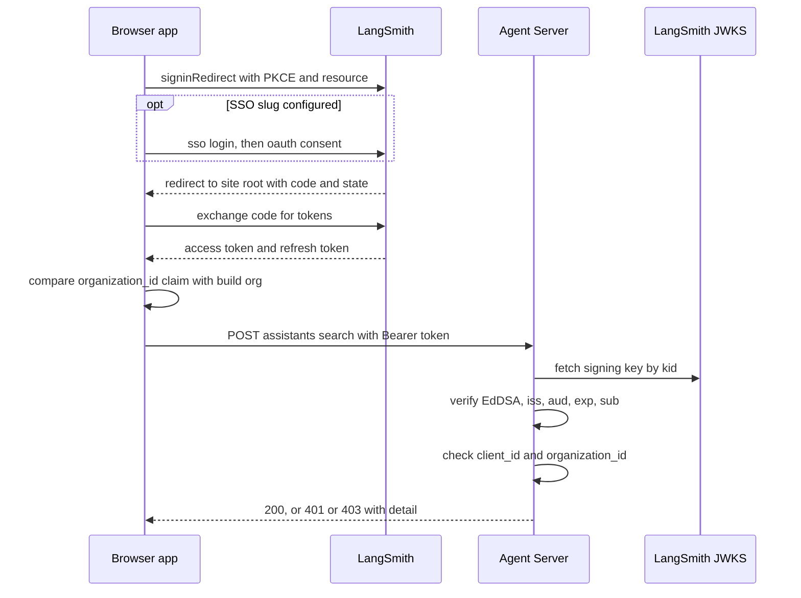

# Sign in with LangSmith: authentication and access control

The deployed chess agent is open only to members of one LangSmith organization. There are two ways in, and each is enforced by a different party:

| Credential | Sent as | Who checks it |
|---|---|---|
| LangSmith OAuth access token ("Sign in with LangSmith") | `Authorization: Bearer <token>` | This repo's auth handler, `apps/server/langchain_chess_server/auth.py` |
| LangSmith API key from the deployment's workspace | `X-Api-Key` | LangSmith itself, because `langgraph.json` sets `allow_langsmith_api_keys` |

The web app (`apps/web/src/auth/`) picks one of these, keeps it for the tab, and attaches it to every SDK request. The server-side handler is registered in `langgraph.json` under `auth.path` (`./apps/server/langchain_chess_server/auth.py:auth`). For the rest of the server see [Agent Server integration](agent-server.md). For the UI shell see [Web frontends](../architecture/web-frontends.md).

## End-to-end OAuth flow

*The browser gets consent from LangSmith, comes back with a code, and then sends the access token to the Agent Server, which verifies it against LangSmith's public keys and this deployment's access policy.*

## Web app: configuration

`langsmithAppConfig()` (`apps/web/src/auth/config.ts`) reads three build-time Vite variables. It trims each one, and a blank value counts as unset:

- `VITE_OAUTH_CLIENT_ID`: if unset, the build has no OAuth app (`app: null`) and offers API keys only.
- `VITE_LANGSMITH_ORGANIZATION_ID`: required whenever the client id is set. A client id with no organization makes the config `ok: false`. `Root.tsx` then shows only a "This build is misconfigured" error banner, with the problem text "VITE_OAUTH_CLIENT_ID is set without VITE_LANGSMITH_ORGANIZATION_ID.", and never mounts the sign-in screen or the game.
- `VITE_LANGSMITH_SSO_SLUG`: optional. If set, sign-in goes through the organization's SSO login.

The Pages workflow (`.github/workflows/pages.yml`) fills these from the repository variables `OAUTH_CLIENT_ID`, `LANGSMITH_ORGANIZATION_ID` and `LANGSMITH_SSO_SLUG`. For local runs, `apps/web/README.md` says to put the `VITE_*` variables in `apps/web/.env.development.local`. Registering the OAuth app is covered in `apps/web/README.md` ("Set up the OAuth app"): it must be a Public app with scopes `openid email profile offline_access`, and its redirect URIs must match exactly, trailing slash included.

## Web app: OAuth sign-in (`oauth.ts`)

`userManager()` configures an `oidc-client-ts` `UserManager` as follows:

- **Authority**: `authority` is `https://api.smith.langchain.com`.
- **Flow**: `response_type: "code"`, so authorization code with PKCE.
- **Scopes**: `openid email profile offline_access`.
- **`resource`**: also `https://api.smith.langchain.com`. Without it, LangSmith's token would only work at `/userinfo`, and the server would reject it because its audience is wrong.
- **Redirect URI**: `redirect_uri` is the site's origin plus `BASE_URL`, i.e. the site root (`makeSignIn`).
- **Storage**: user and state stores live in the tab's `sessionStorage`. If the browser blocks site data, an `InMemoryWebStorage` is used instead.
- **Renewal**: `automaticSilentRenew: false`. Tokens are renewed on demand, never in the background.

`langsmithSignIn()` wraps the manager and exposes the following:

- **`start({ chooseOrganization })`** calls `signinRedirect`. It stores the current `search` and `hash` (the `?thread=` game) in the OAuth `state`. With `chooseOrganization` it also sends `prompt: "consent"`, so LangSmith shows its consent page and organization choice even if the user approved the app before.
- **SSO**: when `ssoSlug` is set, a custom navigator (`redirectThrough`) rewrites the authorize URL. It sends the browser to `https://smith.langchain.com/sso/login/<slug>?redirect_to=/oauth/consent?<original query>`. Skipping `/oauth/authorize` is safe because LangSmith repeats its checks when the user approves. SSO login also lets the user switch LangSmith accounts.
- **`resume(location)`**: a URL with `state` plus `code` or `error` is a callback (`isSignInCallback`). The callback is finished at most once, because a memoized promise guards against StrictMode's double effects (an authorization code works only once). Afterwards the URL is rewritten back to the saved query and hash, so the game is still in the URL. A failed callback clears the OAuth parameters from the URL and rethrows. When the URL is not a callback, `resume` returns the stored user if it still has a refresh token or has not expired. Otherwise it returns `null`.
- **Organization check (`admit`)**: the client decodes the access token's `organization_id` claim *without verifying it* (`tokenOrganization`) and compares it with the build's organization. This check is a UX convenience: the server enforces the same rule. On a mismatch the app signs out at once and returns `wrong-organization`, with the email, if there is one.
- **`accessToken()`** returns the stored token while it has more than 30 seconds left. When it is about to expire, one shared `signinSilent()` refresh is used for all concurrent callers. Refresh tokens rotate, and LangSmith revokes all of them when one is reused. If the refresh fails, the user is removed and `onExpired()` sends the app back to sign-in.
- **`signOut()`** sets a signed-out flag, waits for any refresh still in flight, revokes the refresh token (errors ignored), and always removes the stored user. Every later `accessToken()` call throws, including calls that were part-way through a lookup when sign-out began.

## Web app: session model and storage

`Session` (`apps/web/src/auth/session.ts`) has three kinds:

| Kind | Meaning | Headers (`sessionHeaders`) |
|---|---|---|
| `none` | The server needs no credential (`langgraph dev`) | none |
| `apiKey` | A workspace API key kept in this tab | `x-api-key` |
| `oauth` | LangSmith sign-in, with `email` and an `accessToken()` function | `Authorization: Bearer …`, fetched fresh for each request |

`sessionClient()` creates the LangGraph SDK `Client` that `useGame.ts` uses. It sets `apiKey: null`, so the SDK never picks up a key from the environment, and an `onRequest` hook adds the session's headers to every request and stream.

The values kept in the browser are defined in `apps/web/src/auth/stored.ts`:

- `langchain-chess:api-key`, in `sessionStorage`. The API key, trimmed, for this tab only and never compiled into the bundle.
- The OAuth user and state from `oidc-client-ts`, also in `sessionStorage`.
- `langchain-chess:last-account`, in `localStorage`. Only the email of the last LangSmith sign-in, used to offer a "Last used" button. Never a token.
- `langchain-chess:app`, the legacy `localStorage` entry where older versions kept the API key. It is deleted on every resume (`forgetLegacyApiKey`).

Every reader and writer swallows errors from blocked or corrupt storage.

## Web app: session lifecycle (`useSession.ts`, `Root.tsx`)

`resumeSession` tries credentials in this order:

1. A LangSmith sign-in (`langsmith.resume`). A signed-in result also saves the last account. A `wrong-organization` result ends signed out, with that problem.
2. The tab's stored API key. It is used without asking the server.
3. `checkAccess(NO_SESSION)`. If the server accepts no credentials, as `langgraph dev` does, the app opens straight on the game with session `none`. If the server cannot be reached, the user is signed out with an error banner and a Try again button (`retry`). Otherwise the user is signed out with no problem, and the sign-in screen appears.

`Root` shows a blank "checking" screen first, then either `SignIn` or `App`. `signInWithKey` saves the key and signs in. `signOut` signs out of LangSmith when the session is OAuth, clears the API key, and returns to sign-in. When a refresh token expires partway through a game, the state becomes signed out with the problem `expired`, and the banner says the game is still in the URL.

### Sign-in screen (`SignIn.tsx`)

- **OAuth app built in**: "Sign in with LangSmith" is the main button, or a "Last used" account button plus "Use another account". The API-key form sits under **Advanced**.
- **No OAuth app**: only the API-key form is shown.
- **API keys are checked before they are kept**: the key goes through `checkAccess({kind: "apiKey"})`, and a refused key is never stored. The user sees the server's reason.
- **Wrong organization**: a warning banner says which account was signed in for another organization, and the button reads "Try again". It calls `start({ chooseOrganization: true })`, so LangSmith asks for the organization again. Without SSO, the banner tells the user to sign out at smith.langchain.com and sign back in with the organization's own login (for example Okta). With SSO, retrying goes through the organization's single sign-on.

## Access check (`check.ts`)

`checkAccess()` sends `POST {apiUrl}/assistants/search` with `{limit: 1}`, the cheapest authenticated call, along with the session's headers. It reads the response like this:

- Any status other than 401 or 403 counts as `ok`. Other server errors are left for the game screen to show.
- 401 or 403 with session `none` means `missing` ("Sign-in needed"). So the absence of credentials is reported as a problem only when the server actually refuses the request.
- 401 or 403 with credentials means `rejected`, carrying the server's `detail` string when there is one ("Sign-in refused … Sign out in Settings and sign in again.").
- A network failure means `unreachable`. This also covers an OAuth `accessToken()` that throws because the token cannot be renewed.

## Agent Server: the auth handler (`auth.py`)

`@auth.authenticate` takes the `Authorization` header. It runs `user_for` in a worker thread, because settings read `.env` and `PyJWKClient` fetches keys synchronously. API-key requests never reach this handler: with `allow_langsmith_api_keys`, a request with no `Authorization` header goes to LangSmith's own key check.

1. **Parse.** The scheme must be `Bearer` (case-insensitive, surrounding whitespace trimmed) and the token must be non-empty. Otherwise the result is **401** "Sign in with LangSmith, or send a LangSmith API key as X-Api-Key."
2. **Verify** (`verified_claims`):
   - The signing key comes from `https://api.smith.langchain.com/.well-known/jwks.json`, looked up by the token's `kid` through a cached `PyJWKClient`.
   - Only the `EdDSA` algorithm is accepted.
   - `iss` and `aud` must both equal `https://api.smith.langchain.com`.
   - `exp`, `iss`, `aud` and `sub` are required.

   Any `PyJWTError` gives **401** "Your LangSmith sign-in is invalid or has expired. Sign in again." That covers a bad signature, an expired token, a `/userinfo`-only audience, another issuer such as the EU host, a missing `sub`, or a string that is not a JWT.
3. **Authorize** (`refusal`) against the `AccessPolicy(client_id, organization_id)`, which `ServerSettings` builds once and caches:
   - If the `client_id` claim is not the configured `OAUTH_CLIENT_ID`, or none is configured, the result is **403** "Sign in through the LangChain Chess app to use this server." LangSmith issues tokens to every OAuth app, so a valid token from another app is not enough.
   - If the `organization_id` claim is not the configured `ALLOWED_ORGANIZATION_ID`, is missing, or none is configured, the result is **403** "This LangSmith account isn't in the organization that runs this server."
4. **Admit.** The handler returns `{"identity": claims["sub"]}`, the user's LangSmith id.

**401 or 403?** 401 means there is no usable credential (missing, malformed, unverifiable or expired). 403 means the token is genuine but issued to another app or another organization. The web app passes the `detail` text on to the user either way.

### Unset policy refuses every token

An `AccessPolicy` with either field set to `None` refuses every bearer token. So a deployment without an OAuth app accepts API keys only, and a half-configured deployment is closed, not open.

## Server configuration

`ServerSettings` (`apps/server/langchain_chess_server/settings.py`) reads `OAUTH_CLIENT_ID` and `ALLOWED_ORGANIZATION_ID` from the shell first and `.env` second. **For these OAuth settings a blank value means unset**: they are trimmed, and an empty result becomes `None`. The deploy workflow writes both lines before the OAuth app exists, and an unset value only refuses tokens. That is the opposite of the model credentials (`LANGSMITH_GATEWAY_API_KEY`, `TYPESAFE_API_KEY`, `TYPESAFE_BASE_URL`), where **a blank value is an error** that stops the server. See [Settings and model arguments](../concepts/settings-and-model-arguments.md).

In CI, `.github/workflows/deploy.yml` writes `OAUTH_CLIENT_ID` from the repository variable `OAUTH_CLIENT_ID`, and `ALLOWED_ORGANIZATION_ID` from the repository variable `LANGSMITH_ORGANIZATION_ID`, into the revision's env. Pages and the deployment read the same variables. After changing them, run both workflows by hand (see [Deployment](../operations/deployment.md)).

## Failure modes at a glance

| Symptom | Cause |
|---|---|
| "This build is misconfigured" banner | `VITE_OAUTH_CLIENT_ID` is set without `VITE_LANGSMITH_ORGANIZATION_ID` |
| Only the API-key form is shown | The build has no `VITE_OAUTH_CLIENT_ID` |
| "That account isn't in this organization" after consent | The token's `organization_id` is not the build's organization. The app has already signed out, and "Try again" asks LangSmith to choose the organization again |
| 403 "Sign in through the LangChain Chess app…" | The token belongs to another OAuth client, or the server's `OAUTH_CLIENT_ID` is unset or blank |
| 403 "…isn't in the organization that runs this server" | The organization doesn't match, or the server's `ALLOWED_ORGANIZATION_ID` is unset or blank |
| 401 "…invalid or has expired" | The signature, expiry, issuer or audience check failed. A missing `resource` gives a `/userinfo`-only audience |
| "Signed out: your LangSmith sign-in expired" | The refresh token stopped working, for example after a reused or revoked rotation |
| The app opens straight on the game with no sign-in | The server accepts requests with no credentials. `langgraph dev` does this, so locally the sign-in screen only appears against a server that requires it ([Local development](../operations/local-development.md)) |

## Tests

- `apps/server/tests/test_auth.py` signs real Ed25519 JWTs. It covers: only this app and organization get in; an unset policy (either field, or both) refuses every token; a missing or non-bearer header gives 401; signature, expiry, audience, issuer, missing `sub` and garbage tokens give 401; a verified token from another organization gives 403; the policy is read from settings with blank meaning unset; the handler uses a faked JWKS client; keys come from LangSmith's JWKS URL.
- `apps/web/tests/auth/` covers the client side:
  - config parsing and the misconfiguration case
  - the SSO URL rewrite and the unverified organization decode
  - one-time callback handling and putting the URL back
  - a single shared refresh for concurrent callers, and sign-out races with refresh tokens in flight
  - how check results are classified
  - storage behaviour when the browser blocks it
  - `useSession` resume order and expiry
  - the sign-in screen's states

  See [Testing conventions](../testing/testing-conventions.md).
