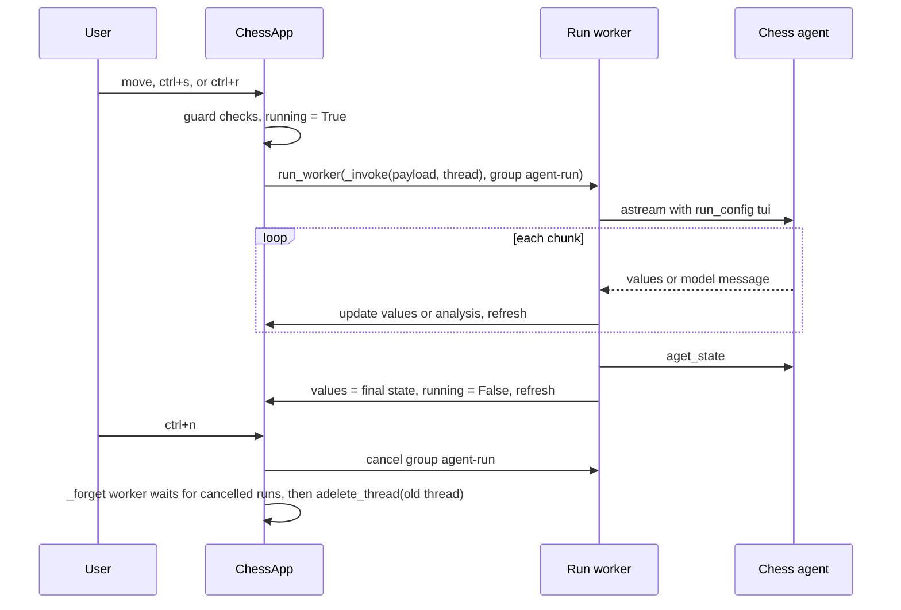

# Terminal UI (`lcchess play`) and CLI options

The `langchain-chess-cli` package (`libs/cli`) ships one console script, `lcchess`, with three Typer subcommands: `uci`, `play` and `grade` ([main.py](../../libs/cli/langchain_chess_cli/main.py)). This page covers `play`, which runs a [Textual](https://textual.textualize.io/) terminal game against the chess agent in the same process. It also covers the option layer that `play` shares with `uci`: `AgentOptions`, `build_agent` and `run_config` in [options.py](../../libs/cli/langchain_chess_cli/options.py). The UCI adapter has its own page, [UCI engine](uci-engine.md). Model specs and cost display are explained in [Models, gateway and cost](../concepts/models-gateway-and-cost.md). Games played here can be graded afterwards with `lcchess grade --metadata surface=tui` (see [Grading and review](../workflows/grading-and-review.md)).

## Installing and running

The packages aren't published on PyPI. Only uv can install the CLI without a clone, because uv resolves the sibling workspace packages from the same git commit. pip would look for them on PyPI and fail ([libs/cli README](../../libs/cli/README.md)):

```sh
uvx --env-file /absolute/path/to/.env \
  --from "git+https://github.com/darieldatoon/langchain-chess#subdirectory=libs/cli" lcchess play
uv tool install "git+https://github.com/darieldatoon/langchain-chess#subdirectory=libs/cli"
# your own Anthropic key instead of the gateway (set ANTHROPIC_API_KEY, unset LANGSMITH_GATEWAY):
uv tool install "langchain-chess-cli[anthropic] @ git+https://github.com/darieldatoon/langchain-chess#subdirectory=libs/cli"
lcchess play --policy llm --model claude-opus-5-5
```

An installed `lcchess` doesn't read `.env`, so the variables from `.env.example` must be exported in the shell. While `LANGSMITH_GATEWAY` is `true`, bare model names also go through the LLM Gateway, so calling a provider directly needs both the extra and the gateway turned off.

`pyproject.toml` maps `lcchess` to `langchain_chess_cli.main:app`. It requires Python ≥ 3.13 and depends on `langchain-chess[systemone]`, `langchain-openai`, `langsmith`, `textual>=6`, `typer` and `rich`. The only optional extra is `anthropic` ([pyproject.toml](../../libs/cli/pyproject.toml)). In a clone, `mise run dev:tui` runs `uv run --all-packages --env-file .env lcchess play`. Pass extra options after `--`, for example `mise run dev:tui -- --side black` ([mise.toml](../../mise.toml), [README](../../README.md)).

## Shared agent options

`play` and `uci` take the same set of agent flags. Typer can't read PEP 695 aliases, so `main.py` declares the choices again as `Annotated` option types, with ranges enforced (for example `--threshold` must be in 0–1 and `--k` in 1–255). Each command copies the flags into a frozen `AgentOptions` dataclass. The dataclass "mirrors the server's context knobs, with the same defaults":

| Option | Default | Meaning |
| --- | --- | --- |
| `--policy` | `hybrid` | `llm` (model alone), `systemone` (System 1 alone), `hybrid` (both) |
| `--model` | `langsmith:baseten/zai-org/GLM-5.3-Flash` | `init_chat_model` spec. A bare name needs its provider package |
| `--reasoning-effort` | unset | `low` / `medium` / `high`; unset uses the model's default and suits non-reasoning models |
| `--systemone-model` | `semif-qwen3.5-4b` | System 1 model (SemIf or Jev) |
| `--threshold`, `--tournament-threshold` | `0.9`, none | Gate value at or above which System 1 plays |
| `--gate` | `margin` | `margin` or `confidence` |
| `--k`, `--top-p` | `5`, none | Candidates suggested to the model |
| `--style` | `rich` | How moves are described to System 1 (`rich`/`terse`) |
| `--with-eval`, `--with-nouls` | off | Extra System 1 questions |
| `--show-legal-moves` | on | List legal moves in the prompt |
| `--memory` | `none` | `none` / `summarize` |
| `--seed` | `0` | Seeds System 1's tournament and fallbacks |

`play` also takes `--side white|black` (default `white`).

### `build_agent`

`build_agent(options, *, draw_claims, checkpointer, model_factory=default_model)` turns options into a compiled `create_chess_agent` graph named `chess`:

- For any policy except `llm`, it adds `SystemOneMiddleware` with the System 1 knobs.
- For `systemone`, no chat model is built, because there is nothing behind System 1. The middleware gets `threshold=0.0`, `tournament_threshold=0.0` and `has_model=False` so that System 1 always plays, and `memory` is forced to `"none"`.
- The CLI builds no summarization middleware of its own. It passes `memory` to `create_chess_agent`, and core's summarization uses a fractional trigger of the model's input limit. Before building, `build_agent` checks `input_limit(model)` (the profile's `max_input_tokens`). If `memory="summarize"` and the model has no known limit, it raises a `ChessContractError` saying the model "has no known input limit, so it can't use memory summarize; use memory none". With `policy=systemone`, summarize is silently dropped because there is no model ([test_options.py](../../libs/cli/tests/test_options.py)).
- `default_model` delegates to the core package: it calls `langchain_chess.chat_models.chat_model(options.model, options.reasoning_effort)` ([chat_models.py](../../libs/chess/langchain_chess/chat_models.py)). The CLI no longer has a model module of its own. That function sets an output budget (`MAX_TOKENS = 64000`, capped by the model's own output limit and by half of a smaller context window), names the trace span after the bare model name (so gateway models don't all appear as `ChatOpenAI`), and passes `reasoning_effort` only when set, because models without reasoning reject the parameter. For `langsmith:` gateway specs with a known context window it adds a profile with `max_input_tokens = window - budget`. For native specs it keeps the provider's profile and only lowers `max_input_tokens` so the input limit leaves room for the output budget. The details are on [Models, gateway and cost](../concepts/models-gateway-and-cost.md).

Each surface chooses its own draw-claim policy and checkpointer. `play` uses `DRAW_CLAIMS = "auto"` from `tui/app.py`. Its factory takes a checkpointer, and `ChessApp` passes it an `InMemorySaver` that the app owns. `uci` uses `draw_claims="never"`, which leaves draws to the GUI. Games in the TUI therefore last only as long as the process, and even less than that: a new game deletes the previous game's checkpoints (see below).

### `run_config`

`run_config(surface, thread_id, options, *, draw_claims)` builds the `RunnableConfig` for every agent invocation:

- `configurable.thread_id` is the game thread.
- `run_name` is `chess-<surface>`, and `tags` is `[surface]`.
- `metadata` holds `surface`, every `AgentOptions` field (through `asdict`), and `draw_claims`.

Both the TUI (`surface="tui"`) and the UCI engine (`surface="uci"`) call it, so CLI traces carry the same knob metadata as server traces. The `grade` command's `--metadata surface=...` filter relies on that metadata. The TUI doesn't show its thread id, so `lcchess grade --metadata surface=tui --limit 1` is how you find your latest terminal game.

## The Textual app

`play` builds a factory closure `factory(checkpointer)` that calls `build_agent(options, draw_claims=DRAW_CLAIMS, checkpointer=checkpointer)`, then runs `ChessApp(factory, options, side=side).run()`. In `__init__`, `ChessApp` creates its own `InMemorySaver`, calls the factory once with it, and keeps the agent for the whole session. It holds all game state:

- `side`: the human's colour.
- `thread`: `tui-<uuid4>`, set by the first new game on mount.
- `checkpointer`: the saver shared by every game in the session.
- `values`: the last state snapshot of the thread.
- `running`, `failed` (error text) and `analysis` (streamed model text).

### Layout

The layout comes from `compose`:

- A `Header`. Its subtitle comes from `describe_options`, for example `semif-qwen3.5-4b + <model>`, `System 1 alone (...)` or `<model> (<effort>)`. The effort suffix appears only when a reasoning effort is set.
- The `ChessBoard` widget, two-thirds of the width.
- A side column with:
  - `#status`: whose move it is, the result, or the failure reason.
  - `#details`: the last agent move's source, model, latency and cost, the count of illegal attempts, and System 1's status and top moves with probabilities.
  - `#moves`: a numbered move list with each move's source (`you`, `LLM`, `System 1`, `forced`) and turn cost. The cost shows `—` if nothing was priced and `≥$` if the estimate is incomplete.
  - A scrolling `Analysis` box.
- An `Input` for notation.
- A `Footer`.

The side-panel `Static` widgets use `markup=False`, so model output, errors and SAN are shown literally and never parsed as Rich markup (text like `[/]` or `[bold]` can't break or restyle the display).

All side-panel text comes from pure functions in [view.py](../../libs/cli/langchain_chess_cli/tui/view.py). They read the thread record: `start_fen`, `moves`, `plies`, `turns`, `outcome` and `error`. `board_of` rebuilds the `chess.Board` by replaying `moves` from `start_fen`. The TUI keeps no board of its own. The thread state is the only source of truth.

### Key bindings and input modes

| Key | Where | Action |
| --- | --- | --- |
| `ctrl+n` | app | New game (new thread) on the current side |
| `ctrl+f` | app | Switch sides and start a new game |
| `ctrl+s` | app | Start: the agent opens when you play Black |
| `ctrl+r` | app | Retry the agent's failed (pending) turn |
| `ctrl+q` | app | Quit |
| arrows | board | Move the cursor (directions follow the board's orientation, clamped at the edges) |
| `enter` / `space` | board | Select a piece, or move the selected piece to the cursor square |
| `escape` | board | Deselect |
| `q`/`r`/`b`/`n`, `escape` | promotion dialog | Pick the promotion piece, or cancel |

You can enter a move in three ways, and all of them submit the same kind of human message:

1. **Mouse.** Click a piece of the side to move, then one of its legal targets.
2. **Keyboard on the board.** Move the cursor, then press Enter on the piece and again on the target.
3. **Notation.** Type SAN or UCI in the `Input` and press Enter. If you type a printable character other than space while the board has focus, the board posts `ChessBoard.Typed`. The app moves focus to the input and inserts the character. The input uses `select_on_focus=False` so the first character isn't overwritten. After you submit, the input clears and focus returns to the board. Empty lines are ignored.

The app does not check notation itself. The agent's input parsing decides, and a bad entry shows up as the thread's `error` in red under the status line. For example, `Qh8` gives "neither `go` nor a legal move" ([test_tui.py](../../libs/cli/tests/test_tui.py)).

### The board widget

[board.py](../../libs/cli/langchain_chess_cli/tui/board.py) keeps pure layout and drawing apart from the interaction state in `ChessBoard`.

- **Geometry.** `geometry(width, height, white_bottom=...)` picks the largest square height that fits. Square width is `2*h+1`, so squares look about square on screen. The board is centred, with a two-cell rank-label column and a file-label row underneath. `Geometry.square_at` maps click offsets back to squares for either orientation. Piece art (from chess-tui) is scaled to the square size.
- **Highlights.** `background_role` sets the priority for each square: selected, then cursor (shown only while the board has focus), then king in check, then capture target, then last move (light or dark), then plain light or dark. Empty legal targets get a `●`. Each role is a `chess-board--<role>` component class, so CSS or themes can restyle the board. The defaults are chess-tui's skin with lichess-like highlights.
- **Interaction.** `show(board, white_bottom, last_move, interactive)` is the app's only way to push state into the widget. It clears the selection when the position changes or the board becomes non-interactive. If you try to select while the board isn't interactive, you hear a bell. When a move has several promotion options, the widget opens `PromotionScreen`, and the chosen letter is appended to the UCI string. Cancelling posts nothing. A completed move posts `ChessBoard.Moved(uci)`, and the app handles it like typed notation.

### Runs, start, retry and new game


*How one agent run works in the TUI, and how a new game retires the previous one.*

`_submit` sets `running=True` and clears `failed` and `analysis`. It then starts a Textual worker in the `agent-run` group (`RUN`) that streams `agent.astream(payload, config, stream_mode=["messages", "values"])` on the thread captured at submit time. `values` chunks replace `self.values`. Message chunks from the `model` node are appended to the Analysis pane as they arrive. After the stream, including after an ordinary exception, the worker reloads the state with `aget_state` and clears `running`. An exception sets `failed` to the error text (or the exception type name). The agent's turn stays `pending` in the thread, and retry resumes it.

Start and retry are separate actions, as in the web UI:

- **Start** (`ctrl+s`) sends a human `go` message. It only does this when nothing is running, no turn is pending, no moves have been played, and it's the agent's turn. `action_new_game` calls it automatically when you play Black, so it's a no-op for White or after the game has started.
- **Retry** (`ctrl+r`) sends an empty payload `{}` on the same thread. The agent then resumes its pending turn instead of starting a new one. It only does this when nothing is running and the last turn is `pending`, so pressing it with nothing pending does nothing. A retried turn is committed once ([test_tui.py](../../libs/cli/tests/test_tui.py)).
- **Moves** go through `_play`. If the agent is running, a turn is pending, or the game is over, you get a warning to wait or retry. If it isn't the human's turn, you get "It's the agent's move." The board is interactive only when all of these checks pass (`_can_move`).
- **New game** (`ctrl+n`, or `ctrl+f` with a side switch) first cancels every worker in the `agent-run` group, so the previous game's run stops instead of delivering late events, failures or a final refresh (cancellation isn't caught by the run's `except Exception`). If there was a previous thread, it starts a `_forget` worker. That worker waits for the cancelled runs to unwind (suppressing `WorkerCancelled` and `WorkerFailed`) and then calls `checkpointer.adelete_thread(old_thread)`, because nothing can reopen a retired game. The app then creates a new `tui-<uuid>` thread, resets `values`, `running`, `failed` and `analysis`, and refreshes. Finished games are dropped the same way.

Game over (`outcome` set) makes `status_text` show `result_text(outcome)`, for example "Checkmate, black wins. 0-1", and blocks further input.

## Tests

Tests for this topic live in `libs/cli/tests` (see [Testing conventions](../testing/testing-conventions.md)). The CLI README runs them with `uv run --all-packages pytest libs/cli --no-cov -q`.

- `test_tui.py` drives `ChessApp` with Textual's `run_test` pilot and a `ScriptedModel`, using a factory `lambda saver: create_chess_agent(model, checkpointer=saver)`. It covers:
  - a failed first turn as Black, where input is blocked and retry commits exactly once;
  - `ctrl+s` as a no-op for White;
  - the move list and details formatting;
  - input blocked while the agent is thinking;
  - late events and failures from the previous game not showing after `ctrl+n`;
  - a new game cancelling the in-flight run (`WorkerState.CANCELLED`) and leaving no checkpoints for the old thread, for both running and finished games;
  - `ctrl+f` starting the agent;
  - game-over blocking;
  - model and error text shown literally, without markup parsing;
  - moving by clicking;
  - typing on the board filling the input.
- `test_tui_snapshots.py` holds SVG snapshot regressions (`snap_compare`). They cover three board sizes, a selected piece with its targets, Black's orientation with the cursor, the promotion dialog, and the full game screen. After a deliberate visual change, run `uv run --all-packages pytest libs/cli/tests/test_tui_snapshots.py --snapshot-update --no-cov` and look at the SVGs under `__snapshots__/` before you accept them.
- `test_tui_view.py` and `test_tui_board.py` unit-test the pure view and board functions.
- `test_options.py` checks:
  - the middleware stack for each policy;
  - gateway model construction through `default_model` and core's `chat_model` (profile `max_input_tokens` = window − 64000, span name, reasoning effort only when set);
  - the summarization rules;
  - `run_config` naming and metadata.
- `test_main.py` checks that `play --side black --policy systemone` builds an agent named `chess` and runs the app, that the `uci` factory uses `draw_claims="never"`, and that bad choices exit with code 2.
