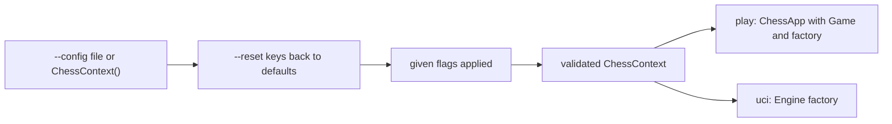
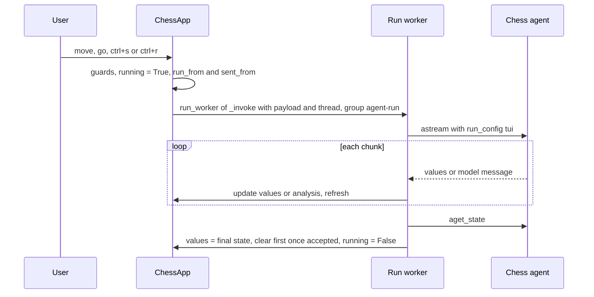

# Terminal UI (`lcchess play`)

The `langchain-chess-cli` package (`libs/cli`) ships one console script, `lcchess`, with three Typer subcommands: `uci`, `play` and `grade` ([main.py](../../libs/cli/langchain_chess_cli/main.py)). This page covers `play`, which runs a [Textual](https://textual.textualize.io/) terminal game against the chess agent in the same process. The screen is laid out like the web app's. It also covers the option layer that `play` shares with `uci`. Both commands turn their flags into one `ChessContext` (the same settings model the server and web UI use) and build the agent with the shared `build_agent` from `langchain_chess_systemone.agent`.

Related pages:

- [Settings and model arguments](../concepts/settings-and-model-arguments.md) explains the settings model, settings files and model arguments.
- [UCI engine](uci-engine.md) covers the UCI adapter.
- [Grading and review](../workflows/grading-and-review.md) covers grading. You can grade games played here afterwards with `lcchess grade --metadata surface=tui`.

## Installing and running

The packages aren't published on PyPI. Only uv can install the CLI without a clone, because uv resolves the sibling workspace packages from the same git commit. pip would look for them on PyPI and fail ([libs/cli README](../../libs/cli/README.md)):

```sh
uvx --env-file /absolute/path/to/.env \
  --from "git+https://github.com/darieldatoon/langchain-chess#subdirectory=libs/cli" lcchess play
uv tool install "git+https://github.com/darieldatoon/langchain-chess#subdirectory=libs/cli"
# your own Anthropic key instead of the gateway (set ANTHROPIC_API_KEY, unset LANGSMITH_GATEWAY):
uv tool install "langchain-chess-cli[anthropic] @ git+https://github.com/darieldatoon/langchain-chess#subdirectory=libs/cli"
lcchess play --policy llm --model claude-opus-5-5
```

An installed `lcchess` doesn't read `.env`, so you must export the variables from `.env.example` in the shell. While `LANGSMITH_GATEWAY` is `true`, bare model names also go through the LLM Gateway. Calling a provider directly therefore needs both the extra and the gateway turned off.

`pyproject.toml` maps `lcchess` to `langchain_chess_cli.main:app` and requires Python ≥ 3.13. It depends on `langchain-chess[systemone]`, `langchain-openai`, `langsmith`, `textual>=6`, `typer` and `rich`, and its only optional extra is `anthropic` ([pyproject.toml](../../libs/cli/pyproject.toml)). In a clone, `mise run dev:tui` runs `uv run --all-packages --env-file .env lcchess play`. Pass extra options after `--`, for example `mise run dev:tui -- --side black` or `mise run dev:tui -- --fen "4k3/8/8/8/8/8/4P3/4K3 w - - 0 1"` ([mise.toml](../../mise.toml), [README](../../README.md)).

## Shared settings flags

`play` and `uci` take one flag per `ChessContext` setting, and the CLI keeps no settings type or defaults of its own. The helper `_setting(name)` builds each Typer option from the `ChessContext` field. The help text is the field's description, and the default shown is the field's default. Typer can't read PEP 695 aliases, so `main.py` repeats the choices as `Annotated` `Literal` types and enforces ranges (for example, `--threshold` must be in 0–1 and `--k` in 1–255). Every flag defaults to `None`, meaning "not given", so a flag you leave out keeps whatever the base settings say.

| Flag | Default (from `ChessContext`) | Meaning |
| --- | --- | --- |
| `--policy` | `hybrid` | `llm` (the model alone), `systemone` (System 1 alone), `hybrid` (both) |
| `--model` | `langsmith:baseten/zai-org/GLM-5.3-Flash` | An `init_chat_model` spec. A bare name needs its provider package |
| `--reasoning-effort` | unset | `low` / `medium` / `high`. Unset uses the model's default |
| `--model-kwargs JSON` | `{}` | Extra model arguments, as a JSON object |
| `--system-prompt` | none | Replaces the agent's system prompt |
| `--show-fen`, `--show-board` | on | What the prompt shows of the position |
| `--move-list` | `both` | `both` / `legal` / `candidates` / `none` |
| `--memory` / `--no-memory` | off | Summarize older conversation |
| `--systemone-model` | `typesafe/jev-latest` | The System 1 model (Jev) |
| `--threshold`, `--tournament-threshold` | `0.9`, none | The gate value at or above which System 1 plays |
| `--gate` | `margin` | `margin` or `confidence` |
| `--k`, `--top-p` | `5`, none | Candidates suggested to the model |
| `--style` | `rich` | How moves are described to System 1 (`rich`/`terse`) |
| `--with-eval`, `--with-nouls` | off | Extra System 1 questions (recorded only) |
| `--seed` | `0` | Seeds System 1's tournament shuffle |

The defaults are those of settings version 3 in [settings.py](../../libs/systemone/langchain_chess_systemone/settings.py). Version 3 made Jev the default System 1 after the gateway retired SemIf.

`play` takes three more options:

- `--side white|black` (default `white`).
- `--draw-claims auto|never`.
- `--fen FEN` to start from a position. `start_problem` validates the FEN. A position that can't be parsed, or one that is already over under the game's draw claims, is rejected with exit code 2 against `--fen`.

`uci` has no `--draw-claims` flag, because the engine always forces `draw_claims="never"` and leaves draws to the GUI.

### `--config`, `--reset` and the overlay

Both commands resolve their settings the same way, in `main._settings`:

1. The base is `load_file(--config)` when you give a settings file, or `ChessContext()` otherwise. This is the same versioned JSON file the web UI exports. A file without a `version`, with unknown keys, or with invalid JSON is rejected.
2. `--model-kwargs` is parsed from JSON.
3. `options.overlay(base, flags, resets)` puts every `--reset` setting (repeatable) back to its `ChessContext` default, then applies the flags that were given (non-`None`). It validates the result again as a `ChessContext`. Resetting an unknown key or `version` raises a `SettingsError` ("no such setting to reset: ...").

Any `ValueError` in these steps becomes `typer.BadParameter`, so the command exits with code 2. This covers a bad settings file, bad JSON in `--model-kwargs`, a validation failure such as an empty `--model` or a disallowed model argument like `base_url`, and an unknown reset.


*How a CLI command turns a settings file, resets and flags into one `ChessContext`.*

### `build_agent`

Both surfaces build their agent with `langchain_chess_systemone.agent.build_agent(settings, *, checkpointer=..., ...)` ([agent.py](../../libs/systemone/langchain_chess_systemone/agent.py)). The server uses the same builder, so the CLI adds no middleware or model logic of its own. In short:

- For any policy except `llm`, it adds `SystemOneMiddleware`. For `systemone`, it never calls the model factory. The middleware gets `threshold=0.0`, `tournament_threshold=0.0` and `has_model=False`, so System 1 always plays.
- Memory is on only when `settings.memory` is set and there is a model. With `policy=systemone`, `--memory` is silently dropped. If memory is on and the model's profile has no known input limit (`input_limit(model)` is `None`), it raises `ChessContractError`: "<model> has no known input limit, so it can't use memory; turn it off".
- The default model is `chat_model(settings.model, arguments(settings))` from the core package, where `arguments` merges `model_kwargs` over `reasoning_effort`. `chat_model` first rejects a reasoning effort for a model that doesn't take one (`ModelArgumentsError`, a `ValueError`). It also rejects an explicit `max_tokens` that would fill the context window. It then sets an output budget of `MAX_TOKENS = 64000`, capped by the model's own output limit and by half of a smaller context window. It names the trace span after the bare model name and sends a reasoning effort only when one is set. For `langsmith:` gateway specs with a known window, it adds a profile with `max_input_tokens = window - budget` ([chat_models.py](../../libs/chess/langchain_chess/chat_models.py)). [Models, gateway and cost](../concepts/models-gateway-and-cost.md) has the details.
- The remaining settings (system prompt, FEN/board display, move list, draw claims, seed) are passed to `create_chess_agent`. The graph is named `chess`.

Both `play` and `uci` pass a `factory(settings, checkpointer)` that calls `build_agent(settings, checkpointer=checkpointer)`. In `play`, draw claims follow `settings.draw_claims` (default `auto`). The UCI engine replaces `draw_claims` with `never` before it builds. `play` constructs `ChessApp(factory, Game(settings, side, start))`, and the constructor calls the factory once for the first game. A `ValueError` raised there, such as an effort the model doesn't take, becomes `typer.BadParameter` (exit 2) before the TUI opens.

### `run_config`

`run_config(surface, thread_id, settings)` in [options.py](../../libs/cli/langchain_chess_cli/options.py) builds the `RunnableConfig` for every agent invocation:

- `configurable.thread_id` is the game thread.
- `run_name` is `chess-<surface>`, and `tags` is `[surface]`.
- `metadata` holds `surface`, every settings key through `dump(settings)` (including `version`, `model_kwargs` and `draw_claims`), and then `sent(settings)`. `sent` overwrites `reasoning_effort` with the effort actually sent, after `model_kwargs` has been applied, and adds `max_tokens` when `model_kwargs` sets it. With `policy=systemone` the recorded effort is `None`.

The TUI calls it with the current game's context (`surface="tui"`), and the UCI engine with `surface="uci"`. CLI traces therefore carry the same settings metadata as server traces, and the `grade` command's `--metadata surface=...` filter relies on that metadata. The TUI doesn't show its thread id, so `lcchess grade --metadata surface=tui --limit 1` is how you find your latest terminal game. The PGN export also records the thread (see below).

## The Textual app

[app.py](../../libs/cli/langchain_chess_cli/tui/app.py) holds `ChessApp`. A `Game` (a frozen dataclass of `context: ChessContext`, `side` and `start` FEN) describes what is being played. In `__init__`, `ChessApp` does the following:

- creates its own `InMemorySaver`;
- calls the factory once for the game's context;
- registers the two themes and selects `langchain`.

Games therefore last only as long as the process, and a new game deletes the previous game's checkpoints (see below). The app holds all game state:

- `game`: the current `Game`. `agent` is the agent built for its context, and `factory` is kept so a new opponent can be built later.
- `thread`: `tui-<uuid4>`. The first game sets it on mount.
- `checkpointer`: the saver shared by every game in the session.
- `values`: the last state snapshot of the thread. This is the only source of truth for the board and the move list.
- `running`, `failed` (error text), `analysis` and `analysis_id` (the streamed model message), `since` (for the thinking timer), and `run_from`/`sent_from` (which turn and position a run is answering).
- `viewed`: the move index being browsed, or `None` to follow the game. Also `flipped`, a one-line `notice`, and `open_stages` for the Last Reply panel.
- `first`: for a game from a custom position, the position packet still waiting for a turn to accept it.

### Layout

`compose` yields these widgets:

- A `Header`.
- A `Main` grid with:
  - the `ReplyPanel` (`#reply`, "Last reply");
  - a `BoardColumn` (`#board-col`) with a `PlayerStrip` above and below the `ChessBoard`;
  - a table column (`#table`) holding:
    - a result headline;
    - the `MoveList` (opening name, numbered moves and result);
    - a "Viewing move N / Back to live" bar;
    - navigation buttons (`|◀ ◀ ▶ ▶|`);
    - action buttons (Resign, Offer draw, Flip);
    - game-over buttons (Rematch, New game, Lichess ↗);
    - a `#note` line.
- An `Input` for notation, with `select_on_focus=False`.
- A `Footer`.

The layout follows the terminal width (`layout_for`):

- **full** (160 columns or more): three columns, with Last Reply on the left.
- **wide** (88–159): the board column spans two rows, and the table and Last Reply sit beside it. `on_resize` moves the reply panel after the table.
- **phone** (under 88): everything stacks vertically and scrolls.

`BoardColumn.fit` sizes the board to the largest geometry that fits the visible height. When the layout is stacked, it measures against the parent's height rather than its own.

Player strips show a ○/● dot, the player name ("You" or `opponent_label(context)`, for example `Jev + GLM-5.3 Flash · medium`), and the material lead. The material lead is `material_text`, for example `♟♟ +2`. Each strip also shows a status:

- "Your turn";
- a "Thinking… Ns" ticker that updates every second;
- a **Start ^s** / **Ask opponent to move ^s** or **Retry ^r** button;
- after the game, Won / Draw / Checkmated / Resigned / Forfeited.

`opponent_label` takes the effort from `sent(context)`, so an effort set through `model_kwargs` shows too, and the suffix appears only when there is an effort.

All text derives from pure functions over the thread record:

- `view.py` rebuilds boards by replaying `moves` from `start_fen` (`positions`, `board_at`, `board_of`). It also builds move rows numbered from the root, which may have Black to move, plus material and result words.
- `reply.py` builds the Last Reply panel's content.
- `setup.py` builds the opponent words.

The widgets in [widgets.py](../../libs/cli/langchain_chess_cli/tui/widgets.py) render what they are given as plain Textual `Content`, never as markup. `#note` is a `Static(markup=False)`. Model output, errors and SAN therefore appear literally, and text like `[/]` or `[bold]` can't break or restyle the display.

### Key bindings and input modes

| Key | Where | Action |
| --- | --- | --- |
| `ctrl+n` | app | Open the New Game screen |
| `ctrl+s` | app | Start: ask the agent to move when it's the agent's turn |
| `ctrl+r` | app | Retry the agent's failed turn, or resend an unanswered position packet |
| `ctrl+f` | app | Flip the board (view only) |
| `ctrl+g` | app | Resign, after a confirmation dialog |
| `ctrl+o` | app | Offer a draw |
| `,` / `.` | app | Step back or forward through the game |
| `home` / `end` | app, move list | First position or back to live |
| `ctrl+p` | app | Command palette: New game, Flip board, Copy PGN, Copy FEN, Save PGN, Analyze on Lichess, Resign, Offer draw, themes |
| `ctrl+q` | app | Quit |
| arrows | board | Move the cursor. Directions follow the board's orientation and clamp at the edges |
| `enter` / `space` | board | Select a piece, or move the selected piece to the cursor square |
| `escape` | board | Deselect |
| arrows | move list | Step through moves |
| `q`/`r`/`b`/`n`, `escape` | promotion dialog | Pick the promotion piece, or cancel |

`check_action` hides Start, Retry, Resign and Offer draw from the footer when they can't apply. Resign and Offer draw are hidden altogether once the game is over.

You can enter a move in three ways:

1. **Mouse.** Click a piece of the side to move, then one of its legal targets. Clicking a move in the move list jumps to that position.
2. **Keyboard on the board.** Move the cursor, then press Enter on the piece and again on the target.
3. **Notation.** Type SAN or UCI in the `Input` and press Enter. If the board has focus and you type a character that can start a move or `go` (`abcdefghKQRBNO0`), the board posts `ChessBoard.Typed`. The app moves focus to the input and inserts the character, unless the input is disabled. Other keys are left to the app's bindings. After you submit, the input clears and focus returns to the board. Empty lines are ignored.

Board moves arrive as `ChessBoard.Moved(uci)`. Both they and typed text go through `_play`, which checks the following in order:

- Game over: notice "The game is over."
- Browsing an earlier position: notice "Back to live to move."
- The text is parsed locally with `parse_chat(latest_board, text)` from `langchain_chess.rules`. `go`, `resign <side>` and `draw <side>` go to `_control`, which runs the same action as the key, with the same guards and confirmation. The action always applies to the human's side, whatever side was typed. If it can't apply, a notice says why ("It isn't the opponent's move.", "You can't resign yet.", "You can't offer a draw now.").
- A run in progress or a pending turn: a warning toast, "Wait for the agent, or retry its failed move."
- Not the human's turn: a warning toast, "It's the agent's move."
- A parse error: the `CommandError` text appears in `#note`, for example ``"`Qh8` is neither `go` nor a legal move"``, or a hint to add the promotion piece.
- Otherwise, the move is sent as a human message with its UCI, or inside the position packet for a custom root (see below).

Rejections that the agent itself records in the thread's `error` field appear as "Move rejected: …". A failed run with no turn to show it appears as "The run failed: …".

### The board widget

[board.py](../../libs/cli/langchain_chess_cli/tui/board.py) keeps pure layout and drawing apart from the interaction state in `ChessBoard`.

- **Geometry.** `geometry(width, height, white_bottom=...)` picks the largest square height that fits. Square width is `2*h+1`, so squares look roughly square on screen. The board is centred, with a two-cell rank-label column and a file-label row underneath. `Geometry.square_at` maps click offsets back to squares for either orientation.
- **Pieces.** [pieces.py](../../libs/cli/langchain_chess_cli/tui/pieces.py) holds chess-tui's block art (MIT) at four sizes, chosen by square height: Unicode glyphs below 3 rows, then compact, extended and large.
- **Colours.** `palette(theme_variables)` builds a style per role from the theme's `board-<role>` variables, falling back to `DARK_BOARD`. The roles are the square backgrounds `light`, `dark`, `last-move`, `cursor`, `selected`, `capture` and `check`, plus the inks `white-piece`, `black-piece`, `target` and `label`. The board redraws when the theme changes.
- **Highlights.** `background_role` sets the priority for each square: selected, then cursor (shown only while the board has focus), then king in check, then capture target, then last move, then plain light or dark. Empty legal targets get a `●`. `render_line` never emits an unstyled cell, so the board also renders under Textual's NO_COLOR filter.
- **Interaction.** `show(board, white_bottom, last_move, interactive)` is the app's only way to push state into the widget. It clears the selection when the position changes or the board becomes non-interactive. A select attempt on a non-interactive board rings the bell. When a move has promotion options, the widget opens `PromotionScreen`, and the chosen letter is appended to the UCI string. Cancelling posts nothing.

The app shows the board at the browsed index. The orientation is the human's side unless the board is flipped. The board is interactive only when you are live and `_can_move()` holds.

### Runs, start, retry and the position packet


*How one agent run works in the TUI.*

`_submit` does the following:

- sets `running=True` and clears `failed`, `analysis` and the notice;
- records `since`, `run_from = turn_key(values)` and `sent_from`, the position the agent will move from after the payload lands;
- starts a Textual worker in the `agent-run` group (`RUN`) on the thread captured at submit time.

The worker streams `agent.astream(payload, run_config("tui", thread, game.context), stream_mode=["messages", "values"])`:

- `values` chunks replace `self.values`.
- Message chunks from the `model` node are appended to `analysis`. A chunk with a new message id starts the text afresh, so a new LLM attempt replaces the last one's text.

After the stream, including after an ordinary exception, the worker reloads the state with `aget_state` and clears `running`. If the state now has turns or an outcome, it clears `first`. An exception sets `failed` to the error text (or the exception type name). The agent's turn stays `pending` in the thread, and retry resumes it.

The app guards each action with a predicate:

- `_idle()`: nothing is running, no turn is pending, and the game isn't over.
- `_can_move()`: `_idle()`, and the latest position has the human to move.
- `_can_go()`: `_idle()`, the agent is to move, and no position packet is unanswered.
- `_can_retry()`: not running and not over, and either the last turn is `pending` or the first position packet failed.

Start and retry are separate actions, as in the web UI:

- **Start** (`ctrl+s`, the strip button, or typing `go`) runs only when `_can_go()` holds. It sends a human `go` message, or the position packet for a custom root. The strip labels it "Start" before any move and "Ask opponent to move" afterwards. `_start_game` calls it automatically whenever the agent is to move at the start, for example when you play Black.
- **Retry** (`ctrl+r` or the strip button) sends an empty payload `{}` on the same thread when a turn is pending, so the agent resumes that turn instead of starting a new one. A retried turn is committed once. If the first position packet failed before any turn existed, retry resends the packet instead. With nothing to retry, it does nothing.

**Custom starting positions.** If the game's `start` FEN isn't the standard position, `first` is set to `{"position": {"start_fen": start}}`. While no turn has accepted it, the app reads its root from `game.start` rather than the thread. If the agent is to move, Start sends the packet. If the human is to move, their first move goes inside the packet as `{"position": {"start_fen": ..., "moves": [uci]}}`. A failed packet is resent unchanged by Retry until a turn accepts it.

### New game, rematch, resign and draw

`ctrl+n`, the palette's New game, and the game-over "New game" button all open the New Game screen. That screen is pre-filled from the current game via `setup_of(context, side)`. When you press Play:

1. If the picked context differs from the current one, the app builds the new agent with the factory **before** dropping the current game. If the build raises `ValueError` or `ImportError`, the app shows a toast "Couldn't build that opponent: …", keeps the current game, and reopens New Game with your picks. If the context is the same, the existing agent is reused.
2. `resolve_side` settles a "random" side once with a coin flip.
3. `_start_game(Game(context, side, start), agent)` runs.

**Rematch** starts the same game with the sides swapped.

`_start_game` first cancels every worker in the `agent-run` group, so the previous game's run stops and can't deliver late events, failures or a final refresh. Cancellation isn't caught by the run's `except Exception`. If there was a previous thread, `_start_game` starts a `_forget` worker. That worker waits for the cancelled runs to unwind (suppressing `WorkerCancelled` and `WorkerFailed`) and then calls `checkpointer.adelete_thread(old_thread)`, because nothing can reopen a retired game. `_start_game` then:

- creates a new `tui-<uuid>` thread;
- resets `values`, `running`, `failed`, `analysis`, `viewed`, `flipped` and the notice;
- sets `first` for a custom root;
- refreshes, and starts the agent if it is to move.

**Resign** (`ctrl+g`, the button, or typing `resign <side>`) opens `ConfirmResign`. Confirming sends `resign <human side>`. Resign is allowed once the game has started and nothing is running, including after a failed turn, which resigning abandons.

**Offer draw** (`ctrl+o`) sends `draw <human side>`. It is allowed only on the human's live move, and not twice at the same ply. A declined offer shows "Draw declined." and a `½?` mark in the move list.

When the game is over (`outcome` set):

- the headline shows "You won/You lost/Draw · …";
- the move list shows the score and outcome line;
- the action buttons give way to Rematch/New game/Lichess;
- further moves are refused.

### New Game screen and opponent setup

[newgame.py](../../libs/cli/langchain_chess_cli/tui/newgame.py) is the web app's New game dialog in the terminal. [setup.py](../../libs/cli/langchain_chess_cli/tui/setup.py) is its pure model. It mirrors `apps/web/src/setup.ts` and `AdvancedSettings.tsx`, so both apps offer the same opponents in the same words.

- **Fields.**
  - Play as: White / Random / Black.
  - Starting position: a FEN, validated live by `start_problem`.
  - System 1: the `SYSTEM_ONE_NAMES` presets (Jev and Luna Decisions), any other current model, or None.
  - LLM: the inexpensive `LLM_NAMES` presets, None, or "Custom model…" with a free spec.
  - A collapsible **Advanced** section with the LLM, System 1, gate and rules knobs. Labels and help come from each `ChessContext` field's `x-label`/`x-help`.
- **Policy.** `matchup_of` derives the policy from the pickers: System 1 only gives `systemone`, the LLM only gives `llm`, and both give `hybrid`. Neither, or an empty custom spec, is `Unplayable` with the reason shown. If the model can't take an effort (`takes_effort`), `matchup_of` forces `reasoning_effort` to `None` and refuses an effort set in Model arguments. Invalid knob values are reported per field. **Play** stays disabled until the matchup is a valid `ChessContext`.
- **Memory check.** Choosing an LLM starts a debounced worker in the `limit` group. It runs `model_limit(model)`, which builds the default model and reads `input_limit`, in a thread. While the check is running, memory holds Play ("Checking whether … can summarize…"). A model without a known input limit gets memory disabled with a hint. Closing the screen cancels any check still running.
- **Visible sections.** `sections_of` hides the sections the opponent doesn't use. A hidden invalid field no longer holds Play. With Advanced collapsed, a summary line reads like "White · Jev + GLM-5.3 Flash · 3 settings changed", counted by `changed_knobs`.

### The Last Reply panel

[reply.py](../../libs/cli/langchain_chess_cli/tui/reply.py) ports the web's `stages.ts`, `turnStats.ts` and `turnText.ts`. `ReplyPanel` renders the result.

- **Which reply.** While live, `latest_reply` returns one of three things:
  - the open (pending) turn;
  - while a run is out but its turn hasn't landed yet, an `IN_FLIGHT` stand-in at `sent_from`;
  - otherwise the latest agent move.

  When browsing, `reply_at` returns the last agent move before the viewed position, titled "Reply before move N".
- **Stages.** A turn's pipeline follows the policy (System 1, LLM, or both), or is `FORCED` when only one move was legal. `stage_statuses` gives each stage waiting, running, done, skipped, not-needed or failed. Clicking a stage head toggles it.
- **System 1 stage.** It shows the top moves as probability bars, with the played move in green, and the gate line explaining why the LLM was or wasn't asked.
- **LLM stage.** It shows the analysis as Markdown. Markdown writes are serialized so streamed text never renders twice. Below the analysis is a notes line: the error, illegal attempts, the played move's System 1 rank, and the memory summary cost.
- **Figures.** "Model time" is always the recorded `latency_ms`, never wall-clock time. Costs show `—` when nothing was priced and a trailing `+` when the total is a lower bound.
- **Game so far.** `so_far` gives the cost through the position, the number of agent moves, the average model time, counts by source, and abandoned turns. A move's pace is flagged once there are three agent moves.

### Browsing, openings, export and themes

- **Browsing.** `action_go`, `action_step` and `action_go_live` set `viewed`, where `None` means following the game. While you browse, the board shows that position and is not interactive. The input is disabled ("Back to live to type a move"), and arriving moves don't move you. The move list follows new moves only when you are already viewing the end.
- **Openings.** [openings.py](../../libs/cli/langchain_chess_cli/tui/openings.py) names openings from Lichess's CC0 chess-openings table. The lookup is by position key (`epd(en_passant="legal")`), so transpositions are named too. `opening_at` returns the latest named position at or before the index, so the name holds after the game leaves the book. `openings.json` is a link to the same file the web app uses (written by `scripts/openings.py`). Don't copy it.
- **Export** ([export.py](../../libs/cli/langchain_chess_cli/tui/export.py)).
  - `to_pgn` writes the web app's headers. `Site` is `lcchess play`. Custom roots get `SetUp`/`FEN` headers.
  - The leading comment holds the opponent label, the changed knobs and `Thread <id>`. The opening's ECO and name are attached at the ply it was reached.
  - Copy PGN and Copy FEN use the terminal clipboard (OSC 52). Copy FEN copies the position shown.
  - Save PGN writes `langchain-chess-<thread>.pgn` in the current directory.
  - Analyze on Lichess opens `https://lichess.org/analysis/pgn/...`. If that URL would exceed 8000 characters, it opens the shown position instead and says so.
- **Themes.** [theme.py](../../libs/cli/langchain_chess_cli/tui/theme.py) defines `langchain` (dark) and `langchain-light` from the web app's Macaw colours, including the board and move-source colours. The light squares are deliberately darker than the web's, so white block-art pieces stay visible.

## Tests

Tests for this topic live in `libs/cli/tests` (see [Testing conventions](../testing/testing-conventions.md)). Run them with `uv run --all-packages pytest libs/cli --no-cov -q`.

- `test_tui.py` drives `ChessApp` with Textual's `run_test` pilot. The game uses a `ScriptedModel` and a factory `lambda context, saver: create_chess_agent(model, checkpointer=saver)`, with a stub `limit` and coin. It covers:
  - strips, move rows, the opening and Last Reply after a game;
  - a parse error in `#note`;
  - a failed first turn as Black that blocks input and retries to exactly one commit;
  - the thinking timer and streaming analysis;
  - a new LLM attempt replacing the analysis;
  - input blocked while thinking;
  - browsing and the move list's keys;
  - flip, resign confirmation, and a declined draw offer;
  - custom roots: the packet, its resend, and the first move inside it;
  - New Game: cancel, reuse of the same agent, building a new opponent, and a random side;
  - an unbuildable opponent keeping the game;
  - rematch, palette export, responsive layouts, stage toggles and theme switching;
  - literal model and error text;
  - typed commands taking the same path as their keys;
  - late failures and in-flight runs from a previous game being cancelled, with no checkpoints left behind.
- `test_tui_snapshots.py` holds SVG snapshot regressions (`snap_compare`). It covers three board sizes, a selected piece, Black's orientation with the cursor, and the promotion dialog. It also covers a hybrid game screen built through `build_agent` with a `FakeRanker` and `ScriptedModel`, with the latency clock patched to zero. That game screen is checked in the full, light/narrow, short and 50-column stacked layouts, plus stepping back, game over, the New Game screen, a stopped turn offering Retry, and an invalid Advanced field. After a deliberate visual change, run `uv run --all-packages pytest libs/cli/tests/test_tui_snapshots.py --snapshot-update --no-cov` and inspect the SVGs under `__snapshots__/` before accepting them.
- `test_tui_board.py`, `test_tui_view.py`, `test_tui_reply.py`, `test_tui_setup.py`, `test_tui_newgame.py`, `test_tui_export.py` and `test_tui_widgets.py` unit-test the pure modules and widgets: geometry and palette, replay and move numbering, stages, stats and words, matchup and opponent words, New Game validation and the memory check, PGN/Lichess/openings, and serialized analysis writes.
- `test_options.py` checks four things about the shared option layer. `overlay` applies only the given flags and revalidates. Resets happen before flags and reject unknown keys and `version`. `run_config` names the trace by surface and records every setting (version 3). It also records the values actually sent.
- `test_main.py` checks that `play --side black --policy systemone --memory` builds an agent named `chess` and keeps the factory for later games. It checks that `--fen` is normalized or rejected with exit 2, and that an effort a model can't take exits with code 2. It checks that `--help` documents flags with the settings' descriptions and defaults, and that a `--config` file combines with flags and `--reset`. Bad choices, bad `--model-kwargs`, a malformed config and an out-of-range UCI seed all exit with code 2.
- `build_agent` itself is tested in `libs/systemone/tests/test_agent.py`.
