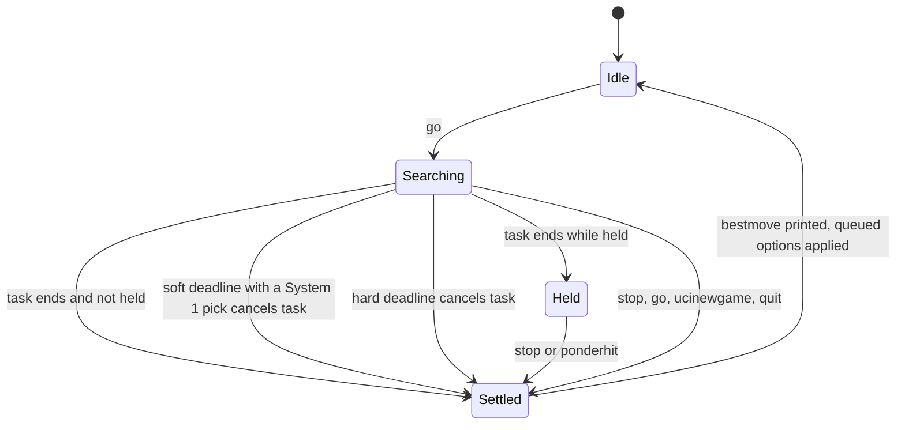
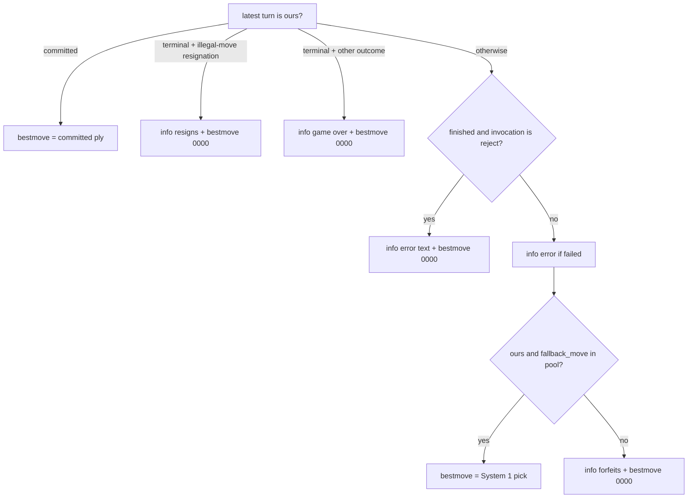

# UCI engine adapter (`lcchess uci`)

`lcchess uci` lets a chess GUI or match runner (fastchess, Cute Chess, and so on) play a langchain-chess agent as if it were an ordinary UCI engine. It is an **in-process adapter**. The agent graph is built directly in the CLI process with an `InMemorySaver` checkpointer. The adapter turns UCI commands on stdin into agent runs and turns agent state back into `info string` / `bestmove` lines on stdout. There is no server in between.

The code lives in `libs/cli/langchain_chess_cli/uci/`:

| Module | Role |
| --- | --- |
| `protocol.py` | Pure parser. One line in, one typed command out (`Uci`, `IsReady`, `SetOption`, `UciNewGame`, `Position`, `Go`, `Stop`, `PonderHit`, `Quit`, `Unknown`). |
| `clock.py` | Pure calculation of a search's soft and hard deadlines from `go` parameters. |
| `completion.py` | Pure mapping from final agent state plus the search's run status to `info string` lines and exactly one `bestmove`. |
| `engine.py` | The stateful `Engine`: search state machine, UCI options, tasks, stdin loop (`run`). |

Related pages: the per-turn lifecycle the adapter relies on (pending, committed, abandoned, terminal turns) is covered in [Turn lifecycle](/openwiki/architecture/turn-lifecycle.md) and the [middleware contract](/openwiki/concepts/middleware-contract.md) (which is what lets System 1 write `fallback_move`). The settings model (`ChessContext`), settings files and flags are covered in [Settings and model arguments](/openwiki/concepts/settings-and-model-arguments.md). The source of the fallback move is covered in [System 1](/openwiki/architecture/system-one.md). The other CLI adapter is the [Terminal UI](/openwiki/integrations/terminal-ui.md); runtime behaviour across surfaces is in [Runtime behavior](/openwiki/operations/runtime-behavior.md).

## Entry point and wiring

The `uci` Typer command in `libs/cli/langchain_chess_cli/main.py` builds a `ChessContext` (the shared opponent settings from `langchain_chess_systemone.settings`). It starts from `--config <file>` (a JSON settings file) or the defaults, resets any `--reset <setting>` names to their defaults, and then overlays the flags that were given (`overlay` in `libs/cli/langchain_chess_cli/options.py`). A flag left out keeps the setting's value. The flags mirror the settings: `--policy`, `--model`, `--reasoning-effort`, `--systemone-model`, `--threshold`, `--tournament-threshold`, `--k`, `--top-p`, `--gate`, `--style`, `--seed`, `--move-list`, `--with-eval`, `--with-nouls`, `--memory/--no-memory` (a boolean), `--system-prompt`, `--show-fen`, `--show-board` and `--model-kwargs <JSON>`. Unlike `play`, `uci` has **no `--draw-claims` flag**. The command then:

- sends logging to **stderr** at WARNING, so stdout carries only protocol output;
- defines a factory `(ChessContext, Checkpointer) -> CompiledStateGraph` that calls `build_agent(settings, checkpointer=...)`. The engine calls it again whenever settings change, and it always passes the same checkpointer;
- defines `out`, which writes one line to stdout and flushes it;
- constructs `Engine(factory, settings, out=out)` (a `ValueError`, such as an out-of-range seed, becomes a Typer `BadParameter`) and runs `asyncio.run(run(engine))`.

`run()` reads stdin lines through `loop.run_in_executor(None, stdin.readline)` so the event loop keeps running searches and timers while it waits for input. It stops after `quit`. At end of input it handles an implicit `quit`, which settles any active search, and then stops.

Every agent run uses `run_config("uci", thread, settings)`. The trace is named `chess-uci`, tagged `uci`, and its metadata holds `surface: "uci"` plus every setting (`dump(settings)`, which includes `draw_claims`) and the values actually sent where `model_kwargs` changed them (`sent(settings)`), in the same shape as server traces.

### Settings the engine enforces (`_for_uci`)

Every settings value the engine accepts, at construction or from an option, passes through `_for_uci`:

- `draw_claims` is forced to `"never"` (`DRAW_CLAIMS`), whatever the flags, config file or settings say. See [Draws](#draws-draw_claims--never).
- `seed` must be within `0..2147483647`, the range of the `Seed` spin. A larger launch seed fails the command. A config file with an out-of-range seed is reported as `options not applied: ...` and changes nothing.

## Protocol parsing

`parse()` is intentionally forgiving:

- Bare keywords (`uci`, `isready`, `ucinewgame`, `stop`, `ponderhit`, `quit`) must appear with no extra tokens. `uci extra` becomes `Unknown`.
- `setoption name <multi word name> [value <multi word value>]`. A missing `value` gives `value=None`, which the engine converts from the empty string.
- `position startpos|fen <FEN...> [moves ...]`. The FEN is not checked here. Invalid FENs are rejected later by the agent.
- `go` reads `movetime`, `wtime`, `btime`, `winc`, `binc`, `movestogo`, the flags `infinite` and `ponder`, and `searchmoves ...`. The `searchmoves` list runs until the next go keyword. `depth`, `nodes` and `mate` are recognised so their arguments get skipped, but they have no effect. Non-integer values are dropped.

Unknown non-blank lines produce `info string unknown command: ...`. Blank lines are ignored.

## The search state machine

The engine is `idle → searching → idle`, with **at most one `Search` at a time**. Each search has an increasing id, a fixed root `Position`, its `Go`, a request fingerprint, a fallback pool, and a `held` flag. It owns two asyncio tasks: `task` streams the agent run, and `runner` supervises it. It may also own a deadline task, `clock`.



*The engine's search lifecycle. Every path to Settled goes through `_settle`, which prints exactly one bestmove.*

### Starting a search (`go`)

1. **Retire the previous search first.** `go`, `ucinewgame` and `quit` all call `_retire()`. It cancels the old task, waits for its supervisor, and settles it, so the old search prints its `bestmove` before anything new starts.
2. Apply queued options (see below).
3. **Pick the thread.** `_thread_extends` reads the current thread's checkpointed `moves` and `start_fen`. The thread is kept only if the new position has the same root (FENs normalised through python-chess) and its move list starts with the moves already recorded. Otherwise, for example after a takeback, a different root, or a new game without `ucinewgame`, the engine starts a fresh `uci-<uuid>` thread. `ucinewgame` always starts a fresh thread. Because of this, the model sees only the new moves on a continuing game: "one thread, one game." Replacing a thread deletes the old one from the checkpointer (`adelete_thread`), which is safe because no search is outstanding at that point, so the checkpointer holds only the current game.
4. **searchmoves.** Illegal entries are dropped and reported with `info string ignoring illegal searchmoves: ...`. The engine never widens the search: if every entry was illegal, it still sends an empty `restrict`, and the agent rejects it (`restrict must not be empty` → `bestmove 0000`).
5. Build the agent input `{"position": {"start_fen", "moves", ["restrict"]}}`. Compute `request = fingerprint(start_fen, moves, restrict)`, the same fingerprint the core middleware uses as the turn's `request`. Compute the pool from `root_moves(...)`: the legal root moves within the restriction, which are the only moves a fallback may play.
6. Start `_think` (the agent stream) and `_supervise`, and arm the deadline (`_arm`). `held = go.infinite or go.ponder`.

### Streaming analysis

`_think` streams `astream(..., stream_mode="messages")` and keeps only chunks from the `model` node. It buffers text and emits one `info string <line>` per completed non-blank line. Once the search has settled it stops emitting, so a late stream cannot interleave with the next search's output. All `info string` output goes through `info_lines`, which splits text into one prefixed line per non-blank line, so a multi-line model reply or error message cannot forge a command such as `bestmove` on stdout.

### Deadlines (`clock.py`)

`deadlines(go, white_to_move=...)` returns `None` (no deadline) for `infinite`, `ponder`, or a `go` with neither `movetime` nor the side-to-move's clock (depth/nodes-only). Otherwise it returns a `Deadlines(soft, hard)` pair in milliseconds from the start of the search. Each limit is `min(max(MIN_MS, ms), max(0, remaining))`, with `MIN_MS = 50`, so it is floored at 50 ms but never past the time actually left.

| `go` | soft (the per-move budget) | hard (the clock itself) |
| --- | --- | --- |
| `movetime T` | `T − 150` (floored at 50, capped at `T`) | same as soft: a single deadline |
| `wtime`/`btime` (+ `winc`/`binc`, `movestogo`) | `min(remaining / (movestogo or 30) + increment, remaining) − 150` | `remaining − 150` |

The side to move comes from the start FEN's turn and the parity of the move list. `SAFETY_MS = 150` is kept back so the engine can settle and print `bestmove` before the GUI's flag falls. The increment only counts toward the budget, because it arrives after the move.

The `clock` task (`_clock`) sleeps until the soft deadline, then reads the thread's state. If System 1 has already left a usable pick for this search (`kept_move`: the state's `fallback_move`, the latest turn is this search's request, and the move is in the pool), it cancels the stream task right away so that pick is played. Otherwise it keeps waiting until the hard deadline and cancels then. So a slow LLM move on a long clock may run well past its budget instead of forfeiting early. The supervisor records status `cancelled` and settles. Any other exception becomes status `failed` with the error message ("every failure still owes a bestmove"). When the stream task ends for any reason, the supervisor cancels the clock task.

### Holding: `go infinite`, `go ponder`, `stop`, `ponderhit`

With `held` set, the supervisor records completion (`done`) but does not settle. The result waits:

- `stop` calls `_release`: clear `held`, cancel the task (no effect if it already finished), wait for the supervisor, then settle.
- `ponderhit` on a held search turns it into a normal search: `ponder` and `infinite` are cleared. If the run already finished, the engine settles at once. Otherwise it arms deadlines from the ponder `go`'s clock values, measured from the `ponderhit`.
- `stop` or `ponderhit` with no active search, or a second one after settling, does nothing. The `Ponder` option is **not** advertised.

### Settling: one completion per `go`

`_settle` runs under a lock and does nothing if the search is already `settled`. This check is what guarantees exactly one `bestmove` per `go`, even when the clock, supervisor, `stop` and a new `go` race. It reads the thread's checkpointed state, builds a `SearchResult(request, status, error, pool)`, prints the lines from `complete()`, clears the active search, and applies queued options.

## From agent state to `bestmove` (`completion.py`)

`complete()` checks these rows in order. A turn counts as "ours" only when the latest turn's `request` equals this search's fingerprint, so state left over from an older request never decides the answer.



*How `complete()` chooses the single bestmove for a search.*

- **Committed.** A committed ply wins even if the search was cancelled. The move landed before the cancellation took effect.
- **Resignation.** After repeated illegal replies (four in the tests), the output is `info string resigns: no legal move after N attempts` and then `bestmove 0000`. A terminal resignation for another reason (UCI never sends `resign`, but the record type allows one) reads as a game over.
- **Game already over** (checkmate, stalemate, insufficient material, and so on): `info string game over: <result text>` and then `bestmove 0000`.
- **Rejected position** (invalid FEN, illegal moves, empty restriction): `info string <agent error>` and then `bestmove 0000`.
- **System 1's pick** after a cancellation, a deadline or an execution failure. A failure also prints `info string error: <message>` first. The pick is the state's private `fallback_move` field, used only when the latest turn is ours and the move is in the pool. System 1 records its top-ranked move as the decision's `fallback` whenever it ranked, and replays it into `fallback_move` when that move is still allowed (`libs/systemone/langchain_chess_systemone/middleware.py`).
- **Forfeit.** With no usable pick (no System 1 ranking, a stale turn, an out-of-pool move, or an empty pool), the output is `info string forfeits: no move to play` and `bestmove 0000`. The engine **never plays a random move**; the module docstring notes that would be worse than a loss on time.

### Why `0000`

`NULL_MOVE = "0000"` is a null move, not a standard UCI resignation. GUIs score it as a forfeit, and that is the intent. The README notes that fastchess (pinned at `v1.8.2-alpha` in `mise.toml`) scores it as an illegal-move loss for the engine that played it.

### Abandoned pending turns

A fallback is decided by the adapter, not the agent, so the agent's turn stays `pending` in the checkpoint. The GUI's next `position ... moves` includes the fallback move. The thread still extends (the old moves are a prefix), so the core middleware's lifecycle sees a new request while a turn is pending. It marks that turn `abandoned`, syncs the fallback in as an **external** ply, and opens a new turn (`libs/chess/langchain_chess/middleware/core.py`). `test_stop_before_commit_then_the_fallback_enters_as_an_external_move` checks exactly this with a System 1 middleware below its threshold: the `bestmove` is System 1's top move, then turn statuses are `["abandoned", "committed"]` and ply 1 has `source == "external"`.

## Options

`uci` prints `id name langchain-chess`, `id author ...`, the option declarations, then `uciok`. Option names are case-insensitive (keyed by lowercase name). Declared defaults come from the launch settings.

| UCI option | Type | Values | `ChessContext` field |
| --- | --- | --- | --- |
| `Config` | string | path to a settings file, or `<empty>` | replaces all settings |
| `Model` | string | any non-blank model spec | `model` |
| `ReasoningEffort` | combo | `default` / `low` / `medium` / `high` (`default` sends no effort, i.e. `None`) | `reasoning_effort` |
| `SystemOneModel` | string | e.g. `typesafe/jev-latest` | `systemone_model` |
| `Policy` | combo | `llm` / `systemone` / `hybrid` | `policy` |
| `Threshold` | string | float in 0..1 | `threshold` |
| `K` | spin | 1..255 | `k` |
| `Memory` | check | `true` / `false` (case-insensitive; the legacy values `summarize` / `none` map to true / false) | `memory` |
| `MoveList` | combo | `both` / `legal` / `candidates` / `none` | `move_list` |
| `Seed` | spin | 0..2147483647 | `seed` |

Other settings (`gate`, `style`, `top_p`, `tournament_threshold`, `with_eval`, `with_nouls`, `system_prompt`, `show_fen`, `show_board`, `model_kwargs`) have no individual option. They can be set with command-line flags or through a `Config` file.

**Config.** `setoption name Config value <path>` loads a settings file and **replaces every setting** with it (still passed through `_for_uci`, so draws stay `never`). Options set afterwards patch the loaded settings. A relative path is resolved from the engine's working directory, which the GUI chooses. An empty value or `<empty>` (which GUIs often send at startup) restores the settings the engine **started with**, not the library defaults. A file that can't be read or validated is reported as `invalid value for Config: ...` and changes nothing.

**Validation.** Unknown names produce `info string unknown option: <name>`. Invalid values produce `info string invalid value for <name>: <reason>` and are dropped.

**Rebuild semantics.** Valid values go into a queue. When idle, the queue is applied at once. During a search, options stay queued so the running search is not disturbed. They are applied after the search settles, at the next `go`, or at `isready` once idle. `isready` always answers `readyok` right away, even mid-search. Queued values are applied **one at a time, in order**: each builds new settings (the current settings with that field changed, or the loaded config), validates them, and calls the factory with the **same** checkpointer, so thread history survives. Settings and agent change together or not at all. If validation or the factory raises (for example `build_agent` refusing `Memory` for a model with no known input limit), the engine prints `info string options not applied: <error>` and keeps the previous settings and agent for that entry, then continues with the rest of the queue, so a failing option costs only itself.

## Draws: `draw_claims = "never"`

The engine forces `draw_claims = "never"` onto every settings value it builds agents from, and so onto their trace metadata ("The GUI adjudicates draws: a claimed one would end the game as `bestmove 0000`"). The agent does not claim threefold repetition or fifty-move draws itself. The GUI or match runner adjudicates them. Draws that happen automatically on the board (for example insufficient material) still end the game in the agent and produce `game over` + `0000`.

## Operations

```sh
mise run dev:uci -- --policy systemone   # uv run --all-packages --env-file .env lcchess uci ...
mise run test:uci                        # fastchess smoke match
```

LLM moves take seconds (the README cites 30–60 s for GLM-5.3 Flash). On short time controls, a move that misses its budget is replaced by System 1's pick when System 1 ranked the position, and otherwise runs until the hard deadline and forfeits. `Policy systemone` is the practical choice for fast games.

### fastchess smoke test (`mise run test:uci`)

The `test:uci` task in `mise.toml` runs inside `.uci-match/`, which is gitignored, because fastchess writes `config.json` to the working directory. It plays two System 1-only (Jev) engines against each other, `jev-seed1` (`lcchess uci --policy systemone --seed 1`) against `jev-seed2` (`--seed 2`), with `st=3` (3 s per move), `timemargin=2000`, 1 round of 2 games, and a 60-move cap. It writes `games.pgn` and `fastchess.log`. It passes only if both games have a real `Result` (`1-0`, `0-1`, `1/2-1/2`) and no `Termination` tag other than `normal` or `adjudication`, meaning no forfeits from time losses or `0000`. fastchess is pinned in `mise.toml` (`v1.8.2-alpha`).

## Tests

- `libs/cli/tests/test_uci_protocol.py` covers the pure layers: the parse table, soft/hard deadline arithmetic (safety margin, `MIN_MS` floor, the cap at the time left, `movestogo`, increments, negative clocks, missing side clock), `root_moves`, and every `complete()` row, including System 1 picks after cancellation and failure and forfeits for stale-request, empty-pool and out-of-pool picks.
- `libs/cli/tests/test_uci_engine.py` drives `Engine` with a `ScriptedModel` (optionally with a `SystemOneMiddleware` around a `FakeRanker`). It covers the handshake and option declarations, draws never being claimed whatever the settings say, streamed analysis, game continuation on one thread, takebacks, new roots and invalid FENs starting new threads, the soft deadline playing System 1's pick, a search without a pick running past the soft deadline, deadline and hard-deadline forfeits, provider failures, resignation, insufficient material, searchmoves, the `go infinite` / `stop` / `ponderhit` holding rules, one `bestmove` per `go` when `go` or `ucinewgame` interrupts a search, late results being ignored, option queueing and rebuild counts, failed rebuilds leaving settings untouched, `ReasoningEffort default` mapping to `None`, `Config` loading / `<empty>` restore / failure / queueing during a search, a failing queued option costing only itself, the seed range check, retired threads being deleted from the checkpointer, multi-line errors that cannot forge commands, and `run()` stopping at `quit` or end of input.
- `libs/cli/tests/test_options.py` covers settings overlay and `run_config` trace naming and metadata.
