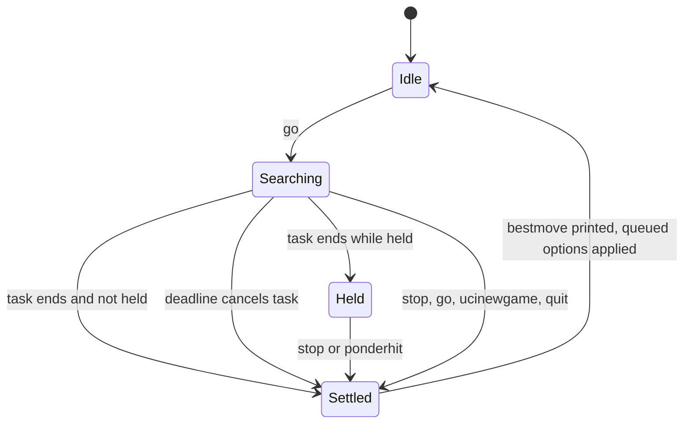
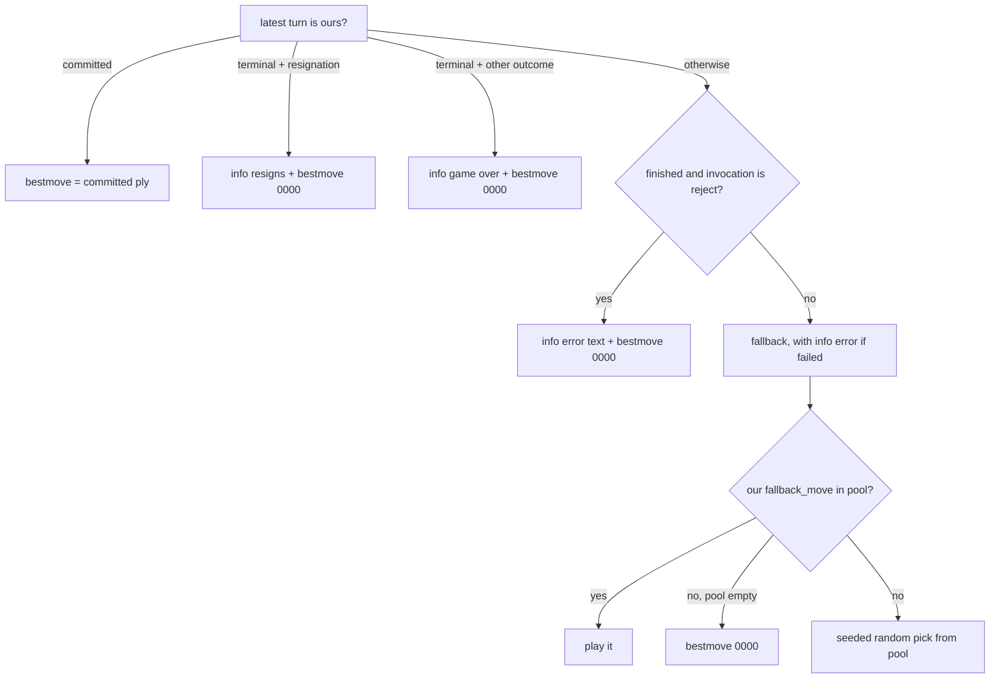

# UCI engine adapter (`lcchess uci`)

`lcchess uci` lets a chess GUI or match runner (fastchess, Cute Chess, and so on) play a langchain-chess agent as if it were an ordinary UCI engine. It is an **in-process adapter**. The agent graph is built directly in the CLI process with an `InMemorySaver` checkpointer. The adapter turns UCI commands on stdin into agent runs and turns agent state back into `info string` / `bestmove` lines on stdout. There is no server in between.

The code lives in `libs/cli/langchain_chess_cli/uci/`:

| Module | Role |
| --- | --- |
| `protocol.py` | Pure parser. One line in, one typed command out (`Uci`, `IsReady`, `SetOption`, `UciNewGame`, `Position`, `Go`, `Stop`, `PonderHit`, `Quit`, `Unknown`). |
| `clock.py` | Pure deadline calculation from `go` parameters. |
| `completion.py` | Pure mapping from final agent state plus the search's run status to `info string` lines and exactly one `bestmove`. |
| `engine.py` | The stateful `Engine`: search state machine, options, threads, stdin loop (`run`). |

Related pages: the per-turn lifecycle the adapter relies on (pending, committed, abandoned, terminal turns) is covered in [Turn lifecycle](/openwiki/architecture/turn-lifecycle.md). The source of the fallback move is covered in [System 1](/openwiki/architecture/system-one.md). The other CLI adapter is the [Terminal UI](/openwiki/integrations/terminal-ui.md).

## Entry point and wiring

The `uci` Typer command in `libs/cli/langchain_chess_cli/main.py` builds an `AgentOptions` from its flags (`--policy`, `--model`, `--reasoning-effort`, `--systemone-model`, `--threshold`, `--tournament-threshold`, `--k`, `--top-p`, `--gate`, `--style`, `--seed`, `--show-legal-moves`, `--with-eval`, `--with-nouls`, `--memory`). `--memory` accepts only `none` (the default) or `summarize`. It then:

- sends logging to **stderr** at WARNING, so stdout carries only protocol output;
- defines a factory `(AgentOptions, Checkpointer) -> CompiledStateGraph` that calls `build_agent(..., draw_claims=DRAW_CLAIMS, checkpointer=...)`. The engine calls it again whenever options change, and it always passes the same checkpointer;
- defines `out`, which writes one line to stdout and flushes it;
- runs `asyncio.run(run(Engine(factory, options, out=out)))`.

`run()` reads stdin lines through `loop.run_in_executor(None, stdin.readline)` so the event loop keeps running searches and timers while it waits for input. It stops after `quit`. At end of input it handles an implicit `quit`, which settles any active search, and then stops.

Every agent run uses `run_config("uci", thread, options, draw_claims="never")`. The trace is named `chess-uci`, tagged `uci`, and its metadata holds all option values plus `draw_claims`, in the same shape as server traces (`libs/cli/langchain_chess_cli/options.py`).

## Protocol parsing

`parse()` is intentionally forgiving:

- Bare keywords (`uci`, `isready`, `ucinewgame`, `stop`, `ponderhit`, `quit`) must appear with no extra tokens. `uci extra` becomes `Unknown`.
- `setoption name <multi word name> [value <multi word value>]`. A missing `value` gives `value=None`, which the engine converts from the empty string.
- `position startpos|fen <FEN...> [moves ...]`. The FEN is not checked here. Invalid FENs are rejected later by the agent.
- `go` reads `movetime`, `wtime`, `btime`, `winc`, `binc`, `movestogo`, the flags `infinite` and `ponder`, and `searchmoves ...`. The `searchmoves` list runs until the next go keyword. `depth`, `nodes` and `mate` are recognised so their arguments get skipped, but they have no effect. Non-integer values are dropped.

Unknown non-blank lines produce `info string unknown command: ...`. Blank lines are ignored.

## The search state machine

The engine is `idle → searching → idle`, with **at most one `Search` at a time**. Each search has an increasing id, a fixed root `Position`, its `Go`, a request fingerprint, a fallback pool, and a `held` flag. It owns two asyncio tasks: `task` streams the agent run, and `runner` supervises it. It may also own a deadline `timer`.



*The engine's search lifecycle. Every path to Settled goes through `_settle`, which prints exactly one bestmove.*

### Starting a search (`go`)

1. **Retire the previous search first.** `go`, `ucinewgame` and `quit` all call `_retire()`. It cancels the old task, waits for its supervisor, and settles it, so the old search prints its `bestmove` before anything new starts.
2. Apply queued options (see below).
3. **Pick the thread.** `_thread_extends` reads the current thread's checkpointed `moves` and `start_fen`. The thread is kept only if the new position has the same root (FENs normalised through python-chess) and its move list starts with the moves already recorded. Otherwise, for example after a takeback, a different root, or a new game without `ucinewgame`, the engine starts a fresh `uci-<uuid>` thread. `ucinewgame` always starts a fresh thread. Because of this, the model sees only the new moves on a continuing game: "one thread, one game."
4. **searchmoves.** Illegal entries are dropped and reported with `info string ignoring illegal searchmoves: ...`. The engine never widens the search: if every entry was illegal, it still sends an empty `restrict`, and the agent rejects it (`restrict must not be empty` → `bestmove 0000`).
5. Build the agent input `{"position": {"start_fen", "moves", ["restrict"]}}`. Compute `request = fingerprint(start_fen, moves, restrict)`, the same fingerprint the core middleware uses as the turn's `request`. Compute `pool = root_moves(...)`, the legal root moves within the restriction, which are the only moves a fallback may play.
6. Start `_think` (the agent stream) and `_supervise`, and arm the deadline. `held = go.infinite or go.ponder`.

### Streaming analysis

`_think` streams `astream(..., stream_mode="messages")` and keeps only chunks from the `model` node. It buffers text and emits one `info string <line>` per completed non-blank line. Once the search has settled it stops emitting, so a late stream cannot interleave with the next search's output.

### Deadlines (`clock.py`)

`deadline_ms(go, white_to_move)` returns:

- `None` (no deadline) for `infinite`, `ponder`, or a `go` with neither `movetime` nor the side's clock (depth/nodes-only);
- `max(50, movetime − 150)` for `movetime`;
- otherwise `max(50, min(remaining / (movestogo or 30) + increment, remaining) − 150)`, using `wtime/winc` or `btime/binc` for the side to move. The side to move comes from the start FEN's turn and the parity of the move list.

`SAFETY_MS = 150` is kept back so the engine can settle and print `bestmove` before the GUI's flag falls. When the deadline fires, `_expire` cancels the stream task. The supervisor records status `cancelled` and settles. Any other exception becomes status `failed` with the error message ("every failure still owes a bestmove").

### Holding: `go infinite`, `go ponder`, `stop`, `ponderhit`

With `held` set, the supervisor records completion (`done`) but does not settle. The result waits:

- `stop` calls `_release`: clear `held`, cancel the task (no effect if it already finished), wait for the supervisor, then settle.
- `ponderhit` on a held search turns it into a normal search: `ponder` and `infinite` are cleared. If the run already finished, the engine settles at once. Otherwise it arms a deadline from the ponder `go`'s clock values.
- `stop` or `ponderhit` with no active search, or a second one after settling, does nothing. The `Ponder` option is **not** advertised.

### Settling: one completion per `go`

`_settle` runs under a lock and does nothing if the search is already `settled`. This check is what guarantees exactly one `bestmove` per `go`, even when the timer, supervisor, `stop` and a new `go` race. It reads the thread's checkpointed state, builds a `SearchResult(request, status, error, pool, seed=f"{seed}:{request}")`, prints the lines from `complete()`, clears the active search, and applies queued options.

## From agent state to `bestmove` (`completion.py`)

`complete()` checks these rows in order. A turn counts as "ours" only when the latest turn's `request` equals this search's fingerprint, so state left over from an older request never decides the answer.



*How `complete()` chooses the single bestmove for a search.*

- **Committed.** A committed ply wins even if the search was cancelled. The move landed before the cancellation took effect.
- **Resignation.** After repeated illegal replies (four in the tests), the output is `info string resigns: no legal move after N attempts` and then `bestmove 0000`.
- **Game already over** (checkmate, stalemate, insufficient material, and so on): `info string game over: <result text>` and then `bestmove 0000`.
- **Rejected position** (invalid FEN, illegal moves, empty restriction): `info string <agent error>` and then `bestmove 0000`.
- **Fallback** after a cancellation, a deadline or an execution failure. A failure also prints `info string error: <message>`. The first choice is the turn's `fallback_move` if it is in the pool. System 1 writes that field with its top-ranked move for the turn when it ranked (`libs/systemone/langchain_chess_systemone/middleware.py`). Without one, the engine picks with `random.Random(f"{seed}:{request}")` from the pool, so the choice is reproducible for a given `Seed` and position. An empty pool (the position doesn't replay) gives `0000`.

### Why `0000`

`NULL_MOVE = "0000"` is a null move, not a standard UCI resignation. GUIs score it as a forfeit, and that is the intent. The README notes that fastchess v1.8.2-alpha scores it as an illegal-move loss for the engine that played it.

### Abandoned pending turns

A fallback is decided by the adapter, not the agent, so the agent's turn stays `pending` in the checkpoint. The GUI's next `position ... moves` includes the fallback move. The thread still extends (the old moves are a prefix), so the core middleware's lifecycle sees a new request while a turn is pending. It marks that turn `abandoned`, syncs the fallback in as an **external** ply, and opens a new turn (`libs/chess/langchain_chess/middleware/core.py`). `test_stop_before_commit_then_the_fallback_enters_as_an_external_move` checks exactly this: turn statuses `["abandoned", "committed"]`, and ply 1 has `source == "external"`.

## Options

`uci` prints `id name langchain-chess`, `id author ...`, the option declarations, then `uciok`. Option names are case-insensitive (keyed by lowercase name). Declared defaults come from the launch `AgentOptions`.

| UCI option | Type | Values | `AgentOptions` field |
| --- | --- | --- | --- |
| `Model` | string | any `init_chat_model` spec | `model` |
| `ReasoningEffort` | combo | `low` / `medium` / `high` | `reasoning_effort` |
| `SystemOneModel` | string | e.g. `semif-qwen3.5-4b` | `systemone_model` |
| `Policy` | combo | `llm` / `systemone` / `hybrid` | `policy` |
| `Threshold` | string | float in 0..1 | `threshold` |
| `K` | spin | 1..255 | `k` |
| `Memory` | combo | `none` / `full` / `summarize` | `memory` |
| `Seed` | spin | 0..2147483647 | `seed` |

Other knobs (`gate`, `style`, `top_p`, `tournament_threshold`, `show_legal_moves`, `with_eval`, `with_nouls`, `summary_trigger_tokens`) can only be set with command-line flags.

**Validation.** Unknown names produce `info string unknown option: <name>`. Invalid values produce `info string invalid value for <name>: <reason>` and are dropped.

**Rebuild semantics.** Valid values go into a queue. When idle, the queue is applied at once: `dataclasses.replace` on the options, then the factory rebuilds the agent with the **same** checkpointer, so thread history survives. During a search, options stay queued so the running search is not disturbed. They are applied after the search settles, at the next `go`, or at `isready` once idle. `isready` always answers `readyok` right away, even mid-search.

## Draws: `draw_claims = "never"`

The engine builds the agent and its run config with `DRAW_CLAIMS = "never"` ("The GUI adjudicates draws"). The agent does not claim threefold repetition or fifty-move draws itself. The GUI or match runner adjudicates them. Draws that happen automatically on the board (for example insufficient material) still end the game in the agent and produce `game over` + `0000`.

## Operations

```sh
mise run dev:uci -- --policy systemone   # uv run --all-packages --env-file .env lcchess uci ...
mise run test:uci                        # fastchess smoke match
```

LLM moves take seconds, so short time controls mostly produce fallback moves. `Policy systemone` is the practical choice for fast games.

### fastchess smoke test (`mise run test:uci`)

The `test:uci` task in `mise.toml` runs inside `.uci-match/`, which is gitignored, because fastchess writes `config.json` to the working directory. It plays two SemIf-only engines against each other, `lcchess uci --policy systemone --seed 1` against `--seed 2`, with `st=3` (3 s per move), `timemargin=2000`, 1 round of 2 games, and a 60-move cap. It writes `games.pgn` and `fastchess.log`. It passes only if both games have a real `Result` (`1-0`, `0-1`, `1/2-1/2`) and no `Termination` tag other than `normal` or `adjudication`, meaning no forfeits from time losses or `0000`. fastchess is pinned in `mise.toml` (`v1.8.2-alpha`).

## Tests

- `libs/cli/tests/test_uci_protocol.py` covers the pure layers: the parse table, deadline arithmetic (safety margin, `MIN_MS` floor, `movestogo`, missing side clock), `root_moves`, and every `complete()` row, including stale-request and out-of-pool fallbacks.
- `libs/cli/tests/test_uci_engine.py` drives `Engine` with a `ScriptedModel`. It covers the handshake, streamed analysis, game continuation on one thread, takebacks and new roots starting new threads, deadline fallbacks, provider failures, resignation, insufficient material, searchmoves, the `go infinite` / `stop` / `ponderhit` holding rules, one `bestmove` per `go` when `go` or `ucinewgame` interrupts a search, late results being ignored, option queueing and rebuild counts, and `run()` stopping at `quit` or end of input.
t` or end of input.
