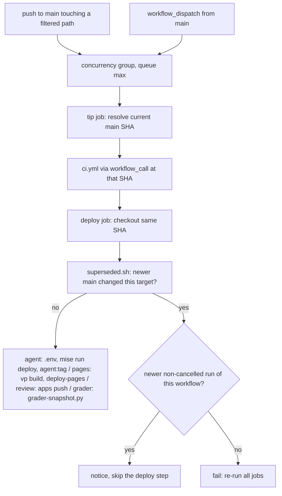

# Deployment and image build

The repository deploys four things. Each has its own workflow:

- **agent**: the LangGraph Agent Server image for the `langchain-chess` agent's `production` environment on LangSmith Deployments. It serves the `chess` graph and the small `/ui/*` JSON routes. It is deployed by `.github/workflows/deploy.yml`.
- **pages**: the web UI (`apps/web`), published as a static site to GitHub Pages by `.github/workflows/pages.yml`. The deployed image does **not** carry the UI.
- **review**: the `apps/review` LangSmith custom app. It is published by `.github/workflows/deploy-review.yml`.
- **grader**: the `langchain-chess-grader` LangSmith sandbox snapshot (Stockfish plus `lcchess`) that runs behind the review app's Analyze button. It is built by `.github/workflows/deploy-grader.yml`.

All four workflows run on pushes to `main`, and all four deploy only after the same checks that pull requests run (`.github/workflows/ci.yml`). The `evals` workspace member is never deployed: it is checked and tested by CI, but no deploy workflow watches its paths (see [path filters](#triggers-and-path-filters)).

This page covers the image build inputs, the workflows, and how to check a build locally. For the package layout see [package map](/openwiki/architecture/package-map.md). For the server's graph and HTTP app see [Agent Server integration](/openwiki/integrations/agent-server.md). For what the grader and review app do see [grading and review](/openwiki/workflows/grading-and-review.md). For local dev servers and tasks see [local development](/openwiki/operations/local-development.md). For the test and coverage gates CI runs, see [testing conventions](/openwiki/testing/testing-conventions.md).

## Image build: `langgraph.json`

`langgraph.json` is the build spec that `langgraph build` and `langgraph deploy` read:

- `python_version: "3.13"`, `image_distro: "wolfi"`.
- `source: { kind: "uv", root: ".", package: "langchain-chess-server" }`. The image is built from the uv workspace and its `uv.lock`, not from a requirements list. The package installed as the app is the `apps/server` distribution.
- `graphs.chess` points at `./apps/server/langchain_chess_server/graph.py:make_graph`, and `http.app` points at `./apps/server/langchain_chess_server/app.py:app`. The custom FastAPI app handles the `/ui` routes.
- `env: ".env"`. The agent deploy job writes this file (see below).

### Why `dockerfile_lines` copies member `pyproject.toml` files

langgraph-cli copies only the root `pyproject.toml` into `/tmp/uv_export/project` before it runs `uv export`. (`apps/server/README.md` names langgraph-cli 0.4.31 as the version with this behaviour; the root dev group now pins `langgraph-cli[inmem]==0.4.40`, and the workaround is still in place.) The root is a *virtual* workspace with no package of its own. Its `[tool.uv.workspace] members` list is `libs/chess`, `libs/systemone`, `libs/cli`, `apps/server` and `evals`, so the export needs member manifests to resolve the workspace. `dockerfile_lines` fills the gap with one `ADD <member>/pyproject.toml /tmp/uv_export/project/<member>/pyproject.toml` line per member. `apps/server/README.md` records this workaround and says to keep the list in step with the workspace members.

**Current state:** `dockerfile_lines` has `ADD` lines for `libs/chess`, `libs/systemone`, `libs/cli` and `apps/server`, but **not** for `evals`, which was added to the workspace members later. The README's rule says the list should match the members. The repository does not show whether `uv export` tolerates the missing `evals` manifest. If you touch the workspace or `langgraph.json`, run a local smoke build (see below) to confirm the image still builds, and add `ADD evals/pyproject.toml …` if it does not. `libs/cli` is copied even though the server does not depend on it. This is also why the agent path filter watches `libs/cli/pyproject.toml` (only that file, not the rest of `libs/cli`).

The members are listed by name rather than with a glob. A glob over `apps/` would pick up `apps/web`, which has no `pyproject.toml`.

### Why workspace sources live only in the root `pyproject.toml`

The root `[tool.uv.sources]` marks all five distributions (`langchain-chess`, `langchain-chess-systemone`, `langchain-chess-cli`, `langchain-chess-server`, `langchain-chess-evals`) as `{ workspace = true }`. The member manifests declare plain dependencies (for example, `apps/server/pyproject.toml` depends on `langchain-chess` and `langchain-chess-systemone`, and so does `evals/pyproject.toml`) and have no `[tool.uv.sources]` of their own. According to `apps/server/README.md`, each member is installed on its own inside the image, and a member-level `workspace = true` source fails there. Keep new workspace sources in the root file. The same root sources also let `uvx --from git+…#subdirectory=libs/cli` resolve the unpublished sibling packages from the same commit.

### Build context: `.dockerignore`

`.dockerignore` limits the context to what the image needs, the uv workspace (`libs/`, `apps/server/`, the lockfile). It excludes:

- `.git/`, virtualenvs, `node_modules`, caches and coverage output, `.langgraph_api/`, `.uci-match/`.
- `**/tests/`, `plans/`, `docs/`, `.github/`.
- The JS sources `apps/web/`, `apps/review/` and `packages/`.
- Secrets and key material: `.env`, `.env.*` except `.env.example`, `*.pem`, `*.key`, `*.crt`, `credentials.json`.

It does not exclude `evals/` or `docker/`, so the evals sources (minus their tests) are part of the build context even though the server does not use them.

`static/` is gitignored, but `.dockerignore` follows Docker semantics only, not git's, so a `static/` directory that happens to exist in the build directory (for example after a local `mise run build`) still reaches the image. The file's header comment still says the web build is part of what the image needs and that CI relies on this; that is out of date. The CI agent job sets up without web dependencies and `mise run deploy` no longer builds the UI, so the image CI deploys has no `static/` directory.

## The server app at deploy time

`app.py` builds its FastAPI app through `create_app(static_dir=STATIC_DIR)`, where `STATIC_DIR` is the package's `static/` directory (the default Vite output of `mise run build`). Its routes:

- `/ui/config`: the graph id `chess`, plus the `ChessContext` JSON schema and defaults.
- `/ui/model?model=<spec>`: `max_input_tokens` (from `model_limit`) and `takes_effort` for that model; a request without `model` is a 422.
- A bare `/ui` redirects to `/ui/`.
- If the static directory exists, it is mounted at `/ui` with `StaticFiles(..., html=True)`. Otherwise `/ui/` returns a 404 JSON message telling you to run `mise run build` (or use `vp dev`).

The JSON routes are registered whether or not the build exists. In the deployed image the build is absent (GitHub Pages hosts the UI), so `/ui/` is the 404 there, while the Pages-hosted UI calls `/ui/config` and `/ui/model` on the deployment. The static mount survives for local runs and the e2e tests (`mise run test:e2e` runs `mise run build` first). The UI is mounted under `/ui`, never `/`, because `/` is the Agent Server's health check. It uses `app.mount` rather than `app.frontend()`, because `app.frontend()` routes have low priority and the Agent Server's own `/ui` mount would answer first. The app's lifespan closes both shared graph client pools (`POOL` and `DECISIONS_POOL`) on shutdown; the Agent Server merges this lifespan with its own.

`apps/server/tests/test_app.py` tests both branches (`static_dir=None`, and a temporary directory holding an `index.html` and an asset), the `/ui/model` route, and that shutdown closes the clients of the graph module as langgraph loads it by path.

### `mise run build` and `mise run deploy`

`mise run build` runs `pnpm --dir apps/web exec vp build`. `apps/web/vite.config.ts` uses `base` from `BASE_PATH` (default `/ui/`) and `build.outDir` from `OUT_DIR` (default `../server/langchain_chess_server/static`), with `emptyOutDir: true`. By default the bundle therefore goes into the Python package for local serving; the Pages workflow overrides both.

`mise run deploy` no longer builds the UI. It is only:

```toml
[tasks.deploy]
run = "uv run --all-packages langgraph deploy --no-remote --agent-id langchain-chess --agent-environment production --deployment-type dev"
```

`--no-remote` builds the image locally (on the CI runner, or on your machine, which needs Docker with buildx) from the `.dockerignore`d context and then pushes it to the `langchain-chess` agent's `production` environment. The task's comment says to deploy from CI, because `langgraph deploy` sends `.env` as the deployment's secrets and a local `.env` names the local environment.

## Deploy workflows

`deploy.yml` (agent), `pages.yml` (web UI), `deploy-review.yml` (review) and `deploy-grader.yml` (grader) have the same structure: a trigger with path filters, a workflow-level queued concurrency lock, a `tip` job, a call to `ci.yml`, and a deploy job that checks it has not been superseded.



*One deploy workflow run: queued lock, tip SHA, shared CI gate, superseded check, then the target-specific deploy.*

### Triggers and path filters

Each workflow runs on `push` to `main` filtered by `on.push.paths`, and on `workflow_dispatch` (no inputs). A manual dispatch ignores the path filters, so it is the way to retry a failed deploy that no later push would redo (and, for Pages, to republish after changing `VITE_API_URL`). Every job is conditioned on `github.ref == 'refs/heads/main'` (via `tip`), so a dispatch from another branch skips.

- **agent** (`deploy.yml`): `libs/chess/**`, `libs/systemone/**`, `libs/cli/pyproject.toml`, `apps/server/**`, `uv.lock`, `pyproject.toml`, `.python-version`, `langgraph.json`, `.dockerignore`, `scripts/agent-tags.sh`, the common set below, and `.github/workflows/deploy.yml`. It no longer watches `apps/web/**`, `packages/chess-ui/**` or the JS shared files, since the UI is not in the image.
- **pages** (`pages.yml`): `apps/web/**`, `packages/chess-ui/**`, the JS shared set (`pnpm-lock.yaml`, `pnpm-workspace.yaml`, `package.json`, `vite.config.ts`, `tsconfig.json`), the common set, and `.github/workflows/pages.yml`.
- **review** (`deploy-review.yml`): `apps/review/**`, `packages/chess-ui/**`, the JS shared set, the common set, and `.github/workflows/deploy-review.yml`.
- **grader** (`deploy-grader.yml`): `libs/chess/**`, `libs/systemone/**`, `libs/cli/**` (all of it, because `lcchess grade` runs from it), `uv.lock`, `pyproject.toml`, `.python-version`, `docker/grader.Dockerfile`, `scripts/grader-snapshot.py`, the common set, and `.github/workflows/deploy-grader.yml`.
- **common** (in all four): `mise.toml`, `mise.lock`, `.github/actions/setup/**`, `.github/workflows/ci.yml`, `scripts/superseded.sh`.

**`evals` never triggers a deploy.** None of the four filters lists `evals/**`, so a change confined to `evals/` (code, datasets, experiments or `evals/reports`) runs CI on its pull request but does not redeploy the agent, UI, review app or grader. Only changes to shared root files such as `pyproject.toml` or `uv.lock` (for example, adding an evals dependency) trigger the agent and grader workflows. This is intended, since nothing deployed imports `langchain_chess_evals`. (The positions dataset's LangSmith renderer, `render.html`, is built from `apps/web` and published by Pages, so it follows the Pages filter, not `evals/`.) If a deployable ever starts depending on `evals`, add its paths to that workflow's filter.

A path missing from a filter causes a silent stale deploy. The workflow comments say to over-include rather than under-include when a deployable gains a dependency.

### Concurrency queue and the tip SHA

Concurrency is set per workflow, so the whole run, CI included, holds the lock and deploys go out in push order. The groups are `deploy-agent-${{ github.ref }}`, `pages-${{ github.ref }}`, `deploy-review-${{ github.ref }}` and `deploy-grader-${{ github.ref }}`, with `queue: max`: a newer arrival waits its turn and never cancels a pending deploy. The group is per ref so that a branch dispatch, which skips anyway, cannot displace a pending `main` run. The workflow comments note that a newer run replacing a pending older one is acceptable only because every run of a workflow deploys the same target. That is why each target has its own workflow and group.

The first job, `tip`, runs inside the lock and asks the GitHub API for the current `main` commit (`gh api repos/$GITHUB_REPOSITORY/commits/main`). It does not use the pushed `GITHUB_SHA`. It passes that SHA to `ci.yml` as the `ref` input and to the deploy job's checkout. So a retried or long-queued older run still ships `main` as it is now, and what deploys is exactly the commit that passed CI.

### CI gate

The `ci` job calls `./.github/workflows/ci.yml` as a reusable workflow with `ref` set to the tip SHA, and the deploy job `needs` both `tip` and `ci`. Merges therefore deploy only behind the same checks that pull requests run.

### Superseded check

Re-running only the deploy job in the Actions UI reuses the earlier `tip` output and CI result, while `main` may have moved. Before deploying, each deploy job fetches the current `main` and runs `scripts/superseded.sh <workflow file> <tested sha> <main sha>`. The script reads the workflow's `on.push.paths` from **main's** copy of the file (with `yq`), turns each into a `:(glob)` pathspec so `**` and `*` match the way GitHub's filters do, and prints `git diff --name-only` between the two SHAs.

- **No output:** `main` moved only in unrelated paths (or not at all), so the deploy proceeds with the tested SHA.
- **Output, and a newer run exists:** the job asks the Actions API for runs of the same workflow on `main` with a higher run number whose conclusion is not `cancelled`. If there is one, it emits a notice, sets `superseded=true`, and the deploy steps are skipped (the job succeeds). The newer run deploys the target.
- **Output, and no newer run:** the job fails with an error asking you to re-run all jobs. This keeps a push that triggers no run (for example `[skip ci]`) red instead of silently leaving the target stale.

### `agent` job (`deploy.yml`)

30-minute timeout. It checks out the tip SHA and runs the setup action with `web: false` (no pnpm install, so no UI build). Then it:

1. Writes `.env` with the runtime variables `LANGSMITH_GATEWAY`, `LANGSMITH_GATEWAY_API_KEY`, `TYPESAFE_BASE_URL` and `TYPESAFE_API_KEY`. Both API keys come from the `LC_GATEWAY_KEY` repository secret. `langgraph deploy` re-sends this env file as the revision's secrets on every deploy, so the file must contain the *complete* runtime set. A variable left out could be dropped by a redeploy.
2. Runs the superseded check against `deploy.yml`.
3. Unless superseded, runs `mise run deploy -- --no-input` with the `LANGSMITH_API_KEY` repository secret. This builds and pushes the image only.
4. Unless superseded, runs `mise run agent:tag` (`scripts/agent-tags.sh`) with the same key. The script looks up the `langchain-chess` agent through `langsmith api`, then tags the `langchain-chess-positions` dataset (if it exists; tagging it also tags its experiments) and each environment's tracing project with the agent's tag value. Tagging upserts, so every deploy re-tags and picks up resources added since.

At runtime `ServerSettings` (`apps/server/langchain_chess_server/settings.py`) reads the shell, then `.env`, and rejects `LANGSMITH_GATEWAY_API_KEY`, `TYPESAFE_API_KEY` or `TYPESAFE_BASE_URL` when set but blank. `make_graph` constructs it for each run (reads, updates and introspection without an execution runtime get a credential-free graph shape instead), so an empty secret written into the deployment `.env` makes runs fail loudly instead of falling back silently to another key.

The two sign-in variables are handled the other way: `ServerSettings` treats a blank `OAUTH_CLIENT_ID` or `ALLOWED_ORGANIZATION_ID` as unset. The workflow writes both even before the OAuth app exists, so an unset repository variable expands to an empty value. With either value unset, `auth.py` refuses every Bearer token, but API keys still work. The deployment therefore starts safely before sign-in is configured. `auth.py` caches its access policy for the life of the process, so changing these variables takes effect only after a redeploy.

### `pages` workflow (`pages.yml`)

The whole workflow is skipped until the repository variable `VITE_API_URL` (the agent deployment's API URL) is set: `tip` requires both `main` and a non-empty `VITE_API_URL`. The `build` job (15-minute timeout) sets up without Python (`python: false`), runs the superseded check against `pages.yml`, and then, unless superseded, runs `pnpm --dir apps/web exec vp build` with `BASE_PATH=/<repository name>/` (the site lives under that path), `OUT_DIR=dist`, `VITE_API_URL`, and the sign-in build variables `VITE_OAUTH_CLIENT_ID`, `VITE_LANGSMITH_ORGANIZATION_ID` and `VITE_LANGSMITH_SSO_SLUG`. These three take their values from the repository variables `OAUTH_CLIENT_ID`, `LANGSMITH_ORGANIZATION_ID` and `LANGSMITH_SSO_SLUG`. The job then uploads `apps/web/dist` with `actions/upload-pages-artifact`. A separate `deploy` job, skipped when `build` reported `superseded`, runs `actions/configure-pages` and `actions/deploy-pages` in the `github-pages` environment with `pages: write` and `id-token: write`.

The UI uses `VITE_API_URL` as its API base when set, so the Pages site talks to the deployed agent. A deployed Agent Server needs a LangSmith API key, which the UI asks for and sends as `X-Api-Key`. Changing `VITE_API_URL` does not touch a watched path, so republish by dispatching the workflow by hand.

### `review` job (`deploy-review.yml`)

15-minute timeout. The whole workflow is skipped until the repository variable `CUSTOM_APP_ID` is set: `tip` requires both `main` and a non-empty `CUSTOM_APP_ID`. The job sets up without Python (`python: false`) and runs the superseded check against `deploy-review.yml`. Then, unless superseded, in `apps/review` it writes `.langsmith/app.json` (`app_id` from `CUSTOM_APP_ID`, `name` `langchain-chess-review`) and runs `langsmith apps push` with `LANGSMITH_API_KEY`. The file is written here because the CLI reads the app id only from it, and it is gitignored (`/apps/review/.langsmith/`).

### `snapshot` job (`deploy-grader.yml`)

30-minute timeout. It sets up without web dependencies (`web: false`), runs the superseded check against `deploy-grader.yml`, and then, unless superseded, runs `uv run --all-packages python scripts/grader-snapshot.py` with the `LANGSMITH_API_KEY` secret and the optional `LANGSMITH_WORKSPACE_ID` repository variable. The same script backs `mise run review:snapshot` for manual builds.

The script stages a build context holding `docker/grader.Dockerfile`, wheels of `langchain-chess`, `langchain-chess-systemone` and `langchain-chess-cli` (`uv build --package … --wheel`), and a `requirements.txt` from `uv export --package langchain-chess-cli --frozen --no-dev --no-emit-workspace`. It then asks the LangSmith `SandboxClient` to build the snapshot `langchain-chess-grader` from that Dockerfile, tagging it `latest` so the review app's bare name resolves to it. The build runs in a LangSmith sandbox, so the runner needs no Docker. The Dockerfile starts from `ubuntu:24.04`, installs Stockfish 19 from a pinned URL checked against a SHA-256, copies `uv` 0.12, and installs the locked requirements and then the wheels (`--no-deps`) into `/opt/lcchess`, with `STOCKFISH_PATH` set. This image does not use the uv workspace or `langgraph.json`, so `evals` plays no part in it.

## `ci.yml`

`ci.yml` runs on `pull_request` (except for changes only to `**/*.md`, `plans/**` or `openwiki/**`) and on `workflow_call` from the deploy workflows. The `workflow_call` input `ref` names the exact commit to check. Every job passes it to `actions/checkout`, and an empty value checks the triggering commit. The concurrency group is `ci-<PR number or run id>` with `cancel-in-progress: true`. A called run gets its own group, so a new merge never cancels the checks of a deploy in progress.

- **python** job: setup with `web: false`, then `mise run check:python` (ruff format check, ruff lint, `ty check`) and `mise run test:python` (`pytest -q -n auto` with the 100% coverage gate from the root pytest/coverage config; the `live` and `e2e` markers are deselected by default). The root config includes `evals/tests` and `--cov=langchain_chess_evals`, so evals is gated here even though it is never deployed. On failure it uploads `snapshot_report.html` as an artifact.
- **web** job: setup with `python: false`, then `mise run check:web` (`vp check`), `mise run test:web` (`vp run -r test` with 100% coverage thresholds), and `mise run review:size`. That last task builds `apps/review` and runs `scripts/upload-size.mjs`, because `langsmith apps push` uploads the directory whole with a budget of 5 MiB, 500 files, text only.
- **e2e** job: full setup, `uv run playwright install --with-deps chromium`, then `mise run test:e2e`, which builds the web UI into the server's static directory and drives it in Chromium against `langgraph dev` with a fake model.

### Shared setup action

`.github/actions/setup/action.yml` is a composite action with `python` and `web` inputs (both default `true`). It runs these steps in order:

1. Enables Socket Firewall (`socketdev/action`, `firewall-free`).
2. Installs mise tools through `jdx/mise-action` (its cache is saved only on `main`).
3. When `python` is true, restores (or on `main`, saves) the uv cache, then runs `sfw uv sync --all-packages --all-groups --locked`, which fails on a stale `uv.lock`.
4. When `web` is true, restores (or on `main`, saves) the pnpm store, then runs `sfw pnpm install --frozen-lockfile`.

Package caches (the uv cache and uv-managed Python, keyed on `uv.lock` and `.python-version`; the pnpm store, keyed on `pnpm-lock.yaml`) are saved only on `main`. Other refs only restore (with prefix `restore-keys`), because caches scoped to one PR can't be read by other PRs. The `main` save steps deliberately have no `restore-keys`, so a store seeded from an older key does not keep growing.

## Secrets and variables

| Name | Kind | Used by |
|---|---|---|
| `LANGSMITH_API_KEY` | repository secret | `mise run deploy` and `mise run agent:tag` (agent), `langsmith apps push` (review), `grader-snapshot.py` (grader) |
| `LC_GATEWAY_KEY` | repository secret | written into the agent `.env` as `LANGSMITH_GATEWAY_API_KEY` and `TYPESAFE_API_KEY` |
| `VITE_API_URL` | repository variable | the agent deployment's API URL baked into the Pages build; the Pages workflow skips while it is empty |
| `CUSTOM_APP_ID` | repository variable | review app id; the review workflow skips while it is empty |
| `LANGSMITH_WORKSPACE_ID` | repository variable | grader snapshot; needed when the API key reaches more than one workspace |

## Local smoke builds and manual deploys

- Build the image locally without deploying: `uv run --all-packages langgraph build -t langchain-chess:smoke`. Without a local `mise run build` the image has no UI and `/ui/` returns the "UI not built" 404, which matches the deployed image.
- Manual deploy from a workstation: `mise run deploy`. It needs Docker with buildx, `LANGSMITH_API_KEY` in the environment, and a complete `.env` with the runtime variables listed above. The task itself advises deploying from CI (a local `.env` describes the local environment and would be sent as the deployment's secrets), so prefer `workflow_dispatch` from `main`, which also gates the deploy on CI. If a local `static/` exists, it would be shipped too.
- Re-tag the agent's resources by hand: `mise run agent:tag`.
- Rebuild the grader snapshot by hand: `mise run review:snapshot` (reads `.env`).
- Check the review app's upload budget: `mise run review:size`.

## Changing things safely

- **Adding a workspace member:** add it to the root `members` and `[tool.uv.sources]` (not to the member's own manifest), add an `ADD` line to `dockerfile_lines` (and confirm with a smoke build), add it to the pytest/ruff/ty/coverage lists in the root `pyproject.toml`, and decide which deploy workflows it affects. Add its paths to a workflow's `on.push.paths` only if that target ships it; like `evals`, a tooling-only member needs none.
- **Adding a runtime environment variable:** add it to the `.env` heredoc in the `agent` job. Otherwise the next deploy won't carry it.
- **New build input for the server, UI, review app or grader:** add its path to the matching workflow's `on.push.paths`. UI inputs belong in `pages.yml`, not `deploy.yml`. `superseded.sh` reads the same list, so it needs no separate change.
- **Adding another deploy target:** give it its own workflow and concurrency group. Queued-run replacement is safe only when every run of a workflow deploys the same target.
- **Excluding files from the image:** edit `.dockerignore`.
pp or grader:** add its path to the matching workflow's `on.push.paths`. UI inputs belong in `pages.yml`, not `deploy.yml`. `superseded.sh` reads the same list, so it needs no separate change.
- **Adding another deploy target:** give it its own workflow and concurrency group. Queued-run replacement is safe only when every run of a workflow deploys the same target.
- **Excluding files from the image:** edit `.dockerignore`.
g in `pages.yml`, not `deploy.yml`. `superseded.sh` reads the same list, so it needs no separate change.
- **Adding another deploy target:** give it its own workflow and concurrency group. Queued-run replacement is safe only when every run of a workflow deploys the same target.
- **Excluding files from the image:** edit `.dockerignore`.
t is safe only when every run of a workflow deploys the same target.
- **Excluding files from the image:** edit `.dockerignore`.
 run of a workflow deploys the same target.
- **Excluding files from the image:** edit `.dockerignore`.
