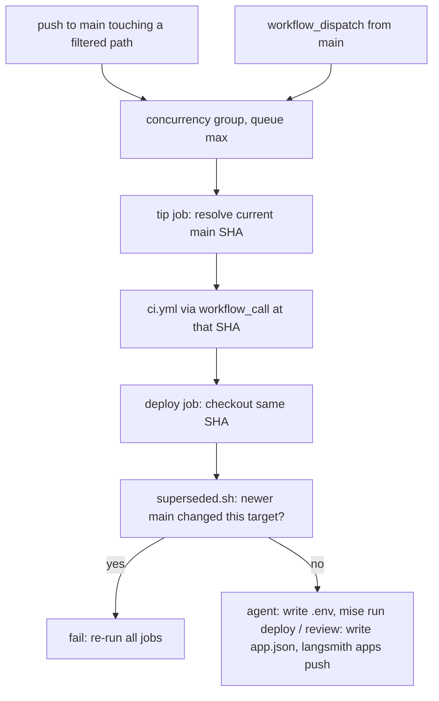

# Deployment and image build

The repository deploys two things, and each has its own workflow:

- **agent**: the LangGraph Agent Server image `langchain-chess-app`. It serves the `chess` graph plus the web UI under `/ui`. It is deployed by `.github/workflows/deploy.yml`.
- **review**: the `apps/review` LangSmith custom app. It is published by `.github/workflows/deploy-review.yml`.

Both workflows run on pushes to `main`, and both deploy only after the same checks that pull requests run (`.github/workflows/ci.yml`). This page covers the image build inputs, the workflows, and how to check a build locally. For the package layout see [package map](/openwiki/architecture/package-map.md). For the server's graph and HTTP app see [Agent Server integration](/openwiki/integrations/agent-server.md). For local dev servers and tasks see [local development](/openwiki/operations/local-development.md). For the test and coverage gates CI runs, see [testing conventions](/openwiki/testing/testing-conventions.md).

## Image build: `langgraph.json`

`langgraph.json` is the build spec that `langgraph build` and `langgraph deploy` read:

- `python_version: "3.13"`, `image_distro: "wolfi"`.
- `source: { kind: "uv", root: ".", package: "langchain-chess-server" }`. The image is built from the uv workspace and its `uv.lock`, not from a requirements list. The package installed as the app is the `apps/server` distribution.
- `graphs.chess` points at `./apps/server/langchain_chess_server/graph.py:make_graph`, and `http.app` points at `./apps/server/langchain_chess_server/app.py:app`. The custom FastAPI app handles the UI routes.
- `env: ".env"`. The agent deploy job writes this file (see below).

### Why `dockerfile_lines` copies every member's `pyproject.toml`

langgraph-cli (pinned in the root dev group as `langgraph-cli[inmem]==0.4.31`) copies only the root `pyproject.toml` into `/tmp/uv_export/project` before it runs `uv export`. The root is a *virtual* workspace with no package of its own. Its `[tool.uv.workspace] members` list is `libs/chess`, `libs/systemone`, `libs/cli` and `apps/server`, so the export cannot resolve the workspace without each member's manifest. `dockerfile_lines` fills the gap with one `ADD <member>/pyproject.toml /tmp/uv_export/project/<member>/pyproject.toml` line per member. `apps/server/README.md` records this workaround.

**Invariant:** keep `dockerfile_lines` in step with `[tool.uv.workspace] members`. If you add a member without an `ADD` line, the image build breaks. `libs/cli` is a member even though the server does not depend on it, so its manifest is copied too. This is also why the agent path filter watches `libs/cli/pyproject.toml` (only that file, not the rest of `libs/cli`).

The members are listed by name rather than with a glob. A glob over `apps/` would pick up `apps/web`, which has no `pyproject.toml`.

### Why workspace sources live only in the root `pyproject.toml`

The root `[tool.uv.sources]` marks all four distributions (`langchain-chess`, `langchain-chess-systemone`, `langchain-chess-cli`, `langchain-chess-server`) as `{ workspace = true }`. The member manifests declare plain dependencies (for example, `apps/server/pyproject.toml` depends on `langchain-chess` and `langchain-chess-systemone`) and have no `[tool.uv.sources]` of their own. According to `apps/server/README.md`, each member is installed on its own inside the image, and a member-level `workspace = true` source fails there. Keep new workspace sources in the root file. The same root sources also let `uvx --from git+…#subdirectory=libs/cli` resolve the unpublished sibling packages from the same commit.

### Build context: `.dockerignore`

The image needs two things: the uv workspace (`libs/`, `apps/server/`, the lockfile) and the built UI under `apps/server/langchain_chess_server/static`. `.dockerignore` excludes everything else:

- `.git/`, virtualenvs, `node_modules`, caches and coverage output.
- `**/tests/`, `plans/`, `docs/`, `.github/`.
- The JS sources `apps/web/`, `apps/review/` and `packages/`.
- Secrets and key material: `.env`, `.env.*` except `.env.example`, `*.pem`, `*.key`, `*.crt`, `credentials.json`.

`static/` is gitignored (`/apps/server/langchain_chess_server/static/` in `.gitignore`), but `.dockerignore` follows Docker semantics only, not git's. A `static/` directory built in the CI checkout therefore still reaches the image. CI depends on this.

## UI build into the server package

`mise run build` runs `pnpm --dir apps/web exec vp build`. `apps/web/vite.config.ts` sets `base: "/ui/"` and `build.outDir: "../server/langchain_chess_server/static"` with `emptyOutDir: true`, so the bundle goes directly into the Python package.

`app.py` builds its FastAPI app through `create_app(static_dir=STATIC_DIR)`, where `STATIC_DIR` is the package's `static/` directory. It mounts that directory at `/ui` with `StaticFiles(..., html=True)`, but only if the directory exists. In a plain checkout there is no build output. In that case `/ui/` returns a 404 JSON message telling you to run `mise run build` (or use `vp dev`). The JSON routes are registered whether or not the build exists, so they keep working without it: `/ui/config` (the graph id `chess`, plus the `ChessContext` schema and defaults) and `/ui/model-limit`. A bare `/ui` redirects to `/ui/`. The UI is mounted under `/ui`, never `/`, because `/` is the Agent Server's health check. It uses `app.mount` rather than `app.frontend()`, because `app.frontend()` routes have low priority and the Agent Server's own `/ui` mount would answer first. `apps/server/tests/test_app.py` tests both branches, with `static_dir=None` and with a temporary directory holding an `index.html` and an asset.

**Ordering matters:** the UI has to be built before the image, or the deployed server has no UI. `mise run deploy` enforces this order:

```toml
[tasks.deploy]
run = [
  "mise run build",
  "uv run --all-packages langgraph deploy --no-remote --name langchain-chess-app --deployment-type dev",
]
```

`--no-remote` builds the image locally (on the CI runner, or on your machine, which needs Docker with buildx) from the `.dockerignore`d context and then pushes it to LangSmith Deployments.

## Deploy workflows

`deploy.yml` (agent) and `deploy-review.yml` (review) have the same structure: a trigger with path filters, a workflow-level queued concurrency lock, a `tip` job, a call to `ci.yml`, and a deploy job that checks it has not been superseded.



*One deploy workflow run: queued lock, tip SHA, shared CI gate, superseded check, then the target-specific deploy.*

### Triggers and path filters

Each workflow runs on `push` to `main` filtered by `on.push.paths`, and on `workflow_dispatch` (no inputs). A manual dispatch ignores the path filters, so it is the way to retry a failed deploy that no later push would redo. Every job is conditioned on `github.ref == 'refs/heads/main'` (via `tip`), so a dispatch from another branch skips.

- **agent** (`deploy.yml`): `libs/chess/**`, `libs/systemone/**`, `libs/cli/pyproject.toml`, `apps/server/**`, `apps/web/**`, `packages/chess-ui/**`, `uv.lock`, `pyproject.toml`, `.python-version`, `langgraph.json`, `.dockerignore`, plus the shared set below and `.github/workflows/deploy.yml`.
- **review** (`deploy-review.yml`): `apps/review/**`, `packages/chess-ui/**`, plus the shared set and `.github/workflows/deploy-review.yml`.
- **shared** (in both): `pnpm-lock.yaml`, `pnpm-workspace.yaml`, `package.json`, `vite.config.ts`, `tsconfig.json`, `mise.toml`, `mise.lock`, `.github/actions/setup/**`, `.github/workflows/ci.yml`, `scripts/superseded.sh`.

A path missing from a filter causes a silent stale deploy. The workflow comments say to over-include rather than under-include when a deployable gains a dependency.

### Concurrency queue and the tip SHA

Concurrency is set per workflow, so the whole run, CI included, holds the lock and deploys go out in push order. The groups are `deploy-agent-${{ github.ref }}` and `deploy-review-${{ github.ref }}`, with `queue: max`: a newer arrival waits its turn and never cancels a pending deploy. The group is per ref so that a branch dispatch, which skips anyway, cannot displace a pending `main` run. The workflow comments note that a newer run replacing a pending older one is acceptable only because every run of a workflow deploys the same target. That is why the review app is kept in its own workflow and group rather than sharing the agent's.

The first job, `tip`, runs inside the lock and asks the GitHub API for the current `main` commit (`gh api repos/$GITHUB_REPOSITORY/commits/main`). It does not use the pushed `GITHUB_SHA`. It passes that SHA to `ci.yml` as the `ref` input and to the deploy job's checkout. So a retried or long-queued older run still ships `main` as it is now, and what deploys is exactly the commit that passed CI.

### CI gate

The `ci` job calls `./.github/workflows/ci.yml` as a reusable workflow with `ref` set to the tip SHA, and the deploy job `needs` both `tip` and `ci`. Merges therefore deploy only behind the same checks that pull requests run.

### Superseded check

Re-running only the deploy job in the Actions UI reuses the earlier `tip` output and CI result, while `main` may have moved. Before deploying, each deploy job fetches the current `main` and runs `scripts/superseded.sh <workflow file> <tested sha> <main sha>`. The script reads the workflow's `on.push.paths` from **main's** copy of the file (with `yq`), turns each into a `:(glob)` pathspec so `**` and `*` match the way GitHub's filters do, and prints `git diff --name-only` between the two SHAs. Any output means a newer run of that workflow will deploy this target, so the job fails with an error asking you to re-run all jobs. If `main` moved only in unrelated paths, the deploy proceeds with the tested SHA.

### `agent` job (`deploy.yml`)

30-minute timeout. It checks out the tip SHA and runs the setup action. Then it:

1. Writes `.env` with the runtime variables `LANGSMITH_GATEWAY`, `LANGSMITH_GATEWAY_API_KEY`, `TYPESAFE_BASE_URL` and `TYPESAFE_API_KEY`. Both API keys come from the `LC_GATEWAY_KEY` repository secret. `langgraph deploy` re-sends this env file as the revision's secrets on every deploy, so the file must contain the *complete* runtime set. A variable left out could be dropped by a redeploy.
2. Runs the superseded check against `deploy.yml`.
3. Runs `mise run deploy -- --no-input` with the `LANGSMITH_API_KEY` repository secret.

At runtime `ServerSettings` (`apps/server/langchain_chess_server/settings.py`) reads the shell, then `.env`, and rejects `LANGSMITH_GATEWAY_API_KEY`, `TYPESAFE_API_KEY` or `TYPESAFE_BASE_URL` when set but blank. `make_graph` constructs it for each run, so an empty secret written into the deployment `.env` makes runs fail loudly instead of falling back silently to another key.

### `review` job (`deploy-review.yml`)

15-minute timeout. The whole workflow is skipped until the repository variable `CUSTOM_APP_ID` is set: `tip` requires both `main` and a non-empty `CUSTOM_APP_ID`. The job sets up without Python (`python: false`) and runs the superseded check against `deploy-review.yml`. Then, in `apps/review`, it writes `.langsmith/app.json` (`app_id` from `CUSTOM_APP_ID`, `name` `langchain-chess-review`) and runs `langsmith apps push` with `LANGSMITH_API_KEY`. The file is written here because the CLI reads the app id only from it, and it is not committed.

## `ci.yml`

`ci.yml` runs on `pull_request` (except for changes only to `**/*.md`, `plans/**` or `openwiki/**`) and on `workflow_call` from the deploy workflows. The `workflow_call` input `ref` names the exact commit to check. Both jobs pass it to `actions/checkout`, and an empty value checks the triggering commit. The concurrency group is `ci-<PR number or run id>` with `cancel-in-progress: true`. A called run gets its own group, so a new merge never cancels the checks of a deploy in progress.

- **python** job: setup with `web: false`, then `mise run check:python` (ruff format check, ruff lint, `ty check`) and `mise run test:python` (`pytest -q -n auto` with the 100% coverage gate from the root pytest/coverage config; live tests are deselected by `-m "not live"`).
- **web** job: setup with `python: false`, then `mise run check:web` (`vp check`), `mise run test:web` (`vp run -r test` with 100% coverage thresholds), and `mise run review:size`. That last task builds `apps/review` and runs `scripts/upload-size.mjs`, because `langsmith apps push` uploads the directory whole with a budget of 5 MiB, 500 files, text only.

### Shared setup action

`.github/actions/setup/action.yml` is a composite action that runs these steps in order:

1. Enables Socket Firewall (`socketdev/action`, `firewall-free`).
2. Installs mise tools through `jdx/mise-action`.
3. When `python` is true, runs `sfw uv sync --all-packages --all-groups --locked`, which fails on a stale `uv.lock`.
4. When `web` is true, runs `sfw pnpm install --frozen-lockfile`.

Package caches (the uv cache and uv-managed Python, keyed on `uv.lock` and `.python-version`; the pnpm store, keyed on `pnpm-lock.yaml`) are saved only on `main`. Other refs only restore, because caches scoped to one PR can't be read by other PRs.

## Secrets and variables

| Name | Kind | Used by |
|---|---|---|
| `LANGSMITH_API_KEY` | repository secret | `mise run deploy` (agent) and `langsmith apps push` (review) |
| `LC_GATEWAY_KEY` | repository secret | written into the agent `.env` as `LANGSMITH_GATEWAY_API_KEY` and `TYPESAFE_API_KEY` |
| `CUSTOM_APP_ID` | repository variable | review app id; the review workflow skips while it is empty |

## Local smoke builds and manual deploys

- Build the image locally without deploying: `uv run --all-packages langgraph build -t langchain-chess:smoke`. Run `mise run build` first if you want the UI inside the image. Otherwise `/ui/` returns the "UI not built" 404.
- Manual deploy from a workstation: `mise run deploy`. It needs Docker with buildx, `LANGSMITH_API_KEY` in the environment, and a complete `.env` with the runtime variables listed above. Prefer `workflow_dispatch` from `main` so that CI gates the deploy.
- Check the review app's upload budget: `mise run review:size`.

## Changing things safely

- **Adding a workspace member:** add it to the root `members` and `[tool.uv.sources]` (not to the member's own manifest), add an `ADD` line to `dockerfile_lines`, add its `pyproject.toml` to the `on.push.paths` of `deploy.yml` (every member's manifest is copied into the image, whether or not the server imports it) and its source paths if the server depends on it, and add it to the pytest/ruff/coverage lists in the root `pyproject.toml`.
- **Adding a runtime environment variable:** add it to the `.env` heredoc in the `agent` job. Otherwise the next deploy won't carry it.
- **New build input for the server, UI or review app:** add its path to the matching workflow's `on.push.paths`. `superseded.sh` reads the same list, so it needs no separate change.
- **Adding another deploy target:** give it its own workflow and concurrency group. Queued-run replacement is safe only when every run of a workflow deploys the same target.
- **Excluding files from the image:** edit `.dockerignore`. Don't exclude `apps/server/langchain_chess_server/static`.
