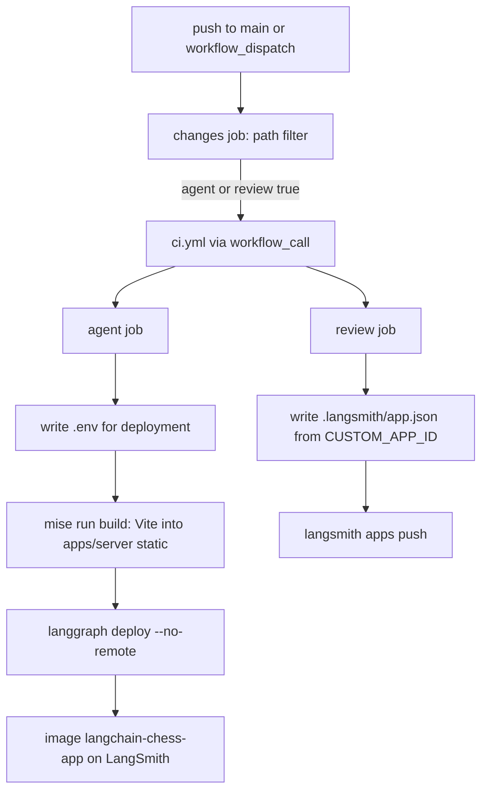

# Deployment, image build and CI

The repository deploys two things:

- **agent**: the LangGraph Agent Server image `langchain-chess-app`. It serves the `chess` graph plus the web UI under `/ui`.
- **review**: the `apps/review` LangSmith custom app.

Both are deployed from `.github/workflows/deploy.yml` on pushes to `main`, and both deploy only after the same checks that pull requests run (`.github/workflows/ci.yml`). This page covers the image build inputs, the workflows, and how to check a build locally. For the package layout see [package map](/openwiki/architecture/package-map.md). For the server's graph and HTTP app see [Agent Server integration](/openwiki/integrations/agent-server.md). For local dev servers and tasks see [local development](/openwiki/operations/local-development.md).

## Image build: `langgraph.json`

`langgraph.json` is the build spec that `langgraph build` and `langgraph deploy` read:

- `python_version: "3.13"`, `image_distro: "wolfi"`.
- `source: { kind: "uv", root: ".", package: "langchain-chess-server" }`. The image is built from the uv workspace and its `uv.lock`, not from a requirements list. The package installed as the app is the `apps/server` distribution.
- `graphs.chess` points at `./apps/server/langchain_chess_server/graph.py:make_graph`, and `http.app` points at `./apps/server/langchain_chess_server/app.py:app`. The custom FastAPI app handles the UI routes.
- `env: ".env"`. The deploy job writes this file (see below).

### Why `dockerfile_lines` copies every member's `pyproject.toml`

langgraph-cli (pinned in the root dev group as `langgraph-cli[inmem]==0.4.31`) copies only the root `pyproject.toml` into `/tmp/uv_export/project` before it runs `uv export`. The root is a *virtual* workspace with no package of its own. Its `[tool.uv.workspace] members` list is `libs/chess`, `libs/systemone`, `libs/cli` and `apps/server`, so the export cannot resolve the workspace without each member's manifest. `dockerfile_lines` fills the gap with one `ADD <member>/pyproject.toml /tmp/uv_export/project/<member>/pyproject.toml` line per member.

**Invariant:** keep `dockerfile_lines` in step with `[tool.uv.workspace] members`. If you add a member without an `ADD` line, the image build breaks. `libs/cli` is a member even though the server does not depend on it, so its manifest is copied too. This is also why the deploy path filter watches `libs/cli/pyproject.toml` (only that file, not the rest of `libs/cli`).

The members are listed by name rather than with a glob. A glob over `apps/` would pick up `apps/web`, which has no `pyproject.toml`.

### Why workspace sources live only in the root `pyproject.toml`

The root `[tool.uv.sources]` marks all four distributions (`langchain-chess`, `langchain-chess-systemone`, `langchain-chess-cli`, `langchain-chess-server`) as `{ workspace = true }`. The member manifests declare plain dependencies (for example, `apps/server/pyproject.toml` depends on `langchain-chess` and `langchain-chess-systemone`) and have no `[tool.uv.sources]` of their own. According to the README, each member is installed on its own inside the image, and a member-level `workspace = true` source fails there. Keep new workspace sources in the root file. The same root sources also let `uvx --from git+…#subdirectory=libs/cli` resolve the unpublished sibling packages from the same commit.

### Build context: `.dockerignore`

The image needs three things: the uv workspace (`libs/`, `apps/server/`, the lockfile) and the built UI under `apps/server/langchain_chess_server/static`. `.dockerignore` excludes everything else:

- `.git/`, virtualenvs, caches and coverage output.
- `**/tests/`, `plans/`, `docs/`, `.github/`.
- The JS sources `apps/web/`, `apps/review/` and `packages/`.
- Secrets and key material: `.env`, `.env.*` except `.env.example`, `*.pem`, `*.key`, `*.crt`, `credentials.json`.

`static/` is gitignored (`/apps/server/langchain_chess_server/static/` in `.gitignore`), but `.dockerignore` follows Docker semantics only, not git's. A `static/` directory built in the CI checkout therefore still reaches the image. CI depends on this.

## UI build into the server package

`mise run build` runs `pnpm --dir apps/web exec vp build`. `apps/web/vite.config.ts` sets `base: "/ui/"` and `build.outDir: "../server/langchain_chess_server/static"` with `emptyOutDir: true`, so the bundle goes directly into the Python package.

`app.py` mounts that directory at `/ui` with `StaticFiles(..., html=True)`, but only if the directory exists. In a plain checkout there is no build output. In that case `/ui/` returns a 404 JSON message telling you to run `mise run build`, and `/ui/config` still answers. The UI is mounted under `/ui`, never `/`, because `/` is the Agent Server's health check. It uses `app.mount` rather than `app.frontend()` so that the Agent Server's own `/ui` routes don't shadow it. `apps/server/tests/test_app.py` tests both branches, with `static_dir=None` and with a temporary directory.

**Ordering matters:** the UI has to be built before the image, or the deployed server has no UI. `mise run deploy` enforces this order:

```toml
[tasks.deploy]
run = [
  "mise run build",
  "uv run --all-packages langgraph deploy --no-remote --name langchain-chess-app --deployment-type dev",
]
```

`--no-remote` builds the image locally (on the CI runner) from the `.dockerignore`d context and then pushes it to LangSmith Deployments.



*Deploy workflow: path filter, shared CI gate, then the per-target deploy jobs.*

## `deploy.yml`

**Triggers.** The workflow runs on `push` to `main`, and on `workflow_dispatch` with a `target` choice of `both`, `agent` or `review` (default `both`). A manual dispatch skips the path filters. Use it to retry a failed deploy that no later push would redo.

**`changes` job.** This job decides which targets to deploy:

- On dispatch, it follows `target`.
- If `github.event.before` is not a known commit (a new branch or a force push), there is nothing to diff against, so both targets are deployed.
- Otherwise it runs `git diff --name-only "$BEFORE" "$GITHUB_SHA"` and matches each path:
  - **agent**: `libs/chess/*`, `libs/systemone/*`, `libs/cli/pyproject.toml`, `apps/server/*`, `apps/web/*`, `uv.lock`, `pyproject.toml`, `.python-version`, `langgraph.json`, `.dockerignore`.
  - **review**: `apps/review/*`.
  - **both**: `packages/chess-ui/*`, `pnpm-lock.yaml`, `pnpm-workspace.yaml`, `package.json`, `vite.config.ts`, `tsconfig.json`, `mise.toml`, `mise.lock`, `.github/actions/setup/*`, `.github/workflows/deploy.yml`.

A path missing from the filter causes a silent stale deploy. The workflow comment says to over-include rather than under-include when a deployable gains a dependency.

**`ci` job.** When either target is selected, this job calls `./.github/workflows/ci.yml` as a reusable workflow. Merges therefore deploy only behind the same checks that pull requests run. Both deploy jobs `need` it.

**`agent` job** (30 min timeout, concurrency group `deploy-agent`, `cancel-in-progress: false`):

1. Runs the setup action.
2. Writes `.env` with the runtime variables `LANGSMITH_GATEWAY`, `LANGSMITH_GATEWAY_API_KEY`, `TYPESAFE_BASE_URL` and `TYPESAFE_API_KEY`. Both API keys come from the `LC_GATEWAY_KEY` repository secret. `langgraph deploy` re-sends this env file as the revision's secrets on every deploy, so the file must contain the *complete* runtime set. A variable left out could be dropped by a redeploy.
3. Runs `mise run deploy -- --no-input` with `LANGSMITH_API_KEY` from secrets.

**`review` job** (15 min timeout, group `deploy-review`) runs only if review changed *and* the repository variable `CUSTOM_APP_ID` is non-empty. It sets up without Python, writes `apps/review/.langsmith/app.json` from `CUSTOM_APP_ID` (the CLI reads the app id only from that file, and it is not committed), and runs `langsmith apps push`.

Concurrency is set per job, not per workflow. A queued run replaces the pending run in its group, and a later run that skips a job must not replace a pending deploy of that job. Neither group cancels a deploy that is already running.

## `ci.yml`

`ci.yml` runs on `pull_request` (except for changes only to `**/*.md`, `plans/**` or `openwiki/**`) and on `workflow_call` from deploy. The concurrency group is `ci-<PR number or run id>` with `cancel-in-progress: true`. A called run gets its own group, so a new merge never cancels the checks of a deploy in progress.

- **python** job: setup with `web: false`, then `mise run check:python` (ruff format check, ruff lint, `ty check`) and `mise run test:python` (`pytest -q -n auto` with the 100% coverage gate from the root pytest/coverage config; live tests are deselected by `-m "not live"`).
- **web** job: setup with `python: false`, then `mise run check:web` (`vp check`), `mise run test:web` (`vp run -r test` with 100% coverage thresholds), and `mise run review:size`. That last task builds `apps/review` and runs `scripts/upload-size.mjs`, because `langsmith apps push` uploads the directory whole with a budget of 5 MiB, 500 files, text only.

### Shared setup action

`.github/actions/setup/action.yml` is a composite action that runs these steps in order:

1. Enables Socket Firewall (`socketdev/action`, `firewall-free`).
2. Installs mise tools through `jdx/mise-action`.
3. When `python` is true, runs `sfw uv sync --all-packages --all-groups --locked`, which fails on a stale `uv.lock`.
4. When `web` is true, runs `sfw pnpm install --frozen-lockfile`.

Package caches (the uv cache and uv-managed Python, keyed on `uv.lock` and `.python-version`; the pnpm store, keyed on `pnpm-lock.yaml`) are saved only on `main`. Other refs only restore, because caches scoped to one PR can't be read by other PRs.

## Local smoke builds and manual deploys

- Build the image locally without deploying: `uv run --all-packages langgraph build -t langchain-chess:smoke`. Run `mise run build` first if you want the UI inside the image. Otherwise `/ui/` returns the "UI not built" 404.
- Manual deploy from a workstation: `mise run deploy`. It needs `LANGSMITH_API_KEY` in the environment and a complete `.env` with the runtime variables listed above. Prefer `workflow_dispatch` so that CI gates the deploy.
- Check the review app's upload budget: `mise run review:size`.

## Changing things safely

- **Adding a workspace member:** add it to the root `members` and `[tool.uv.sources]`, add an `ADD` line to `dockerfile_lines`, add its `pyproject.toml` to the `agent` filter in `deploy.yml` (every member's manifest is copied into the image, whether or not the server imports it) and its source paths if the server depends on it, and add it to the pytest/ruff/coverage lists in the root `pyproject.toml`.
- **Adding a runtime environment variable:** add it to the `.env` heredoc in the `agent` job. Otherwise the next deploy won't carry it.
- **New build input for the server or UI:** add its path to the deploy filter.
- **Excluding files from the image:** edit `.dockerignore`. Don't exclude `apps/server/langchain_chess_server/static`.
