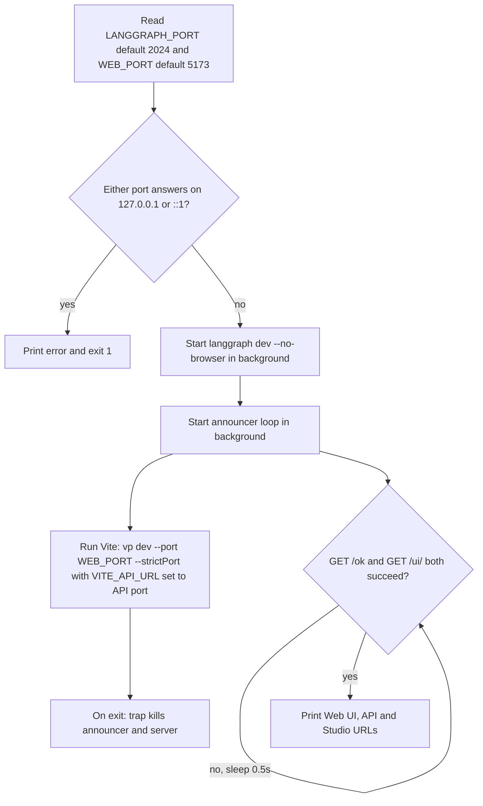

# Local development toolchain

The whole repository, both the Python uv workspace and the pnpm/Vite+ web workspace, is driven by one file: `mise.toml`. It pins the tools and defines every task developers, git hooks, CI and worktree bootstrap scripts call. You never install tools by hand. Python itself is the exception: it comes from uv (`.python-version`), not mise.

Related pages: [Quickstart](/openwiki/quickstart.md), [Deployment](/openwiki/operations/deployment.md) (the `deploy` task, CI setup action and image build), [Testing conventions](/openwiki/testing/testing-conventions.md) (coverage gates and the `live` marker).

## Bootstrapping

```sh
mise trust && mise install && mise run setup
```

- `mise install` fetches the pinned tools listed under `[tools]`: node 24, pnpm 12, uv 0.12, lefthook 2, Socket Firewall (`sfw`, from `SocketDev/sfw-free`), fastchess (used by `test:uci`), Stockfish (used by `lcchess grade`), and the `langsmith` CLI (used by `dev:review` and `langsmith apps push`).
- `mise run setup` runs `sfw uv sync --all-packages --all-groups`, then `sfw pnpm install --frozen-lockfile`, then `lefthook install`.

**Git worktrees.** `scripts/setup-worktree.sh` prepares a new worktree. It runs `mise trust` again because mise trusts config per path, so every worktree needs it. Then it runs `mise install`, symlinks the main checkout's gitignored `.env` into the worktree, and finishes with `mise run setup`. Because `.env` is a symlink, a rotated key reaches every worktree at once. The script never replaces a worktree's own real `.env`. If the main checkout has no `.env`, it prints a note telling you to copy `.env.example` first. `t3.json` runs this script automatically when a worktree is created, and also defines Dev (`mise run dev`, preview at `http://localhost:5173/ui/`), Test and Check scripts. You can safely run the script by hand or re-run it.

## Task map

`mise tasks` lists everything. Anything after `--` is passed through to the underlying command, for example `mise run dev:tui -- --side black`.

| Task | What it runs | Notes |
|---|---|---|
| `setup` | sfw-wrapped `uv sync` + `pnpm install --frozen-lockfile`, `lefthook install` | Run once per checkout or worktree |
| `dev:web` (alias `dev`) | `langgraph dev` on `:2024` + Vite dev server on `:5173/ui/` | Ports set by `LANGGRAPH_PORT` / `WEB_PORT` |
| `dev:tui` | `uv run --all-packages --env-file .env lcchess play` | Textual terminal game |
| `dev:uci` | `uv run --all-packages --env-file .env lcchess uci` | UCI engine over stdin/stdout |
| `dev:review` | `langsmith apps dev` in `apps/review` | Local LangSmith sandbox, rebuilt on save |
| `review:size` | `vp build` + `scripts/upload-size.mjs` in `apps/review` | Checks what `langsmith apps push` would upload |
| `check` | `check:python` + `check:web` | ruff format check, ruff lint, `ty check`, `vp check` |
| `test` | `test:python` + `test:web` | `pytest -q -n auto` and `vp run -r test`, both with 100% coverage gates |
| `test:live` | `uv run --all-packages --env-file .env pytest -m live --no-cov -q` | Hits the real LLM Gateway and costs a few cents |
| `test:uci` | two-game fastchess smoke match, run inside `.uci-match/` | Fails if a game has no result or ended by forfeit |
| `build` | `pnpm --dir apps/web exec vp build` | Writes the UI into `apps/server/langchain_chess_server/static`, served at `/ui` |
| `deploy` | `mise run build` then `langgraph deploy` | See [Deployment](/openwiki/operations/deployment.md) |
| `wiki:init` / `wiki:update` / `wiki:view` | `scripts/openwiki.sh code --init/--update --print`, `openwiki visualize` | OpenWiki pinned per task |

### `dev:web`: port checks and wiring

`langgraph dev` silently moves to a random port when its port is taken, but the UI would keep calling the old one. To avoid that, the task checks both ports before starting anything:


*How `mise run dev:web` checks the ports, starts both servers in order and cleans up.*

- It probes both loopback addresses, because Vite listens only on `::1`.
- The UI gets the API address through `VITE_API_URL=http://localhost:$port`, so the frontend always targets the same port the server got. Vite runs with `--strictPort`, so it fails instead of moving to another port.
- Once `http://127.0.0.1:$port/ok` and `http://localhost:$web_port/ui/` both respond, a background announcer prints the Web UI, API and LangSmith Studio URLs. It does this because `langgraph dev`'s startup logs bury Vite's own URL.
- An `EXIT` trap kills the announcer and the server when Vite stops, for example on Ctrl-C.

### `check` and `test`

- `check:python` runs `ruff format --check libs apps`, `ruff check libs apps` and `ty check`. `check:web` runs `pnpm exec vp check` at the root. Lint and format config live only in the root `vite.config.ts`.
- `test:python` adds `-n auto` (xdist) on the command line on purpose, not in pytest `addopts`. A bare `pytest` therefore stays serial, which keeps `-k`, `--pdb` and `--snapshot-update` usable. Pytest `addopts` exclude the `live` marker by default and enforce `--cov-fail-under=100` with branch coverage.
- `test:live` selects `-m live`, drops coverage with `--no-cov`, and loads `.env`.

## Environment loading

Copy `.env.example` to `.env`. It is gitignored. Export `LC_GATEWAY_KEY` in your shell. Variable names involved:

- Tracing: `LANGSMITH_TRACING`, `LANGSMITH_API_KEY`, `LANGSMITH_PROJECT` (local runs use a separate project from the deployment), and `LANGSMITH_WORKSPACE_ID`. The workspace ID pins the workspace the tracing key belongs to. Without it the SDK falls back to the `langsmith` CLI profile, which can cause 403 errors.
- Gateway: `LANGSMITH_GATEWAY`, and `LANGSMITH_GATEWAY_API_KEY`, which the template fills from `${LC_GATEWAY_KEY}`.
- System 1: `TYPESAFE_BASE_URL`, and `TYPESAFE_API_KEY`, also filled from `${LC_GATEWAY_KEY}`.
- Dev ports (shell only): `LANGGRAPH_PORT`, `WEB_PORT`.

Provider secrets live in the gateway workspace, never in `.env`.

Loading is **explicit**. Nothing sources `.env` globally:

- Commands that make model calls pass `--env-file .env` to `uv run`: `dev:tui`, `dev:uci`, `test:live` and `test:uci`. `test:uci` passes `../.env` because it runs inside `.uci-match/`. Run by hand, `lcchess grade` needs the same flag.
- `langgraph dev`, used by `dev:web`, reads `.env` through the `"env": ".env"` key in `langgraph.json`.
- The server's `ServerSettings` (pydantic-settings) reads the shell first and `.env` second.
- `scripts/openwiki.sh` sources `.env` itself with `set -a`, if the file exists.

`uv run --env-file` and python-dotenv both expand `${VAR}` from the parent environment. If `LC_GATEWAY_KEY` is missing, the gateway and TypeSafe keys expand to an empty string. langchain-core would then silently fall back to `LANGSMITH_API_KEY` and send model calls to the tracing org's gateway. To prevent that, `ServerSettings` rejects `LANGSMITH_GATEWAY_API_KEY`, `TYPESAFE_API_KEY` and `TYPESAFE_BASE_URL` when they are set but blank, so the app refuses to start.

## Supply-chain guard: `sfw`

Socket Firewall (`sfw`) wraps every dependency install. `setup` uses it for `uv sync` and `pnpm install`. Add dependencies the same way:

```sh
sfw uv add --package <distribution> <dependency>   # a workspace member
sfw uv add --group dev <tool>                      # root dev tools
sfw pnpm add <pkg>                                 # inside the JS package that needs it
```

Shared JS versions live in the `pnpm-workspace.yaml` catalog. The OpenWiki workflow also installs OpenWiki through `sfw mise install npm:openwiki@0.6.0` before running the wiki task. Otherwise the task would install it without the firewall.

## Git hooks (lefthook)

`lefthook.yml`, installed by `mise run setup`:

- **pre-commit** (parallel, staged-file scope so it stays fast):
  - `vp check` when `*.{ts,tsx,css,json}` files are staged.
  - `ruff format --check` and `ruff check` on staged `*.py` files, plus `ty check` whenever Python is staged.
  - A secrets scan over the added lines of `git diff --cached`, excluding `lefthook.yml` itself. It rejects the commit on patterns that look like Anthropic, OpenAI project, LangSmith, TypeSafe live or GitHub personal tokens. The patterns require a key body, so the regex never matches its own definition. The scan checks each staged file separately (NUL-separated names, literal pathspecs, so unusual file names still get scanned) and prints only the names of the matching files, never the matched line, so the secret never lands in the log.
  - `vp check` and `ty check` run over the whole repo. Only the ruff commands take `{staged_files}`; the globs only decide whether each command runs.
- **pre-push**: `mise run test`, the full Python and web suites with coverage gates.

CI runs the same `mise run check` and `mise run test` on pull requests. See [Deployment](/openwiki/operations/deployment.md) for the workflows. `mise.toml` is a shared deploy input, so a push to `main` that changes it redeploys both targets. Deploy jobs also use `scripts/superseded.sh` to skip deploying a SHA that a newer `main` has overtaken; see Deployment for details.

## Troubleshooting

| Symptom | Fix |
|---|---|
| `error: port 2024 is already in use` from `dev:web` | Stop the other server, or pick other ports: `LANGGRAPH_PORT=2034 WEB_PORT=5180 mise run dev`. |
| `error: the servers were not up within 2 minutes` | One of the servers failed to become ready. Check the `langgraph dev` and Vite output above the error. |
| The server exits because the gateway key is empty | Export `LC_GATEWAY_KEY` in the shell that runs `mise`. |
| 403 on traces or grading | Set `LANGSMITH_WORKSPACE_ID` to the tracing key's workspace. |
| `lcchess grade` can't find the game | Pass the project it was traced to: `--project langchain-chess-local` locally, `langchain-chess-app` for the deployment. |
| `dev:review` can't reach LangSmith | The review app uses the `langsmith` CLI's own credentials, not `.env`. Run `langsmith auth login --prompt-workspace` once. |
| Commit rejected with `possible secret in staged changes to:` | Remove the token from the listed files. Keep keys in `.env` or the shell. |

## OpenWiki tasks and update workflow

The `openwiki` npm package is pinned **per task** (`tools = { "npm:openwiki" = "0.6.0" }`), not in `[tools]`. Every CI job runs `mise install`, which skips task tools, so only the wiki tasks install it. If you bump the version, update the three task pins and the version in `.github/workflows/openwiki-update.yml` together.

- `wiki:init` regenerates `openwiki/` from scratch, except `INSTRUCTIONS.md`. `--init` also drops the committed LangSmith connector config, so the task then runs `git checkout -- openwiki/.langsmith.json` to restore it.
- `wiki:update` refreshes only the pages that code changes made stale. It does nothing when nothing changed.
- `wiki:view` runs `openwiki visualize` to browse the wiki locally.

`scripts/openwiki.sh` wraps both generation tasks:

1. It changes to the repo root and sources `.env` if present.
2. It points OpenWiki at Anthropic through the LangSmith LLM Gateway: `OPENWIKI_PROVIDER`, `OPENWIKI_MODEL_ID` and `ANTHROPIC_BASE_URL`. `ANTHROPIC_API_KEY` comes from `LC_GATEWAY_KEY`.
3. It maps `LANGSMITH_API_KEY` to `OPENWIKI_LANGSMITH_API_KEY` for the LangSmith connector and tracing.
4. It enables tracing under both the `LANGSMITH_*` and `LANGCHAIN_*` spellings, to the `langchain-chess-openwiki` project.
5. It disables telemetry and `exec`s `openwiki` with the task's arguments.

Missing `LC_GATEWAY_KEY` or `LANGSMITH_API_KEY` stops the script immediately with a message.

The **`openwiki-update`** GitHub workflow is currently `workflow_dispatch` only. The push trigger on `main` is commented out while the code churns. It:

- Runs one at a time (concurrency group `openwiki-update`, no cancel-in-progress), because every run pushes to the same `openwiki/update` branch.
- Checks out with `fetch-depth: 0`, because `--update` diffs HEAD against the last documented commit.
- Runs the shared setup action without Python or web dependencies, installs OpenWiki through `sfw`, then runs `mise run wiki:update` with `LC_GATEWAY_KEY` and `LANGSMITH_API_KEY` from repository secrets. That step is `continue-on-error`.
- Deletes `openwiki/.run.json`, then uses `peter-evans/create-pull-request` to open or update a `docs: update OpenWiki` PR covering `openwiki`, `AGENTS.md` and `CLAUDE.md`. The PR is created only when files changed.
- If OpenWiki failed, the PR still holds the pages finished before the failure, and a final step fails the job. Merging such a PR makes those pages the baseline for the next run.

`AGENTS.md` tells coding agents not to hand-edit generated pages. Change the source instead and let the workflow regenerate them.
s. That step is `continue-on-error`.
- Deletes `openwiki/.run.json`, then uses `peter-evans/create-pull-request` to open or update a `docs: update OpenWiki` PR covering `openwiki`, `AGENTS.md` and `CLAUDE.md`. The PR is created only when files changed.
- If OpenWiki failed, the PR still holds the pages finished before the failure, and a final step fails the job. Merging such a PR makes those pages the baseline for the next run.

`AGENTS.md` tells coding agents not to hand-edit generated pages. Change the source instead and let the workflow regenerate them.
