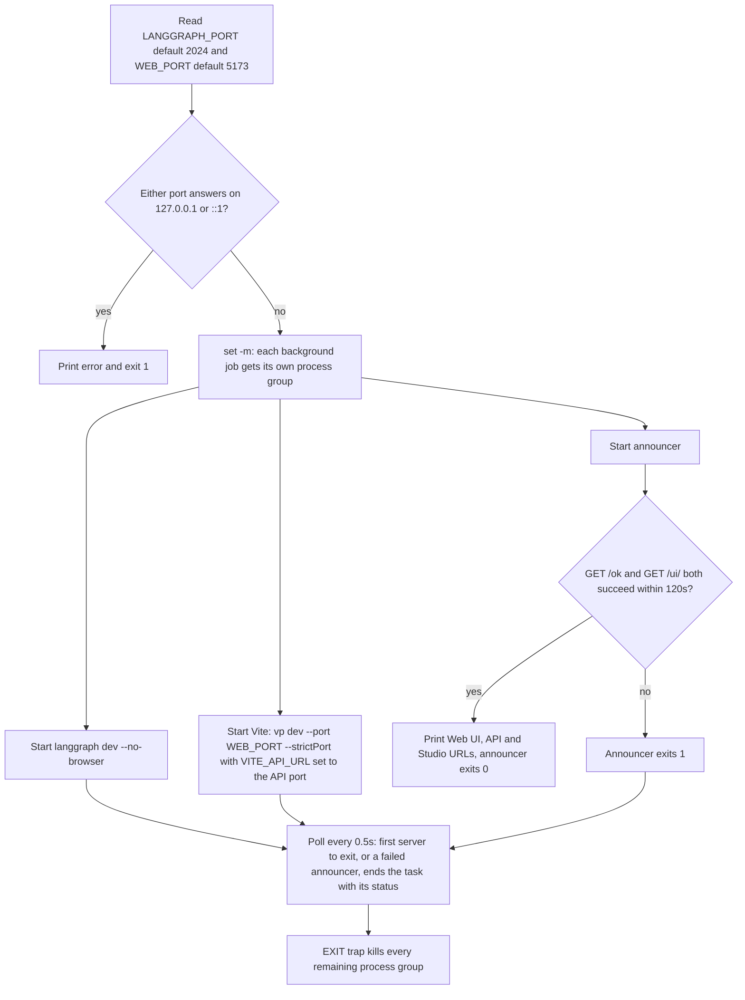

# Local development toolchain

One file drives the whole repository, both the Python uv workspace and the pnpm/Vite+ web workspace: `mise.toml`. It pins the tools and defines every task that developers, git hooks, CI and the worktree bootstrap script call, so nobody installs tools by hand. The one exception is Python, which comes from uv (`.python-version`), not mise.

Related pages: [Quickstart](/openwiki/quickstart.md), [Deployment](/openwiki/operations/deployment.md) (the `deploy` task, CI setup action and image build), [Testing conventions](/openwiki/testing/testing-conventions.md) (coverage gates and the `live` / `e2e` markers).

## Bootstrapping

```sh
mise trust && mise install && mise run setup
```

- `mise install` fetches the pinned tools listed under `[tools]`: node 24, pnpm 12, uv 0.12, lefthook 2, Socket Firewall (`sfw`, from `SocketDev/sfw-free`), fastchess (used by `test:uci`), Stockfish (used by `lcchess grade`) and the `langsmith` CLI (used by `dev:review` and `langsmith apps push`). The README asks you to activate mise in your shell (`mise activate`) so these tools land on your `PATH` inside the repo.
- `mise run setup` runs `sfw uv sync --all-packages --all-groups`, then `sfw pnpm install --frozen-lockfile`, then `lefthook install`.

**Git worktrees.** `scripts/setup-worktree.sh` prepares a new worktree:

1. It runs `mise trust` again, because mise trusts config per path and every worktree is a new path.
2. It runs `mise install`.
3. It symlinks the main checkout's gitignored `.env` into the worktree. Because it is a symlink, a rotated key reaches every worktree at once. The script never replaces a real `.env` that already belongs to the worktree. If the main checkout has no `.env`, it prints a note telling you to copy `.env.example` first.
4. It finishes with `mise run setup`.

It finds the main checkout through `T3CODE_PROJECT_ROOT`, or through the parent of the common git dir when you run it by hand. `t3.json` runs the script automatically when a worktree is created. It also defines Dev (`mise run dev`, preview at `http://localhost:5173/ui/`), Test and Check scripts. The script is safe to run by hand and to re-run.

## Task map

`mise tasks` lists every task. Anything after `--` is passed to the underlying command, for example `mise run dev:tui -- --side black`.

| Task | What it runs | Notes |
|---|---|---|
| `setup` | sfw-wrapped `uv sync` + `pnpm install --frozen-lockfile`, `lefthook install` | Run once per checkout or worktree |
| `dev:web` (alias `dev`) | `langgraph dev` on `:2024` + Vite dev server on `:5173/ui/` | Ports set by `LANGGRAPH_PORT` / `WEB_PORT` |
| `dev:tui` | `uv run --all-packages --env-file .env lcchess play` | Textual terminal game |
| `dev:uci` | `uv run --all-packages --env-file .env lcchess uci` | UCI engine over stdin/stdout |
| `dev:review` | `langsmith apps dev` in `apps/review` | Local LangSmith sandbox, rebuilt on save |
| `review:size` | `vp build` + `scripts/upload-size.mjs` in `apps/review` | Checks what `langsmith apps push` would upload |
| `review:snapshot` | `uv run --env-file .env python scripts/grader-snapshot.py` | Builds the review app's grader snapshot (Stockfish + `lcchess`) in your LangSmith workspace |
| `check` | `check:python` + `check:web` | ruff format check, ruff lint, `ty check`, `vp check` |
| `test` | `test:python` + `test:web` | `pytest -q -n auto` and `vp run -r test`, both with 100% coverage gates |
| `test:e2e` | `mise run build`, then `pytest -m e2e --no-cov -q` | Drives the built UI in Chromium against `langgraph dev` with a fake model |
| `test:live` | `uv run --all-packages --env-file .env pytest -m live --no-cov -q` | Calls the real LLM Gateway and costs a few cents |
| `test:uci` | two-game fastchess smoke match, run inside `.uci-match/` | Fails if a game has no result or ended by forfeit |
| `eval:positions:build` | `lcchess-evals positions build` | One-off: samples and labels Lichess positions into `evals/datasets/positions/vN.jsonl` |
| `eval:positions:upload` | `lcchess-evals positions upload` (with `.env`) | Creates or updates the LangSmith dataset from the committed JSONL, tagged `vN` |
| `eval:systemone` | `lcchess-evals systemone run` (with `.env`) | One System 1 experiment: `-- --model ... --style ... [--split dev]` |
| `eval:systemone:baseline` | `lcchess-evals systemone baseline` (with `.env`) | The five baseline experiments in `evals/experiments/systemone-baseline.toml` |
| `generate:settings` | `python -m langchain_chess_server.codegen packages/chess-ui/src/generated` | Regenerates the settings JSON Schemas and TypeScript from `ChessContext` |
| `build` | `pnpm --dir apps/web exec vp build` | Writes the UI into `apps/server/langchain_chess_server/static`, served at `/ui` |
| `deploy` | `mise run build` then `langgraph deploy` | See [Deployment](/openwiki/operations/deployment.md) |
| `wiki:init` / `wiki:update` / `wiki:view` | `scripts/openwiki.sh code --init/--update --print`, `openwiki visualize` | OpenWiki pinned per task |

### `dev:web`: port checks and process lifecycle

When its port is taken, `langgraph dev` silently moves to a random port, but the UI would keep calling the old one. To prevent that, the task checks both ports before it starts anything:


*How `mise run dev:web` checks the ports, starts the servers and cleans up.*

- It probes both loopback addresses, because Vite listens only on `::1`.
- The UI gets the API address through `VITE_API_URL=http://localhost:$port`, so the frontend always calls the port the server actually got. Vite runs with `--strictPort`, so it fails instead of moving to another port.
- Job control (`set -m`) puts each job in its own process group. Stopping a job therefore also stops the processes it spawned, such as uvicorn's worker or Vite under pnpm, and a terminal Ctrl-C reaches only the script.
- The announcer reprints the Web UI, API and LangSmith Studio URLs once `http://127.0.0.1:$port/ok` and `http://localhost:$web_port/ui/` both respond, because `langgraph dev`'s startup logs bury Vite's own URL. If they are not up within 2 minutes, it fails.
- The script checks its jobs every 0.5 s instead of using `wait -n`, which macOS's bash 3.2 lacks. When the announcer exits successfully, the script stops watching it. When a server exits, or the announcer fails, the task ends with that exit status, and the `EXIT` trap kills the remaining process groups.

### `check` and `test`

- `check:python` runs `ruff format --check .`, `ruff check .` and `ty check` over the repo root. `ty` covers `libs`, `apps/server` and `evals`. `check:web` runs `pnpm exec vp check` at the root. Lint and format config for all JS lives only in the root `vite.config.ts`.
- `test:python` passes `-n auto` (xdist) on the command line on purpose, not in pytest `addopts`. A bare `pytest` therefore stays serial, which keeps `-k`, `--pdb` and `--snapshot-update` usable. Pytest `addopts` deselect both the `live` and `e2e` markers (`-m "not live and not e2e"`) and enforce `--cov-fail-under=100`, with branch coverage turned on.
- `test:live` selects `-m live`, turns coverage off with `--no-cov`, and loads `.env`.
- `test:e2e` builds the UI first, because the browser test fails when `static/index.html` is missing. It then runs `-m e2e --no-cov`. The test gives `langgraph dev` its own throwaway `.env` and strips `LANGSMITH_*`, `LANGCHAIN_*`, `TYPESAFE_*` and `LC_*` variables from the environment, so it never needs real keys.
- `generate:settings` output is checked in. `apps/server/tests/test_codegen.py` fails with "run `mise run generate:settings`" when the files committed under `packages/chess-ui/src/generated` no longer match what the codegen renders. Run the task whenever `ChessContext` changes.

## Environment loading

Copy `.env.example` to `.env`, which is gitignored, and export `LC_GATEWAY_KEY` in your shell. The variables involved are:

- Tracing: `LANGSMITH_TRACING`, `LANGSMITH_API_KEY`, `LANGSMITH_PROJECT` (local runs trace to a different project than the deployment) and `LANGSMITH_WORKSPACE_ID`. The workspace ID pins the workspace the tracing key belongs to. Without it, the SDK falls back to the `langsmith` CLI profile, which can cause 403 errors.
- Gateway: `LANGSMITH_GATEWAY`, plus `LANGSMITH_GATEWAY_API_KEY`, which the template fills from `${LC_GATEWAY_KEY}`.
- System 1: `TYPESAFE_BASE_URL`, plus `TYPESAFE_API_KEY`, also filled from `${LC_GATEWAY_KEY}`.
- Dev ports (shell only): `LANGGRAPH_PORT` and `WEB_PORT`.

Provider secrets live in the gateway workspace, never in `.env`.

Loading is **explicit**. Nothing sources `.env` globally:

- Commands that make model calls or LangSmith writes pass `--env-file .env` to `uv run`: `dev:tui`, `dev:uci`, `test:live`, `test:uci`, `review:snapshot`, `eval:positions:upload`, `eval:systemone` and `eval:systemone:baseline`. `test:uci` passes `../.env` because it runs inside `.uci-match/`. `lcchess grade` needs the same flag when you run it by hand.
- `langgraph dev`, used by `dev:web`, reads `.env` through the `"env": ".env"` key in `langgraph.json`.
- The server's `ServerSettings` (pydantic-settings) reads the shell first and `.env` second.
- `scripts/openwiki.sh` sources `.env` itself with `set -a`, if the file exists.

Both `uv run --env-file` and python-dotenv expand `${VAR}` from the parent environment. If `LC_GATEWAY_KEY` is missing, the gateway and TypeSafe keys expand to an empty string, and langchain-core would silently fall back to `LANGSMITH_API_KEY`, sending model calls to the tracing org's gateway. To prevent that, `ServerSettings` rejects `LANGSMITH_GATEWAY_API_KEY`, `TYPESAFE_API_KEY` and `TYPESAFE_BASE_URL` when they are set but blank, so the app refuses to start.

## Supply-chain guard: `sfw`

Socket Firewall (`sfw`) wraps every dependency install. `setup` uses it for `uv sync` and `pnpm install`. Add dependencies the same way:

```sh
sfw uv add --package <distribution> <dependency>   # a workspace member
sfw uv add --group dev <tool>                      # root dev tools
sfw pnpm add <pkg>                                 # inside the JS package that needs it
```

JS versions shared by several packages live in the `pnpm-workspace.yaml` catalog. The root `package.json` declares pnpm 12.5.1 in `devEngines` (it only warns on a mismatch). The OpenWiki workflow installs OpenWiki with `sfw mise install npm:openwiki@0.6.0` before it runs the wiki task, because the task would otherwise install it without the firewall.

## Git hooks (lefthook)

`mise run setup` installs the hooks defined in `lefthook.yml`:

- **pre-commit** runs its commands in parallel, and each one runs only when matching files are staged, so the hook stays fast:
  - `vp check` when `*.{ts,tsx,css,json}` files are staged.
  - `ruff format --check` and `ruff check` on the staged `*.py` files, plus `ty check` whenever Python is staged.
  - A secrets scan over the added lines of `git diff --cached`, excluding `lefthook.yml` itself. It rejects the commit when a line looks like an Anthropic, OpenAI project, LangSmith, TypeSafe live or GitHub personal token. The patterns require a key body, so the regex never matches its own definition. The scan checks each staged file on its own. It uses NUL-separated names and literal pathspecs, so files with unusual names still get scanned. It prints only the names of matching files, never the matched line, so a secret never ends up in the log.
  - `vp check` and `ty check` run over the whole repo. Only the ruff commands take `{staged_files}`. The globs only decide whether each command runs.
- **pre-push**: `mise run test`, which runs the full Python and web suites with their coverage gates.

CI runs the same `mise run check` and `mise run test` on pull requests that change more than Markdown. See [Deployment](/openwiki/operations/deployment.md) for the workflows. `mise.toml` is a shared deploy input, so a push to `main` that changes it redeploys both targets. Deploy jobs also use `scripts/superseded.sh` to skip deploying a SHA that a newer `main` commit has overtaken. See Deployment for details.

## Troubleshooting

| Symptom | Fix |
|---|---|
| `error: port 2024 is already in use` from `dev:web` | Stop the other server, or pick other ports: `LANGGRAPH_PORT=2034 WEB_PORT=5180 mise run dev`. |
| `error: the servers were not up within 2 minutes` | One of the servers never became ready. Check the `langgraph dev` and Vite output above the error. |
| The server exits because the gateway key is empty | Export `LC_GATEWAY_KEY` in the shell that runs `mise`. |
| 403 on traces or grading | Set `LANGSMITH_WORKSPACE_ID` to the tracing key's workspace. |
| `lcchess grade` can't find the game | Pass the project the game was traced to: `--project langchain-chess-local` locally, `langchain-chess-app` for the deployment. |
| `dev:review` can't reach LangSmith | The review app uses the `langsmith` CLI's own credentials, not `.env`. Run `langsmith auth login --prompt-workspace` once and pick the tracing workspace. |
| `test_the_committed_files_are_current` fails | Run `mise run generate:settings` and commit the regenerated files. |
| `test:e2e` says the web UI isn't built | Run it through `mise run test:e2e`, which builds the UI first, or run `mise run build` beforehand. |
| Commit rejected with `possible secret in staged changes to:` | Remove the token from the listed files. Keep keys in `.env` or the shell. |

## OpenWiki tasks and update workflow

The `openwiki` npm package is pinned **per task** (`tools = { "npm:openwiki" = "0.6.0" }`), not in `[tools]`. Every CI job runs `mise install`, which skips task tools, so only the wiki tasks install it. If you bump the version, update the three task pins and the version in `.github/workflows/openwiki-update.yml` together.

- `wiki:init` regenerates `openwiki/` from scratch, keeping only `INSTRUCTIONS.md`. Because `--init` also drops the committed LangSmith connector config, the task then runs `git checkout -- openwiki/.langsmith.json` to restore it.
- `wiki:update` refreshes only the pages that code changes made stale. It does nothing when nothing changed.
- `wiki:view` runs `openwiki visualize` so you can browse the wiki locally.

`scripts/openwiki.sh` wraps both generation tasks:

1. It changes to the repo root and sources `.env` if the file exists.
2. It points OpenWiki at Anthropic through the LangSmith LLM Gateway by setting `OPENWIKI_PROVIDER`, `OPENWIKI_MODEL_ID` and `ANTHROPIC_BASE_URL`. `ANTHROPIC_API_KEY` comes from `LC_GATEWAY_KEY`.
3. It maps `LANGSMITH_API_KEY` to `OPENWIKI_LANGSMITH_API_KEY` for the LangSmith connector and for tracing.
4. It turns on tracing under both the `LANGSMITH_*` and `LANGCHAIN_*` spellings, sending traces to the `langchain-chess-openwiki` project.
5. It disables telemetry and `exec`s `openwiki` with the task's arguments.

If `LC_GATEWAY_KEY` or `LANGSMITH_API_KEY` is missing, the script stops immediately with a message.

The **`openwiki-update`** GitHub workflow currently runs only on `workflow_dispatch`. Its push trigger on `main` is commented out while the code is changing quickly. The workflow:

- Runs one job at a time (concurrency group `openwiki-update`, no cancel-in-progress), because every run pushes to the same `openwiki/update` branch.
- Checks out with `fetch-depth: 0`, because `--update` diffs HEAD against the last documented commit.
- Runs the shared setup action without Python or web dependencies, installs OpenWiki through `sfw`, then runs `mise run wiki:update` with `LC_GATEWAY_KEY` and `LANGSMITH_API_KEY` from repository secrets. That step is `continue-on-error`.
- Deletes `openwiki/.run.json`, then uses `peter-evans/create-pull-request` to open or update a `docs: update OpenWiki` PR covering `openwiki`, `AGENTS.md` and `CLAUDE.md`. The PR is opened only when files changed.
- Still opens the PR when OpenWiki fails. The PR then holds the pages finished before the failure, and a final step fails the job. Merging such a PR makes those pages the baseline for the next run.

`AGENTS.md` tells coding agents not to hand-edit generated pages. Change the source instead and let the workflow regenerate the pages.
