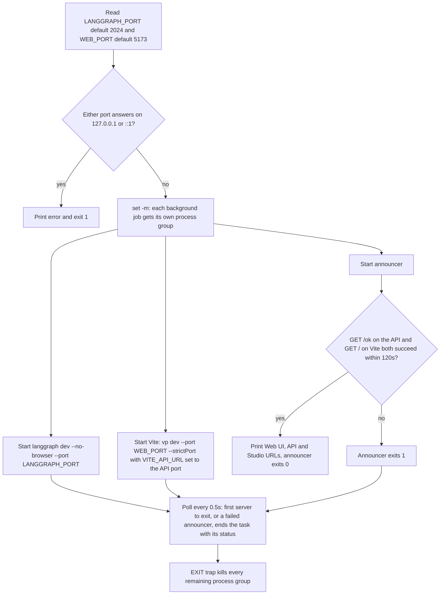

# Local development

A single file, `mise.toml`, drives the whole repository: the Python uv workspace and the pnpm/Vite+ web workspace. It pins the tools and defines every task that developers, git hooks, CI and the worktree bootstrap script call, so nobody installs tools by hand. Python is the only exception. It comes from uv (`.python-version`), not from mise.

Related pages: [Quickstart](../quickstart.md), [Web frontends](../architecture/web-frontends.md), [Deployment](deployment.md) (the `deploy` task, the CI setup action and the image build), [Testing conventions](../testing/testing-conventions.md) (coverage gates and the `live` / `e2e` markers).

## Bootstrapping

```sh
mise trust && mise install && mise run setup
```

- `mise install` fetches the pinned tools listed under `[tools]`: node 24, pnpm 12, uv 0.12, lefthook 2, Socket Firewall (`sfw`, from `SocketDev/sfw-free`), fastchess (used by `test:uci`), Stockfish (used by `lcchess grade`) and the `langsmith` CLI (used by `dev:review` and `langsmith apps push`). The README asks you to activate mise in your shell (`mise activate`), which puts these tools on your `PATH` inside the repo.
- `mise run setup` runs `sfw uv sync --all-packages --all-groups`, then `sfw pnpm install --frozen-lockfile`, then `lefthook install`.

**Git worktrees.** `scripts/setup-worktree.sh` prepares a new worktree in four steps:

1. It runs `mise trust` again. mise trusts config per path, and every worktree is a new path.
2. It runs `mise install`.
3. It symlinks the main checkout's gitignored `.env` into the worktree. Because the file is a symlink, a rotated key reaches every worktree at once. The script never replaces a real `.env` that belongs to the worktree. If the main checkout has no `.env`, it prints a note telling you to copy `.env.example` first.
4. It finishes with `mise run setup`.

The script finds the main checkout through `T3CODE_PROJECT_ROOT`. When you run it by hand, it uses the parent of the common git dir instead. `t3.json` runs the script automatically when a worktree is created. `t3.json` also defines Dev (`mise run dev`, preview at `http://localhost:5173/`), Test and Check scripts. You can run the script by hand and re-run it safely.

## Task map

`mise tasks` lists every task. Anything after `--` goes to the underlying command, for example `mise run dev:tui -- --side black`.

| Task | What it runs | Notes |
|---|---|---|
| `setup` | `uv sync` and `pnpm install --frozen-lockfile`, both wrapped in sfw, then `lefthook install` | Run once per checkout or worktree |
| `dev:web` (alias `dev`) | `langgraph dev` on `:2024` and the Vite dev server on `:5173` | Ports come from `LANGGRAPH_PORT` / `WEB_PORT` |
| `dev:tui` | `uv run --all-packages --env-file .env lcchess play` | The Textual terminal game |
| `dev:uci` | `uv run --all-packages --env-file .env lcchess uci` | A UCI engine over stdin/stdout |
| `dev:review` | `langsmith apps dev` in `apps/review` | A local LangSmith sandbox, rebuilt on save |
| `review:size` | `vp build` and `scripts/upload-size.mjs` in `apps/review` | Checks what `langsmith apps push` would upload |
| `review:snapshot` | `uv run --env-file .env python scripts/grader-snapshot.py` | Builds the review app's grader snapshot (Stockfish + `lcchess`) in your LangSmith workspace |
| `check` | `check:python` and `check:web` | ruff format check, ruff lint, `ty check`, `vp check` |
| `test` | `test:python` and `test:web` | `pytest -q -n auto` and `vp run -r test`, both with 100% coverage gates |
| `test:e2e` | `uv run --all-packages pytest -m e2e --no-cov -q` | Builds the UI itself and drives it in Chromium against `langgraph dev` with a fake model |
| `test:live` | `uv run --all-packages --env-file .env pytest -m live --no-cov -q` | Calls the real LLM Gateway, which costs a few cents |
| `test:uci` | a two-game fastchess smoke match, run inside `.uci-match/` | Fails if a game has no result or ended by forfeit |
| `eval:positions:build` | `lcchess-evals positions build` | One-off: samples and labels Lichess positions into `evals/datasets/positions/vN.jsonl` |
| `eval:positions:upload` | `lcchess-evals positions upload` (with `.env`) | Creates or updates the LangSmith dataset from the committed JSONL, tagged `vN` |
| `eval:systemone` | `lcchess-evals systemone run` (with `.env`) | One System 1 experiment: `-- --model ... --style ... [--split dev]` |
| `eval:systemone:baseline` | `lcchess-evals systemone baseline` (with `.env`) | The four baseline experiments in `evals/experiments/systemone-baseline.toml`: Jev in both description styles, Luna Decisions, and a Jev control capped at 16 options |
| `generate:settings` | `python -m langchain_chess_server.codegen packages/chess-ui/src/generated` | Regenerates the settings JSON Schemas and TypeScript from `ChessContext` |
| `probe:efforts` | `python -m langchain_chess.efforts` (with `.env`) | Asks each recorded model, and any model given after `--`, whether it takes a reasoning effort. Makes real calls |
| `deploy` | `langgraph deploy --no-remote --agent-id langchain-chess --agent-environment production --deployment-type dev` | The UI ships separately to GitHub Pages. Prefer deploying from CI, because `langgraph deploy` sends `.env` as the deployment's secrets. See [Deployment](deployment.md) |
| `agent:tag` | `bash scripts/agent-tags.sh` | Tags the positions dataset and the agent's tracing projects |
| `wiki:init` / `wiki:update` / `wiki:view` | `scripts/openwiki.sh code --init/--update --print`, `openwiki visualize` | OpenWiki `0.9.0`, pinned per task |

There is no `build` task. To build the web UI by hand, run `pnpm --dir apps/web exec vp build`, which writes to `apps/web/dist`. The Vite config reads `BASE_PATH` (default `/`) and `OUT_DIR` (default `dist`). The GitHub Pages workflow sets `BASE_PATH` to `/<repo>/`.

### `dev:web`: port checks, readiness and process lifecycle

If its port is taken, `langgraph dev` silently moves to a random port, and the UI would keep calling the old one. To prevent this, the task checks both ports before it starts anything:


*How `mise run dev:web` checks the ports, starts the servers and cleans up.*

- The task probes both loopback addresses, because Vite listens only on `::1`.
- `langgraph dev` runs through `uv run --all-packages` on `LANGGRAPH_PORT`. The UI gets the API address through `VITE_API_URL=http://localhost:$LANGGRAPH_PORT`, so the frontend always calls the port the server actually uses. Vite runs with `--strictPort`, so it fails instead of moving to another port.
- Job control (`set -m`) puts each job in its own process group. Stopping a job therefore also stops the processes it spawned, such as uvicorn's worker or Vite under pnpm, and a Ctrl-C in the terminal reaches only the script.
- `langgraph dev`'s startup logs bury Vite's own URL. The announcer therefore prints the Web UI (`http://localhost:$WEB_PORT/`), API and LangSmith Studio URLs again once `http://127.0.0.1:$LANGGRAPH_PORT/ok` and `http://localhost:$WEB_PORT/` both respond. If they are not up within 2 minutes, the announcer fails.
- The script checks its jobs every 0.5 s instead of calling `wait -n`, because macOS's bash 3.2 lacks `wait -n`. When the announcer exits successfully, the script stops watching it. When a server exits, or the announcer fails, the task ends with that exit status, and the `EXIT` trap kills the remaining process groups.

### `check`, `test` and codegen

- `check:python` runs `ruff format --check .`, `ruff check .` and `ty check` over the repo root. `ty` covers `libs`, `apps/server` and `evals`. `check:web` runs `pnpm exec vp check` at the root. The lint and format config for all JS lives only in the root `vite.config.ts`.
- `test:python` passes `-n auto` (xdist) on the command line on purpose, not through pytest `addopts`. A bare `pytest` therefore stays serial, so `-k`, `--pdb` and `--snapshot-update` keep working. Pytest `addopts` deselect both the `live` and `e2e` markers (`-m "not live and not e2e"`) and enforce `--cov-fail-under=100`, with branch coverage turned on.
- `test:live` selects `-m live`, turns coverage off with `--no-cov`, and loads `.env`.
- `test:e2e` runs `-m e2e --no-cov` and no longer depends on a separate build step. The browser test runs `langgraph dev` with a throwaway `.env` and strips `LANGSMITH_*`, `LANGCHAIN_*`, `TYPESAFE_*` and `LC_*` variables from its environment, so it never needs real keys. It then builds the web UI with `vp build`, with `VITE_API_URL` pointed at that server and `OUT_DIR` set to a temporary directory, after stripping the inherited `VITE_*` variables. It serves the result from a separate local HTTP server on another origin, the way GitHub Pages serves it. If the build fails, the test fails with the build output. The test needs pnpm and Chromium.
- The output of `generate:settings` is checked in. `apps/server/tests/test_codegen.py` fails with "run `mise run generate:settings`" when the files committed under `packages/chess-ui/src/generated` no longer match what the codegen renders. Run the task whenever `ChessContext` changes.

## Environment loading

Copy `.env.example` to `.env`, which is gitignored, and export `LC_GATEWAY_KEY` in your shell. The variables are:

- Tracing: `LANGSMITH_TRACING`, `LANGSMITH_API_KEY`, `LANGSMITH_AGENT_ID` and `LANGSMITH_AGENT_ENVIRONMENT`, plus `LANGSMITH_WORKSPACE_ID`. Local runs trace to the agent's `local` environment, and the deployment traces to `production`. Don't also set `LANGSMITH_PROJECT`: when both are set, the SDK traces nothing. `LANGSMITH_WORKSPACE_ID` pins the workspace the tracing key belongs to. Without it, the SDK falls back to the `langsmith` CLI profile, which can cause 403 errors.
- Gateway: `LANGSMITH_GATEWAY`, plus `LANGSMITH_GATEWAY_API_KEY`, which the template fills from `${LC_GATEWAY_KEY}`.
- System 1: `TYPESAFE_BASE_URL`, plus `TYPESAFE_API_KEY`, which the template also fills from `${LC_GATEWAY_KEY}`.
- Sign in with LangSmith: `OAUTH_CLIENT_ID` and `ALLOWED_ORGANIZATION_ID`. While these are unset, the server refuses sign-in tokens, but API keys still work. For local web sign-in, the web app reads `VITE_OAUTH_CLIENT_ID`, `VITE_LANGSMITH_ORGANIZATION_ID` and `VITE_LANGSMITH_SSO_SLUG` from `apps/web/.env.development.local`. The web app trims these values. Without a client ID it offers only API keys, and a client ID set without the organization ID counts as a configuration problem. `langgraph dev` lets keyless requests through, so the sign-in screen appears only against a server that requires sign-in.
- Dev ports (shell only): `LANGGRAPH_PORT` and `WEB_PORT`.

Provider secrets live in the gateway workspace, never in `.env`.

Loading is **explicit**. Nothing sources `.env` globally:

- Commands that make model calls or LangSmith writes pass `--env-file .env` to `uv run`: `dev:tui`, `dev:uci`, `test:live`, `test:uci`, `review:snapshot`, `probe:efforts`, `eval:positions:upload`, `eval:systemone` and `eval:systemone:baseline`. `test:uci` passes `../.env` because it runs inside `.uci-match/`. `lcchess grade` needs the same flag when you run it by hand.
- `langgraph dev`, which `dev:web` starts, reads `.env` through the `"env": ".env"` key in `langgraph.json`.
- The server's `ServerSettings` (pydantic-settings) reads the shell first and `.env` second.
- `scripts/openwiki.sh` sources `.env` itself with `set -a` when the file exists.

Both `uv run --env-file` and python-dotenv expand `${VAR}` from the parent environment. If `LC_GATEWAY_KEY` is missing, the gateway and TypeSafe keys expand to an empty string. langchain-core would then silently fall back to `LANGSMITH_API_KEY` and send model calls to the tracing org's gateway. To prevent this, `ServerSettings` rejects `LANGSMITH_GATEWAY_API_KEY`, `TYPESAFE_API_KEY` and `TYPESAFE_BASE_URL` when they are set but blank ("is set but empty; unset it or give it a value"), and the app refuses to start. The OAuth settings (`OAUTH_CLIENT_ID`, `ALLOWED_ORGANIZATION_ID`) work the opposite way on purpose: a blank value counts as unset. `apps/server/tests/test_settings.py` covers both rules and `.env` loading.

## Supply-chain guard: `sfw`

Socket Firewall (`sfw`) wraps every dependency install. `setup` uses it for `uv sync` and `pnpm install`. Add dependencies the same way:

```sh
sfw uv add --package <distribution> <dependency>   # a workspace member
sfw uv add --group dev <tool>                      # root dev tools
sfw pnpm add <pkg>                                 # inside the JS package that needs it
```

JS versions shared by several packages live in the `pnpm-workspace.yaml` catalog. The OpenWiki workflow runs `sfw mise install npm:openwiki@0.9.0` before the wiki task, because otherwise the task would install OpenWiki without the firewall.

## Git hooks (lefthook)

`mise run setup` installs the hooks defined in `lefthook.yml`:

- **pre-commit** runs its commands in parallel. Each command runs only when matching files are staged, which keeps the hook fast:
  - `vp check` runs when `*.{ts,tsx,css,json}` files are staged.
  - `ruff format --check` and `ruff check` run on the staged `*.py` files. `ty check` runs whenever Python files are staged.
  - A secrets scan checks the added lines of `git diff --cached`, excluding `lefthook.yml` itself. It rejects the commit when a line looks like an Anthropic key, an OpenAI project key, a LangSmith key, a TypeSafe live key or a GitHub personal token. The patterns require a key body, so the regex never matches its own definition. The scan checks each staged file separately, using NUL-separated names and literal pathspecs, so files with unusual names still get scanned. It prints only the names of matching files, never the matched line, so a secret never ends up in the log.
  - `vp check` and `ty check` run over the whole repo. Only the ruff commands receive `{staged_files}`. The globs only decide whether each command runs.
- **pre-push** runs `mise run test`, the full Python and web suites with their coverage gates.

CI runs the same `mise run check` and `mise run test`. See [Deployment](deployment.md) for the workflows.

## Troubleshooting

| Symptom | Fix |
|---|---|
| `error: port 2024 is already in use` from `dev:web` | Stop the other server, or choose other ports: `LANGGRAPH_PORT=2034 WEB_PORT=5180 mise run dev`. |
| `error: the servers were not up within 2 minutes` | One of the servers never became ready. Check the `langgraph dev` and Vite output above the error. |
| The server exits because the gateway key is empty | Export `LC_GATEWAY_KEY` in the shell that runs `mise`. |
| No traces appear | Check that `.env` does not set `LANGSMITH_PROJECT` alongside `LANGSMITH_AGENT_ID` / `LANGSMITH_AGENT_ENVIRONMENT`. |
| 403 on traces or grading | Set `LANGSMITH_WORKSPACE_ID` to the tracing key's workspace. |
| `lcchess grade` says to `set --project, or --environment` | Pass the project the game was traced to (`langchain-chess-local` for local games, `langchain-chess-production` for the deployment), or pass `--environment`, or set `LANGSMITH_AGENT_ENVIRONMENT`. |
| `dev:review` can't reach LangSmith | The review app uses the `langsmith` CLI's own credentials, not `.env`. Run `langsmith auth login --prompt-workspace` once and pick the tracing workspace. |
| `test_the_committed_files_are_current` fails | Run `mise run generate:settings` and commit the regenerated files. |
| `test:e2e` fails with "the web UI didn't build" | Read the `vp build` output in the failure message. Make sure `mise run setup` has installed the web dependencies. |
| A commit is rejected with `possible secret in staged changes to:` | Remove the token from the listed files. Keep keys in `.env` or the shell. |

## OpenWiki tasks and update workflow

The `openwiki` npm package is pinned **per task** (`tools = { "npm:openwiki" = "0.9.0" }` on `wiki:init`, `wiki:update` and `wiki:view`), not in `[tools]`. Every CI job runs `mise install`, which skips task tools, so only the wiki tasks install OpenWiki. When you bump the version, update the three task pins and the version in `.github/workflows/openwiki-update.yml` together.

- `wiki:init` regenerates `openwiki/` from scratch and keeps only `INSTRUCTIONS.md`. `--init` also drops the committed LangSmith connector config, so the task then runs `git checkout -- openwiki/.langsmith.json` to restore it.
- `wiki:update` refreshes only the pages that code changes made stale. When nothing changed, it does nothing.
- `wiki:view` runs `openwiki visualize` so you can browse the wiki locally.

`scripts/openwiki.sh` wraps both generation tasks:

1. It changes to the repo root and sources `.env` if the file exists.
2. It points OpenWiki at Anthropic through the LangSmith LLM Gateway by setting `OPENWIKI_PROVIDER`, `OPENWIKI_MODEL_ID` and `ANTHROPIC_BASE_URL`. It takes `ANTHROPIC_API_KEY` from `LC_GATEWAY_KEY`.
3. It maps `LANGSMITH_API_KEY` to `OPENWIKI_LANGSMITH_API_KEY` for the LangSmith connector and for tracing.
4. It turns tracing on under both the `LANGSMITH_*` and `LANGCHAIN_*` spellings and sends traces to the `langchain-chess-openwiki` project. It unsets `LANGSMITH_AGENT_ID` and `LANGSMITH_AGENT_ENVIRONMENT`, because the SDK traces nothing when a project and an agent are both set.
5. It disables telemetry and `exec`s `openwiki` with the task's arguments.

If `LC_GATEWAY_KEY` or `LANGSMITH_API_KEY` is missing, the script stops immediately with a message.

The **`openwiki-update`** GitHub workflow runs on `workflow_dispatch` and on a weekly schedule (Mondays at 08:00 UTC). A weekly run collects a week of changes into one update. The workflow:

- Runs one job at a time (concurrency group `openwiki-update`, no cancel-in-progress), because every run pushes to the same `openwiki/update` branch.
- Starts with a `check` job that counts open PRs from `openwiki/update`. If one is open, the `update` job is skipped with a notice to merge or close that PR first. Each run starts from main's baseline, so running while the previous PR is still open would pay again for the same pages.
- Checks out with `fetch-depth: 0`, because `--update` diffs HEAD against the last documented commit.
- Runs the shared setup action without Python or web dependencies and installs OpenWiki through `sfw`. It then runs `mise run wiki:update` with `LC_GATEWAY_KEY` and `LANGSMITH_API_KEY` from repository secrets, and with `OPENWIKI_TRACE_THREAD_ID` set to the commit SHA. That step is `continue-on-error`, and the job times out after 60 minutes.
- Deletes `openwiki/.run.json`, then uses `peter-evans/create-pull-request` to open or update a `docs: update OpenWiki` PR covering `openwiki`, `AGENTS.md` and `CLAUDE.md`. A PR is opened only when files changed.
- Opens the PR even when OpenWiki fails. The PR then holds the pages finished before the failure, and a final step fails the job. Merging such a PR makes those pages the baseline for the next run.

`AGENTS.md` tells coding agents not to hand-edit generated pages. Change the source instead and let the workflow regenerate the pages.
