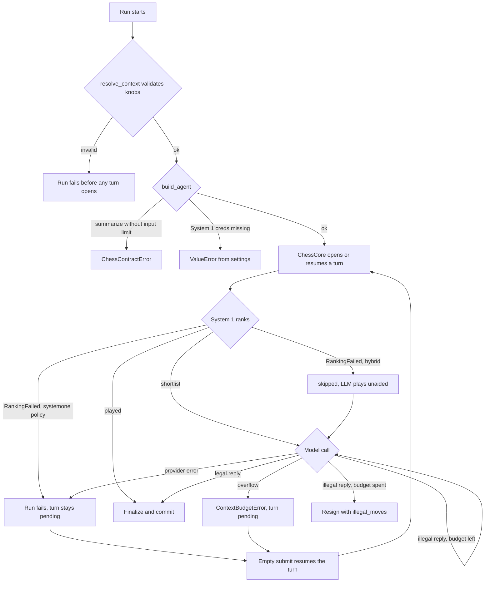
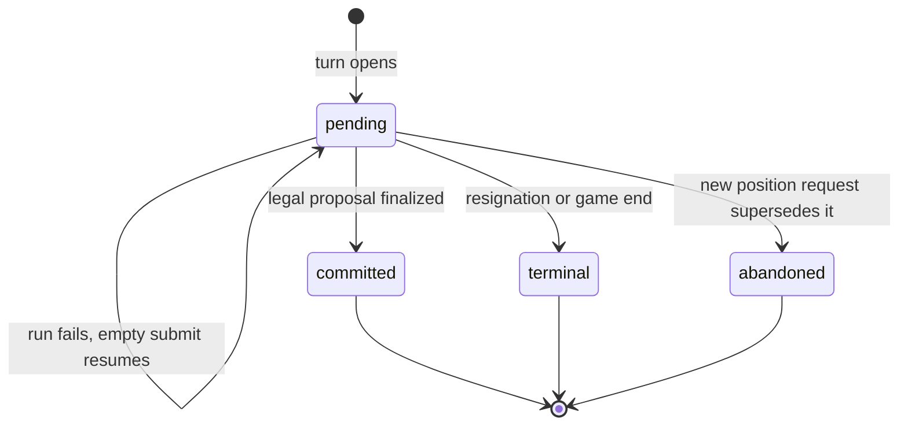

# Runtime behavior and failure modes

This page covers what happens at runtime when a turn of the `chess` graph goes wrong, and how
it recovers. It also explains how to read production traces in the LangSmith project
`langchain-chess-app` against the code. Static design is covered on these pages:

- [turn lifecycle](../architecture/turn-lifecycle.md): turn states, retries, finalization
- [System 1](../architecture/system-one.md): the gate, tournaments, frozen decisions
- [Agent Server adapter](../integrations/agent-server.md): graph factory, knobs, deployment
- [models, gateway and cost](../concepts/models-gateway-and-cost.md)
- [prompt and memory](../concepts/prompt-and-memory.md)

Statements carry one of three labels:

- **Observed:** read directly from sampled traces.
- **Correlated:** tied to source code this page cites.
- **Hypothesis:** a change or check that still needs verifying.

## Status of trace evidence

- **Observed:** none. No LangSmith sample could be read when this page was generated, so the page
  reports **no** trace counts, latencies, token totals or error signatures. The failure semantics
  below come from the code (**Correlated**). None of it is a production measurement.

## Failure map at a glance

*Where a run can fail, and which failures leave a pending turn that an empty submit resumes.*

## Before a turn: context validation and graph construction

- **Knob resolution.** `resolve_context` merges the assistant's `context` first and then
  keys that are explicitly present in `config["configurable"]`. It drops unknown keys, because
  the server puts its own keys there. An explicit `None` overrides only a nullable knob. The merged
  values are validated with pydantic, so an out-of-range or mistyped knob fails the run up front,
  before any turn opens (`apps/server/langchain_chess_server/context.py`).
- **Server defaults.** `ChessContext` defaults to policy `hybrid`, model
  `langsmith:baseten/zai-org/GLM-5.3-Flash` with no `reasoning_effort`, `memory="none"`,
  `threshold=0.9` with the `margin` gate, `tournament_threshold` unset, `k=5`,
  `systemone_model="semif-qwen3.5-4b"`, and `with_eval` and `with_nouls` off.
- **Policy shapes.** `policy="systemone"` builds no chat model, forces memory to `none`, and
  sets both System 1 thresholds to 0 with `has_model=False`, so System 1 always plays.
  `policy="llm"` installs `NoSystemOne`, which keeps the node but does nothing
  (`apps/server/langchain_chess_server/graph.py`).
- **Credentials.** Any policy that runs System 1 calls `ServerSettings.typesafe()`, which raises
  `ValueError` if `TYPESAFE_API_KEY` or `TYPESAFE_BASE_URL` is missing. A variable that is set
  but blank is also rejected, so a blank gateway key never silently falls back to the tracing key
  (`apps/server/langchain_chess_server/settings.py`).
- **Reads never build a runnable agent.** When the server calls the factory without an execution
  runtime (to read or update state, or to describe the graph), `make_graph` returns `shape()`.
  That graph has every node switched off and needs no model, clients or credentials.

## Summarize eligibility

- Summarization runs only with `memory="summarize"`. `create_chess_agent` appends
  `ChessSummarization` only in that case, otherwise a no-op `NoSummarization` that keeps the graph
  shape. The server default is `memory="none"`, so under default settings no summary calls happen.
- The trigger is 70% of the model's input limit (`DEFAULT_TRIGGER = ("fraction", 0.7)`), and
  at least `2 * max_retries + 2` recent messages are kept so one turn's attempts survive.
- `chat_model` (`libs/chess/langchain_chess/chat_models.py`) gives gateway models a profile
  whose `max_input_tokens` is the known context window minus the output budget. `build_agent`
  raises `ChessContractError` when `memory="summarize"` is requested for a model that has no
  known input limit.
- The web dialog asks `GET /ui/model-limit` (backed by the cached `model_limit`) and offers
  `summarize` only when a limit is known (`apps/server/langchain_chess_server/app.py`).
- Summary calls run in `before_model`, outside `ChessCore.wrap_model_call`. Their `Call`s go
  onto the turn record together with the message rewrite, but their time does not count toward
  `turn.latency_ms`.

## During a turn: model errors, retries and resume

*Turn status transitions that matter for failure handling. A failed run leaves the turn `pending`.*

- **Illegal or unparseable replies.** `ChessCore._parse` rejects a reply that has no parseable
  move or names a move outside `allowed_moves`. While `illegal_attempts < max_retries` (default
  3) it appends a feedback message and jumps back to the model. After that it sets a resignation
  `terminal_intent` with reason `illegal_moves`. The counter is stored on the durable turn
  record, so a resume after a provider error keeps the remaining budget. A turn therefore gets at
  most four parsed replies. An empty reply is replaced with `EMPTY_REPLY` so the feedback can say
  the reply was empty.
- **Provider errors.** If the model call raises before any response has been recorded, the error
  propagates and the run fails with the turn still `pending`.
- **Errors after a completed call.** If a wrapper inside the model call records a response and
  then fails, `wrap_model_call` keeps the completed `Call`s on the turn and writes a
  `failed_call` marker. `after_model` then re-raises the original error in the same run. The
  error itself is kept only in the middleware instance's memory. A later resume does not have it,
  so it clears the marker and calls the model again instead of re-raising forever.
- **Context overflow.** A provider exception whose text looks like context overflow ("prompt is
  too long", "context length", and so on) is re-raised as `ContextBudgetError`. This also applies
  when it happens after a call has completed. The turn stays pending.
- **Resume.** An empty submit with a pending turn goes to `ChessCore._retry`. If a validated
  `proposal` or `terminal_intent` is already in state, the run jumps straight to finalization
  and does not call the model again. Otherwise it clears the decision fields and restores
  `allowed_moves` from `initial_allowed`. A new chat message while a turn is pending is rejected
  with "finish or retry the pending turn first". A new `position` request abandons the pending
  turn and opens a fresh one.
- **Forced moves.** When the turn opened with exactly one legal move, `ForcedMoveMiddleware`
  proposes it and no model is called.

## System 1 failures

- **Retry envelope.** `GatewayRanker._ask` and `_aask` retry only transient errors (rate limit,
  connection, timeout, internal server error): `max_attempts=3` in total, with
  `backoff_seconds` of 0.5 s and then 1 s between attempts. Other errors and malformed answers
  fail at once. The server's classifiers use the shared pool's HTTP clients, which have a 15 s
  timeout. A request whose three attempts all time out therefore blocks for about 46.5 s before
  `RankingFailed`. That figure is arithmetic from the constants, not a measurement. A tournament
  makes two sequential requests (heats, then final), so it can take twice as long in the worst
  case.
- **Hybrid degrades, System-1-only fails.** On `RankingFailed`, a hybrid turn freezes a
  `skipped` decision and the LLM plays without candidates. With `has_model=False`
  (`policy="systemone"`) the error is re-raised, so the run fails and the turn stays pending.
- **Skipped time is recorded.** `RankingFailed` carries `elapsed_ms` and the calls that completed
  before the failure. The `skipped` decision stores both, so
  `Ply.meta["SystemOneMiddleware"].latency_ms` shows the time lost to a failed ranking, and that
  time is also folded into the turn's latency.
- **Frozen per turn.** The decision is keyed to the turn id and replayed on every retry. A resume
  never re-ranks, so a retry cannot flip the gate and does not count ranking time or calls twice.

## Client pool lifetime

- The System 1 classifiers share one `ClientPool` per process (`POOL`, 15 s timeout). It lives in
  `clients.py` rather than `graph.py` because langgraph loads `graph.py` under a generated module
  name, and a pool kept there would exist once per copy.
- `get()` creates the sync and async `httpx2` client pair on first use. A lock makes sure that
  concurrent first uses create only one pair.
- The FastAPI app's `lifespan` calls `POOL.aclose()` on shutdown. The Agent Server merges that
  lifespan with its own. `aclose` closes both clients if a pair exists, and the next `get()`
  creates a fresh pair (`apps/server/tests/test_clients.py`).

## What the web UI shows

- **Submits.** Every submit (`apps/web/src/useGame.ts`, `send`) uses `multitaskStrategy:
  "reject"`. It carries the game's recorded knob set in `config.configurable` (built by
  `configurableOf`, exactly the `ChessContext` fields), plus `run_name: "chess-web"`, tag `web`
  and metadata `surface: "web"`.
- **Rejected commands.** When `ChessCore` rejects a command, it writes the reason to state
  `error`. The table shows it as a dismissible "Move rejected" banner. Each new command re-arms
  the banner.
- **Failed runs.** A run failure arrives as the stream's error, or as a submit error if it
  failed before reaching the stream. It is shown as an inline error message. A 401 or 403 from
  the Agent Server shows a "LangSmith API key needed" banner instead. The check is anchored so
  that a model provider's 401 inside a failed run does not look like the browser's key. A
  "run already in flight" rejection is dropped silently.
- **Pending turns.** When the last turn is `pending`, the board locks and only a **Retry** button
  is offered. It sends empty input (`retry`), because a fresh `go` would be rejected while a turn
  is pending. The human's move is shown optimistically until the run settles, whether it
  succeeds or fails.
- **Thread loading.** A game whose thread fails to load shows "Couldn't load this game" with a
  Reload button. A thread the server doesn't have shows "This game isn't on the server". A thread
  with no recorded `setup` can only be viewed.

## How to read a production trace against the code

- **Slicing web traffic.** Split on `run_name: "chess-web"`, tag `web` or metadata
  `surface: "web"` before comparing latency. Studio and SDK runs lack these markers and may use
  different knobs.
- **LLM span names.** `chat_model` passes `name=<model name>`, so gateway calls appear under the
  model name rather than `ChatOpenAI`. Output is capped at `MAX_TOKENS = 64000`, reasoning
  included. The cap is lowered to the model's own output limit, or to half of a small context
  window, when those are smaller.
- **System 1 span names.** Each classifier request is traced as `systemone.rank`,
  `systemone.heats` or `systemone.final`. A tournament is one heats span followed by one final
  span. A transient retry shows up as a repeated span with the same name.
- **Recorded cost versus traced calls.** `CallRecorder` appends a `Call` only when a response
  arrives (`on_llm_end`), and drops errored provider attempts in `on_llm_error`. The turn's
  `calls` therefore undercount attempts that LangSmith shows as errored spans. System 1 calls are
  recorded with the classifier's reported token usage. Their `cost_usd` is `None` whenever
  genai-prices has no price for the model.
- **Two latencies.** `turn.latency_ms`, which is copied onto the ply, is the wall time inside
  `ChessCore.wrap_model_call` plus each extension's `turn_latency_ms` (System 1 ranking, counted
  once). The extension time is added when the turn finalizes or is abandoned. It excludes
  summarization and graph overhead, so root-trace latency is higher. A System-1-played turn
  records its ranking time, and a forced turn records 0 ms.

## Code-anchored checks for each refresh

| # | Code claim (Correlated) | Source | What to look for in the sample |
|---|---|---|---|
| 1 | One run plays at most one turn. A normal LLM turn makes **one** `llm` call. System-1-played and forced turns make zero. | `core.py` `wrap_model_call`, `_parse`; `forced_move.py` | LLM spans per root. More than one means illegal-reply retries or provider-level retries. |
| 2 | Illegal replies get up to `max_retries=3` more attempts before a resignation with reason `illegal_moves`. The budget survives resumes. | `core.py` `_parse`; `agent.py` | Roots with 2–4 LLM spans, and any resignation. Report the rejection signature only (no `MOVE:` line, empty, disallowed move), never the text. |
| 3 | The hybrid gate plays when `threshold < 1` and the signal is at least the threshold (default 0.9, margin). | `context.py`; `middleware.py` `_freeze` | Share of hybrid turns with no LLM span after a System 1 span. |
| 4 | More than 16 allowed moves (SemIf) triggers a tournament: two sequential requests. | `ranker.py` `default_max_options` | Heats and final spans, and the wall time they add. |
| 5 | Transient System 1 errors: 3 attempts, 15 s client timeout, 0.5 s then 1 s backoff, about 46.5 s worst case per request. | `ranker.py` `_ask`; `clients.py` `POOL` | Repeated `systemone.*` spans, spans near 15 s, outliers dominated by System 1 time. |
| 6 | Ranking failure: hybrid goes `skipped` and records the elapsed time. `policy="systemone"` fails the run. | `middleware.py` `_after_ranking`, `_skipped` | Errored roots in System-1-only games. Failed System 1 spans followed by an LLM span. |
| 7 | Summarization runs only with `memory="summarize"`, which is off by default. | `context.py`; `agent.py`; `summarization.py` | Any `summary`-kind call. None is expected under defaults. |
| 8 | Output cap is `MAX_TOKENS = 64000`, or less where the model's limits require it. | `chat_models.py` | Calls that stop at the length limit, followed by a retry. |
| 9 | Context overflow becomes `ContextBudgetError`, and the turn stays pending. | `core.py` `looks_like_overflow` | Errored roots with this exception type. |
| 10 | An empty-input resume with a frozen proposal commits without calling the model. | `useGame.ts` `retry`; `core.py` `_retry` | Roots with no LLM span that commit right after an errored root on the same game (describe the pattern only). |
| 11 | Off by default: `with_eval`, `with_nouls`, `top_p`, `tournament_threshold`, `gate="confidence"`, `systemone_model="typesafe/jev-latest"`. | `context.py` | Whether any sampled run enables them. |
| 12 | The UCI adapter plays System 1's `fallback_move`, or a seeded random legal move, after a cancellation or failure. | `libs/cli/langchain_chess_cli/uci/completion.py` `_fallback` | Out of scope for server traces. |

## Runtime findings and opportunities

These are code-derived watch items. None has Observed evidence yet.

1. **A degraded classifier stalls hybrid turns before the LLM starts.** (Correlated, checks 5
   and 6.) With a 15 s timeout, 3 attempts and two requests per tournament, a failing System 1
   can add tens of seconds. The elapsed time now appears in `SystemOneMeta.latency_ms` and in
   the turn's latency. Before tuning `timeout_s`, `max_attempts` or the backoff, measure System 1
   span time in outlier roots.
2. **Illegal-reply retries repeat the most expensive call.** (Correlated, check 2.) Before
   changing `SYSTEM_PROMPT`, `feedback_text`, `show_legal_moves` or `max_retries`, count LLM
   spans per root and classify the rejection signature. A reply truncated at the length cap
   needs a different fix from a disallowed move.
3. **Recorded turn cost is a lower bound.** (Correlated.) Errored provider attempts are not
   recorded, and System 1 calls may be unpriced. Use LangSmith spans to reconcile spend. Read the
   `CallRecorder` docstring about run-tree keying before changing it.
4. **The gate may act as a pruner in practice.** (Hypothesis, check 3.) If sampled hybrid turns
   almost always reach the LLM, System 1 adds latency without saving LLM calls.
5. **Summarization is unlikely to appear in production traces.** (Correlated, check 7.) It is
   opt-in and needs a model with a known input limit. For coverage, rely on `libs/chess/tests`.

## Focused tests

- `libs/chess/tests/test_contract.py`: completed calls survive a wrapper failure; a resume calls
  the model again; overflow after a completed call is still `ContextBudgetError`.
- `libs/chess/tests/test_lifecycle.py`: overflow surfaces as `ContextBudgetError`.
- `libs/systemone/tests/test_middleware.py`: ranking time counts once across retries; a skipped
  ranking carries its elapsed time.
- `libs/systemone/tests/test_ranker.py`: `RankingFailed.elapsed_ms` is set.
- `apps/server/tests/test_clients.py`: concurrent first use makes one client pair; closing
  resets the pool.

## This pull

- **Observed:** no figures, because the raw sample was not accessible. When a later refresh can
  read it, record here the bucket counts (error / outlier / baseline), baseline medians, per-kind
  (`llm`, `summary`, `systemone`) call counts and latency or token totals, and the results of the
  checks above. Bucket counts describe how the anomaly-weighted sample was built. They are not
  fleet rates.
