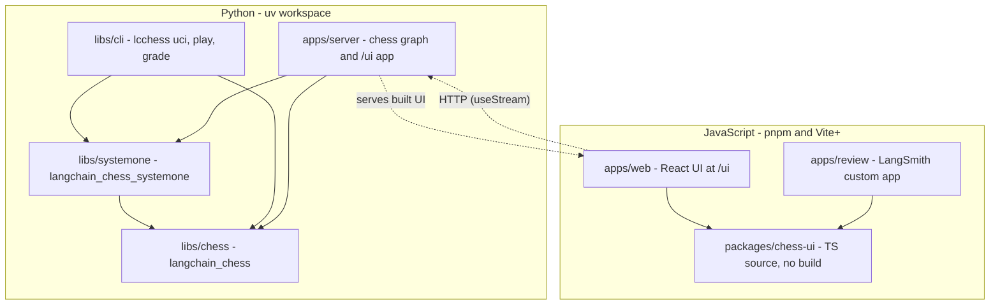

# Quickstart: working in langchain-chess

langchain-chess builds chess-playing agents on LangChain's `create_agent`. The design is simple: **everything that decides how a move is chosen is middleware, and everything that talks to the agent is an adapter outside the graph.** Legality, forced moves, the System 1 ranker (SemIf or Jev) and memory summarization are all middleware. The UCI engine, the terminal UI, the Agent Server graph with its web UI, and the grader are all adapters.

"System 1 + System 2" is a single middleware. A cheap ranker scores the legal moves. If its confidence gate clears, it plays the move and the LLM never runs. If not, it hands over a shortlist and the LLM can still play any legal move. Details are in [System 1](architecture/system-one.md).

## Package map


*Arrows show "depends on". Solid arrows are package dependencies. Dotted arrows are runtime-only links.*

| Package | Import / binary | Role |
|---|---|---|
| `libs/chess` (`langchain-chess`) | `langchain_chess` | `create_chess_agent`, `ChessState`, the middleware contract and write guard, `ChessCore`, the call recorder and pricing, grading math, test fakes |
| `libs/systemone` (`langchain-chess-systemone`) | `langchain_chess_systemone` | `SystemOneMiddleware`, `GatewayRanker`, the tournament |
| `libs/cli` (`langchain-chess-cli`) | `lcchess` | The UCI engine, the Textual TUI, `lcchess grade` |
| `apps/server` (private) | `langchain_chess_server` | The `chess` graph factory (`make_graph`) and the FastAPI app serving `/ui` |
| `apps/web` | — | React UI. It talks to the `chess` graph over the Agent Server API |
| `apps/review` | — | LangSmith custom app that replays graded games |
| `packages/chess-ui` | `@langchain-chess/chess-ui` | Board, move list, ply details and state types shared by both web apps |

Dependency direction you must keep: `systemone → chess`. `cli` and `server` depend on both. **Nothing depends on `cli` or `server`.** The web apps never import Python. They reach the agent only over HTTP. `libs/chess` declares an optional `systemone` extra, and `libs/cli` installs through it (`langchain-chess[systemone]`), but `langchain_chess` code never imports System 1. See [Package map and dependency direction](architecture/package-map.md) to decide which layer a new feature belongs in.

### How a turn is assembled

`create_chess_agent` wraps every user middleware in the write guard, then builds this stack: `ChessCore` first, then `ForcedMoveMiddleware` (when `forced_move=True`), then the guarded extensions, and last `ChessSummarization` (only when `memory="summarize"`). It passes the stack to `create_agent(tools=[])` with `ChessState`. It attaches a `CallRecorder` as a callback so every provider response gets priced. It refuses to build a graph whose input schema exposes anything other than `messages` and `position`. If `model=None` it installs a `NoModel` that fails loudly. That only works when middleware always proposes a move, as a System-1-only agent does.

The server's `build_agent` selects one of three policies from `ChessContext`:

- `llm`: no System 1.
- `systemone`: no model, and System 1 always plays (threshold forced to 0).
- `hybrid`: both.

## Rules a change must keep

- **One run plays at most one turn. One thread is one game.** Input is either a chat message (`go` or one move) or a `position` that extends the thread's game. A position that doesn't extend the game is rejected. A run with no new command retries a pending turn or does nothing. → [Turn lifecycle](architecture/turn-lifecycle.md), [State record](concepts/state-record.md)
- **Clients read only `start_fen`, `moves`, `plies`, `turns`, `outcome` and `error`.** `messages` is model working context and may be summarized. The thread-state API also returns private channels. → [State record](concepts/state-record.md)
- **The middleware contract:**
  - `allowed_moves` can only narrow.
  - A turn gets at most one `proposal`, from a hook declaring `can_jump_to=["end"]`.
  - `candidates` are soft suggestions with a single writer.
  - Your own state keys are `PrivateStateAttr`.
  - No tools.
  - Every hook needs both sync and async variants.
  - `before_model` must be idempotent: a decision is frozen per turn and replayed as `current allowed ∩ frozen`.

  → [Middleware contract](concepts/middleware-contract.md)
- **Cost is computed locally.** Every provider response inside a turn, retries included, is recorded and priced with the pinned genai-prices snapshot. SemIf calls are unpriced, so a hybrid turn's cost is marked incomplete. → [Models, gateway and cost](concepts/models-gateway-and-cost.md)
- **Coverage is 100% line and branch on both halves.** Use fakes, not mocks. → [Testing conventions](testing/testing-conventions.md)
- **Image build:** `langgraph.json` builds from the uv workspace, and `dockerfile_lines` must list every member's `pyproject.toml`. Workspace sources live only in the root `pyproject.toml`. → [Deployment](operations/deployment.md)

## Commands

mise provides the tools: node, pnpm, uv, lefthook, `sfw`, fastchess, Stockfish and the `langsmith` CLI. Python comes from uv.

```sh
mise trust && mise install && mise run setup   # tools, uv sync --all-packages, pnpm install, git hooks
mise run check        # ruff format/lint + ty, then vp check (web lint, format, types)
mise run test         # pytest -n auto (100% coverage gate) + vp run -r test (Vitest)
mise run test:live    # opt-in live tests against the real gateway, `-m live --no-cov`; costs money
mise run test:uci     # two SemIf-only games under fastchess, fails on any forfeit
mise run build        # web UI into apps/server's static dir, served at /ui

mise run dev:web      # alias `dev`: langgraph dev on :2024 + web UI on :5173/ui/
                      # override with LANGGRAPH_PORT / WEB_PORT; refuses to start if a port is taken
mise run dev:tui -- --side black          # lcchess play
mise run dev:uci -- --policy systemone    # lcchess uci
mise run dev:review   # apps/review in a local LangSmith sandbox
```

Tips:

- Options after `--` pass through to the underlying command.
- Plain `pytest` runs serially, which is what you want for `-k`, `--pdb` and `--snapshot-update`.
- Add dependencies with `sfw uv add --package <dist> <dep>` or `sfw pnpm add <pkg>` in the JS package that needs it.
- JS versions shared by more than one package go in the `pnpm-workspace.yaml` catalog.

**Environment.** Commands that call models load `.env` explicitly (`uv run --env-file .env …`). `langgraph dev` reads it through `langgraph.json`. The relevant variable names are:

- `LANGSMITH_GATEWAY_API_KEY`: gateway key for the default `langsmith:` model specs. `.env.example` fills it from `LC_GATEWAY_KEY`, which you export in your shell.
- `LANGSMITH_API_KEY` and `LANGSMITH_WORKSPACE_ID`: tracing.
- `TYPESAFE_API_KEY` and `TYPESAFE_BASE_URL`: System 1.
- `LANGSMITH_GATEWAY`: gateway passthrough for bare or `provider:model` specs.
- `STOCKFISH_PATH`: optional, for grading.

Copy `.env.example` to create `.env`. Never commit values. The app refuses to start when a key is set but empty. → [Local development](operations/local-development.md)

## Task routing

| I want to… | Go to |
|---|---|
| Understand which package owns what, or where a new feature belongs | [Package map and dependency direction](architecture/package-map.md) |
| Change how a turn runs: command classification, pending/abandoned turns, reply parsing, illegal-move retries, resignation, forced moves, draw claims | [The agent loop: ChessCore and the turn lifecycle](architecture/turn-lifecycle.md) |
| Tune or change System 1: gates, thresholds, `k`/`top_p`, the tournament, ranking retries and the `skipped` path | [System 1: SystemOneMiddleware, ranker and tournament](architecture/system-one.md) |
| Change the React UI, the shared board components, or how the review app displays games | [Web frontends](architecture/web-frontends.md) |
| Write a new middleware, or understand why the write guard rejected one | [The middleware contract and write guard](concepts/middleware-contract.md) |
| Add a model, change gateway routing, or fix cost and token accounting | [Model specs, the LLM Gateway and cost accounting](concepts/models-gateway-and-cost.md) |
| Change the prompt, `show_legal_moves`, or memory modes (`none`/`full`/`summarize`) | [Prompt, model view and memory modes](concepts/prompt-and-memory.md) |
| Add or read a field in `plies`/`turns`, or change input and thread semantics | [The public state record and threads](concepts/state-record.md) |
| Add a `ChessContext` knob, change policies, or change the `/ui` mount and `/ui/config` | [Agent Server graph and the /ui mount](integrations/agent-server.md) |
| Change the terminal UI or shared CLI options | [Terminal UI (lcchess play) and CLI options](integrations/terminal-ui.md) |
| Change the UCI adapter: time management, fallback moves, `bestmove 0000` | [UCI engine adapter (lcchess uci)](integrations/uci-engine.md) |
| Change grading, feedback keys, or the review app's data | [Grading games and the review app](workflows/grading-and-review.md) |
| Change the image build, `langgraph.json`, CI, or deploy path filters | [Deployment, image build and CI](operations/deployment.md) |
| Add a mise task, a git hook, a tool pin, or change the OpenWiki workflow | [Local development toolchain](operations/local-development.md) |
| Check how the deployed graph actually behaves: calls per turn, latency, cost, failure modes | [Runtime behavior (LangSmith evidence)](operations/runtime-behavior.md) |
| Add tests, use the fakes, update TUI snapshots, or run live and fastchess tests | [Testing conventions](testing/testing-conventions.md) |

For measured design decisions (prompt caching, memory mode versus analysis length), read the README's [Decisions and measurements](../README.md#decisions-and-measurements) section. It keeps the current numbers, and this wiki doesn't repeat them.
d CLI options](integrations/terminal-ui.md) |
| Change the UCI adapter: time management, fallback moves, `bestmove 0000` | [UCI engine adapter (lcchess uci)](integrations/uci-engine.md) |
| Change grading, feedback keys, or the review app's data | [Grading games and the review app](workflows/grading-and-review.md) |
| Change the image build, `langgraph.json`, CI, or deploy path filters | [Deployment, image build and CI](operations/deployment.md) |
| Add a mise task, a git hook, a tool pin, or change the OpenWiki workflow | [Local development toolchain](operations/local-development.md) |
| Check how the deployed graph actually behaves: calls per turn, latency, cost, failure modes | [Runtime behavior (LangSmith evidence)](operations/runtime-behavior.md) |
| Add tests, use the fakes, update TUI snapshots, or run live and fastchess tests | [Testing conventions](testing/testing-conventions.md) |

For measured design decisions (prompt caching, memory mode versus analysis length), read the README's [Decisions and measurements](../README.md#decisions-and-measurements) section. It keeps the current numbers, and this wiki doesn't repeat them.
