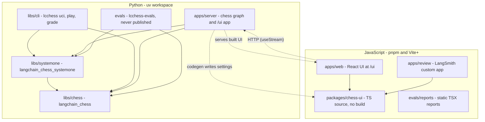

# Quickstart: working in langchain-chess

langchain-chess builds chess-playing agents on LangChain's `create_agent`. The design comes down to one rule: **anything that decides how a move is chosen is middleware, and anything that talks to the agent is an adapter outside the graph.** Legality, forced moves, the System 1 ranker (Jev or OpenAI Decisions), memory summarization and stall retries are all middleware. The UCI engine, the terminal UI, the Agent Server graph with its web UI, and the grader are all adapters. The separate `evals` workspace member runs LangSmith experiments against System 1 and is not part of the agent.

"System 1 + System 2" is a single middleware. A cheap ranker scores the legal moves. If its confidence clears the gate, it plays the move and the LLM never runs. If not, it gives the LLM a shortlist, and the LLM can still play any legal move. The default System 1 model is Jev (`typesafe/jev-latest`). An `openai/…` model (for example `openai/gpt-6-luna`) uses OpenAI Decisions instead. The details are in [System 1](architecture/system-one.md).

## Package map


*Solid arrows mean "depends on". Dotted arrows are runtime or build-time links: the web UI calls the server over HTTP, the server serves the built UI, and `mise run generate:settings` writes generated settings files into `packages/chess-ui`.*

| Package | Import / binary | Role |
|---|---|---|
| `libs/chess` (`langchain-chess`) | `langchain_chess` | `create_chess_agent`, `ChessState`, the middleware contract and write guard, `ChessCore`, `StallRetry`, `CoreSettings`, `model_kwargs` checks (`model_arguments.py`), `chat_model` (`chat_models.py`), the call recorder and pricing, grading math, test fakes |
| `libs/systemone` (`langchain-chess-systemone`) | `langchain_chess_systemone` | `SystemOneMiddleware`, `NoSystemOne`, `GatewayRanker` (TypeSafe or OpenAI Decisions client), the tournament, the versioned `ChessContext` settings (`settings.py`), and `build_agent` (`agent.py`), which every surface uses |
| `libs/cli` (`langchain-chess-cli`) | `lcchess` | The UCI engine, the Textual TUI, `lcchess grade` |
| `apps/server` (private) | `langchain_chess_server` | The `chess` graph factory (`make_graph`), context resolution, `GameSetupMiddleware`, settings codegen, and the FastAPI app that serves `/ui` |
| `evals` (private, never published) | `lcchess-evals` | The Lichess + Stockfish positions dataset and System 1 experiments. `evals/reports` holds the static reports |
| `apps/web` | — | React UI that signs in (`src/auth/`) and then talks to the `chess` graph over the Agent Server API |
| `apps/review` | — | LangSmith custom app that replays graded games |
| `packages/chess-ui` | `@langchain-chess/chess-ui` | Board, move list, ply details, state types and the generated settings schemas, shared by both web apps |

Keep this dependency direction: `systemone → chess`. `cli`, `server` and `evals` each depend on both. `cli` gets them through the `langchain-chess[systemone]` extra, while `server` and `evals` list both directly. **Nothing depends on `cli`, `server` or `evals`.** `evals` is never published, and changing it never redeploys the agent. The web apps never import Python and reach the agent only over HTTP. `libs/chess` declares the optional `systemone` extra, but `langchain_chess` code never imports System 1. Model construction (`chat_model`) lives in `libs/chess` and agent assembly (`build_agent`) lives in `libs/systemone`, so the CLI, the server and the evals all build the same agent from the same settings. The CLI's `uci` and `play` commands load an optional `--config` settings file with `load_file`, apply their flags on top, and hand each game's `ChessContext` to a factory that calls `build_agent`. To decide which layer a new feature belongs in, see [Package map and dependency direction](architecture/package-map.md).

### How a turn is assembled

`create_chess_agent` wraps every user middleware in the write guard and rejects any two middlewares that declare the same state key. It then builds this stack:

1. `ChessCore`.
2. `ForcedMoveMiddleware`, when `forced_move=True`.
3. The guarded extensions.
4. `ChessSummarization`, when `memory=True`. With `fixed_topology=True` and memory off, a `NoSummarization` placeholder takes this slot so the graph's nodes don't depend on `memory`.
5. `StallRetry`, always last. It retries only the provider call when a response stream stalls. Any other error still fails the turn.

It passes the stack to `create_agent(tools=[])` with `ChessState`, and attaches a `CallRecorder` as a callback so every provider response is priced. It refuses to build a graph whose input schema exposes anything other than `messages` and `position`. With `model=None` it installs a `NoModel` that fails loudly when called. That works only when middleware always proposes a move, as in a System-1-only agent.

`build_agent(settings, …)` in `libs/systemone` turns a `ChessContext` into that call. Each surface passes in what it owns: the model and ranker factories, the checkpointer, and its own middleware, which runs after System 1. The default model factory calls `chat_model(settings.model, arguments(settings))`, which uses the `local` model-argument surface. `chat_model` takes a resolved `ModelArguments` object, checks the reasoning effort and the output budget against the model's window, and gives gateway models a profile so memory can schedule summaries. `build_agent` picks one of three policies:

- `llm`: a chat model, with `NoSystemOne` in System 1's slot when `fixed_topology=True`.
- `systemone`: no model, memory ignored, and System 1 always plays (thresholds forced to 0, `has_model=False`).
- `hybrid`: both.

It only calls the factories that the chosen policy needs. It raises `ChessContractError` when memory is on for a model with no known input limit.

The server's `make_graph` builds one of two graphs, depending on the call:

- **Runs** carry the assistant's settings. `make_graph` resolves a `ChessContext` (assistant `context` first, then `configurable`) and calls `build_graph`. That calls `build_agent` with `fixed_topology=True`, `GameSetupMiddleware`, a `server_model` factory (`chat_model` with the `server` model-argument surface), and a pooled System 1 ranker. The ranker uses OpenAI Decisions on the gateway credentials for `openai/…` models, and the server's TypeSafe credentials for any other model.
- **Runless calls** (state reads, updates, introspection) get `shape()`: no model, `NoSystemOne` and `GameSetupMiddleware`, with no clients or credentials.

Both paths use `fixed_topology=True`, so every build has the same nodes and state schema. A setting may switch a node off but must never remove it. `GameSetupMiddleware` records the run's resolved settings as `setup` on the game's first turn and never again.

## Rules a change must keep

- **One run plays at most one turn, and one thread is one game.** Input is either a chat message (`go` or one move) or a `position` that extends the thread's game. A position that doesn't extend the game is rejected. A run with no new command retries a pending turn or does nothing. → [Turn lifecycle](architecture/turn-lifecycle.md), [State record](concepts/state-record.md)
- **Clients read only `start_fen`, `moves`, `plies`, `turns`, `outcome` and `error`, plus the server's `setup`.** `messages` is the model's working context and may be summarized. The thread-state API also returns private channels. → [State record](concepts/state-record.md)
- **Keep the graph's topology fixed on the server.** Any new server-side middleware must also go into `shape()` or get a no-op placeholder like `NoSystemOne`. Otherwise reads made with the runless graph won't match the running graph. → [Agent Server graph](integrations/agent-server.md)
- **Settings are versioned.** `ChessContext` (System 1 settings over `CoreSettings`) is one schema shared by the server, the CLI, the web apps and the evals. It is currently at version 3, the version that retired SemIf and made Jev the default System 1. Any schema change must bump `VERSION`, add a frozen `DEFAULTS` entry and a `MIGRATIONS` step, and be followed by `mise run generate:settings` so the TypeScript in `packages/chess-ui` stays current. A test fails if the committed generated files are stale. → [Settings and model arguments](concepts/settings-and-model-arguments.md)
- **The middleware contract:**
  - `allowed_moves` can only narrow.
  - A turn gets at most one `proposal`, from a hook that declares `can_jump_to=["end"]`.
  - `candidates` are soft suggestions with a single writer.
  - Your own state keys are `PrivateStateAttr`.
  - No tools.
  - Every hook needs both sync and async variants.
  - `before_model` must be idempotent: the decision is frozen per turn and replayed as `current allowed ∩ frozen`.

  → [Middleware contract](concepts/middleware-contract.md)
- **Cost is computed locally.** Every provider response inside a turn, retries included, is recorded and priced with the pinned genai-prices snapshot. OpenAI Decisions System 1 calls use a local per-token rate instead. A stalled call records nothing. A call with no known price, or with approximated usage, marks the turn's cost incomplete. → [Model specs, the LLM Gateway and cost](concepts/models-gateway-and-cost.md)
- **Coverage is 100% line and branch on both the Python and JS halves**, `evals` included. Use fakes, not mocks. → [Testing conventions](testing/testing-conventions.md)
- **Image build:** `langgraph.json` builds from the uv workspace with `langchain-chess-server` as the package. `dockerfile_lines` adds the member `pyproject.toml` files: it currently lists `libs/chess`, `libs/systemone`, `libs/cli` and `apps/server`, but not `evals`. Workspace sources live only in the root `pyproject.toml`. → [Deployment](operations/deployment.md)

## Commands

mise provides the tools: node, pnpm, uv, lefthook, `sfw`, fastchess, Stockfish and the `langsmith` CLI. Python comes from uv.

```sh
mise trust && mise install && mise run setup   # tools, uv sync --all-packages --all-groups, pnpm install, git hooks
mise run check        # ruff format/lint + ty, then vp check (web lint, format, types)
mise run test         # test:python (pytest -n auto, 100% coverage gate) + test:web (vp run -r test)
mise run test:e2e     # build the web UI, drive it in Chromium against langgraph dev with a fake model
mise run test:live    # opt-in live tests against the real gateway, `-m live --no-cov`; costs money
mise run test:uci     # two System 1-only (Jev) games under fastchess, seeds 1 and 2; fails on any forfeit
mise run build        # web UI into apps/server's static dir, served at /ui
mise run generate:settings   # JSON Schemas + TS for ChessContext into packages/chess-ui/src/generated
mise run probe:efforts       # ask models whether they take a reasoning effort (real calls)

mise run dev:web      # alias `dev`: langgraph dev on :2024 + web UI on :5173/ui/
                      # override with LANGGRAPH_PORT / WEB_PORT; refuses to start if a port is taken
mise run dev:tui -- --side black          # lcchess play
mise run dev:uci -- --policy systemone    # lcchess uci
mise run dev:review   # apps/review in a local LangSmith sandbox (also review:size, review:snapshot)

mise run eval:positions:build -- --version v2 --month 2018-06   # one-off dataset rebuild
mise run eval:positions:upload            # committed positions JSONL into LangSmith
mise run eval:systemone -- --model typesafe/jev-latest --style rich   # or --opponent <settings file>
mise run eval:systemone:baseline          # the baseline grid in evals/experiments/

mise run deploy       # langgraph deploy to production; meant to run from CI
mise run wiki:update  # refresh OpenWiki pages (also wiki:init, wiki:view)
```

Tips:

- Options after `--` are passed through to the underlying command.
- `dev:web` points the UI at the chosen server port through `VITE_API_URL`. Once both servers are up it prints the web UI, API and Studio URLs, and it stops everything when either server exits.
- Plain `pytest` runs serially, which is what you want for `-k`, `--pdb` and `--snapshot-update`. By default pytest skips the `live` and `e2e` markers.
- Add dependencies with `sfw uv add --package <dist> <dep>`, or with `sfw pnpm add <pkg>` in the JS package that needs it.
- JS versions shared by more than one package go in the `pnpm-workspace.yaml` catalog. The pnpm workspace covers `apps/web`, `apps/review`, `evals/reports` and `packages/*`.

**Environment.** Commands that call models load `.env` explicitly (`uv run --env-file .env …`). `langgraph dev` reads it through `langgraph.json`. These are the relevant variable names:

- `LANGSMITH_GATEWAY_API_KEY`: the gateway key for the default `langsmith:` model specs and for OpenAI Decisions System 1. `.env.example` fills it from `LC_GATEWAY_KEY`, which you export in your shell.
- `LANGSMITH_API_KEY` and `LANGSMITH_WORKSPACE_ID`: tracing. The eval upload and experiments also need `LANGSMITH_API_KEY`.
- `LANGSMITH_AGENT_ID` and `LANGSMITH_AGENT_ENVIRONMENT`: where local games are traced. `lcchess grade` also reads them.
- `TYPESAFE_API_KEY` and `TYPESAFE_BASE_URL`: the credentials for TypeSafe System 1 models such as Jev. The server requires them only when a run uses a System 1 policy (`systemone` or `hybrid`) with a non-`openai/` System 1 model.
- `LANGSMITH_GATEWAY`: gateway passthrough for bare or `provider:model` specs.
- `STOCKFISH_PATH`: optional, for grading.
- `OAUTH_CLIENT_ID` and `ALLOWED_ORGANIZATION_ID`: server-side "Sign in with LangSmith" settings. If they are unset, the server accepts API keys only.
- `VITE_OAUTH_CLIENT_ID`, `VITE_LANGSMITH_ORGANIZATION_ID` and the optional `VITE_LANGSMITH_SSO_SLUG`: web build variables, set in the Pages workflow and in `apps/web/.env.development.local`. Without a client id, the UI offers API-key sign-in only. If the client id is set without the organization id, the UI shows a "misconfigured build" error.

Create `.env` by copying `.env.example`, and never commit values. The server's settings reject `LANGSMITH_GATEWAY_API_KEY`, `TYPESAFE_API_KEY` or `TYPESAFE_BASE_URL` when one is set but empty, so the graph build fails instead of silently falling back. The two OAuth settings are the opposite: a blank value counts as unset, because the deploy workflow writes them before the OAuth app exists. → [Local development](operations/local-development.md)

## Task routing

| I want to… | Go to |
|---|---|
| Understand which package owns what, or where a new feature belongs | [Package map and dependency direction](architecture/package-map.md) |
| Change how a turn runs: command classification, pending/abandoned turns, reply parsing, illegal-move and stall retries, resignation, forced moves, draw claims | [Turn lifecycle](architecture/turn-lifecycle.md) |
| Tune or change System 1: gates, thresholds, `k`/`top_p`, the tournament, Jev vs OpenAI Decisions, `NoSystemOne`, ranking retries, policy wiring in `build_agent` | [System 1 (SystemOneMiddleware)](architecture/system-one.md) |
| Add or change a setting, bump the settings `VERSION`, write a migration, change merge order or `model_kwargs` checks, regenerate the TS settings, edit opponent settings files | [Settings and model arguments](concepts/settings-and-model-arguments.md) |
| Change the React UI, the LangSmith output renderer, the shared board components, or how the review app displays games | [Web frontends](architecture/web-frontends.md) |
| Write a new middleware, or understand why the write guard rejected one | [The middleware contract](concepts/middleware-contract.md) |
| Add a model, change `chat_model`, gateway routing or reasoning effort, or fix cost and token accounting | [Model specs, the LLM Gateway and cost](concepts/models-gateway-and-cost.md) |
| Change the prompt, the listed moves (`move_list`), or memory and summarize eligibility | [Prompt and memory](concepts/prompt-and-memory.md) |
| Add or read a field in `plies`/`turns`/`setup`, or change input and thread semantics | [The state record](concepts/state-record.md) |
| Change `make_graph`, `shape()`, context resolution, `GameSetupMiddleware`, the client pool, or the `/ui` mount | [Agent Server graph and /ui app](integrations/agent-server.md) |
| Change the terminal UI or the shared CLI options | [Terminal UI (lcchess play)](integrations/terminal-ui.md) |
| Change the UCI adapter: time management, fallback moves, `bestmove 0000` | [UCI engine adapter](integrations/uci-engine.md) |
| Build or upload the positions dataset, run a System 1 experiment or the baseline grid, read the metrics, or write a report | [System 1 evals](workflows/system-one-evals.md) |
| Change grading, feedback keys, or the review app's data | [Grading and review](workflows/grading-and-review.md) |
| Change the image build, `langgraph.json`, CI, or deploy path filters | [Deployment and image build](operations/deployment.md) |
| Add a mise task, a git hook or a tool pin, or change the OpenWiki workflow | [Local development](operations/local-development.md) |
| Understand how turns fail and recover at runtime: model errors, stalls, System 1 failures, context validation, what the UI shows | [Runtime behavior and failure modes](operations/runtime-behavior.md) |
| Add tests, use the fakes, update TUI snapshots, or run e2e, live and fastchess tests | [Testing conventions](testing/testing-conventions.md) |
| Find out why something that looks like a gap was left out on purpose, the measurements behind it, and when to revisit | [Decisions and measurements](concepts/decisions.md) |

Memory is a single on/off setting. When it is off, the model sees only the current position. When it is on, earlier turns are kept and summarized as the conversation nears the model's input limit. Design decisions and their measurements live on the [Decisions and measurements](concepts/decisions.md) page, which the README also points to. No other page in this wiki repeats those numbers.
repeats those numbers.
ers.
evelopment.md) |
| Understand how turns fail and recover at runtime: model errors, stalls, System 1 failures, context validation, what the UI shows | [Runtime behavior and failure modes](operations/runtime-behavior.md) |
| Add tests, use the fakes, update TUI snapshots, or run e2e, live and fastchess tests | [Testing conventions](testing/testing-conventions.md) |
| Find out why something that looks like a gap was left out on purpose, the measurements behind it, and when to revisit | [Decisions and measurements](concepts/decisions.md) |

Memory is a single on/off setting. When it is off, the model sees only the current position. When it is on, earlier turns are kept and summarized as the conversation nears the model's input limit. Design decisions and their measurements live on the [Decisions and measurements](concepts/decisions.md) page, which the README also points to. No other page in this wiki repeats those numbers.
repeats those numbers.
ers.
