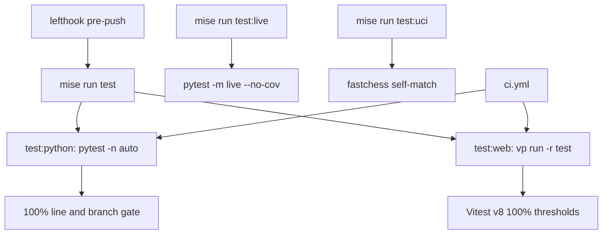

# Testing conventions

The repo has a Python half (the `libs/chess`, `libs/systemone`, `libs/cli` and `apps/server` uv workspace members) and a JS half (`apps/web`, `apps/review`, `packages/chess-ui`). The same rules apply to both:

- **Coverage is a hard 100% gate.** It covers lines and branches in Python, and lines, branches, functions and statements in JS.
- **Tests use fakes, not mocks.** Test doubles are real implementations of the collaborator's interface. They live in `testing` modules that ship with each package.
- **The default suite never touches the network.** Anything that calls the real LLM Gateway or boots a real server is marked `live` and only runs when you ask for it.

For toolchain setup (`mise install`, `mise run setup`), see [Local development](/openwiki/operations/local-development.md).

*Which commands run which suites. The pre-push hook and CI run only the gated default suites. Live tests and the UCI smoke match are manual.*

## Commands

| Command | What it runs |
| --- | --- |
| `mise run test` | `test:python` and `test:web`, both with the coverage gates |
| `mise run test:python` | `uv run --all-packages pytest -q -n auto` |
| `mise run test:web` | `pnpm exec vp run -r test`, which runs each JS package's `vp test --run --coverage` |
| `mise run test:live` | `uv run --all-packages --env-file .env pytest -m live --no-cov -q` |
| `mise run test:uci` | A two-game fastchess match of `lcchess uci` against itself |

The lefthook `pre-push` hook runs `mise run test`. The `pre-commit` hook only runs format, lint, type and secret checks on staged files, so commits stay fast. The CI workflow (`.github/workflows/ci.yml`) runs `check:python` + `test:python` and `check:web` + `test:web` as separate jobs. None of the configured automation (lefthook, `ci.yml`, `mise run test`) runs `test:live` or `test:uci`.

## Python: pytest configuration

The root `pyproject.toml` holds the only pytest configuration:

- `testpaths` lists the four packages' `tests/` directories.
- `asyncio_mode = "auto"`: `async def` tests need no decorator.
- `addopts` includes `-m "not live"`, `--import-mode=importlib`, a `--cov=` for each of the four import packages (`langchain_chess`, `langchain_chess_systemone`, `langchain_chess_cli`, `langchain_chess_server`), `--cov-report=term-missing` and `--cov-fail-under=100`.
- `[tool.coverage.run] branch = true` makes the gate count branches as well as lines. `[tool.coverage.report]` also sets `fail_under = 100` and only excludes `if TYPE_CHECKING:` and `@overload` blocks.

Two reasons for `--import-mode=importlib`: every package has a `tests/` directory, and several test modules share a basename (every package has a `test_live.py`, for example). Importlib mode keeps those from colliding. This is an inference from the layout; the config doesn't comment on it.

**xdist lives in the mise task, not in `addopts`.** `mise run test:python` passes `-n auto`, but a bare `pytest` runs serially. The `mise.toml` comment says why: `-k`, `--pdb` and `--snapshot-update` need a serial run. A bare `pytest` still enforces the 100% gate, so a single-test run with `-k` usually needs `--no-cov`.

**Tracing is off by default.** The repo-root `conftest.py` sets `LANGSMITH_TRACING=false` in `pytest_configure`. It skips this only when the marker expression selects `live`, so the offline suite never sends traces to LangSmith.

**Typing is relaxed only in tests.** `ty` overrides turn off several rules under `**/tests/**`, because tests build state from loose dict literals. Ruff ignores `ANN`/`TC` there. The packages themselves stay strict.

### Shared fixtures

- `libs/chess/tests/conftest.py` provides three fixtures:
  - `cfg` gives each test a fresh `thread_id`.
  - `make_agent` builds `create_chess_agent(...)` with an `InMemorySaver` checkpointer by default.
  - `run` is parameterised over `["sync", "async"]`. Any test that takes `run` executes twice, once through `invoke` and once through `ainvoke`, so both paths stay covered.
- `apps/server/tests/conftest.py` provides an `env` fixture. It clears the gateway variables (and `LC_GATEWAY_KEY`), `chdir`s into `tmp_path` so the repo's `.env` can't leak in, and sets a known-good set of settings.

## Fakes over mocks

There is no `unittest.mock` in the Python tests. Each library has a `testing` module inside the package. These modules are not used at runtime, but they are importable by any downstream package's tests. Because they sit inside the covered packages, the coverage gate measures them too.

### `langchain_chess.testing`

- `ScriptedModel` is a real `BaseChatModel`. It replies from a `script` whose steps are strings, callables (messages → text) or exceptions, which it raises. It records every request's messages (`requests`) and counts calls (`calls`). If the script runs out, it raises `AssertionError("script exhausted ...")`, so an unexpected extra LLM call fails the test loudly.
- `ScriptedModel` reports `ls_provider`/`ls_model_name` (default `anthropic` / `claude-opus-5`) and attaches `usage_metadata`. That means the call recorder prices its calls like a real model's.
- An optional `delay` applies only to the async path, which is useful for concurrency tests.
- `human(content, id=None)` and `position(moves, start_fen=None, restrict=None)` build the two kinds of agent input.
- `fake_engine(directory)` writes an executable UCI engine script, `FakeFish 1` (`FAKE_ENGINE_NAME`), whose shebang points at the current Python interpreter. It supports `uci`, `isready`, `setoption name MultiPV`, `position [fen …] [moves …]`, `go` and `quit`. It ranks moves by mate in one, then material, then UCI order. It is deterministic, instant and needs only python-chess. Engine tests use it instead of Stockfish (`libs/chess/tests/test_engine.py`, `libs/cli/tests/test_grade.py`).

### `langchain_chess_systemone.testing`

- `FakeRanker` returns scripted `MoveDistribution`s or raises scripted errors, and records every `RankRequest`. The script can be a sequence indexed by call count or a function of the request. `arank` delegates to `rank`.
- `FakeTypeSafeClient` stands in for `TypeSafeClassifier`. With `semif=True` (the default) it enforces SemIf's real limits: 2–16 options per `Choice` and at most 32 questions per request. Breaking either limit raises a 422 `TypeSafeAPIError`, just like the real API.
- `FakeTypeSafeClient` answers `Choice` questions through a pluggable `answer` function. The default is `by_option_order`, which gives earlier options higher weights. Score and noul questions get fixed answers.
- `FakeTypeSafeClient` records requests and `run_name`s, and pops queued `errors` one call at a time.
- Helpers: `distribution()`, `choice_answer()`, `failed()` (a `RankingFailed`) and `api_error()`.

The server's graph tests and the SystemOne middleware tests use these fakes (`apps/server/tests/test_graph.py`, `libs/systemone/tests/test_middleware.py`). For the middleware under test, see [Middleware contract](/openwiki/concepts/middleware-contract.md).

### JS fakes

- `packages/chess-ui/src/testing.ts` is exported as `@langchain-chess/chess-ui/testing`. It provides factory functions for the state shapes: `call`, `turn`, `ply` and `systemOne`. Each takes partial overrides. It also exports the `E4_E5` fixture (1. e4 by the human, e5 by System 1, with its turn and a priced `systemone` call) and the `AFTER_E4` FEN.
- `apps/web/tests/support/fakeStream.ts` replaces `@langchain/react`'s `useStream`. A test file installs it with `vi.mock("@langchain/react", async () => (await import("./support/fakeStream")).useStreamMock())` so the mock is hoisted. The fake does three things:
  - It exposes a mutable `fake` object (`values`, `messages`, `isLoading`, `isThreadLoading`, `error`, `submit`).
  - It supports per-thread overrides in `fake.threads[threadId]`, so a test can keep two games apart the way the real hook does.
  - It records every option set the hook was called with (`lastOptions`, `optionsLog`).
- `submit` is late-bound, so a test can swap `fake.submit` without re-rendering. `resetFake()` restores everything between tests.

See [Web frontends](/openwiki/architecture/web-frontends.md) for the components these fakes exercise.

## JS: Vitest through vp

Each JS package (`apps/web`, `apps/review`, `packages/chess-ui`) has a `vite.config.ts` built with `vite-plus`'s `defineConfig`, and a `test` script `vp test --run --coverage`. The test configurations are nearly identical:

- `environment: "jsdom"`, `globals: false` (import `vi`/`expect` explicitly, from `vite-plus/test`), and a `./tests/support/setup.ts` setup file.
- Tests match `tests/**/*.test.{ts,tsx}`. Coverage uses `provider: "v8"` over `src/**/*.{ts,tsx}`, excluding `.d.ts` files.
- `thresholds: { lines: 100, functions: 100, branches: 100, statements: 100 }`.
- `apps/review` writes its coverage report to `../../node_modules/.coverage/review`, not into the app directory, because `langsmith apps push` uploads the directory without reading `.gitignore`. It also skips the production `NODE_ENV` define under Vitest, because React's production build has no `act`.

## Textual snapshot tests

`libs/cli/tests/test_tui_snapshots.py` uses `pytest-textual-snapshot`'s `snap_compare` fixture to catch visual regressions in the terminal UI:

- The chess board at three terminal sizes (small 60×18, compact 100×34, large 150×45).
- A selected knight showing its moves, driven by mouse clicks at `board.geometry.origin(square)` after a `pilot.pause()` so the first layout has happened.
- Black's side with the keyboard cursor moved.
- The promotion dialog.
- The full `ChessApp` game screen after the user plays `e4`, with the reply from a `ScriptedModel` whose script is `"…\nMOVE: e5"`.

To accept a deliberate visual change, run `pytest --snapshot-update` serially (not under `-n auto`, as noted above). The module docstring asks you to open the SVGs under `__snapshots__/` and look at them before accepting the update.

## Live tests (opt-in, cost money)

Tests marked `live` (the marker is described as "hits the real LLM Gateway") are excluded by the default `-m "not live"` in `addopts`. To run them, use `mise run test:live`, which runs `pytest -m live --no-cov` with the repo `.env` loaded. The task description warns it "costs a few cents". Coverage is turned off because a partial selection can't meet the gate. The root `conftest.py` also leaves tracing on in this mode.

Each package has a `test_live.py`:

- **`libs/chess`**: a few Opus moves through the Gateway (`langsmith:anthropic/claude-opus-5-5`, `reasoning_effort="low"`). Asserts that each committed turn's last call is priced (`cost_usd > 0`, `turn_cost(...)["complete"]`).
- **`libs/systemone`**: a real `GatewayRanker("semif-qwen3.5-4b")` tournament over more than 16 legal moves, among other checks.
- **`libs/cli`**: a short TUI game against the hybrid policy through `ChessApp.run_test()`.
- **`apps/server`**: a module-scoped fixture starts a real `langgraph dev`. It rewrites the repo's `langgraph.json` with absolute paths into a temp directory, so the server's `.langgraph_api/` state never mixes into a developer's own dev server. It picks a free port, runs with `--no-reload`, and polls `/ok` for up to 90 s, failing with the server log if the server exits or never comes up. On teardown it terminates the server and kills it after 15 s. The tests check:
  - The `/ui` app is mounted (`/ui/config`).
  - A chat game over the SDK works. The test also checks that resending the same message id is a no-op and that an illegal move gets an error.
  - An assistant's `context` reaches the graph factory through `runtime`.
  - The call recorder survives the server copying the graph and prices LLM calls.

The live modules that use asyncio (`libs/chess`, `libs/systemone`, `libs/cli`) mark `pytest.mark.asyncio(loop_scope="session")` because langchain-openai caches its async client across tests.

## fastchess UCI smoke test

`mise run test:uci` checks the UCI engine front end end-to-end under a real tournament manager. fastchess and Stockfish come from `mise.toml` `[tools]`. The task works like this:

1. It runs inside the gitignored `.uci-match/` directory, because fastchess writes its `config.json` to the working directory.
2. It pits two `lcchess uci --policy systemone` engines against each other, with seeds 1 and 2. Each engine gets `st=3` (3 s per move) and `timemargin=2000`. The match is 1 round of 2 games, capped at 60 moves, and writes `games.pgn` and a warn-level `fastchess.log` that includes engine output.
3. It passes only if both games have a `[Result "1-0"|"0-1"|"1/2-1/2"]` and no `[Termination …]` tag is anything other than `normal` or `adjudication`. That means no forfeits from timeouts, crashes or illegal moves. On success it prints `test:uci: 2 games finished, no forfeits`.

Because it uses the SemIf-only `systemone` policy through `.env`, this test also calls the real gateway. Like the live tests, you run it manually.
