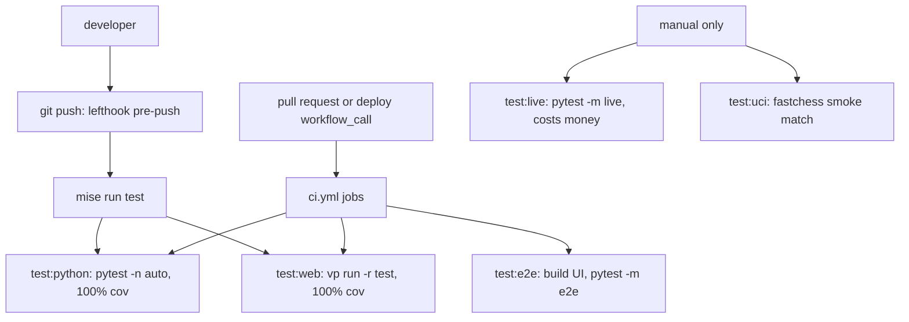

# Testing conventions

The repository has one rule for tests: **every package is held at 100% coverage, and tests use real objects or hand-written fakes rather than mocks**. Beyond the default suite there are three opt-in tiers: a browser e2e suite, a set of **live tests that call real paid services (opt-in with `-m live`, they cost money)**, and a UCI smoke match.

The default suites run on every push and PR; e2e runs in CI; live and UCI tests run only when someone asks for them.

## Commands

| Task | What it runs |
| --- | --- |
| `mise run test` | `test:python` and `test:web` |
| `mise run test:python` | `uv run --all-packages pytest -q -n auto` (100% gate) |
| `mise run test:web` | `pnpm exec vp run -r test` — every JS package's `vp test --run --coverage` |
| `mise run test:e2e` | `mise run build`, then `pytest -m e2e --no-cov -q` |
| `mise run test:live` | `pytest -m live --no-cov -q` with `--env-file .env` — **costs a few cents** |
| `mise run test:uci` | a two-game fastchess match of System 1-only `lcchess uci` |

xdist parallelism (`-n auto`) lives in the mise task, not in pytest `addopts`, so a bare `pytest` stays serial for `-k`, `--pdb` and `--snapshot-update`.

See [Local development](/openwiki/operations/local-development.md) for toolchain setup and [Quickstart](/openwiki/quickstart.md) for the first run.

## Python: pytest and the coverage gate

The root `pyproject.toml` configures one pytest run over every workspace member's tests (`libs/chess`, `libs/systemone`, `libs/cli`, `apps/server`, `evals`):

- `addopts` deselects live and e2e tests by default (`-m "not live and not e2e"`) and declares both markers.
- `--import-mode=importlib`, `asyncio_mode = "auto"`.
- Coverage is measured for the five import packages (`langchain_chess`, `langchain_chess_systemone`, `langchain_chess_cli`, `langchain_chess_server`, `langchain_chess_evals`), with branch coverage on and `--cov-fail-under=100`. Only `if TYPE_CHECKING:`, `@overload` and `if __name__ == "__main__":` are excluded.

The repo-root `conftest.py` is shared by every package's tests. It forces plain Typer output (`_TYPER_FORCE_DISABLE_TERMINAL=1`, `TERMINAL_WIDTH=200`) before any test import, so help-text assertions do not change under GitHub Actions, and it sets `LANGSMITH_TRACING=false` unless the marker expression selects live tests — no remote tracing from the default suite.

Package-level fixtures worth knowing:

- `libs/chess/tests/conftest.py` — the `run` fixture is parametrized over sync and async, so agent tests exercise both `invoke` and `ainvoke`; `make_agent` defaults to an `InMemorySaver` checkpointer.
- `apps/server/tests/conftest.py` — `env` clears the gateway variables and `LC_GATEWAY_KEY`, chdirs to `tmp_path` (isolating tests from the repo `.env`) and sets known-good settings. The session-scoped `langgraph_dev` fixture returns a factory that starts a real `langgraph dev --no-browser --no-reload` on a free port from a work directory, using an absolute-path copy of `langgraph.json` (optionally replacing the env file, process environment and graph specs). It polls `/ok` for up to 90 s, fails with the server log if startup fails, and on exit terminates the server, killing it after 15 s.

`apps/server/tests/test_server.py` uses that fixture in the *default* suite: with fake gateway keys, tracing off and `LANGSMITH_`/`LANGCHAIN_`/`TYPESAFE_`/`LC_` variables stripped, it checks that paused runs read back with the same `next`/setup and graph topology (via run config or assistant context), that versioned partial overrides resolve on unversioned assistants, and that a hybrid run without System 1 keys errors before writing state. `test_codegen` compares every file `codegen.files()` produces with the committed `packages/chess-ui/src/generated` files byte for byte, and tells you to run `mise run generate:settings` when one is stale.

## JS: Vitest via Vite+

Each JS package (`apps/web`, `apps/review`, `packages/chess-ui`, `evals/reports`) has a `test` script `vp test --run --coverage` and a `test` block in its own `vite.config.ts`: jsdom, v8 coverage over `src/**`, and thresholds of 100% for lines, functions, branches and statements. The repo-root `vite.config.ts` holds only `lint` and `fmt`, because Vite+ ignores those blocks in nested configs; its fmt ignores include the generated chess-ui settings files that `test_codegen` compares byte for byte.

Details that matter when changing these configs:

- `apps/review` writes coverage to `../../node_modules/.coverage/review`, outside the app, because `langsmith apps push` uploads the directory without reading `.gitignore`.
- `evals/reports` excludes its one-off report pages (`src/experiments/**`) from the coverage gate. Instead `tests/reports.test.tsx` globs every report, asserts at least one exists, and checks each renders with a truthy `title` and at least one heading (with a 30 s timeout, since a full report can take 4–6 s on a CI runner). Under test the `@report` alias points at `tests/support/FixtureReport.tsx`.
- The shared setup file adds jest-dom matchers, polyfills layout and media APIs jsdom lacks (`matchMedia`, `scrollIntoView`, pointer capture, `ResizeObserver`, `requestAnimationFrame`), and runs cleanup and clears `localStorage` after each test.

## Fakes over mocks

Each package ships its own fakes in a non-runtime module, so tests in other packages can import them.

**`langchain_chess.testing`** (`libs/chess`)

- `ScriptedModel` — a real `BaseChatModel` that replies from a script of strings, callables (messages → text) or exceptions (raised). It records every request, reports itself as `provider`/`model` so the call recorder prices it like a real model, and raises `AssertionError` when the script runs out.
- `human()` and `position()` build agent inputs; `topology()` returns an agent's nodes, edges and state channels, used to check the graph the server describes matches the graph that ran.
- `fake_engine()` writes an executable deterministic UCI engine ("FakeFish 1") run by the current Python interpreter. It ranks moves by mate-in-one, then material, then UCI order, supports MultiPV, and with `quits=False` ignores `quit` to simulate a hung engine.

**`langchain_chess_systemone.testing`** (`libs/systemone`)

- `FakeRanker` returns scripted `MoveDistribution`s or raises scripted errors (from a sequence or a callable over the request), recording every `RankRequest`. `distribution()` and `failed()` build the values it returns.
- `FakeTypeSafeClient` stands in for `TypeSafeClassifier`. By default (`capped=True`, model `other/ranker`, a classifier the ranker does not know) it enforces a capped classifier's limits — 2 to 16 options per `Choice` and at most 32 questions per request — by raising a 422 `TypeSafeAPIError`. Answers default to `by_option_order` (earlier options score higher); it also records requests and run names and can raise queued errors.

**`langchain_chess_evals.testing`** (`evals`)

- `fake_analysis`, `FakePool` (stand-in for `EnginePool`), `FakeFetch` (in-memory URL fetcher) and `FakeDatasetClient` (the slice of `langsmith.Client` that uploads and experiments use, in memory). The evals tests use these instead of Stockfish, Lichess and LangSmith. See [System 1 evals](/openwiki/workflows/system-one-evals.md).

**`@langchain-chess/chess-ui/testing`** (`packages/chess-ui/src/testing.ts`)

- Exported as the package's `./testing` entry: overridable factories `call`, `turn`, `ply`, `systemOne` and `live` (a System 1 live result handing a shortlist to the LLM), plus the `E4_E5` fixture game (1. e4 by the human, e5 by System 1, with its turn) and the `AFTER_E4` FEN.
- The review app's `tests/support/fixtures.ts` builds on these: a Scholar's-mate game state, a Stockfish review, gradings, game list entries, version-2 (header plus parts) reviews, and review, part and status feedback, all from overridable factories.
- The web app's `tests/support/fakeStream.ts` replaces `@langchain/react`'s `useStream` via `vi.mock` with a mutable fake (including `hydrationPromise` and `getThread`) supporting per-thread overrides, a late-bound `submit`, option logging, and `resetFake` for cleanup.

## Snapshot tests (Textual TUI)

`libs/cli/tests/test_tui_snapshots.py` uses `pytest-textual-snapshot`'s `snap_compare`. Board-only cases cover three terminal sizes, a selected piece showing its moves, Black's view with the cursor, and the promotion dialog. Full-app cases run a hybrid game built from a `ScriptedModel` and a `FakeRanker` (System 1 hands e4's reply to the LLM, then plays Nf3's reply alone) and cover the game screen, the light theme on a narrow terminal, stepping back, game over after resigning, the new-game screen, a stopped turn offering retry, advanced settings with an invalid field, and short and narrow terminals. `perf_counter` is stubbed so measured latencies are stable on slow runners.

After a deliberate change, `pytest --snapshot-update` rewrites the SVGs under `__snapshots__/`; look at them before accepting. When the Python CI job fails, it uploads `snapshot_report.html` as an artifact.

## Browser e2e tests

`apps/server/tests/e2e/test_browser.py` is marked `e2e` and runs via `mise run test:e2e`, which builds the web UI first (the test fails fast if the built UI is missing). It boots `langgraph dev` offline through the `langgraph_dev` fixture with fake gateway keys, stripped credentials and a replacement `chess` graph (`e2e/graph.py`): the server's own graph with a `ScriptedModel` that echoes the prompt it was shown plus a legal move, and a `FakeRanker`. Playwright drives Chromium in desktop and phone (portrait, small, landscape) contexts.

The core test fills the setup form and asserts the stored setup, the prompt the agent saw, and the System 1 shortlist size match the chosen settings. Others check phone layouts (no sideways scrolling, controls in the viewport, 44 px tap targets), tap and drag moves, the reply card, promotion on a flipped board, resignation, games from a FEN where the agent moves first, and that a first move whose response was dropped is played only once.

## Live tests: opt-in, and they cost money

Tests marked `live` are deselected by default. They are selected only with `-m live`, normally through `mise run test:live` (`pytest -m live --no-cov` with `.env`). They call the real LLM Gateway and other real services, and **each run costs money** (a few cents). Neither the pre-push hook nor CI runs them.

- `libs/chess/tests/test_live.py` plays and prices a few Opus moves.
- `apps/server/tests/test_live.py` starts a real `langgraph dev` with the shared fixture. It checks the `/ui` mount via `/ui/config` (graph `chess`, default policy `hybrid`), a System 1 chat game with an idempotent resend and an illegal-move error, that assistant context reaches the factory through `runtime` with no run config, and that LLM calls are priced (threshold 1.0, default model `baseten:zai-org/GLM-5.3-Flash`).
- `evals/tests/test_live.py` runs the System 1 eval target with a real `GatewayRanker("typesafe/jev-latest")` on the starting position (all 20 legal moves ranked, no tournament), and verifies LangSmith enforces the positions dataset schemas using a throwaway dataset it deletes afterwards.

## UCI smoke match

`mise run test:uci` runs, inside the gitignored `.uci-match/`, a two-game fastchess match between `lcchess uci --policy systemone --seed 1` and `--seed 2` (3 s per move, 60-move cap). It passes only if both games have a result and no termination other than `normal` or `adjudication`. It uses `.env`, so it makes real System 1 calls.

## Hooks and CI

The lefthook pre-push hook runs `mise run test`; pre-commit stays on staged files (format, lint, type check, secret scan). `.github/workflows/ci.yml` runs on pull requests (ignoring Markdown, `plans/**` and `openwiki/**`) and is called via `workflow_call` by the deploy workflows, so a deploy is gated on the same checks for its ref. It has three jobs:

- **python** — `check:python`, `test:python`, and the snapshot report artifact on failure.
- **web** — `check:web`, `test:web`, and `review:size` (the review app's upload budget).
- **e2e** — installs Playwright Chromium and runs `test:e2e`.

CI does not run live tests or the UCI smoke match.
