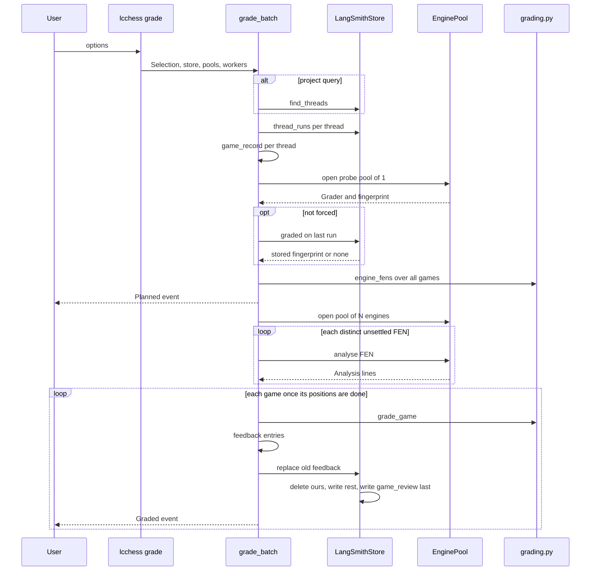

# Grading games and the review app

`lcchess grade` runs after games have been played. It reads the games back from their LangSmith traces, has a UCI engine (Stockfish by default) evaluate every position, classifies each move and computes accuracy the way Lichess does, then writes the results back to the same traces as feedback. The review app is a LangSmith sandbox app. It lists the games in a project and replays each one on a board, using the single `game_review` feedback value that the grader writes.

The code is split into layers:

| Layer | Where | Role |
| --- | --- | --- |
| Command | `libs/cli/langchain_chess_cli/main.py` (`grade`), `grade/cli.py` | Parses and validates options, builds the `EngineConfig`, prints progress |
| Batch | `grade/batch.py` (`grade_batch`) | Selects games, skips games already graded, schedules positions, writes each game |
| Records | `grade/records.py` | Pure code. Turns root runs into a `GameRecord` and a grade into `Feedback` entries |
| Store | `grade/store.py` (`LangSmithStore`) | The LangSmith side: finds threads, reads runs, reads grading marks, replaces feedback |
| Engine | `libs/chess/langchain_chess/engine.py` | `EngineConfig`, `Grader` fingerprint, `EnginePool` of UCI processes |
| Grading math | `libs/chess/langchain_chess/grading.py` | Pure code. Positions, judgements, cp/win% loss, move and game accuracy |
| Review app | `apps/review/src` | Reads threads, last runs and `game_review` feedback, then replays the graded game |

For the shape of the run outputs the grader reads (`start_fen`, `moves`, `plies`, `outcome`), see [the state record](/openwiki/concepts/state-record.md). For how the review app is built and hosted, see [web frontends](/openwiki/architecture/web-frontends.md).

## End-to-end sequence

*The grading pipeline, from option parsing to feedback writes. With `--dry-run` it stops after the Planned event.*

## 1. Choosing threads

`cli.selection` turns the options into one of two kinds of `Selection`:

- **Explicit threads** (`--thread`, repeatable, and/or `--threads-file` with one id per line; blank lines and `#` comments are skipped) become a `Threads(project, ids)` selection. Duplicates are dropped, keeping first-seen order. `--since`, `--until`, `--limit` and `--metadata` cannot be combined with explicit threads; doing so is a usage error.
- **Project query**: with no thread ids, a `ProjectQuery` is built. `LangSmithStore.find_threads` lists root runs in the project, newest first. It passes `--since` as `start_time` and builds a filter from `--until` (`lt(start_time, ...)`) and each `--metadata key=value` pair (`eq(metadata_key)`/`eq(metadata_value)`, joined with `and(...)`). It collects distinct `metadata.thread_id` values and stops once it has `--limit` threads. A naive `--since`/`--until` is read as local time.

You always need a project, either `--project` or `LANGSMITH_PROJECT`. Option errors (`OptionError`) are raised as Typer `BadParameter`, so the command exits with code 2.

## 2. Rebuilding a game from its root runs

For each thread, `thread_runs` fetches every root run whose metadata `thread_id` matches, selecting `id`, `session_id`, `start_time` and `outputs`. Up to 8 threads are fetched at once. `records.game_record` then builds a `GameRecord`:

- Only runs whose outputs contain a `plies` list count. Errored runs and non-chess runs are ignored, and the order the runs arrive in doesn't matter. If no run qualifies, or the best run has no plies, the thread is reported as `Skipped(reason="no_game")`.
- The **last run** is the run with the most plies, with ties going to the latest `start_time`. Its outputs supply `start_fen`, `moves` and `outcome`.
- `turn_ids` come from each ply's `turn_id`. It is `None` for moves that arrived as input (for example a human's move in the web UI), not played by the agent.
- `ply_runs` uses `grading.first_runs` to map each ply to the first run, in start order, whose record contains it. That is the run that played the move or received it.
- `positions` (`grading.positions`) replays the moves to list every FEN, the start position included. Only the final position can be **settled** without an engine: checkmate becomes `Mate(0, winner)`, and a draw outcome or a board-level game end becomes `Cp(0)`. A claimed draw is settled even when an engine could still score the position.

## 3. Engine setup, fingerprint and the skip check

`EngineConfig` holds the engine binary (`--engine`/`STOCKFISH_PATH`, default `stockfish`), a single search limit, `--multipv` (default 1), `--engine-threads` (default 1) and `--hash` MB (default 256). The search limit is one of `--depth`, `--nodes` or `--movetime` in ms; giving more than one is an error, and the default is depth 16.

Before it checks for games already graded, the batch opens a **probe pool of one engine** to learn the `Grader`: the engine's UCI `id name` plus `EngineConfig.settings()`. The settings are the limit kind and value, multipv, threads and hash_mb. The binary path is deliberately left out because it differs between machines. `Grader.fingerprint` is the first 16 hex characters of a SHA-256 over the sorted JSON of the engine name and settings. A different engine version or a different setting therefore produces a different fingerprint.

Unless `--force` is set, `LangSmithStore.graded(last_run.id)` looks for `game_review` feedback on the game's last run and returns the fingerprint from it. It only counts feedback whose source metadata has `grader == "lcchess grade"`. If that fingerprint equals the current grader's, the game is skipped with `Skipped(reason="graded")`. As a result:

- Re-running with the same engine and settings is cheap and idempotent.
- Changing a setting or upgrading the engine re-grades everything.
- A game that has continued since it was graded now has a new last run with no mark, so it is graded again.
- `--force` re-grades regardless.

## 4. Evaluating each distinct position once

`grading.engine_fens` collects the unsettled FENs of every remaining game, deduplicated, in first-seen order. The work unit is a position, not a game, so games that share an opening only evaluate it once and one long game cannot hold up the batch. The `Planned` event reports the games, the position count and the pool size. With `--dry-run` the batch stops here and writes nothing, though the probe engine has already been started.

The pool size is `max(1, min(workers, len(fens)))`. `--workers` defaults to `os.cpu_count() // engine_threads`. `EnginePool` starts that many `popen_uci` processes and configures `Threads` and `Hash` on each. If any process fails to start, the ones already running are shut down. `analyse` takes whichever engine is idle from a FIFO queue. Because the batch creates one task per FEN, game by game, positions from earlier games are searched first, so those games finish and are written first.

Two details keep grades reproducible:

- Each `analyse` call passes a fresh `game` object, so python-chess sends `ucinewgame` and clears the hash. Without this, a grade would depend on which positions that engine happened to search before.
- More than one engine thread makes the search nondeterministic. `--nodes` gives the same grades on any machine; `--movetime` does not.

`analysis_from` turns the engine info into `Line`s, each an eval from White's side plus a UCI PV, best first. It raises `EngineError` if the engine returned no score. Mate scores become `Mate(moves, winner)`.

## 5. Classification and accuracy (Lichess-compatible)

`grade_game(positions, moves, analyses)` is pure. The constants come from scalachess `eval.scala`, lila `Advice.scala` and lila `AccuracyPercent.scala`. For each ply:

- **Evals**: each position uses its settled eval, or else the engine's top line. Centipawns are clamped to ±1000 (`CP_CEILING`), and any mate counts as ±1000 from the mover's point of view.
- **Winning chances**: `2 / (1 + exp(-0.00368208 * cp)) - 1`, in [-1, 1]. Win% is `50 + 50 * chances`.
- **Quality**: a move is `best` when it equals the engine's best move. Otherwise `judge` decides:
  - Between centipawn evals, a drop in winning chances of ≥0.3 is a `blunder`, ≥0.2 a `mistake`, and ≥0.1 an `inaccuracy`.
  - Walking into a forced mate is graded by how good the position was before (`_by_cp`: >999 is an inaccuracy, >700 a mistake, anything else a blunder).
  - Losing your own forced mate is graded by the centipawn eval after the move, and counts as 0 if the opponent now has the mate.
  - Other mate-to-mate transitions get no judgement.
  - Anything left over is `good`.
- **`cp_loss`**: `max(0, cp_before - cp_after)` from the mover's side, using clamped values. **`win_pct_loss`**: `max(0, win%_before - win%_after)`.
- **Move accuracy**: 100 if win% did not drop. Otherwise `103.1668 * exp(-0.04354 * drop) - 3.1669 + 1`, clamped to [0, 100]; the `+1` is lila's uncertainty bonus.
- **Game accuracy** per side (`game_accuracy`): win% windows of size `clamp(len(moves) // 10, 2, 8)`, with each window's weight being its standard deviation clamped to [0.5, 12]. A side's accuracy is the mean of its volatility-weighted mean accuracy and its harmonic mean accuracy. A side that never moved gets `None`. The side to move first comes from the start FEN, so games that start with Black to move are handled.

## 6. Writing feedback

`records.feedback` places each entry on a specific run:

- **Per-move keys** (`move_quality`, `cp_loss`, `win_pct_loss` rounded to 2 decimals, `best_move`) are written only for **agent turns**, meaning plies with a `turn_id`. They go on the root run that played that ply, and their `source_info` includes `ply`.
- **Game keys** go on the game's last run: `accuracy_white`/`accuracy_black` (rounded to 1 decimal; omitted for a side that never moved), then `game_review`, which is always the **last** entry.
- Every entry's `source_info` carries `grader: "lcchess grade"`, `engine`, `settings` and `fingerprint`. The store uses these fields to recognise its own feedback.

The `game_review` value (`version: 1`) holds everything the review app draws in a single value: engine, settings, per-side accuracy, one eval per position (`{"cp": n}` or `{"mate": n, "winner": side}`), and a per-ply list with `run_id`, `side`, `uci`, `best_move`, `quality`, `cp_loss`, `win_pct_loss`, `accuracy` and the engine `lines` for the position before the move. Because each ply carries its `run_id`, the app does not need to read every turn's run.

`LangSmithStore.replace(runs, entries)` implements the "replace" semantics:

1. It lists feedback for any grading key (`KEYS`) on **all** of the game's runs and deletes only the entries whose source metadata says `grader == "lcchess grade"`. Feedback from people or other graders under the same keys is kept.
2. It writes every entry except the last, in parallel (default 16 threads). Deletes finish before any of these writes start.
3. It writes the `game_review` marker by itself, after everything else.

Since the marker is written last, and the skip check only looks at the marker, a write cut short leaves the game unmarked and the next run redoes it.

## Failure behaviour and progress

`grade_batch` runs one `finish` coroutine per game. Each waits for the analyses of that game's unsettled FENs, grades the game, and calls `store.replace`. These coroutines are gathered with `return_exceptions=True`, so every game settles before any failure surfaces and no finished game's write is cut off. The remaining engine tasks are then cancelled and the first exception is re-raised. When an engine dies, games that don't depend on the failed position keep their written grades; a re-run skips them and retries the rest.

`cli.printer` prints progress to stderr:

- `skip <thread>: no game in its traces` or `... already graded with these settings (--force redoes it)`
- `nothing to grade`, or the dry-run plan (`would grade N games, P positions` plus an engine line and plies per game)
- `grading N games, P positions on W x <engine> (<settings>)`
- one `graded <thread>: ... accuracy white X black Y [done/total positions, rate/s]` line per game

After a real run it prints `done: G graded, S skipped`. `Summary.positions` counts only the positions actually evaluated.

## The review app

The review app (`apps/review`) runs in a LangSmith sandbox. `entry.tsx` renders `App`, calling the host's `window.langsmith.call` through `createApi`:

- **Project and window**: `defaultProject` picks `langchain-chess-app` first, then any project whose name contains "chess", then the most recent. The window options are the last 1, 7 (default), 30 or 90 days.
- **Listing games**: `api.games` pages through `POST /api/v2/threads/query`, 20 threads at a time. For each page it fetches the threads' last root runs (`POST /api/v2/runs/query` by `last_trace_id`, with `min_start_time` set because unbounded queries are rate-limited harder) and the `game_review` feedback on those runs (`GET /api/v1/feedback`). `reviewsByRun` keeps only reviews whose source metadata has `grader == "lcchess grade"` and that parse as `version: 1` with `evals` and `plies` arrays. `toGame` builds the matchup label from run metadata (`policy`, `model`, `systemone_model`). A run without a `moves` array counts as having no game record.
- **List row**: matchup, result (`1-0`, `0-1`, `½-½`, or "In progress"), start time, ply count, and White / Black accuracy or "Not graded".
- **Replay** (`GameView`): the app replays FENs from `start_fen` and `moves` and steps through them with keys or controls. When a review exists it adds:
  - an eval bar from `review.evals[index]`
  - arrows for the played move and, if different, the engine's best move
  - quality badges in the move list
  - a `GradeCard` showing eval before → after, best move in SAN, winning chances lost, centipawn loss, move accuracy, and up to `multipv` engine lines of 6 plies each (the card keeps a fixed height so the graph below it doesn't move)
  - an `EvalGraph` over every position, where clicking a point jumps to that position

  "Open trace" opens the current ply's `run_id` from the review, or the thread's last run. An ungraded game shows a banner suggesting `lcchess grade --thread <id>`.
- `review.ts` keeps a TypeScript mirror of the review schema and of `win_percent` (`whiteWinPercent`, same ±1000 clamp and 0.00368208 constant), so the app's eval bar and graph agree with the grader.

The grader writes `game_review` on the run with the most plies, but the app looks for it on the thread's `last_trace_id`. The two are normally the same run, since each new turn's run carries the whole game so far. If they differ, for example when the thread's latest run carries no game record, the app shows no review (or "No game record") for that thread.

## Extension points and invariants

- **Other engines**: any UCI binary works through `--engine`. The fingerprint includes its `id name`, so switching engines re-grades.
- **Other stores or pools**: `grade_batch` depends only on the `Store` protocol (`find_threads`, `thread_runs`, `graded`, `replace`) and on a `Pools` factory that yields an `Evaluator` (`grader`, `analyse`). The tests swap in fakes for both.
- **Changing the review payload**: `records.review` and `apps/review/src/review.ts` must change together. The app rejects any `version` other than 1.
- **Changing grading math**: grading output does not change the fingerprint; only the engine and settings do. After changing `grading.py`, re-grade with `--force` to refresh existing grades.
- **Adding feedback keys**: add them to `PLY_KEYS`/`GAME_KEYS` so `replace` also deletes stale copies. Keep `game_review` as the last entry.

## Tests that matter

- `libs/cli/tests/test_grade.py`:
  - rebuilding records from web-style runs (ply-to-run mapping, last run, ignoring noise runs)
  - where feedback goes (agent turns only, game keys and the marker last)
  - the exact review payload
  - store filters and `replace` ordering (only this grader's feedback deleted, marker written last)
  - batch behaviour: each position evaluated once, pool size clamping, skip unless forced, dry run, a failure that keeps earlier writes
  - option validation, printer output, and an end-to-end CLI run against a fake engine
- `libs/chess/tests/test_grading.py`: symmetry and clamping of winning chances, centipawn and mate judgements from the mover's side, move and game accuracy (including one Black move and long games), settled positions, `engine_fens` dedupe, `grade_game`, `first_runs` and `eval_json`.
- `libs/chess/tests/test_engine.py`: search limit mapping, settings that leave out the path, fingerprint sensitivity, White-side scores, the error when no score comes back, and pool start-up and shutdown with a fake engine.
- `apps/review/tests/`: logic (`logic.test.ts`), components, `App`, and entry rendering.

See also [runtime behavior](/openwiki/operations/runtime-behavior.md) for how the traced runs that grading reads are produced.
