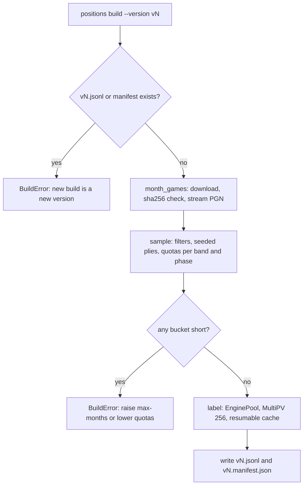
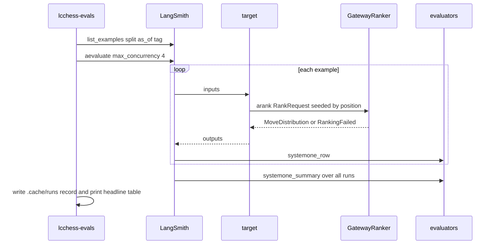

# System 1 evals: positions dataset, experiments and reports

`evals/` is a uv workspace member (`langchain-chess-evals`) that holds datasets and LangSmith experiments. It is never published. It depends on `langchain-chess` and `langchain-chess-systemone`, but nothing imports it, so changing it never redeploys the agent. The `lcchess-evals` Typer CLI (`langchain_chess_evals/cli.py`) is its only entrypoint. It has two command groups, `positions` and `systemone`, and the mise tasks wrap both.

The package is split along one boundary:

- **`positions/`** builds the labelled positions dataset. It knows nothing about System 1, so any move-choice eval can reuse it.
- **`systemone/`** runs System 1 experiments over that dataset: the target, the row scores, and the summary metrics.

For what System 1 is (ranking, the `margin`/`confidence` gates, the SemIf tournament), see [System 1](../architecture/system-one.md). Opponent settings files are described in [Settings and model arguments](../concepts/settings-and-model-arguments.md).

## Commands

| mise task | CLI | Needs |
|---|---|---|
| `eval:positions:build` | `lcchess-evals positions build` | Stockfish, network (one-off) |
| `eval:positions:upload` | `lcchess-evals positions upload` | `LANGSMITH_API_KEY` |
| `eval:systemone` | `lcchess-evals systemone run` | `LANGSMITH_API_KEY` plus the gateway key |
| `eval:systemone:baseline` | `lcchess-evals systemone baseline` | same |

All tasks except `build` load `.env` with `--env-file .env`. This page names the variables only. Experiments call the real LLM Gateway, so they **cost money** and only run when you start them. No test or CI job runs them.

## The positions dataset

The LangSmith dataset is named `langchain-chess-positions`. Each version is committed as `evals/datasets/positions/vN.jsonl` (one example per line), with `vN.manifest.json` beside it. Version `v1` has 2,200 positions from rated Lichess rapid and classical games. Stockfish labels each one at depth 16, with a line for **every legal move**. Build-time caches (Lichess downloads, the label cache, local run summaries) live in the gitignored `evals/.cache/`.

### Building a version

*Control flow of `build()` in `positions/build.py`.*

- **Never edit a version.** `build()` refuses to run if `vN.jsonl` or `vN.manifest.json` already exists. A new build is a new version (`--version v2`). Do not touch `v1`.
- **Source.** `lichess.py` downloads a month of the Lichess database (about 6 GB, CC0) into the cache. It checks the file against Lichess's published `sha256sums.txt` and writes a marker, so a checked copy is not hashed again. Months are read in order from the pinned `--month` (default `2018-06`). The next month is fetched only when the current one runs out, up to `--max-months` (default 3).
- **Sampling** (`sampling.py`, pure) takes rated, standard-variant, non-abandoned games that have both ratings, a rapid or classical time class, and at least 20 plies. Positions come from ply 10 on, at most 2 per game, with at least 2 legal moves. They are deduped by FEN without the move counters. Each position goes into a bucket by the rating band of the side to move (`<1200` … `2400+`) and its phase (lila Divider thresholds). Every bucket gets an equal quota. A seeded `random.Random` picks the plies and deals each bucket between the splits, filling `dev` first. So a given month and seed always produce the same rows, and a short bucket shortens `full`. If any bucket is still short after the allowed months, the build stops.
- **Splits.** `dev` has 40 positions per band (200 in total) for quick passes. `full` has 400 per band (2,000 in total). You can change these with `--dev-per-band` and `--full-per-band`.
- **Labelling** (`labels.py`) runs positions through `langchain_chess.engine.EnginePool` with `multipv=256`, which is above the maximum number of legal moves (218), so every move gets its own line. `reference_from` raises `LabelError` if the engine's lines don't cover every legal move exactly. Each finished label is appended to a JSONL cache named after the grader's fingerprint. An interrupted build therefore resumes where it stopped, and a change of engine settings starts a fresh cache. Labelling runs in an `asyncio.TaskGroup`, so one failure cancels the rest before the cache closes. Expect roughly 1 to 3 minutes of Stockfish per position per core.
- **Manifest.** It records the source months with their URLs and sha256, the filters, the quotas, the seed, the engine name, settings and fingerprint, the git SHA (with a `-dirty` suffix when the tree has changes), and counts per split, band and phase.

### Row shape and schemas

A row (`positions/examples.py`) holds:

- **`inputs`**: `RankRequest`'s shape without the seed, `{start_fen, moves, legal}`. `start_fen` is always the standard start, and `moves` is every move played so far in UCI.
- **`outputs`** (the reference): `evals` (each legal move's eval from White's side, as `{cp}` or `{mate, winner}`), `ranked` (the engine's order, best first), `best` (`ranked[0]`) and `top3` (`ranked[:3]`).
- **`metadata`**: game URL, month, both Elos, the mover's rating and band, time control and class, ply, phase, `legal_count`, `tactic`, and `played_move` (the move the human played). `tactic` is true when the best move captures or checks, or beats the second-best move by at least 150 cp.

**Read the order from `ranked`, never from `evals`.** LangSmith returns object keys sorted, so the key order of `evals` means nothing once a row has been through LangSmith. `Reference.from_json` rebuilds the order from `ranked` and checks that it lists every move in `evals` exactly once.

`positions/schema.py` defines JSON Schemas for the inputs and outputs, including UCI patterns, uniqueness, and the `cp`/`mate` shapes. The dataset is created with these schemas, so LangSmith rejects a malformed example at upload with a 422 instead of failing later in an experiment. Metadata has no schema in LangSmith.

### Uploading

`upload` (`positions/upload.py`) syncs the committed JSONL into LangSmith:

1. If the dataset exists with **different** inputs or outputs schemas, upload stops with `UploadError`. It deliberately does not patch the schemas: LangSmith would re-check every stored example in one request, which fails (500) on a full dataset. **A schema change needs a new dataset.** Either delete the old one in LangSmith (its experiments go with it) or upload under another `--dataset`.
2. Otherwise upload creates the dataset if it's missing, with the schemas, a description built from the manifest, and the manifest in its metadata.
3. Example ids are `uuid5`s of the row id, so a re-upload never duplicates rows. Upload creates new examples, updates changed ones, and **deletes examples that are no longer in the file**. All three happen in batches of 500.
4. It PATCHes the description and metadata through the REST API, because the SDK has no dataset update. The metadata is **merged**, never replaced, so UI settings such as `iframe_config` survive.
5. It tags the latest dataset version with `vN`. Only this tag pins a version.

`--renderer-url` sets `iframe_config` to the web deployment's `https://<host>/ui/render.html`. Upload rejects anything that isn't an absolute `https://` URL. Without the flag, upload leaves the setting unchanged.

## Running System 1 experiments

*One experiment from `run_experiment` in `systemone/experiment.py`.*

### Specs, the grid and opponent files

An `ExperimentSpec` has a name, `model`, `style` (`rich` or `terse`), `max_options` (where `None` means the model's own cap), and `with_eval`/`with_nouls`. It can be defined in two ways:

- **`systemone run`** takes either `--model` (with an optional `--style`, default `rich`) or `--opponent <file>`, but not both. An opponent file already sets the style, so `--style` is refused alongside it. `--max-options`, `--split` (default `dev`), `--version` (default `v1`), `--dataset`, `--name` and `--concurrency` are the eval-only controls.
- **`systemone baseline`** reads `evals/experiments/systemone-baseline.toml` and runs every `[[experiment]]` in order on `full` by default. It then prints one headline table. An entry either names `model`/`style` or gives `opponent` (a path relative to the TOML). Giving both is an error, and so is a style outside `rich`/`terse`.

Opponent files (`evals/experiments/opponents/*.json`) are the same settings files every surface reads, loaded with `langchain_chess_systemone.settings.load_file`. `ranker_settings` takes only what applies to ranking alone: `systemone_model`, `style`, `with_eval` and `with_nouls`. The gate, the LLM and the rules are ignored. The baseline grid crosses the model (SemIf, Jev) with the description style, and adds a control, `jev-rich-cap16`. That control forces SemIf's 16-option tournament onto Jev, so comparing it with plain `jev-rich` shows what the tournament alone costs.

### The target

`systemone/target.py` wraps a `Ranker` the way `SystemOneMiddleware` would call it. The default is `GatewayRanker(model, style=..., max_options=..., max_attempts=30, with_eval=..., with_nouls=...)`.

- **Deterministic seed.** `request_of` builds the `RankRequest` seed from a sha256 of `[start_fen, moves]`. Every run of an example therefore shuffles the tournament the same way, across models and runs.
- **Outputs** hold `ranked` (`{uci, probability}` in System 1's order), `confidence`, `margin`, `tournament`, `finalists`, `heats`, `requests`, token counts, `latency_ms` and `error`.
- **Failure is a miss.** A `RankingFailed` after retries becomes empty `ranked` with `error` set, and it still reports the call count and elapsed time. This mirrors the middleware falling back to the LLM.

**Concurrency must stay at 4** (`MAX_CONCURRENCY`). The gateway caps SemIf at about 70 rankings a minute, then refuses everything for 40 s or more with no `Retry-After`. The old harness hit 429s at 8. `max_attempts=30` retries for up to about 2 minutes, so a rate limit does not turn into a ranking failure and score as a miss.

Examples are listed with `as_of=<tag>` and `splits=[split]`, so every experiment runs against a pinned dataset version. Experiment metadata records the model, style, effective `max_options`, flags, dataset, version, split and git SHA. The experiment prefix is `systemone-<name>`.

### Row scores

`systemone/scoring.py` is pure. `row_scores` returns `ROW_METRICS`. A value of `None` means the score doesn't apply, and LangSmith omits it.

| Score | Meaning |
|---|---|
| `recall@1/3/5/8` | Stockfish's best move is in System 1's top k |
| `top3_in_top5` | Any of Stockfish's top 3 is in System 1's top 5 |
| `human_match@1` | System 1's top move equals `played_move` |
| `cp_loss` | cp loss of System 1's top move against the best, from the mover's side, capped at `CP_CEILING` (1,000). `None` if nothing was ranked. |
| `win_pct_loss` | The same loss in win percentage |
| `finalist_recall`, `finalist_top3` | Tournament rows only: did the heats keep Stockfish's best move, or any of its top 3? |
| `error`, `requests`, `latency_ms`, `input_tokens` | Cost and reliability. `input_tokens` is `None` if any call lacked a count. |

After a tournament only the finalists come back, so a move knocked out in the heats counts as a miss for recall@k. The `finalist_*` scores isolate what the heats lose.

### Summary metrics

`systemone/summary.py` is also pure. The summary evaluator builds a `Scored` row for each run that has outputs, then `summarize` computes keys of the form `metric|group`:

- **Groups:** `all`, `band=<band>`, `phase=<phase>`, and the legal-move-count split `legal<=16` (a single ranking) versus `legal>16` (a SemIf tournament). Each group also gets `n|group`.
- **Row metrics:** the plain mean of each row score, ignoring `None`.
- **Gate table** (for `all` and the two legal groups only): for each of `margin` and `confidence`, at thresholds 0.5, 0.6, 0.7, 0.8, 0.9 and 0.95, it reports `gate.<signal>>=<t>.kept` (the share of *all* rows whose signal clears the threshold, meaning System 1 would play alone) and `.accuracy` (recall@1 among the kept rows). A failed ranking has no signal, so it is never kept.
- **Calibration** (same groups): for each signal decile, the row count `.n` and top-1 `.accuracy`. A value of exactly 1.0 falls in the last decile.

Means are plain means over the stratified set: every band and phase weighs the same, not in proportion to how often it occurs on Lichess. The experiment description says this too.

After the run, `run_experiment` writes `{name, url, spec, metadata, summary}` to `evals/.cache/runs/<experiment>.json`. The CLI prints `headline_table`, a Markdown table of selected keys such as recall@1/5, cp loss, the tournament split, finalist recall, the margin ≥ 0.9 gate, requests, tokens and errors, with a link to each experiment's comparison URL. If the summary evaluator did not run, `run_experiment` raises.

## Seeing outputs as a board

LangSmith shows outputs as JSON. The web app also builds `render.html` (served at `/ui/render.html`), a [custom output renderer](https://docs.langchain.com/langsmith/custom-output-rendering) for this dataset. It draws Stockfish's best move and top 3 as arrows with every move's eval, and System 1's picks as arrows with probability bars, confidence, margin and its tournament. LangSmith posts `{type: "output" | "reference", data, metadata: {inputs}}` into the iframe. The page fetches nothing and accepts messages only from the window that embeds it (not from a fixed origin, because self-hosted LangSmith can live anywhere). The renderer shows up in experiment runs, the compare view and annotation queues, but not in the dataset's Examples tab. Enable it with `upload --renderer-url` as described above, and turn it off in LangSmith (⋮ → Custom Output Rendering). For local work there is `render-preview.html` under `vp dev`; see [Web frontends](../architecture/web-frontends.md).

## Static reports

`evals/reports/` is a pnpm package that turns experiment results into dated, self-contained HTML pages, built with Macaw and `chess-ui`. JavaScript, CSS and fonts are all inlined, so you can open a page straight from disk.

- A report is `src/experiments/<date>-<name>.tsx`. It exports `title` and a default component. Its data sits as constants at the top, copied from LangSmith or a run record, and every figure on the page is computed from those constants rather than typed into prose. The report must say where the data came from and link to it. Shared pieces live in `src/components/` (`ReportHeader`, `Section`, `Answer`, `MetricCard`, `RunBarChart`, `DataTable`, `PositionExample`).
- `pnpm --dir evals/reports build` builds only reports that have no HTML yet. `build <substring>` rebuilds the reports whose names match. The script warns about any built page whose source has disappeared. Commit both the `.tsx` and the built `experiments/<name>.html`.
- **A report is a snapshot.** Nothing regenerates it, and a later run gets a new report instead of an edit. The existing example is `2026-09-26-systemone-baseline.tsx`, covering the five baseline runs on `full`.

## Tests

The Python tests (`evals/tests/`) are part of `mise run test` with the 100% coverage gate. They use fakes for Stockfish, Lichess and LangSmith (see `langchain_chess_evals/testing.py` and [Testing conventions](../testing/testing-conventions.md)). The most useful ones:

- `tests/systemone/test_scoring.py` pins the metric semantics: the best move second, losses capped and seen from the mover's side (Black to move), a tournament that lost the best move in the heats, and a failed ranking that scores as a miss.
- `test_summary.py`, `test_experiment.py` and `test_target.py` cover grouping, gates, calibration, the grid and opponent parsing, and the failure outputs.
- `tests/positions/` covers sampling determinism, label caching, sync planning and schema checks.

`mise run test:live` (`-m live`, costs a few cents) runs one real SemIf ranking through the target, which checks that a 20-legal-move position triggers a tournament. It also checks that LangSmith enforces the dataset schemas with a 422, using a throwaway dataset that it deletes afterwards. In `evals/reports`, report pages are left out of the coverage gate: `tests/reports.test.tsx` only checks that each one renders, while the shared components are tested at 100%.

## Rules to keep when changing this area

- A new dataset build is a new version file and tag. Never edit `v1.jsonl` or its manifest.
- A change to `INPUTS_SCHEMA`/`OUTPUTS_SCHEMA` needs a new (or deleted and recreated) LangSmith dataset. Upload will not patch schemas.
- Read engine order from `ranked`, never from the key order of `evals`.
- Keep `max_concurrency` at 4 and the ranker's high `max_attempts`, so gateway 429s don't score as misses.
- Keep the target's position-derived seed, so runs stay comparable.
- Live experiments and `test:live` cost money and are opt-in.
